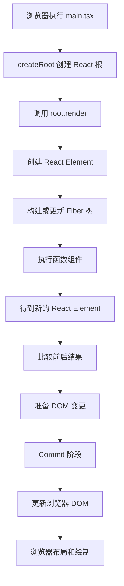

# 第 1 章 React 解决了什么问题

React 的核心价值，可以先用一句话概括：

> React 让开发者描述“界面在某种状态下应该长什么样”，再由 React 负责把状态变化同步到页面。

```text
用户操作
  ↓
状态发生变化
  ↓
组件重新计算界面描述
  ↓
React 比较前后结果
  ↓
React 更新必要的 DOM
```

React 主要解决的问题，不是“如何创建一个按钮”，而是：

- 页面状态越来越多时，如何保持界面正确；
- 多个组件之间如何协作；
- 用户操作、网络请求和页面展示如何保持一致；
- 如何避免手动操作大量 DOM 导致状态错乱；
- 如何让大型前端项目具备清晰的边界和可维护性。

## 本章学习目标

学习完本章，你应该能够：

1. 解释传统 DOM 编程为什么容易失控；
2. 理解声明式 UI 和命令式 UI 的区别；
3. 理解 React 的组件化思想；
4. 理解 React 中的单向数据流；
5. 区分组件重新执行、DOM 更新和浏览器绘制；
6. 说明 React 与 Vue 的核心差异；
7. 用面试语言解释 React 解决了什么问题；
8. 在真实业务中判断状态应该放在哪里。

## 1.1 传统 DOM 编程的问题

### 1.1.1 传统 DOM 编程像“手工维护现场”

假设需要实现一个计数器：

- 页面显示当前数字；
- 点击“增加”按钮，数字加 1；
- 数字为偶数时显示“偶数”；
- 数字为奇数时显示“奇数”。

使用原生 DOM 时，通常需要手动操作页面：

```js
let count = 0;

const valueElement = document.querySelector('#value');
const statusElement = document.querySelector('#status');
const incrementButton = document.querySelector('#increment');

function render() {
  valueElement.textContent = String(count);
  statusElement.textContent = count % 2 === 0 ? '偶数' : '奇数';
}

incrementButton.addEventListener('click', () => {
  count += 1;
  render();
});

render();
```

这段代码要求开发者自己维护很多关系：

- `count` 变化后，数字节点要更新；
- `count` 变化后，奇偶状态也要更新；
- 如果以后增加进度条，还要继续手动更新进度条；
- 如果数字显示在多个位置，每个位置都要更新；
- 如果某个更新遗漏，页面就会出现数据不一致。

这像是在办公室里同时维护很多张纸：一张记录总数，一张记录状态，一张记录进度。每次数据变化，都要记得修改所有相关的纸。数据一多，遗漏就很容易发生。

### 1.1.2 状态和界面容易失去同步

考虑一个商品列表页面：

- 商品总数；
- 已选择商品数量；
- 全选复选框；
- 批量删除按钮；
- 底部统计栏；
- 购物车角标。

如果用户选择一个商品，可能需要手动更新多个 DOM 节点：

```text
选择商品
  ├─ 更新复选框
  ├─ 更新已选择数量
  ├─ 更新全选状态
  ├─ 更新批量删除按钮
  ├─ 更新底部统计
  └─ 更新购物车角标
```

只要有一个地方忘记更新，就会出现：

- 页面顶部显示已选 3 项；
- 底部却显示已选 2 项；
- 批量删除按钮状态不正确；
- 全选框状态和列表状态不一致。

在复杂系统中，问题通常不是某一行代码写错，而是同一份业务状态被多个地方分别维护。

### 1.1.3 DOM 操作和业务逻辑容易混在一起

传统写法经常类似这样：

```js
if (loading) {
  loadingElement.style.display = 'block';
  errorElement.style.display = 'none';
  submitButton.disabled = true;
} else if (error) {
  loadingElement.style.display = 'none';
  errorElement.style.display = 'block';
  submitButton.disabled = false;
} else {
  loadingElement.style.display = 'none';
  errorElement.style.display = 'none';
  submitButton.disabled = false;
}
```

业务状态和 DOM 操作耦合在一起。随着状态增加，分支会越来越多：

```text
空闲、加载中、加载成功、加载失败、部分成功、无权限、登录过期、网络断开、重试中……
```

最终容易出现条件互相覆盖、遗漏清理和状态组合不完整等问题。

### 1.1.4 多人协作时边界不清晰

在大型项目中，不同开发者可能同时操作同一块 DOM：

```js
// 模块 A
panel.innerHTML = renderUserInfo(user);

// 模块 B
panel.classList.add('expanded');

// 模块 C
panel.querySelector('.loading').style.display = 'none';
```

这些代码之间缺少明确的所有权：

- 谁负责这个 DOM 节点？
- 谁负责决定它显示什么？
- 哪个模块可以修改它？
- A 模块重新渲染时，会不会覆盖 B 模块添加的 class？
- B 模块依赖的子节点是否可能被 A 模块替换？

React 的组件模型试图通过组件边界回答这些问题：

> 一块界面通常由一个组件负责描述，组件通过输入接收数据，通过状态驱动自己的显示结果。

## 1.2 声明式 UI

### 1.2.1 命令式 UI

命令式代码关注“过程”：

```text
找到标题节点
把标题改成“加载中”
找到列表节点
清空列表
禁用提交按钮
显示加载图标
```

开发者需要自己描述每一步如何修改页面。

### 1.2.2 声明式 UI

声明式代码关注“结果”：

```tsx
return (
  <>
    <h1>{loading ? '加载中' : title}</h1>

    <button disabled={loading}>
      提交
    </button>

    {loading ? <Spinner /> : <List items={items} />}
  </>
);
```

开发者描述：

- `loading` 为 `true` 时显示什么；
- `loading` 为 `false` 时显示什么；
- 按钮在什么状态下可操作；
- 列表在什么状态下出现。

React 负责把这个描述转换为 DOM 更新。

::: tip 容易混淆
声明式 UI 不代表 React 没有执行过程。React 仍然需要执行组件、比较结果、安排任务和修改 DOM，只是这些过程不再由业务代码手动维护。
:::

### 1.2.3 UI 可以看成状态的函数

React 的第一层直觉可以写成：

```text
UI = f(state)
```

也就是：

```text
界面 = 状态经过计算后的结果
```

当 `count` 从 0 变成 1 时，React 会重新计算组件的界面描述，然后比较前后结果，最后更新真正需要变化的 DOM。

这里需要注意：

> “重新计算组件”不等于“重新创建整个页面 DOM”。

React 可以重新执行组件函数，但最终只提交必要的 DOM 变化。

## 1.3 组件化

### 1.3.1 组件是界面的独立单元

一个复杂页面可以拆成多个组件：

```text
DashboardPage
├─ Header
│  ├─ Logo
│  ├─ SearchBox
│  └─ UserMenu
├─ Sidebar
├─ MainContent
│  ├─ FilterPanel
│  ├─ StatisticsCard
│  └─ DataTable
└─ NotificationCenter
```

每个组件负责一部分界面和逻辑：

- `Header` 负责顶部区域；
- `Sidebar` 负责导航；
- `FilterPanel` 负责筛选条件；
- `DataTable` 负责表格展示；
- `NotificationCenter` 负责通知状态。

组件化带来的价值包括：

- 责任边界清晰；
- 代码可以复用；
- 局部修改不必理解整个页面；
- 组件可以独立测试；
- 业务逻辑可以逐步抽离；
- 多人可以按组件边界协作。

### 1.3.2 组件不是简单的 HTML 片段

组件通常包含三类内容：

```text
组件
├─ 输入：Props
├─ 内部状态：State
└─ 输出：UI
```

例如一个分页组件：

```text
输入：currentPage、totalPages、onPageChange
内部状态：可能有正在输入的页码
输出：分页按钮和当前页展示
```

在 React 中，函数组件可以理解为：

```text
组件函数 = 根据 Props 和 State 计算 UI
```

真实 React 内部比这个公式复杂，因为 React 还要处理更新优先级、Hook 状态、Fiber 节点、Effect、错误边界和并发渲染。但这个公式适合建立第一层直觉。

## 1.4 单向数据流

### 1.4.1 什么是单向数据流

React 中最常见的数据方向是：

```text
父组件
  ↓ Props
子组件
  ↓ 事件回调
父组件更新 State
  ↓
重新传递新的 Props
```

例如：

```text
App
├─ 保存 count
└─ CounterPanel
   ├─ 接收 count
   └─ 接收 onIncrement
```

子组件通常不直接修改父组件的 State，而是调用父组件传入的回调函数。

### 1.4.2 为什么单向数据流有价值

单向数据流使状态变化比较容易追踪：

```text
谁拥有状态？
谁读取状态？
谁触发更新？
更新之后数据传给谁？
```

正确的原则是：

> 状态应该放在能够满足所有使用者需求的最近共同父组件中。

如果状态只被一个输入框使用，就放在输入框内部；如果多个兄弟组件需要使用，就提升到共同父组件；如果很多页面都需要使用，再考虑 Context 或状态管理库。

## 1.5 最小可运行 TypeScript 示例

下面的计数器展示了函数组件、State、Props、父子组件通信、声明式 UI 和单向数据流。

### `src/App.tsx`

```tsx
import { useState } from 'react';

type CounterPanelProps = {
  value: number;
  onIncrement: () => void;
  onDecrement: () => void;
};

function CounterPanel({
  value,
  onIncrement,
  onDecrement,
}: CounterPanelProps) {
  const status = value % 2 === 0 ? '偶数' : '奇数';

  return (
    <section className="counter-panel">
      <p className="counter-value">{value}</p>

      <p aria-live="polite">
        当前数字是：{status}
      </p>

      <div className="counter-actions">
        <button type="button" onClick={onDecrement}>
          减少
        </button>

        <button type="button" onClick={onIncrement}>
          增加
        </button>
      </div>
    </section>
  );
}

export default function App() {
  const [count, setCount] = useState(0);

  function handleIncrement() {
    setCount((currentCount) => currentCount + 1);
  }

  function handleDecrement() {
    setCount((currentCount) => currentCount - 1);
  }

  return (
    <main className="app">
      <h1>React 计数器</h1>

      <CounterPanel
        value={count}
        onIncrement={handleIncrement}
        onDecrement={handleDecrement}
      />
    </main>
  );
}
```

### `src/main.tsx`

```tsx
import { StrictMode } from 'react';
import { createRoot } from 'react-dom/client';
import App from './App';
import './index.css';

const container = document.getElementById('root');

if (!container) {
  throw new Error('找不到 id 为 root 的 DOM 容器');
}

createRoot(container).render(
  <StrictMode>
    <App />
  </StrictMode>,
);
```

### `src/index.css`

```css
:root {
  font-family:
    Inter, system-ui, -apple-system, BlinkMacSystemFont,
    "Segoe UI", sans-serif;
  color: #1f2937;
  background: #f3f4f6;
}

* {
  box-sizing: border-box;
}

body {
  margin: 0;
}

button {
  cursor: pointer;
  border: 1px solid #d1d5db;
  border-radius: 6px;
  padding: 8px 14px;
  background: #ffffff;
}

button:hover {
  background: #f9fafb;
}

.app {
  width: min(480px, calc(100% - 32px));
  margin: 80px auto;
  padding: 24px;
  border-radius: 12px;
  background: #ffffff;
  box-shadow: 0 8px 24px rgb(0 0 0 / 8%);
}

.counter-panel {
  text-align: center;
}

.counter-value {
  margin: 24px 0 8px;
  font-size: 48px;
  font-weight: 700;
}

.counter-actions {
  display: flex;
  justify-content: center;
  gap: 12px;
}
```

在 Vite + React + TypeScript 项目中，可以使用以下命令运行：

```bash
npm create vite@latest react-demo -- --template react-ts
cd react-demo
npm install
npm run dev
```

### 代码执行过程

```text
main.tsx
  ↓
createRoot(container)
  ↓
render(<App />)
  ↓
App 创建 count 状态
  ↓
CounterPanel 接收 value 和事件回调
  ↓
用户点击“增加”
  ↓
setCount 更新状态
  ↓
App 重新计算
  ↓
CounterPanel 得到新的 value
  ↓
React 更新显示数字
```

## 1.6 逐行理解关键代码

### 1.6.1 `useState`

```tsx
const [count, setCount] = useState(0);
```

这里有两个变量：

- `count`：当前状态值；
- `setCount`：请求 React 更新状态的函数。

初始值是 `0`。

`setCount` 不是普通的变量赋值函数，它会通知 React 当前组件需要重新计算。更新队列和批量更新会在第 5 章详细解释。

### 1.6.2 Props 类型

```tsx
type CounterPanelProps = {
  value: number;
  onIncrement: () => void;
  onDecrement: () => void;
};
```

这定义了子组件能够接收的输入：

- `value` 是数字；
- `onIncrement` 是增加函数；
- `onDecrement` 是减少函数。

TypeScript 可以在开发阶段检查组件接口，避免漏传属性或传入错误类型。

### 1.6.3 派生数据

```tsx
const status = value % 2 === 0 ? '偶数' : '奇数';
```

`status` 完全可以由 `value` 计算出来，因此没有必要把它再次保存为 State。

如果同时保存 `value` 和 `status`，就可能出现：

```text
value = 2
status = "奇数"
```

::: warning 工程实践
能够由已有状态直接计算出来的值，通常优先直接计算，不要重复保存。
:::

### 1.6.4 事件处理函数作为 Props

```tsx
<button type="button" onClick={onDecrement}>
  减少
</button>
```

`onClick` 接收的是函数引用：

```tsx
onClick={onDecrement}
```

而不是函数执行结果：

```tsx
onClick={onDecrement()}
```

后者会在渲染时立即执行函数，通常是错误写法。

### 1.6.5 函数式更新

```tsx
setCount((currentCount) => currentCount + 1);
```

它表示：

> 请基于 React 当前队列中的最新状态计算下一个状态。

在简单场景中也可以写成 `setCount(count + 1)`，但在连续更新、异步回调或多个更新合并的场景中，函数式更新更安全。

### 1.6.6 `createRoot`

```tsx
createRoot(container).render(
  <StrictMode>
    <App />
  </StrictMode>,
);
```

其中：

- `container` 是真实 DOM 节点；
- `createRoot(container)` 创建 React 根；
- `.render(<App />)` 告诉 React 从 `App` 开始渲染；
- `StrictMode` 用于开发阶段发现潜在问题。

`createRoot` 是 React 18 以来的客户端根 API，React 19 继续使用这一模型。

## 1.7 React 内部大致如何工作

下面是第一次渲染的简化流程：



这张图是简化模型，真实实现还包含 Update、Lane、Scheduler、HostRoot、WorkInProgress Fiber、Effect 和错误处理等概念。

### 1.7.1 JSX 先变成 React Element

例如：

```tsx
<CounterPanel value={count} onIncrement={handleIncrement} />
```

会经过 JSX 转换，生成类似下面的结构：

```ts
jsx(CounterPanel, {
  value: count,
  onIncrement: handleIncrement,
});
```

这个调用不会立即创建真实 DOM，它产生的是一个描述：

```text
使用 CounterPanel 组件
传入 value
传入 onIncrement
```

这个描述通常被称为 React Element。

### 1.7.2 React 执行组件函数

React 得到 `CounterPanel` 组件后，会执行它并得到新的 JSX。JSX 仍然只是界面描述，不是浏览器 DOM。

### 1.7.3 React 创建和处理 Fiber

React 会为组件、原生元素和其他节点建立内部 Fiber 节点。可以粗略理解为：

```text
App Fiber
└─ CounterPanel Fiber
   └─ section Fiber
      ├─ p Fiber
      ├─ p Fiber
      └─ div Fiber
         ├─ button Fiber
         └─ button Fiber
```

Fiber 不等于 JSX，也不等于真实 DOM。它是 React 为了管理工作而维护的内部节点，可以记录节点类型、Props、State、父子兄弟关系、更新标记、优先级和对应的真实 DOM。

### 1.7.4 React 比较前后结果

当 `count` 从 0 变为 1 时：

```text
旧结果：<p>0</p>
新结果：<p>1</p>
```

React 会判断：

- `section` 仍然可以复用；
- 第一个 `p` 仍然可以复用；
- `p` 的文本内容需要更新；
- 按钮不需要更新。

所以 React 不需要重新创建整个页面。

### 1.7.5 Render 阶段和 Commit 阶段

React 更新通常可以先分成两个阶段：

```text
Render 阶段：计算哪些地方需要变化
Commit 阶段：真正修改 DOM
```

在 React 18/19 的并发模型中，Render 阶段有机会被暂停和恢复；Commit 阶段则负责把已经确定的变更提交出去。

::: info 源码视角
Fiber、Render、Commit、Lane 和 Scheduler 是 React 18/19 当前实现中的重要概念。具体函数名、字段组织和调用关系属于源码细节，后续版本可能调整，但这些概念有助于理解 React 的运行机制。
:::

## 1.8 React 与 Vue 的核心差异

React 和 Vue 都可以用于构建复杂前端应用，也都具备组件化、声明式 UI、父子组件通信、单向数据传递和工程化生态。

不能简单地说“React 是声明式，Vue 是命令式”，这种说法是不准确的。更准确的比较是：两者默认的编程模型不同。

### React 更强调 JavaScript 表达 UI

React 通常使用 JSX：

```tsx
function UserCard({ user }: { user: User }) {
  return (
    <article className={user.isOnline ? 'online' : 'offline'}>
      <h2>{user.name}</h2>
      {user.isOnline && <span>在线</span>}
    </article>
  );
}
```

条件、循环、函数和变量都直接使用 JavaScript。

### Vue 更强调模板和响应式系统

Vue 常见写法是模板：

```vue
<template>
  <article :class="user.isOnline ? 'online' : 'offline'">
    <h2>{{ user.name }}</h2>
    <span v-if="user.isOnline">在线</span>
  </article>
</template>
```

Vue 的响应式系统会跟踪数据被哪些地方读取，当数据变化时，框架可以根据依赖关系触发相关更新。

### 默认状态模型不同

React 常见写法：

```tsx
const [visible, setVisible] = useState(false);

<button onClick={() => setVisible(true)}>
  打开
</button>

{visible && <Dialog />}
```

开发者明确调用 `setVisible` 触发状态更新。

Vue 常见写法：

```ts
const visible = ref(false);
visible.value = true;
```

Vue 通过响应式引用追踪数据变化。

更准确的总结是：

- React 更强调通过重新执行组件得到新的 UI 描述；
- Vue 更强调响应式数据依赖和模板更新；
- React 的状态更新通常通过 Setter 或外部状态订阅触发；
- Vue 的响应式对象和 `ref` 可以直接修改并触发更新。

::: tip 面试重点
不要把 React 和 Vue 的差异简单说成“一个有虚拟 DOM、一个没有”，也不要直接断言某个框架一定更快。现代 React 和 Vue 都在使用编译优化和多种性能策略，具体性能需要结合业务结构分析。
:::

## 1.9 常见错误和错误写法

### 1.9.1 直接修改 DOM，绕过 React 状态

错误示例：

```tsx
function Counter() {
  function handleClick() {
    const element = document.querySelector('#value');

    if (element) {
      element.textContent = '1';
    }
  }

  return (
    <>
      <p id="value">0</p>
      <button type="button" onClick={handleClick}>
        增加
      </button>
    </>
  );
}
```

问题在于：

- React 不知道数字已经变成 1；
- 下一次 React 重新渲染时可能覆盖手动修改；
- 状态和页面显示脱节；
- 其他依赖这个数字的 UI 不会同步变化。

推荐通过 State 驱动 UI：

```tsx
function Counter() {
  const [count, setCount] = useState(0);

  return (
    <>
      <p>{count}</p>
      <button
        type="button"
        onClick={() => setCount((value) => value + 1)}
      >
        增加
      </button>
    </>
  );
}
```

### 1.9.2 在 State 中重复保存派生数据

错误倾向：

```tsx
const [count, setCount] = useState(0);
const [isEven, setIsEven] = useState(true);
```

推荐：

```tsx
const [count, setCount] = useState(0);
const isEven = count % 2 === 0;
```

### 1.9.3 把所有状态都提升到顶层

如果把所有弹窗状态、输入状态、表格筛选状态和局部 hover 状态都放在 `App`，会导致：

- 顶层组件职责过多；
- Props 层层传递；
- 组件之间耦合；
- 局部更新可能引起大范围重新计算。

状态位置应该根据使用范围决定，而不是默认放进全局 Store。

### 1.9.4 把 React 当成模板引擎

JSX 只是 React 使用的界面描述语法。React 还负责处理状态、更新调度、组件身份、Hook、Fiber、Diff、Effect、错误边界和并发更新。

### 1.9.5 认为组件重新执行就一定很慢

需要区分：

```text
组件函数重新执行
≠ 真实 DOM 一定更新
≠ 浏览器一定重新布局
≠ 页面一定出现可感知卡顿
```

性能问题应该先通过 Profiler 和浏览器 Performance 面板确认，再选择拆分组件、缩小状态范围、缓存计算或使用并发 API。

## 1.10 真实业务场景：订单管理页面

考虑一个订单管理系统：

```text
订单页面
├─ 筛选区域
├─ 订单统计
├─ 订单列表
├─ 批量操作栏
├─ 详情抽屉
└─ 分页器
```

用户可以选择订单状态、输入订单号、选择日期范围、勾选订单、批量导出、打开详情和修改订单状态。

一个合理的状态划分可以是：

```text
OrderPage
├─ filters
├─ selectedOrderIds
├─ currentOrder
├─ drawerOpen
└─ loading

OrderFilter
  └─ 通过回调修改 filters

OrderStatistics
  └─ 读取查询结果

OrderTable
  └─ 读取 orders 和 selectedOrderIds

BatchActionBar
  └─ 读取 selectedOrderIds

OrderDetailDrawer
  └─ 读取 currentOrder
```

关键是明确状态来源：

```text
filters
  ↓
请求订单列表
  ↓
orders
  ↓
OrderTable 和 OrderStatistics
```

这比让每个区域自己发请求、自己修改 DOM 更容易维护。

## 1.11 React 在 Agent 和流式项目中的价值

在 AI Agent、SSE 和流式输出项目中，页面状态通常包括：

```text
会话列表
当前会话
消息列表
当前流式消息
Agent 当前阶段
工具调用状态
是否等待用户确认
请求是否正在运行
请求是否被取消
错误信息
```

如果所有状态都通过手动 DOM 操作维护，很容易出现：

- 新消息追加到错误的会话；
- 流式文本重复；
- 取消请求后仍然显示旧结果；
- 工具调用状态和消息状态不一致；
- 多个请求互相覆盖。

React 的声明式模型可以帮助建立清晰的数据关系：

```text
Agent 状态
  ↓
消息列表和阶段状态
  ↓
消息组件、阶段组件和工具卡片
  ↓
用户确认或取消
  ↓
状态更新
```

## 1.12 性能与架构考虑

### 1.12.1 状态尽量靠近使用它的组件

如果一个输入框的临时值只被自己使用，就没有必要把它提升到整个页面或全局 Store：

```tsx
function SearchInput() {
  const [value, setValue] = useState('');

  return (
    <input
      value={value}
      onChange={(event) => setValue(event.target.value)}
    />
  );
}
```

状态越靠近使用位置，依赖关系越清楚，Props 传递越少，可能触发更新的组件越少。

### 1.12.2 状态不要随意全局化

全局状态适合当前用户、权限、主题、多页面共享的会话和全局通知。

全局状态通常不适合承载某个输入框的临时值、某个列表项的 hover 状态或某个局部组件的展开状态。

### 1.12.3 不要过早使用性能优化 API

`React.memo`、`useMemo` 和 `useCallback` 不是默认必需品。更合理的过程是：

```text
先建立正确的组件边界
  ↓
确认数据流合理
  ↓
使用 Profiler 定位瓶颈
  ↓
针对真实热点优化
```

### 1.12.4 高频流式更新需要合并

在 AI Agent 流式输出中，可能每几十毫秒收到一次文本片段。如果每次都重新计算整个消息列表、重新解析全部 Markdown 和重新进行代码高亮，页面就可能卡顿。

工程上可以考虑：

- 合并多个小片段再更新；
- 将当前流式消息和历史消息拆分；
- 对长列表使用虚拟化；
- 对非紧急内容使用 `startTransition`；
- 避免每次更新都重新解析全部 Markdown；
- 将工具卡片和消息文本拆成独立组件。

## 1.13 官方行为、源码细节与经验结论

### 官方行为

以下属于 React 的公开使用模型：

- React 使用组件描述界面；
- Props 从父组件传递给子组件；
- State 更新会请求 React 重新计算界面；
- JSX 是描述 UI 的语法；
- `createRoot` 用于客户端创建 React 根；
- React 会协调组件结果并更新宿主环境，例如浏览器 DOM。

### 源码视角

以下是 React 18/19 当前实现中的重要概念：

- Fiber 树；
- 当前树和工作树；
- `beginWork`；
- `completeWork`；
- Render 阶段和 Commit 阶段；
- Lane；
- 更新队列；
- Scheduler；
- Effect 处理。

这些内容有助于理解 React，但具体函数名、字段组织和内部调用关系可能随版本变化。

### 工程实践

以下更多属于项目实践原则：

- 状态尽量靠近使用它的地方；
- 不要重复保存派生数据；
- 不要为了“看起来高级”而过度使用全局状态；
- 性能问题应该通过工具确认；
- 复杂异步流程需要处理取消和竞态；
- 组件边界应该围绕业务职责设计。

## 1.14 面试重点：React 解决了什么问题

### 标准回答

> React 主要解决的是复杂用户界面中状态和视图同步的问题。传统 DOM 编程需要开发者手动查找节点并维护各种更新关系，当页面状态增多时，容易出现数据和界面不一致。React 使用声明式 UI，开发者描述某种状态下界面应该是什么样子，状态变化后由 React 重新计算组件结果，并通过协调机制更新必要的 DOM。
>
> React 还通过组件化和单向数据流建立了更清晰的代码边界：组件接收 Props、维护必要的 State，并返回界面描述；数据通常从父组件流向子组件，子组件通过回调通知父组件更新。这样可以降低复杂页面的维护成本。

### 面试官可能继续追问

#### React 会不会每次都更新整个 DOM？

不会。状态更新通常会导致相关组件重新计算界面描述，但 React 会比较前后的结果，并只提交必要的 DOM 变化。组件重新执行、React Element 变化、Fiber 更新和真实 DOM 更新是不同层次的事情。

#### React 为什么需要虚拟 DOM？

React Element 或虚拟 DOM 可以作为界面的中间描述，让开发者通过状态描述 UI，再由 React 统一协调更新。它的价值不仅是减少 DOM 操作，还包括提供组件模型、跨平台抽象、更新调度和并发渲染的基础。具体性能不能简单归因于“有虚拟 DOM 就一定更快”。

#### React 和 Vue 最大的区别是什么？

React 更偏向 JavaScript 和 JSX 驱动的 UI 描述，函数组件通常通过重新执行得到新的界面结果；Vue 提供了更完整的响应式系统和模板语法，通过响应式数据依赖触发相关更新。两者都支持组件化、声明式 UI 和单向数据传递。

#### 单向数据流有什么缺点？

单向数据流提高了数据变化的可追踪性，但在组件层级较深时可能出现 Props 层层传递，也就是 Prop Drilling。可以通过组件组合、Context、自定义 Hook 或状态管理库解决，但不能因为 Prop Drilling 就把所有状态放进全局 Store。

#### 函数组件重新执行会不会重建所有 DOM？

不会。函数组件重新执行主要是重新生成 React Element 描述。React 会基于组件身份、元素类型、Key 和前后结果进行协调，只有最终确认发生变化的部分才会提交到 DOM。

## 1.15 本章小结

1. 传统 DOM 编程要求开发者手动维护状态与页面之间的关系；
2. 页面越复杂，手动 DOM 操作越容易造成状态不一致；
3. React 使用声明式 UI，让开发者描述状态对应的界面结果；
4. React 通过组件化建立界面和业务逻辑边界；
5. Props 通常从父组件流向子组件；
6. 子组件通常通过回调通知父组件更新；
7. React 组件重新执行不等于整个 DOM 被重建；
8. React Element、Fiber 和真实 DOM 是不同层次的对象；
9. React 与 Vue 都是声明式组件框架，但默认编程模型不同；
10. 性能优化应该基于真实测量，而不是看到重新渲染就立即优化。

可以把本章浓缩成一句话：

> React 让 UI 成为状态的函数，通过组件化组织界面，通过单向数据流组织数据，通过协调机制把状态变化提交到真实 DOM。

## 1.16 练习题与参考答案

### 练习 1：命令式和声明式

请分别描述下面两段代码的思维方式：

```js
element.textContent = String(count);
```

```tsx
<p>{count}</p>
```

**参考答案：** 第一段是命令式写法，直接告诉浏览器修改哪个节点以及修改成什么内容。第二段是声明式写法，描述当 `count` 为当前值时界面应该显示什么，React 会根据状态变化决定是否以及如何更新真实 DOM。

### 练习 2：设计状态位置

一个页面包含搜索输入框、订单列表、订单总数和订单详情抽屉。请判断搜索关键词、订单列表数据、当前打开的订单和输入框焦点状态应该放在哪里。

**参考答案：** 搜索关键词可以放在订单列表和搜索请求的共同父组件中；订单列表数据通常放在页面状态、请求层或服务端状态管理中；当前打开的订单可以放在页面组件中；输入框焦点状态通常放在输入框内部，除非其他组件确实需要知道它。

### 练习 3：识别重复状态

下面的代码有什么问题？

```tsx
const [firstName, setFirstName] = useState('Lin');
const [lastName, setLastName] = useState('Chen');
const [fullName, setFullName] = useState('Lin Chen');
```

**参考答案：** `fullName` 可以由 `firstName` 和 `lastName` 直接计算，不需要单独保存。重复保存会增加状态不同步的概率。

### 练习 4：分析数据流

```tsx
function Parent() {
  const [value, setValue] = useState(0);

  return (
    <Child
      value={value}
      onChange={() => setValue((current) => current + 1)}
    />
  );
}
```

**参考答案：** `Parent` 持有 State，通过 `value` 传给 `Child`。用户点击 `Child` 中的按钮后，`Child` 调用 `onChange`，`Parent` 更新 State，新的 `value` 再次传给 `Child`。

### 练习 5：面试表达

请用不超过 1 分钟回答“React 解决了什么问题”。

**参考答案：**

> React 主要解决复杂页面中状态和视图同步的问题。传统 DOM 编程需要手动修改节点，当页面状态增多时，很容易遗漏更新，导致数据和界面不一致。React 使用声明式 UI，开发者描述某种状态下界面应该是什么样子，状态变化后由 React 重新计算组件结果，并通过协调机制更新必要的 DOM。同时，React 使用组件化和单向数据流建立代码边界，使复杂页面更容易拆分、维护和测试。

---

下一章将讲解 **JSX、React Element 与虚拟 DOM**，重点回答：

> JSX 到底是什么？它和 HTML、React Element、虚拟 DOM、Fiber 之间是什么关系？
