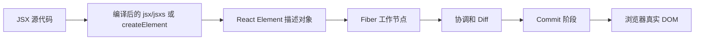

# 第 2 章 JSX、React Element 与虚拟 DOM

上一章建立了一个核心直觉：

> React 让 UI 成为状态的函数，通过组件化组织界面，通过协调机制把状态变化提交到真实 DOM。

这一章继续追问一个基础问题：

```tsx
const element = <Button type="primary">保存</Button>;
```

这行代码到底是什么？

它不是 HTML 字符串，也不是浏览器 DOM，更不是 Fiber 节点。它会经历一条大致链路：

```text
JSX 源代码
  ↓ 编译
jsx / jsxs 调用
  ↓ 执行
React Element
  ↓ React 处理
Fiber 节点
  ↓ Commit 阶段
浏览器 DOM
```

把这几个对象区分清楚，是理解 React 源码、Diff、Fiber 和性能问题的起点。

## 本章学习目标

学习完本章，你应该能够：

1. 解释 JSX 到底是什么；
2. 手写简单 JSX 的 `createElement` 等价形式；
3. 说出 React Element 的主要字段；
4. 理解 `props.children` 的来源和数据形态；
5. 解释经典 JSX Transform 和 JSX Runtime 的区别；
6. 区分 React Element、虚拟 DOM、Fiber 和真实 DOM；
7. 理解 React 为什么需要中间描述，而不是直接创建 DOM；
8. 识别 JSX、组件调用和 `children` 使用中的常见错误。

## 2.1 先建立直觉：JSX 是一张界面订单

### 2.1.1 JSX 不是 HTML

浏览器认识 HTML：

```html
<button class="primary">保存</button>
```

浏览器解析 HTML 字符串后，会创建真实的 `HTMLButtonElement`。

但浏览器并不认识 JSX：

```tsx
<button className="primary">保存</button>
```

JSX 是 JavaScript 生态中的一种语法扩展。它让我们可以在 JavaScript 或 TypeScript 中，用类似 HTML 的方式描述界面。

可以把 JSX 理解成一张“界面订单”：

```text
请创建一个 button 类型的界面节点
它有 className 属性
它的文本内容是“保存”
```

React 先接收这张订单，再决定如何处理它。

### 2.1.2 React Element 是订单对象

JSX 不会立即创建真实 DOM，而是产生一个普通的 JavaScript 对象，描述希望出现的界面：

```text
类型：button
属性：{ className: "primary" }
子内容："保存"
```

这个描述对象叫做 **React Element**。

React Element 可以看成：

```text
对一个界面节点的不可变描述
```

它描述“应该是什么”，但本身不是“已经存在于浏览器中的节点”。

### 2.1.3 Fiber 是 React 的工作记录

React 拿到 React Element 后，还需要处理很多工作：

- 这个节点以前是否存在；
- 以前的节点能不能复用；
- 它是否需要创建真实 DOM；
- 它的子节点是什么；
- 当前更新优先级是什么；
- 是否有需要执行的 Effect；
- 当前工作是否可以暂停。

React 会使用 Fiber 节点记录这些工作信息。

因此可以先记住三者的区别：

```text
React Element：描述结果的对象
Fiber：React 内部管理工作的节点
真实 DOM：浏览器中的实际节点
```

## 2.2 JSX 到底是什么

### 2.2.1 一个 JSX 表达式

```tsx
const title = <h1>深入浅出 React</h1>;
```

它看起来像 HTML，但它位于 JavaScript 表达式中，因此可以赋值给变量：

```tsx
const title = <h1>深入浅出 React</h1>;

return <main>{title}</main>;
```

JSX 的本质是：

```text
允许在 JavaScript 中书写树形 UI 描述的语法
```

### 2.2.2 JSX 中的 JavaScript 表达式

JSX 使用大括号嵌入 JavaScript 表达式：

```tsx
const user = {
  name: 'Lin',
  isOnline: true,
};

const element = (
  <article>
    <h2>{user.name}</h2>
    <p>{user.isOnline ? '在线' : '离线'}</p>
  </article>
);
```

大括号中的内容必须是表达式，例如：

```tsx
{user.name}
{items.length}
{condition ? <A /> : <B />}
{items.map((item) => <Item key={item.id} item={item} />)}
```

不能直接放一条普通语句：

```tsx
// 错误示例
<div>{if (visible) { return <Panel />; }}</div>
```

可以先使用表达式得到结果：

```tsx
<div>{visible ? <Panel /> : null}</div>
```

### 2.2.3 JSX 属性和 HTML 属性不是完全一样

JSX 属性使用 JavaScript 风格的命名：

```tsx
<div className="panel" tabIndex={0} />
```

常见区别包括：

- HTML 的 `class` 在 JSX 中通常写成 `className`；
- HTML 的 `for` 在 JSX 中通常写成 `htmlFor`；
- 事件名使用驼峰形式，例如 `onClick`；
- JavaScript 表达式使用大括号，例如 `disabled={loading}`；
- 字符串属性可以使用引号，例如 `role="button"`。

JSX 不是 HTML 的完整复制品，而是 React 对 JavaScript 语法的一层约定。

### 2.2.4 JSX 标签大小写有含义

小写标签通常表示宿主元素：

```tsx
<div />
<button />
```

首字母大写的标签通常表示组件变量：

```tsx
<UserCard />
<DashboardLayout />
```

React 需要通过大小写区分：

```text
小写：交给浏览器或宿主环境处理
大写：调用一个 React 组件
```

下面的写法会产生不同含义：

```tsx
const Button = 'button';

<Button />
```

这里的 `Button` 实际上是一个字符串变量，最终可能被当成宿主标签类型。

而下面的代码表示调用组件：

```tsx
function Button() {
  return <button type="button">保存</button>;
}

<Button />
```

::: confuse 容易混淆
组件名称首字母大写不是装饰性写法，而是 JSX 语法区分组件和原生元素的重要规则。
:::

## 2.3 JSX 如何转换成 `createElement`

### 2.3.1 经典转换

早期 React 项目通常使用经典 JSX Transform：

```tsx
const element = <h1 className="title">Hello</h1>;
```

会被转换成近似形式：

```js
const element = React.createElement(
  'h1',
  { className: 'title' },
  'Hello',
);
```

等价关系可以写成：

```text
JSX 标签
  ↓
React.createElement(type, props, ...children)
  ↓
React Element
```

这里的“近似”很重要。编译器生成的代码会受到：

- TypeScript 配置；
- Babel 配置；
- SWC 配置；
- React 版本；
- 开发模式或生产模式；
- JSX Runtime 配置影响。

### 2.3.2 `createElement` 的参数

`createElement` 可以先理解为：

```ts
createElement(type, props, ...children)
```

其中：

- `type` 表示节点类型；
- `props` 表示属性；
- `children` 表示子节点。

例如：

```tsx
const element = React.createElement(
  'button',
  {
    type: 'button',
    className: 'primary',
  },
  '保存',
);
```

可以理解成：

```text
type = "button"
props = { type: "button", className: "primary", children: "保存" }
```

### 2.3.3 组件也可以作为 `type`

`type` 不一定是字符串，也可以是函数组件：

```tsx
function Greeting({ name }: { name: string }) {
  return <h1>Hello, {name}</h1>;
}

const element = React.createElement(Greeting, {
  name: 'Ada',
});
```

这里的 `type` 是 `Greeting` 函数：

```text
type = Greeting
props = { name: "Ada" }
```

React 后续会执行这个组件函数，得到它返回的 React Element。

### 2.3.4 `createElement` 不会立即创建 DOM

下面的代码：

```tsx
const element = React.createElement('button', null, '保存');
```

不会立即让浏览器出现按钮。

它只是创建一个描述对象：

```text
我希望这里有一个 button，文本是“保存”
```

只有这个 Element 被传给 React 根并经过 Render、Commit 流程后，浏览器 DOM 才会发生变化：

```tsx
createRoot(container).render(element);
```

::: interview 面试重点
`React.createElement` 的主要作用是创建 React Element，而不是直接创建真实 DOM。真实 DOM 的创建和更新发生在 ReactDOM 的协调与 Commit 过程中。
:::

## 2.4 React Element 的结构

### 2.4.1 一个简化的结构

可以用下面的 TypeScript 类型理解 React Element：

```ts
type SimplifiedReactElement = {
  $$typeof: symbol;
  type: unknown;
  key: string | null;
  ref: unknown;
  props: Record<string, unknown>;
  _owner?: unknown;
};
```

这是帮助理解的简化类型，不是建议在业务代码中重新声明或依赖的公共 API。

一个类似的 Element 可以想象成：

```js
{
  $$typeof: Symbol.for('react.element'),
  type: 'button',
  key: null,
  ref: null,
  props: {
    type: 'button',
    className: 'primary',
    children: '保存',
  },
  _owner: null,
}
```

### 2.4.2 主要字段的作用

#### `$$typeof`

它用于标识这是一个 React Element 类型的对象。

它是 React 内部实现细节，业务代码不应该依赖具体 Symbol 值。

::: note 版本说明
在 React 18 中，常见的 Element 类型标记是 `Symbol.for('react.element')`。React 19 内部引入了与新 Element 语义相关的类型标记，具体 Symbol 名称属于实现细节。面试中应回答“使用内部 Symbol 标识 React Element”，不要把某个具体 Symbol 当成长期稳定 API。
:::

#### `type`

表示节点类型：

```tsx
<div />             // type 是 "div"
<UserCard />        // type 是 UserCard 函数
<Fragment />        // type 可能是 Fragment 标记
```

#### `key`

用于列表协调时识别节点身份：

```tsx
items.map((item) => (
  <Row key={item.id} item={item} />
));
```

`key` 不是普通业务 Props。React 会单独读取它，用于判断旧节点能否和新节点对应起来。

第 9 章会详细分析 Key 和 Diff。

#### `ref`

用于访问某些实例或 DOM 引用。`ref` 的处理涉及组件类型和 React 版本，业务代码不要把它当成普通 Props 使用。

React 19 对 `ref` 作为 Prop 的支持有新的变化，但仍然需要结合组件类型和具体 API 使用。不要把不同版本的 `ref` 行为混在一起。

#### `props`

保存传给节点或组件的属性：

```tsx
<Card title="状态">
  内容
</Card>
```

可以得到近似的：

```js
{
  title: '状态',
  children: '内容',
}
```

#### `_owner`

开发模式下可能用于记录创建 Element 的上下文信息。它属于 React 内部字段，业务代码不应该读取或修改。

### 2.4.3 React Element 通常是不可变描述

下面的代码不应该使用：

```tsx
const element = <h1>旧标题</h1>;

// 错误：不要修改 Element 内部字段
(element as any).props.children = '新标题';
```

正确方式是创建新的描述：

```tsx
const nextElement = <h1>新标题</h1>;
```

在 React 应用中，状态变化后通常会重新得到一批新的 React Element。React 通过新旧描述进行协调，而不是让开发者直接修改旧 Element。

## 2.5 `props.children` 的本质

### 2.5.1 `children` 是特殊的普通 Props

下面的 JSX：

```tsx
<Card>
  <p>正文</p>
</Card>
```

可以近似理解为：

```tsx
React.createElement(
  Card,
  null,
  React.createElement('p', null, '正文'),
);
```

`Card` 接收到的 Props 近似为：

```ts
{
  children: ReactElement;
}
```

所以 `children` 本质上仍然是 Props，只是 JSX 语法提供了更自然的传递形式。

### 2.5.2 一个子节点和多个子节点

一个子节点：

```tsx
<Card>
  <p>正文</p>
</Card>
```

多个子节点：

```tsx
<Card>
  <h2>标题</h2>
  <p>正文</p>
</Card>
```

从使用者角度，`props.children` 可能是：

- 字符串；
- 数字；
- React Element；
- React Element 数组；
- `null`；
- `undefined`；
- Fragment；
- 函数，也就是 Render Props 风格的 children。

因此，不应该假设 `children` 永远是数组：

```tsx
// 容易出错
const firstChild = props.children[0];
```

更稳妥的处理方式是使用 `React.Children` 工具：

```tsx
import { Children, type ReactNode } from 'react';

function ChildCount({ children }: { children: ReactNode }) {
  return <p>子节点数量：{Children.count(children)}</p>;
}
```

### 2.5.3 `children` 的类型

通用容器组件通常使用 `ReactNode`：

```tsx
import type { ReactNode } from 'react';

type PanelProps = {
  title: string;
  children?: ReactNode;
};
```

`ReactNode` 比 `ReactElement` 更宽泛：

```text
ReactNode：可以是文本、数字、Element、数组、Fragment、null 等
ReactElement：一个具体的 React Element 对象
```

如果组件要求必须传入一个特定 Element，可以使用更窄的类型，但业务容器通常使用 `ReactNode` 更灵活。

### 2.5.4 函数作为 children

`children` 不一定必须是可直接渲染的节点，也可以是一个函数：

```tsx
function DataProvider({
  children,
}: {
  children: (value: string) => ReactNode;
}) {
  const value = '来自 Provider 的数据';
  return <>{children(value)}</>;
}

function App() {
  return (
    <DataProvider>
      {(value) => <p>{value}</p>}
    </DataProvider>
  );
}
```

这种形式叫 Render Props：父组件通过函数把数据交给 children，children 决定如何渲染。

它在现代 React 中仍然有效，但很多场景也可以使用自定义 Hook、Context 或组合组件完成。

## 2.6 JSX Runtime

### 2.6.1 为什么需要 JSX Runtime

经典 JSX Transform 通常要求文件中引入 React：

```tsx
import React from 'react';

const element = <h1>Hello</h1>;
```

这是因为编译器可能生成：

```js
React.createElement('h1', null, 'Hello');
```

React 17 引入了新的 JSX Transform，现代 Vite + React 项目通常可以不再手动导入默认的 `React` 变量：

```tsx
const element = <h1>Hello</h1>;
```

编译器会从 JSX Runtime 导入相关函数。

### 2.6.2 `jsx`、`jsxs` 和 `jsxDEV`

自动 JSX Runtime 可能生成类似代码：

```js
import { jsx } from 'react/jsx-runtime';

const element = jsx('h1', {
  children: 'Hello',
});
```

多个静态子节点时，编译器可能生成 `jsxs`：

```js
import { jsxs } from 'react/jsx-runtime';

const element = jsxs('section', {
  children: [
    jsx('h1', { children: '标题' }),
    jsx('p', { children: '正文' }),
  ],
});
```

开发模式下，还可能使用 `react/jsx-dev-runtime` 中的开发辅助函数。

这些函数的目的都是生成 React Element，但具体由编译器选择哪个函数，业务代码通常不需要手动决定。

### 2.6.3 经典 Runtime 和自动 Runtime 的区别

可以这样记忆：

```text
经典 Runtime：JSX → React.createElement
自动 Runtime：JSX → react/jsx-runtime 中的 jsx/jsxs
```

自动 Runtime 的优势包括：

- 不需要为了 JSX 手动引入默认 React 变量；
- 编译结果更适合现代构建工具；
- 开发和生产可以使用不同的 Runtime 辅助函数；
- 将 JSX 语法和 React 默认导入解耦。

::: note 版本说明
新的 JSX Transform 是 React 17 引入的能力，React 18/19 项目普遍使用自动 Runtime。是否使用自动 Runtime 仍然取决于构建工具和 TypeScript、Babel 或 SWC 配置。
:::

### 2.6.4 TypeScript 配置

Vite + React + TypeScript 项目中，常见配置是：

```json
{
  "compilerOptions": {
    "jsx": "react-jsx"
  }
}
```

开发模式配置可能使用：

```json
{
  "compilerOptions": {
    "jsx": "react-jsxdev"
  }
}
```

`jsxImportSource` 还可以指定其他 JSX Runtime 来源，例如某些兼容 JSX 的库，但这已经超出普通 React 项目的需要。

## 2.7 最小可运行代码示例

下面的示例同时展示：

- JSX；
- `createElement`；
- 函数组件作为 `type`；
- `props.children`；
- `ReactNode`；
- 条件渲染；
- Element 和真实 DOM 的区别。

### `src/App.tsx`

```tsx
import {
  createElement,
  useState,
  type ReactNode,
} from 'react';

type PanelProps = {
  title: string;
  children: ReactNode;
};

function Panel({ title, children }: PanelProps) {
  return (
    <section className="panel">
      <h2>{title}</h2>
      <div className="panel-content">{children}</div>
    </section>
  );
}

function CreateElementExample() {
  return createElement(
    'p',
    { className: 'hint' },
    '这段内容由 createElement 创建。',
  );
}

export default function App() {
  const [showDetails, setShowDetails] = useState(true);

  const jsxElement = (
    <p className="hint">
      这段内容由 JSX 描述。
    </p>
  );

  return (
    <main className="app">
      <h1>JSX 与 React Element</h1>

      <Panel title="JSX 示例">
        {jsxElement}
      </Panel>

      <Panel title="createElement 示例">
        <CreateElementExample />
      </Panel>

      <Panel title="children 示例">
        <button
          type="button"
          onClick={() => setShowDetails((visible) => !visible)}
        >
          {showDetails ? '隐藏详情' : '显示详情'}
        </button>

        {showDetails && (
          <p className="detail">
            children 可以是文本、Element、数组或 null。
          </p>
        )}
      </Panel>
    </main>
  );
}
```

### `src/main.tsx`

```tsx
import { StrictMode } from 'react';
import { createRoot } from 'react-dom/client';
import App from './App';
import './index.css';

const container = document.getElementById('root');

if (!container) {
  throw new Error('找不到 id 为 root 的 DOM 容器');
}

createRoot(container).render(
  <StrictMode>
    <App />
  </StrictMode>,
);
```

### `src/index.css`

```css
:root {
  font-family: Inter, system-ui, sans-serif;
  color: #202124;
  background: #f5f2ec;
}

* {
  box-sizing: border-box;
}

body {
  margin: 0;
}

button {
  cursor: pointer;
  border: 1px solid #c7bfb4;
  border-radius: 6px;
  padding: 8px 14px;
  background: #fffdf9;
  color: inherit;
}

.app {
  width: min(720px, calc(100% - 32px));
  margin: 64px auto;
}

.panel {
  margin-top: 20px;
  padding: 20px;
  border: 1px solid #d8d0c5;
  border-radius: 8px;
  background: #fffdf9;
}

.panel h2 {
  margin-top: 0;
}

.panel-content {
  line-height: 1.8;
}

.hint {
  margin-bottom: 0;
  color: #9b4329;
}

.detail {
  margin-bottom: 0;
  color: #5b554d;
}
```

## 2.8 逐行解释代码

### 2.8.1 导入 `createElement` 和 `ReactNode`

```tsx
import {
  createElement,
  useState,
  type ReactNode,
} from 'react';
```

这里导入了三个东西：

- `createElement`：手动创建 React Element；
- `useState`：保存组件状态；
- `ReactNode`：描述可以被 React 渲染的各种子节点类型。

`ReactNode` 只用于 TypeScript 类型检查，运行时不会生成 JavaScript 代码。

### 2.8.2 声明 `children` 类型

```tsx
type PanelProps = {
  title: string;
  children: ReactNode;
};
```

`Panel` 的使用方式是：

```tsx
<Panel title="JSX 示例">
  <p>内容</p>
</Panel>
```

其中 `<p>内容</p>` 会成为 `Panel` 的 `children`。

### 2.8.3 读取 `children`

```tsx
function Panel({ title, children }: PanelProps) {
  return (
    <section className="panel">
      <h2>{title}</h2>
      <div className="panel-content">{children}</div>
    </section>
  );
}
```

`Panel` 不需要知道 children 的具体实现，只负责提供一个布局容器。这就是组合的价值：

```text
Panel 负责外壳
调用者负责内容
```

相比于让 `Panel` 接收大量配置项，使用 children 通常更灵活：

```tsx
<Panel title="订单详情">
  <OrderSummary />
  <OrderItems />
</Panel>
```

### 2.8.4 手动使用 `createElement`

```tsx
function CreateElementExample() {
  return createElement(
    'p',
    { className: 'hint' },
    '这段内容由 createElement 创建。',
  );
}
```

这段代码近似等价于：

```tsx
function CreateElementExample() {
  return (
    <p className="hint">
      这段内容由 createElement 创建。
    </p>
  );
}
```

JSX 主要改善可读性。底层结果都是 React Element 描述，而不是立即创建真实 DOM。

### 2.8.5 保存一个 JSX Element

```tsx
const jsxElement = (
  <p className="hint">
    这段内容由 JSX 描述。
  </p>
);
```

这里的 `jsxElement` 是一个对象，而不是 HTML 字符串：

```text
jsxElement
  ↓
React Element
  ↓
之后由 React 处理
```

它不会在赋值这一刻直接插入页面。

### 2.8.6 使用 Element 作为 children

```tsx
<Panel title="JSX 示例">
  {jsxElement}
</Panel>
```

这里发生了两层描述：

```text
Panel Element
└─ children: jsxElement
```

`jsxElement` 作为一个对象被放入 `Panel` 的 Props 中。

### 2.8.7 条件渲染

```tsx
{showDetails && (
  <p className="detail">
    children 可以是文本、Element、数组或 null。
  </p>
)}
```

当 `showDetails` 为 `true` 时，表达式结果是一个 React Element；当它为 `false` 时，结果是 `false`。

React 不会把 `false` 渲染成页面文本，因此可以实现条件渲染。

需要注意，下面这些值通常不会直接渲染出文本：

```tsx
false
true
null
undefined
```

而字符串和数字通常会被渲染：

```tsx
'文本'
123
```

## 2.9 JSX、React Element、Fiber 和真实 DOM 的关系

可以用下面的流程区分四个概念：



### 2.9.1 JSX

JSX 是源代码层面的语法：

```tsx
<Button>保存</Button>
```

它帮助开发者以树形方式书写界面。

### 2.9.2 React Element

React Element 是 JSX 编译和执行后的描述对象：

```text
类型是什么
Props 是什么
children 是什么
key 是什么
```

它更像一次渲染结果的快照。

### 2.9.3 Fiber

Fiber 是 React 内部用于管理工作和更新的节点。它可能包含：

- `tag`：节点类别；
- `type`：组件或宿主类型；
- `key`：节点身份；
- `pendingProps`：待处理 Props；
- `memoizedProps`：已处理 Props；
- `memoizedState`：已保存的状态；
- `child`：第一个子 Fiber；
- `sibling`：下一个兄弟 Fiber；
- `return`：父 Fiber；
- `stateNode`：组件实例或真实 DOM 等关联对象；
- 更新、优先级和 Effect 相关信息。

这些字段是源码视角下的简化概括，不是业务代码应该直接读取的 API。

### 2.9.4 真实 DOM

真实 DOM 是浏览器维护的对象：

```ts
const button = document.querySelector('button');
```

它具有浏览器提供的属性、事件、布局信息和节点关系。

React Element 和 Fiber 都不是浏览器 DOM。它们是 React 自己使用的中间对象。

## 2.10 虚拟 DOM 是否等于 Fiber

答案是：不等于。

### 虚拟 DOM 是什么

“虚拟 DOM”通常是一个宽泛的概念，指用 JavaScript 对象描述 UI 树，再根据描述更新真实 DOM 的方法或中间表示。

在 React 的语境中，React Element 经常被当成虚拟 DOM 的一部分来讨论，但它不是一个严格的、单独的源码类型名。

### Fiber 是什么

Fiber 是 React 16 之后用于协调工作的内部架构和节点数据结构。

它解决的问题包括：

- 将递归工作拆成一个个工作单元；
- 记录父、子、兄弟关系；
- 保存状态和更新信息；
- 支持不同优先级；
- 支持 Render 阶段的暂停和恢复；
- 在 Commit 阶段统一提交变更。

### 对比

```text
React Element：一次 UI 描述
虚拟 DOM：描述 UI 并协调 DOM 的泛称
Fiber：React 内部管理更新工作的数据结构
真实 DOM：浏览器中的实际节点
```

::: interview 面试重点
不要回答“Fiber 就是虚拟 DOM”。更准确的回答是：React Element 是界面描述，虚拟 DOM 是对这类中间描述和协调思想的泛称，Fiber 是 React 用于实现协调、状态保存、优先级和可中断工作的内部数据结构。
:::

## 2.11 常见错误和错误写法

### 2.11.1 把 JSX 当成字符串

错误理解：

```tsx
const html = '<h1>Hello</h1>';
```

和：

```tsx
const element = <h1>Hello</h1>;
```

是同一种东西。

实际上：

- `html` 是字符串；
- `element` 是 React Element 描述对象。

如果把字符串直接放进 JSX：

```tsx
<div>{'<h1>Hello</h1>'}</div>
```

React 通常会把它当成普通文本显示，而不是解析成标题节点。

### 2.11.2 手动构造 React Element 内部结构

不应该写：

```tsx
const element = {
  $$typeof: Symbol.for('react.element'),
  type: 'div',
  props: { children: 'Hello' },
};
```

原因是：

- 内部字段可能变化；
- 不同 React 版本的 Element 标记可能不同；
- 开发模式和生产模式字段可能不同；
- 缺少必要字段可能导致不可预测行为。

应使用 JSX 或 `createElement`：

```tsx
const element = <div>Hello</div>;
```

### 2.11.3 直接调用函数组件

错误倾向：

```tsx
function UserCard() {
  return <article>用户</article>;
}

function App() {
  return UserCard();
}
```

推荐写法：

```tsx
function App() {
  return <UserCard />;
}
```

直接调用组件函数可能绕过 React 对组件边界的管理，尤其会影响：

- Hooks 调用上下文；
- 组件身份；
- Props 传递；
- 调试信息；
- 错误边界；
- 组件树结构。

函数组件从 JavaScript 角度确实是函数，但在 React 中应该通过 JSX 或 `createElement` 交给 React 调用。

### 2.11.4 假设 `children` 永远是数组

错误写法：

```tsx
function Layout({ children }: { children: ReactNode[] }) {
  return <main>{children[0]}</main>;
}
```

调用者只传一个子节点时，`children` 可能不是数组。

更合理的写法：

```tsx
function Layout({ children }: { children: ReactNode }) {
  return <main>{children}</main>;
}
```

如果确实需要遍历，使用：

```tsx
import { Children, type ReactNode } from 'react';

function Layout({ children }: { children: ReactNode }) {
  return <main>{Children.toArray(children)}</main>;
}
```

### 2.11.5 混淆组件 Props 和 DOM 属性

下面的 `variant` 是自定义组件 Props：

```tsx
<Button variant="primary" />
```

但如果把它直接传给原生 `button`，可能产生无效或不必要的 DOM 属性：

```tsx
function Button(props: { variant: string }) {
  return <button {...props}>保存</button>;
}
```

更合理的写法是先消费自定义 Props，再把合法属性传给 DOM：

```tsx
import type { ComponentProps } from 'react';

type ButtonProps = {
  variant: 'primary' | 'secondary';
} & ComponentProps<'button'>;

function Button({ variant, ...buttonProps }: ButtonProps) {
  return (
    <button
      {...buttonProps}
      data-variant={variant}
    >
      {buttonProps.children ?? '按钮'}
    </button>
  );
}
```

### 2.11.6 错误理解 `key` 是普通 Props

```tsx
function Row(props: { key: string }) {
  console.log(props.key);
  return <div />;
}
```

React 的 `key` 用于协调节点身份，通常不会像普通属性一样传入组件 Props。

如果组件需要业务 ID，应显式传入：

```tsx
<Row key={item.id} itemId={item.id} />
```

## 2.12 实际业务场景：设计系统中的组合组件

在企业系统中，经常会封装这些组件：

```text
Modal
Drawer
Panel
FormSection
TableToolbar
PageLayout
```

它们往往不应该把所有内容都设计成固定 Props，而应该支持 children 组合。

例如一个页面面板：

```tsx
type PagePanelProps = {
  title: string;
  actions?: ReactNode;
  children: ReactNode;
};

function PagePanel({ title, actions, children }: PagePanelProps) {
  return (
    <section className="page-panel">
      <header className="page-panel-header">
        <h2>{title}</h2>
        <div>{actions}</div>
      </header>
      <div className="page-panel-body">{children}</div>
    </section>
  );
}
```

使用时：

```tsx
<PagePanel
  title="订单列表"
  actions={<button type="button">导出</button>}
>
  <OrderTable />
</PagePanel>
```

这里体现了三种职责分离：

- `PagePanel` 负责页面面板结构；
- `actions` 负责操作区内容；
- `children` 负责主内容；
- `OrderTable` 负责订单列表自身逻辑。

这种设计比在 `PagePanel` 中硬编码所有按钮和表格更容易复用。

## 2.13 实际业务场景：Agent 消息卡片

AI Agent 对话页面中的消息可以有不同内容：

```text
普通文本
Markdown
代码块
工具调用卡片
用户确认卡片
错误卡片
引用来源卡片
```

可以设计一个消息外壳：

```tsx
type MessageCardProps = {
  role: 'user' | 'assistant' | 'tool';
  children: ReactNode;
};

function MessageCard({ role, children }: MessageCardProps) {
  return (
    <article data-role={role} className="message-card">
      {children}
    </article>
  );
}
```

具体消息内容通过 children 组合：

```tsx
<MessageCard role="assistant">
  <MarkdownMessage content={content} />
  <ToolCallCard tool={tool} />
  <ConfirmationCard request={request} />
</MessageCard>
```

当新的 Agent 消息类型出现时，不必重写消息外壳，只需增加新的 children 内容组件。

## 2.14 性能与架构考虑

### 2.14.1 创建 React Element 不等于创建 DOM

每次组件执行都可能创建新的 React Element 对象：

```tsx
function App() {
  return <Panel title="标题">正文</Panel>;
}
```

这并不意味着每次都创建新的真实 DOM。React 会在协调阶段判断哪些节点能够复用。

因此，看到“每次 render 都创建对象”时，不要直接得出“页面每次都重建”的结论。

### 2.14.2 但大量 Element 也会带来计算成本

虽然 Element 创建本身通常很轻量，但以下场景仍可能产生压力：

- 一次生成几十万条列表 Element；
- 每次更新都重新计算复杂树；
- 每条流式消息都重新解析完整 Markdown；
- 大量组件同时读取变化频繁的 Context；
- 子组件 Prop 引用不断变化，导致缓存失效。

性能优化需要关注整个链路：

```text
组件执行成本
  ↓
Element 创建成本
  ↓
协调成本
  ↓
Commit DOM 成本
  ↓
浏览器布局、绘制和合成成本
```

### 2.14.3 不要为了保持 Element 引用而过度缓存

初学者可能会这样写：

```tsx
const cachedElement = useMemo(() => {
  return <ExpensivePanel />;
}, []);
```

这不一定能解决真正的问题。Element 本身通常只是描述对象，真正应该分析的是：

- `ExpensivePanel` 是否重新执行；
- 计算逻辑是否昂贵；
- DOM 是否实际发生变化；
- 子树是否可以通过 `React.memo` 跳过；
- 状态是否放错位置。

`useMemo`、`React.memo` 和 `useCallback` 会在第 12 章详细讨论。

### 2.14.4 使用稳定的业务 Key

列表中的 Element 需要 Key：

```tsx
{messages.map((message) => (
  <MessageItem key={message.id} message={message} />
))}
```

Key 应该代表业务实体的稳定身份，而不是每次渲染都会变化的随机值：

```tsx
// 错误倾向
<MessageItem key={Math.random()} message={message} />
```

随机 Key 会使 React 很难复用旧节点，可能导致：

- 子组件状态丢失；
- DOM 节点频繁销毁和重建；
- Effect 反复执行；
- 性能下降。

Key 的详细 Diff 行为会在第 9 章分析。

## 2.15 官方行为、源码细节与经验结论

### 官方行为

以下是可以依赖的公开模型：

- JSX 是一种 JavaScript 语法扩展；
- JSX 可以通过编译转换为 React Element 创建调用；
- Props 用于向组件传递输入；
- `children` 是常见的 Props 形式；
- React 使用 Element 描述 UI，并根据更新协调宿主环境。

### 源码视角

以下内容属于 React 18/19 当前实现中的内部细节：

- Element 对象的具体字段布局；
- `$$typeof` 的具体 Symbol 值；
- `_owner` 的使用；
- `jsx`、`jsxs` 和 `jsxDEV` 的具体实现；
- React Element 和 Fiber 的转换过程；
- Fiber 中的 `pendingProps`、`memoizedProps`、`memoizedState` 等字段。

这些细节适合源码学习和面试解释，但不应该直接作为业务 API 依赖。

### 工程实践

- 对外暴露的容器组件优先考虑 `children` 组合；
- 对自定义组件 Props 和原生 DOM 属性进行边界处理；
- 不要手写 React Element 内部结构；
- 不要直接调用函数组件；
- 列表 Key 使用稳定的业务身份；
- 不要把“创建 Element”直接等同于“创建 DOM”。

## 2.16 面试重点：如何解释 JSX 和虚拟 DOM

### 标准回答

> JSX 是 JavaScript 的语法扩展，用于以树形方式描述 UI。它不会直接生成 HTML 字符串，也不会立即创建真实 DOM。经过经典 JSX Transform 后，JSX 可以转换为 `React.createElement`；经过现代自动 JSX Runtime 后，通常会转换为 `react/jsx-runtime` 中的 `jsx`、`jsxs` 或开发模式函数。最终这些调用会产生 React Element，也就是对 UI 节点的描述对象。
>
> React Element、虚拟 DOM、Fiber 和真实 DOM 不是同一个概念。React Element 是一次 UI 描述，虚拟 DOM 是对这类中间描述和协调思想的泛称，Fiber 是 React 用来管理更新、状态、优先级和可中断工作的内部数据结构，真实 DOM 则是浏览器中的实际节点。

### 面试官可能继续追问

#### `createElement` 会直接创建 DOM 吗？

不会。它主要创建 React Element 描述对象。真实 DOM 的创建和更新发生在 React 根渲染之后的协调和 Commit 阶段。

#### JSX 和 HTML 有什么区别？

HTML 是浏览器理解的标记语言，JSX 是 JavaScript 语法扩展。JSX 可以嵌入 JavaScript 表达式，属性名和事件写法也遵循 JavaScript 与 React 的规则。

#### `props.children` 一定是数组吗？

不一定。它可能是字符串、数字、单个 Element、数组、Fragment、函数或空值。需要遍历时应使用 `React.Children` 工具，而不是直接假设它是数组。

#### 为什么组件名要大写？

JSX 通常用小写标签表示宿主元素，用首字母大写的标签表示组件变量。React 通过这种规则区分 `<div />` 和 `<UserCard />`。

#### 虚拟 DOM 和 Fiber 的区别是什么？

虚拟 DOM 是一个宽泛概念，表示用对象描述 UI 并协调更新的思想；React Element 是这种描述的具体形式之一。Fiber 是 React 内部管理工作和更新的节点架构，包含状态、指针、优先级和 Effect 等信息。

#### 为什么不能直接调用函数组件？

函数组件虽然由 JavaScript 函数组成，但 React 需要通过 Element 知道组件边界、Props、身份和上下文。直接调用可能绕过 React 对组件的管理，也可能破坏 Hooks 调用规则和调试能力。

## 2.17 本章小结

1. JSX 是 JavaScript 的语法扩展，不是 HTML 字符串；
2. JSX 经过编译后会生成 `createElement` 或 JSX Runtime 调用；
3. `createElement` 生成的是 React Element，不是浏览器 DOM；
4. React Element 是对界面节点的描述对象；
5. `props.children` 是由 JSX 子内容形成的普通 Props；
6. `children` 的具体形态可能是文本、Element、数组、函数或空值；
7. 自动 JSX Runtime 通常使用 `jsx`、`jsxs` 和 `jsxDEV`；
8. 虚拟 DOM 是宽泛概念，Fiber 是 React 内部管理工作的架构；
9. React Element、Fiber 和真实 DOM 位于不同层次；
10. 不要手动构造 Element 内部结构，也不要直接调用函数组件。

可以把本章浓缩成一句话：

> JSX 负责让我们方便地描述 UI，React Element 保存这份描述，Fiber 负责管理更新工作，Commit 阶段再把结果提交给真实 DOM。

## 2.18 练习题与参考答案

### 练习 1：转换 JSX

请把下面的 JSX 转换为近似的 `createElement` 调用：

```tsx
<button className="primary" disabled={loading}>
  保存
</button>
```

**参考答案：**

```tsx
createElement(
  'button',
  {
    className: 'primary',
    disabled: loading,
  },
  '保存',
);
```

### 练习 2：分析 `children`

下面组件中的 `children` 可能是什么类型？

```tsx
function Box({ children }: { children: ReactNode }) {
  return <div>{children}</div>;
}
```

**参考答案：** 它可能是字符串、数字、单个 React Element、多个 Element 组成的数组、Fragment、`null`、`undefined`，也可以是其他 React 支持渲染的节点类型。`ReactNode` 比 `ReactElement` 更宽泛。

### 练习 3：判断 Element 和 DOM

下面代码中的 `element` 是什么？

```tsx
const element = <button>保存</button>;
```

**参考答案：** `element` 是 React Element 描述对象，不是 `HTMLButtonElement`，也不是已经插入页面的真实 DOM。只有它被 React 根渲染并完成 Commit 后，浏览器中才会出现真实按钮。

### 练习 4：找出错误

下面代码有什么问题？

```tsx
function UserCard() {
  return <article>用户信息</article>;
}

function App() {
  return UserCard();
}
```

**参考答案：** 不应该直接调用函数组件，推荐使用 `<UserCard />`。直接调用可能绕过 React 组件边界和 Hooks 管理，影响组件身份、调试和上下文处理。

### 练习 5：面试表达

请用不超过 1 分钟回答“虚拟 DOM 是否等于 Fiber”。

**参考答案：**

> 不等于。虚拟 DOM 是一个宽泛概念，表示用 JavaScript 对象描述 UI 并协调真实 DOM 更新的思想。React Element 是具体的 UI 描述对象。Fiber 则是 React 内部用于管理更新工作的节点架构，它保存 Props、State、父子兄弟关系、优先级和 Effect 等信息，并为可中断渲染提供基础。真实 DOM 是浏览器中的实际节点，这几个对象属于不同层次。

---

下一章将讲解 **React 应用是如何启动的**，重点追踪：

```text
createRoot
  ↓
root.render
  ↓
ReactDOM 的职责
  ↓
首次渲染
  ↓
FiberRoot、HostRoot 与浏览器 DOM 的关系
```
