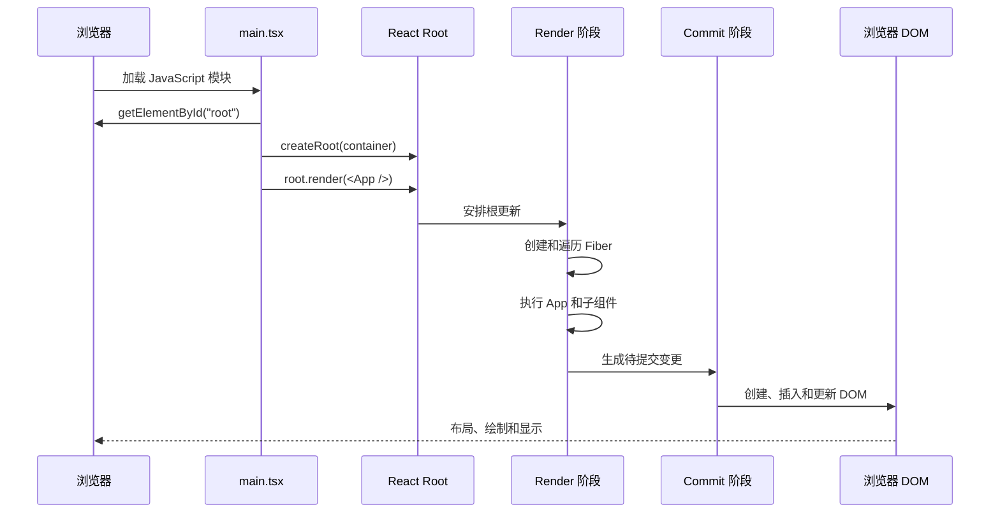

# 第 3 章 React 应用是如何启动的

前两章已经建立了两个基础认识：

- JSX 会被转换成 React Element；
- React Element 是对 UI 的描述，不是真实 DOM。

这一章继续回答：

> React 如何从一个 DOM 容器开始，把 `<App />` 变成浏览器中真正显示的页面？

最常见的入口代码是：

```tsx
createRoot(document.getElementById('root')!).render(
  <App />,
);
```

这几行代码很短，但背后涉及：

- 浏览器找到哪个 DOM 容器；
- ReactDOM 如何创建 Root；
- React 如何建立 FiberRoot 和 HostRoot；
- `render` 如何安排首次更新；
- React 如何执行函数组件；
- React 如何创建真实 DOM；
- React 如何把内部 Fiber 与浏览器 DOM 关联起来。

## 本章学习目标

学习完本章，你应该能够：

1. 解释 `createRoot` 的作用；
2. 解释 `root.render` 的作用；
3. 区分 `react` 和 `react-dom/client` 的职责；
4. 描述 React 首次渲染的基本过程；
5. 理解 FiberRoot、HostRoot 和应用根组件的关系；
6. 解释浏览器 DOM 与 React 内部 Fiber 的关系；
7. 区分 `createRoot` 和 `hydrateRoot` 的使用场景；
8. 识别 React 应用启动阶段的常见错误。

## 3.1 先用生活化语言理解应用启动

### 3.1.1 DOM 容器像施工场地

HTML 中通常会预留一个容器：

```html
<body>
  <div id="root"></div>
</body>
```

这个 `div` 可以看成一块施工场地：

```text
root 容器
  ↓
React 在这里管理应用界面
```

它本身不是整个 React 应用，只是 React 应用要挂载到的浏览器 DOM 节点。

### 3.1.2 `createRoot` 像登记施工项目

```tsx
const root = createRoot(container);
```

这一步不是立刻把所有组件渲染出来，而是告诉 React：

> 从这个 DOM 容器开始，创建一个 React 管理范围。

这个管理范围就是 Root。

React 会在内部准备：

- 应用根的 FiberRoot；
- 一个代表根节点的 HostRoot Fiber；
- 更新队列；
- 调度相关信息；
- 与容器关联的宿主环境配置。

### 3.1.3 `render` 像提交施工图

```tsx
root.render(<App />);
```

这一步告诉 React：

> 请把 `<App />` 作为这个 Root 当前应该显示的内容。

React 随后会：

```text
接收 App Element
  ↓
安排一次更新
  ↓
执行 App 组件
  ↓
生成新的 Element 树
  ↓
构建和处理 Fiber
  ↓
创建或更新 DOM
  ↓
提交到 root 容器
```

### 3.1.4 ReactDOM 像施工执行系统

`react` 和 `react-dom` 的职责并不完全相同：

```text
react
  ├─ 组件模型
  ├─ JSX 对应的 Element 创建能力
  ├─ Hooks
  └─ React 核心运行时抽象

react-dom/client
  ├─ 浏览器 DOM Root
  ├─ createRoot
  ├─ hydrateRoot
  └─ 把 React 结果提交给 DOM
```

React 核心并不只服务浏览器，也可以被不同宿主环境使用。`react-dom` 是浏览器 DOM 的宿主实现之一。

## 3.2 最小可运行示例

下面的代码可以直接放进 Vite + React + TypeScript 项目。

### `index.html`

```html
<!doctype html>
<html lang="zh-CN">
  <head>
    <meta charset="UTF-8" />
    <meta name="viewport" content="width=device-width, initial-scale=1.0" />
    <title>React 启动流程</title>
  </head>
  <body>
    <div id="root"></div>
    <script type="module" src="/src/main.tsx"></script>
  </body>
</html>
```

### `src/App.tsx`

```tsx
import { useState } from 'react';

export default function App() {
  const [count, setCount] = useState(0);

  return (
    <main className="app">
      <h1>React 应用已经启动</h1>

      <p>
        当前计数：{count}
      </p>

      <button
        type="button"
        onClick={() => setCount((current) => current + 1)}
      >
        增加
      </button>
    </main>
  );
}
```

### `src/main.tsx`

```tsx
import { StrictMode } from 'react';
import { createRoot } from 'react-dom/client';
import App from './App';
import './index.css';

const container = document.getElementById('root');

if (!container) {
  throw new Error('找不到 React 根容器');
}

const root = createRoot(container);

root.render(
  <StrictMode>
    <App />
  </StrictMode>,
);
```

### `src/index.css`

```css
:root {
  font-family: Inter, system-ui, sans-serif;
  color: #24211e;
  background: #f7f3ed;
}

* {
  box-sizing: border-box;
}

body {
  margin: 0;
}

.app {
  width: min(560px, calc(100% - 32px));
  margin: 80px auto;
  padding: 32px;
  border: 1px solid #d8cec1;
  border-radius: 10px;
  background: #fffdf9;
}

button {
  cursor: pointer;
  border: 0;
  border-radius: 6px;
  padding: 10px 16px;
  color: #fffdf9;
  background: #bd4e2e;
}
```

运行命令：

```bash
npm create vite@latest react-startup -- --template react-ts
cd react-startup
npm install
npm run dev
```

打开浏览器后，执行过程是：

```text
index.html 提供 #root
  ↓
main.tsx 找到 #root
  ↓
createRoot 创建 React Root
  ↓
root.render 接收 <App />
  ↓
React 执行 App
  ↓
React 创建 h1、p、button 对应的 DOM
  ↓
DOM 被插入 #root
```

## 3.3 逐行解释入口代码

### 3.3.1 导入 `StrictMode`

```tsx
import { StrictMode } from 'react';
```

`StrictMode` 是 React 提供的开发辅助工具，用来帮助发现潜在问题。

它不会在生产构建中增加用户可见的 UI，但在开发环境可能让某些生命周期或渲染逻辑表现出额外检查行为。

例如，开发模式下 React 可能重复调用某些函数，以发现不纯的渲染逻辑。

::: confuse 容易混淆
看到开发环境中组件函数或 Effect 似乎执行了两次，不要立刻判断 React 生产环境会执行两次。首先检查是否启用了 `StrictMode`，并区分开发检查行为和生产行为。
:::

### 3.3.2 从 `react-dom/client` 导入 `createRoot`

```tsx
import { createRoot } from 'react-dom/client';
```

这是 React 18 之后客户端渲染的主要入口。

它和下面这个导入不同：

```tsx
import { createElement } from 'react';
```

`createElement` 负责创建 React Element；`createRoot` 负责创建一个浏览器 DOM Root。

### 3.3.3 查找容器

```tsx
const container = document.getElementById('root');
```

这一步完全属于浏览器 DOM API。

React 还没有开始管理页面。此时只是从 HTML 文档中找到一个真实 DOM 节点。

### 3.3.4 处理空值

```tsx
if (!container) {
  throw new Error('找不到 React 根容器');
}
```

TypeScript 的 `getElementById` 返回类型通常可能是 `HTMLElement | null`。

如果不处理 `null`，就可能把一个不存在的容器传给 `createRoot`。

与其让应用在后面出现一个难以理解的错误，不如在入口处直接抛出明确错误。

### 3.3.5 创建 Root

```tsx
const root = createRoot(container);
```

`createRoot` 会创建一个 React Root 对象。

这个对象不是 DOM 节点，也不是应用组件实例。它是一个用于控制 React 应用根更新的入口对象。

可以粗略理解为：

```ts
type SimplifiedRoot = {
  render(element: ReactNode): void;
  unmount(): void;
};
```

这是帮助理解的简化类型，真实 Root 对象内部包含更多实现细节。

### 3.3.6 调用 `root.render`

```tsx
root.render(
  <StrictMode>
    <App />
  </StrictMode>,
);
```

`<StrictMode>` 和 `<App />` 首先会通过 JSX 变成 React Element。

然后这个 Element 被传给 Root：

```text
Root 接收 React Element
  ↓
安排首次更新
  ↓
处理 Element 树
```

`root.render` 通常没有返回 React 组件实例。它的作用是把一个 Element 树交给 React Root 管理。

## 3.4 `createRoot` 到底做了什么

从源码视角看，`createRoot` 先建立 FiberRoot 和 HostRoot，再把容器交给 Root 管理。首次挂载的调用关系如下：

```mermaid
flowchart TD
  A[createRoot(container)] --> B[校验 DOM 容器]
  B --> C[创建 FiberRoot]
  C --> D[创建 HostRoot Fiber]
  D --> E[建立 current 连接]
  E --> F[返回 Root 控制对象]
  F --> G[root.render(element)]
  G --> H[创建根更新并调度]
```

输入是 DOM 容器，处理过程是创建根级管理对象并建立 current 关系，输出是可以接收 `render` 调用的 Root。`createRoot` 本身不等于执行 App，也不直接创建最终 DOM。

从源码视角看，`createRoot` 可以拆成几个重要步骤。下面是经过简化的概念流程：

```text
createRoot(container)
  ↓
检查 container 是否是合法的 DOM 容器
  ↓
创建 FiberRoot
  ↓
创建 HostRoot Fiber
  ↓
建立 FiberRoot.current = HostRoot Fiber
  ↓
把 Root 与 container 建立关联
  ↓
返回 Root 控制对象
```

### 3.4.1 FiberRoot

FiberRoot 是 React 管理一个根应用时使用的根容器对象。

它和 Fiber 树中的普通 Fiber 节点不同：

```text
FiberRoot：整个 React 根的管理对象
HostRoot Fiber：Fiber 树中的根 Fiber
```

FiberRoot 可能记录：

- 当前正在使用的根 Fiber；
- 容器 DOM 节点；
- 待处理的 Lane；
- 过期更新；
- 调度回调；
- 错误恢复信息；
- 缓存和过渡相关信息。

实际字段会随着 React 版本变化，以上是理解所需的概念层次。

### 3.4.2 HostRoot Fiber

HostRoot Fiber 是 Fiber 树中的根节点，表示 React 应用挂载到宿主环境的入口。

它不是 `App` 组件：

```text
FiberRoot
└─ HostRoot Fiber
   └─ App Fiber
      └─ 真实组件和宿主元素 Fiber
```

这也是很多初学者容易混淆的地方：

```text
createRoot(container)
  不等于创建 App 组件
```

`createRoot` 先创建整个 React 根的管理结构，`root.render(<App />)` 后才把 `App` 放入 HostRoot Fiber 的子树中。

## 3.5 `root.render` 的基本过程

`root.render(<App />)` 可以拆成下面的逻辑：

```text
1. 接收新的 React Element
2. 创建一次根更新
3. 把 Element 放入 HostRoot 的更新队列
4. 为更新选择 Lane
5. 调度 React 工作
6. 进入 Render 阶段
7. 执行 App 和子组件
8. 比较新旧 Fiber
9. 进入 Commit 阶段
10. 创建或更新浏览器 DOM
```

### 3.5.1 接收 React Element

```tsx
root.render(<App />);
```

`<App />` 在传入前已经是一个 React Element。

可以近似理解成：

```tsx
const appElement = createElement(App, null);
root.render(appElement);
```

### 3.5.2 创建根更新

React 需要把这次“根内容变成 `<App />`”记录成一次更新。

这个更新会进入 Root 的更新处理流程。

在 React 源码中，更新通常会携带优先级或 Lane 信息。首次渲染也不是“直接同步修改 DOM”，而是进入 React 的更新系统。

### 3.5.3 进入 Render 阶段

Render 阶段的主要任务是：

```text
计算新的 Fiber 树
判断节点是否新增、复用、删除或更新
收集需要提交的变更
```

这一阶段可能执行函数组件：

```tsx
function App() {
  return <h1>Hello</h1>;
}
```

React 执行 `App` 后得到 `h1` 的 React Element。

### 3.5.4 进入 Commit 阶段

Render 阶段只是计算结果，Commit 阶段才会真正修改浏览器 DOM：

```text
创建 h1 DOM
设置文本内容
把 h1 插入 root 容器
```

Commit 阶段还会处理：

- DOM 插入、删除和属性更新；
- Ref；
- Layout Effect；
- Passive Effect 的调度。

Effect 的细节会在第 11 章介绍。

## 3.6 ReactDOM 的职责

### 3.6.1 React 核心和 ReactDOM 的关系

可以用下面的分层理解：

```text
React 核心
  ├─ Element
  ├─ Component
  ├─ Hooks
  ├─ Fiber 协调
  └─ 更新和调度抽象

ReactDOM
  ├─ 浏览器 DOM 容器
  ├─ DOM 节点创建
  ├─ DOM 属性设置
  ├─ 事件系统连接
  ├─ DOM 提交
  └─ 浏览器相关的宿主逻辑
```

React 核心负责“应该如何计算 UI”，ReactDOM 负责“如何把结果放到浏览器 DOM”。

### 3.6.2 React 不只支持浏览器

因为 React 的核心和宿主环境之间有抽象边界，所以 React 也可以用于：

- React Native；
- React Test Renderer；
- 自定义渲染器；
- 其他宿主环境。

不同宿主环境可以实现不同的提交逻辑，但组件、Props、Hooks 和协调思想可以共享。

### 3.6.3 `react-dom/client` 和 `react-dom/server`

浏览器客户端入口通常来自：

```tsx
import { createRoot, hydrateRoot } from 'react-dom/client';
```

服务器渲染相关 API 通常来自：

```tsx
import {
  renderToString,
  renderToPipeableStream,
} from 'react-dom/server';
```

两者职责不同：

```text
react-dom/client：在浏览器中管理和更新 DOM
react-dom/server：在服务器中生成 HTML 或 HTML 流
```

本章重点讨论客户端首次渲染。服务端渲染和 Hydration 会在工程化章节中继续展开。

## 3.7 首次渲染的完整流程

下面是一次客户端首次渲染的简化流程：



### 3.7.1 浏览器加载 HTML

浏览器先加载 `index.html`：

```html
<div id="root"></div>
```

此时页面可能只有一个空容器。

### 3.7.2 浏览器加载入口模块

```html
<script type="module" src="/src/main.tsx"></script>
```

在开发环境中，Vite 会处理 TypeScript、JSX 和模块依赖；生产环境中，构建工具会输出浏览器可执行的 JavaScript 文件。

### 3.7.3 入口代码查找容器

```tsx
const container = document.getElementById('root');
```

此时 React 还没有接管容器，代码只是拿到一个真实 DOM 引用。

### 3.7.4 创建 Root

```tsx
const root = createRoot(container);
```

React 建立 Root、FiberRoot 和 HostRoot 等内部结构。

### 3.7.5 提交 App Element

```tsx
root.render(<App />);
```

React 把 `<App />` 作为根内容交给更新系统。

### 3.7.6 执行组件和创建宿主节点

```tsx
function App() {
  return <h1>Hello</h1>;
}
```

React 执行 `App`，得到 `h1` Element，然后继续处理 `h1` 及其文本子节点。

### 3.7.7 Commit 到 DOM

ReactDOM 创建真实的 `HTMLHeadingElement`，设置文本，然后插入 `#root`：

```html
<div id="root">
  <h1>Hello</h1>
</div>
```

## 3.8 浏览器 DOM 与 React 内部对象的关系

### 3.8.1 两棵树

一个 React 页面可以从两个角度观察：

```text
React 内部树：Fiber 树
浏览器页面树：DOM 树
```

它们大致对应，但不是同一棵树：

```text
FiberRoot
└─ HostRoot Fiber
   └─ App Fiber
      └─ div Fiber
         ├─ h1 Fiber
         └─ button Fiber

DOM Container
└─ div#root
   └─ div
      ├─ h1
      └─ button
```

React 组件 Fiber 通常没有对应的真实 DOM：

```text
App Fiber
  没有直接对应的 DOM 节点
```

而 `div`、`h1`、`button` 这类宿主 Fiber 通常会关联真实 DOM。

### 3.8.2 `stateNode` 的概念

在 Fiber 中，`stateNode` 可以关联当前节点对应的宿主对象或实例：

```text
函数组件 Fiber：可能没有 DOM stateNode
宿主元素 Fiber：可能关联 HTMLDivElement
Class 组件 Fiber：可能关联类实例
HostRoot Fiber：关联 FiberRoot
```

这是源码阅读中的概念，业务代码不应该直接操作 Fiber 字段。

### 3.8.3 React 如何知道 DOM 属于哪个 Fiber

React DOM 在内部会给 DOM 节点附加一些带随机后缀的属性，用于关联 Fiber、Props 或事件信息，类似：

```text
__reactFiber$随机后缀
__reactProps$随机后缀
```

具体属性名和字段属于实现细节，可能随版本变化。

::: source 源码视角
不要在业务代码中通过遍历 DOM 属性名来获取 Fiber，也不要依赖 `__reactFiber$...` 之类的内部字段。它们没有公共 API 保证，生产构建、React 版本和打包方式都可能影响具体形式。
:::

### 3.8.4 DOM 节点不是 State

下面的 DOM 节点：

```tsx
const button = document.querySelector('button');
```

不等于 React 中的 State。

如果直接修改：

```tsx
button?.textContent = '已保存';
```

React 不会因此知道业务状态变了。下一次 React 提交更新时，手动修改甚至可能被覆盖。

正确做法通常是更新 React 状态：

```tsx
const [label, setLabel] = useState('保存');

<button onClick={() => setLabel('已保存')}>
  {label}
</button>
```

直接操作 DOM 只适合少数场景，例如：

- 测量尺寸；
- 调用浏览器原生能力；
- 管理焦点；
- 集成第三方 DOM 库；
- 使用 Canvas、地图或编辑器等非 React 宿主。

即使需要直接操作，也应该把操作封装在明确的边界中。

## 3.9 `createRoot`、`ReactDOM.render` 和 `hydrateRoot`

### 3.9.1 `createRoot`

客户端纯浏览器渲染通常使用：

```tsx
const root = createRoot(container);
root.render(<App />);
```

React 18 引入了新的 Root API，React 19 继续使用它。

### 3.9.2 旧的 `ReactDOM.render`

旧项目可能有：

```tsx
import ReactDOM from 'react-dom';

ReactDOM.render(<App />, container);
```

React 18 中，这种 API 已经被标记为过时，并且不会使用新的并发 Root 能力。React 19 项目应使用 `createRoot`。

迁移方式：

```tsx
import { createRoot } from 'react-dom/client';

createRoot(container).render(<App />);
```

### 3.9.3 `hydrateRoot`

如果服务器已经输出了 HTML，浏览器端不应该再次把容器当成空白 DOM 重新创建，而应该进行 Hydration：

```tsx
import { hydrateRoot } from 'react-dom/client';

hydrateRoot(container, <App />);
```

Hydration 可以理解为：

```text
服务器已经生成 HTML
  ↓
客户端加载 React
  ↓
React 复用现有 HTML
  ↓
补上事件和内部管理关系
```

`createRoot` 适合：

```text
容器中没有服务端生成的 React HTML
```

`hydrateRoot` 适合：

```text
容器中已经有服务端生成的 React HTML
```

如果把 `createRoot` 用在服务端 HTML 上，可能导致重复创建 DOM、内容不匹配或性能浪费。

## 3.10 常见错误和错误写法

### 3.10.1 Root 容器不存在

错误写法：

```tsx
const root = createRoot(
  document.getElementById('app')!,
);
```

如果 HTML 实际使用的是 `id="root"`，这里会传入 `null`。

推荐显式检查：

```tsx
const container = document.getElementById('root');

if (!container) {
  throw new Error('找不到 React 根容器');
}

const root = createRoot(container);
```

### 3.10.2 对同一个容器重复调用 `createRoot`

错误倾向：

```tsx
createRoot(container).render(<App />);
createRoot(container).render(<App />);
```

一个容器应该由一个 Root 管理。重复创建可能产生警告和不可预测的管理关系。

推荐保存 Root：

```tsx
const root = createRoot(container);
root.render(<App />);
```

后续更新通常继续调用同一个 Root 的 `render`：

```tsx
root.render(<NextApp />);
```

### 3.10.3 在组件内部创建 Root

错误倾向：

```tsx
function App() {
  const container = document.getElementById('root');
  const root = createRoot(container!);

  return <div />;
}
```

组件每次执行都可能重新创建 Root，这会破坏 Root 生命周期，也会造成重复管理。

Root 通常应该在应用入口创建：

```text
main.tsx
  └─ createRoot
      └─ render App
```

### 3.10.4 混用 `createRoot` 和旧 API

不要在同一个容器上混用：

```tsx
createRoot(container).render(<App />);
ReactDOM.render(<App />, container);
```

项目迁移时应统一 Root API。

### 3.10.5 把 `root.render` 当成返回组件实例

错误理解：

```tsx
const app = root.render(<App />);
app.doSomething();
```

函数组件没有传统意义上的组件实例，`root.render` 也不是用来返回实例的方法。

跨组件操作应该通过：

- Props；
- State；
- Context；
- 外部 Store；
- 事件或命令接口。

### 3.10.6 用 `createRoot` 处理服务端 HTML

如果页面是服务端渲染的，使用 `createRoot` 可能造成 HTML 被重新处理。服务端 HTML 通常需要 `hydrateRoot`。

### 3.10.7 直接清空 Root 容器

错误倾向：

```tsx
container.innerHTML = '';
```

React 仍然认为这些 DOM 属于它管理的树，直接清空会让 React 内部记录和真实 DOM 不一致。

如果需要卸载应用，应使用：

```tsx
root.unmount();
```

## 3.11 实际业务场景

### 3.11.1 后台管理系统启动

典型结构：

```text
index.html
  ↓
main.tsx
  ↓
Provider
  ├─ Router
  ├─ Store Provider
  ├─ Theme Provider
  └─ App
```

入口可能是：

```tsx
const root = createRoot(container);

root.render(
  <StrictMode>
    <AuthProvider>
      <StoreProvider>
        <RouterProvider router={router} />
      </StoreProvider>
    </AuthProvider>
  </StrictMode>,
);
```

这个入口的职责应该比较稳定：

- 创建 Root；
- 注入全局 Provider；
- 渲染应用根组件。

不要把复杂业务请求、页面布局和大量初始化逻辑都堆到 `main.tsx` 中。

### 3.11.2 iframe 中挂载独立 React 应用

微前端或 iframe 场景中，子应用通常有自己的容器：

```html
<div id="micro-app-root"></div>
```

子应用可以独立创建 Root：

```tsx
const container = document.getElementById('micro-app-root');

if (!container) {
  throw new Error('找不到子应用容器');
}

const root = createRoot(container);
root.render(<MicroApp />);
```

当 iframe 或子应用销毁时，需要清理：

```tsx
root.unmount();
```

否则可能残留：

- 事件监听；
- 定时器；
- 外部订阅；
- WebSocket；
- Effect 资源；
- 与 DOM 相关的引用。

### 3.11.3 多个 Root

技术上可以在页面上创建多个 Root：

```tsx
createRoot(document.getElementById('header')!).render(<Header />);
createRoot(document.getElementById('content')!).render(<Content />);
```

适合：

- 渐进式迁移旧页面；
- 独立挂载第三方 React 小部件；
- 页面上多个隔离应用。

但多个 Root 之间不会天然共享组件树和 Context：

```text
Root A 的 Context
  不会自动传给 Root B
```

如果多个 Root 需要共享状态，需要通过外部 Store、浏览器事件、URL、SharedWorker 或其他通信机制解决。

## 3.12 性能与架构考虑

### 3.12.1 Root 数量应该有明确理由

多个 Root 不是绝对错误，但会产生边界：

- Context 无法跨 Root 传播；
- 组件树无法直接组合；
- 全局错误处理需要分别配置；
- 事件和生命周期管理更分散；
- 状态共享需要额外通信。

单页面应用通常使用一个主要 Root。只有在嵌入、迁移或隔离场景下才考虑多个 Root。

### 3.12.2 入口层只负责启动和组装

推荐：

```text
main.tsx
  ├─ 创建 Root
  ├─ 注入 Provider
  ├─ 注入 Router
  └─ 渲染 App
```

复杂的请求、权限初始化和错误恢复可以放到专门的 Provider、路由加载层或应用初始化模块中。

入口代码越简单，越容易测试和迁移。

### 3.12.3 `StrictMode` 的开发成本和收益

`StrictMode` 会增加开发环境检查，可能让某些逻辑执行额外次数。

它的价值在于帮助发现：

- 不纯的渲染逻辑；
- 不完整的 Effect 清理；
- 使用过时 API；
- 依赖一次性执行的错误代码。

不要为了隐藏开发问题就随意移除 `StrictMode`。更合理的做法是修复不纯逻辑和资源清理问题。

### 3.12.4 首次渲染中的大任务

如果 `App` 首次渲染时同步执行大量工作：

```tsx
function App() {
  const data = parseHugeJson();
  const rows = buildThousandsOfRows(data);

  return <Table rows={rows} />;
}
```

浏览器可能在首次交互前长时间阻塞。

可以考虑：

- 延迟非首屏工作；
- 分批处理数据；
- 使用 Web Worker；
- 虚拟化长列表；
- 使用路由级懒加载；
- 将非紧急更新放入 Transition。

### 3.12.5 Hydration 一致性

服务端渲染时，服务器 HTML 和客户端首次渲染结果应该一致：

```text
服务器结果 === 客户端首次结果
```

如果服务端使用当前时间，而客户端重新生成另一个时间，就可能产生 Hydration 不匹配。

需要特别注意：

- 随机数；
- 当前时间；
- 浏览器专属 API；
- 用户端和服务端不同的数据；
- 不稳定排序；
- 条件分支。

## 3.13 官方行为、源码细节与经验结论

### 官方行为

以下是可以依赖的公开模型：

- 客户端 React 应用可以使用 `createRoot` 创建 Root；
- 通过 `root.render` 渲染 React Element；
- 服务端 HTML 通常使用 `hydrateRoot` 进行客户端接管；
- `root.unmount` 用于卸载 Root；
- `ReactDOM` 负责浏览器 DOM 宿主环境相关能力。

### 源码视角

以下是 React 18/19 源码中的重要内部概念：

- FiberRoot；
- HostRoot Fiber；
- Root 的更新队列；
- `FiberRoot.current`；
- DOM 节点上的内部 Fiber 和 Props 关联字段；
- Root 更新选择 Lane 和调度任务。

这些字段和函数名可能随版本变化，不是业务代码 API。

### 工程实践

- 一个 DOM 容器通常只由一个 Root 管理；
- Root 创建应放在应用入口；
- 多个 Root 之间需要显式设计状态通信；
- iframe 或微前端卸载时要调用 `root.unmount`；
- 服务端 HTML 使用 Hydration，而不是普通 `createRoot`；
- `StrictMode` 开发环境的额外执行应通过修复代码适配，而不是简单隐藏。

## 3.14 面试重点：React 应用是如何启动的

### 标准回答

> React 应用通常从 `index.html` 中的 DOM 容器开始。入口文件通过 `document.getElementById` 找到容器，然后从 `react-dom/client` 导入 `createRoot` 创建一个 React Root，再调用 `root.render(<App />)` 提交根 Element。
>
> `createRoot` 会在内部创建 FiberRoot 和 HostRoot Fiber，并建立 Root 与浏览器容器之间的关系。`root.render` 会安排一次根更新，React 在 Render 阶段执行组件、构建和协调 Fiber 树，在 Commit 阶段通过 ReactDOM 创建或更新真实 DOM。FiberRoot、HostRoot、App Fiber 和真实 DOM 是不同层次的对象。

### 面试官可能继续追问

#### `createRoot` 和 `root.render` 分别做什么？

`createRoot` 创建一个 React Root 和对应内部管理结构；`root.render` 把一个 React Element 树作为当前根内容提交给这个 Root，并触发更新流程。

#### React 和 ReactDOM 的职责有什么区别？

React 提供 Element、组件、Hooks 和核心协调抽象；ReactDOM 提供浏览器 DOM 宿主实现，包括客户端 Root、DOM 创建、属性更新、事件连接和 Commit。

#### FiberRoot 和 HostRoot Fiber 有什么区别？

FiberRoot 是整个 React 根的管理对象；HostRoot Fiber 是 Fiber 树中的根 Fiber。FiberRoot 通常通过 `current` 指向当前 HostRoot Fiber。

#### `createRoot` 和 `hydrateRoot` 有什么区别？

`createRoot` 适用于容器中没有服务端 React HTML 的客户端渲染；`hydrateRoot` 适用于服务器已经输出 HTML，客户端需要复用现有 HTML 并接管事件和更新的场景。

#### 为什么不能对同一个容器重复 `createRoot`？

一个容器应该由一个 Root 负责管理。重复创建会造成多个 React Root 争夺同一 DOM 容器，破坏内部管理关系。

#### React 首次渲染一定是同步的吗？

不能简单说所有情况都一样。React 18 的 `createRoot` 使用并发 Root 模型，更新会进入 React 的调度系统；但具体更新能否被打断还与更新类型、阶段和宿主环境有关。Commit 阶段仍然需要连续提交已经确定的变更。

## 3.15 本章小结

1. HTML 中的 `#root` 是 React 应用的浏览器容器；
2. `createRoot` 创建 React Root，不会单独代表 `App` 组件；
3. `root.render` 把 React Element 交给 Root 管理；
4. ReactDOM 负责把 React 计算结果提交给浏览器 DOM；
5. FiberRoot 是整个根应用的内部管理对象；
6. HostRoot Fiber 是 Fiber 树中的根节点；
7. `App` Fiber 位于 HostRoot Fiber 的子树中；
8. Render 阶段计算变化，Commit 阶段更新 DOM；
9. `createRoot` 适合客户端空容器渲染，`hydrateRoot` 适合服务端 HTML 接管；
10. DOM 节点上的 React 内部字段属于源码细节，业务代码不应依赖。

可以把本章浓缩成一句话：

> `createRoot` 建立 React 的根管理范围，`root.render` 提交根 Element，React 在 Render 阶段计算 Fiber 工作，在 Commit 阶段通过 ReactDOM 把结果写入浏览器 DOM。

## 3.16 练习题与参考答案

### 练习 1：补全启动代码

请补全下面的代码，使它能够安全地挂载 React 应用：

```tsx
import { createRoot } from 'react-dom/client';
import App from './App';

// 请补全
```

**参考答案：**

```tsx
const container = document.getElementById('root');

if (!container) {
  throw new Error('找不到 React 根容器');
}

const root = createRoot(container);
root.render(<App />);
```

### 练习 2：判断 API

下面两种情况分别应该选择哪个 API？

1. HTML 中只有空的 `<div id="root"></div>`；
2. 服务器已经输出了 `<div id="root"><main>...</main></div>`。

**参考答案：**

1. 使用 `createRoot`；
2. 使用 `hydrateRoot`，让客户端复用并接管服务器生成的 HTML。

### 练习 3：分析 Root 关系

请解释下面的层级：

```text
FiberRoot
└─ HostRoot Fiber
   └─ App Fiber
      └─ div Fiber
```

**参考答案：** `FiberRoot` 是整个 React 根的管理对象；`HostRoot Fiber` 是 Fiber 树中的根节点；`App Fiber` 代表应用根组件；`div Fiber` 代表组件返回的宿主元素。它们不等于浏览器中的 DOM 节点。

### 练习 4：找出错误

```tsx
function App() {
  const root = createRoot(
    document.getElementById('root')!,
  );

  return <div />;
}
```

**参考答案：** 不应该在组件函数中创建 Root。组件可能多次执行，导致重复创建 Root。Root 应该在 `main.tsx` 等应用入口中创建，并在入口处调用 `root.render(<App />)`。

### 练习 5：面试表达

请用不超过 1 分钟回答“React 应用从启动到首次显示经历了什么”。

**参考答案：**

> 浏览器先加载包含根容器的 HTML，然后执行入口模块。入口代码通过 `getElementById` 找到容器，调用 `createRoot` 创建 React Root，内部准备 FiberRoot 和 HostRoot Fiber。接着调用 `root.render(<App />)`，React 安排一次根更新，在 Render 阶段执行组件并构建 Fiber 工作树，确定需要创建或更新的节点，最后在 Commit 阶段通过 ReactDOM 创建真实 DOM 并插入根容器。浏览器随后进行布局和绘制。

---

下一章将进入组件层，讲解 **函数组件与组件树**，重点回答：

```text
函数组件什么时候执行？
父组件和子组件如何建立关系？
组件重新执行和 DOM 更新有什么区别？
```
