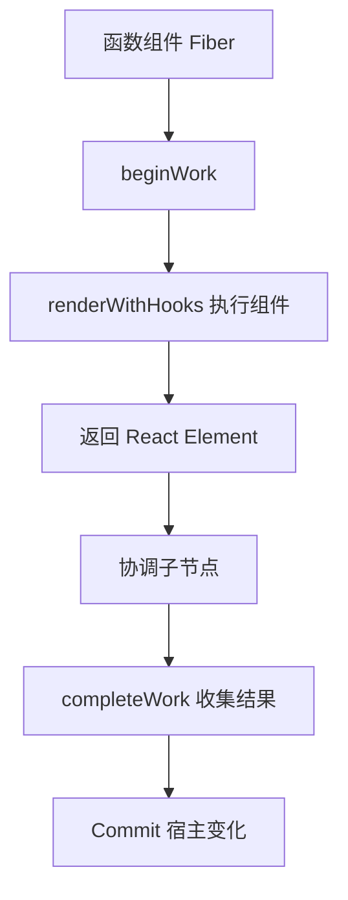

# 第 4 章 函数组件与组件树

前面三章已经建立了这条主线：

```text
JSX
  ↓
React Element
  ↓
React Root
  ↓
Fiber 树
  ↓
Commit
  ↓
浏览器 DOM
```

这一章把视线集中到组件本身。

我们经常说“React 组件会重新渲染”，但这句话可能包含几种不同的事情：

- 函数组件函数再次执行；
- 子组件收到新的 Props；
- React 创建了新的 React Element；
- Fiber 节点被更新；
- 真实 DOM 属性发生变化；
- 浏览器重新布局或绘制。

这些事情并不完全相同。

本章最重要的目标是建立一个准确的判断方式：

> 组件函数执行是计算过程，React Element 是描述结果，Fiber 是内部工作节点，DOM 更新是提交结果，浏览器布局和绘制又是更后面的阶段。

## 本章学习目标

学习完本章，你应该能够：

1. 理解函数组件什么时候执行；
2. 理解父组件和子组件如何形成组件树；
3. 理解 Props 的传递方向和只读约定；
4. 理解 `children` 如何传递到组件内部；
5. 区分组件函数重新执行和真实 DOM 更新；
6. 理解组件身份与状态保留的大致关系；
7. 识别直接调用组件函数、修改 Props 和重复保存状态等错误；
8. 在业务系统中设计合理的组件边界。

## 4.1 先用生活化语言理解函数组件

### 4.1.1 函数组件像一台制图机器

假设有一台机器：

```text
输入：用户信息、是否在线
输出：用户卡片的界面描述
```

它可以写成：

```tsx
function UserCard({ name, online }: UserCardProps) {
  return (
    <article>
      <h2>{name}</h2>
      <span>{online ? '在线' : '离线'}</span>
    </article>
  );
}
```

每次调用它，都会根据当前输入重新计算一份界面描述。

```text
Props
  ↓
执行函数组件
  ↓
React Element
```

函数组件不是一个永久存在的 DOM 节点，也不是一个传统面向对象意义上的实例。它更像一个根据输入计算 UI 的函数。

### 4.1.2 重新执行像重新出图

如果用户在线状态发生变化，React 可能再次执行：

```tsx
UserCard({ name: 'Lin', online: true });
```

得到新的描述：

```tsx
<span>在线</span>
```

React 再把新旧描述进行比较：

```text
旧描述：<span>离线</span>
新描述：<span>在线</span>
```

最后只更新必要的文本内容。

所以组件重新执行不等于 DOM 被全部销毁重建。

### 4.1.3 父子组件像一棵树

组件之间会形成嵌套关系：

```tsx
function App() {
  return (
    <PageLayout>
      <Header />
      <MainContent />
    </PageLayout>
  );
}
```

可以看成：

```text
App
└─ PageLayout
   ├─ Header
   └─ MainContent
```

父组件负责组合子组件，子组件负责自己的界面和逻辑。

## 4.2 组件树、Element 树和 DOM 树

React 应用至少可以从三个角度观察。

### 4.2.1 组件树

组件树只关注自定义组件之间的关系：

```text
App
├─ Header
├─ Sidebar
└─ Content
   ├─ FilterPanel
   └─ DataTable
```

### 4.2.2 React Element 树

Element 树包含自定义组件和原生元素：

```text
App Element
└─ div Element
   ├─ Header Element
   ├─ aside Element
   └─ main Element
      ├─ FilterPanel Element
      └─ table Element
```

### 4.2.3 DOM 树

DOM 树只包含最终的宿主节点：

```text
div#root
└─ div
   ├─ header
   ├─ aside
   └─ main
      ├─ form
      └─ table
```

自定义组件通常没有直接对应的 DOM：

```text
Header 组件
  ↓
可能返回 header、button、nav 等多个 DOM 节点
```

React 组件是逻辑边界，DOM 元素是宿主环境中的实际节点。

## 4.3 Props：组件的输入

### 4.3.1 Props 是父组件传入的数据

```tsx
function App() {
  return <UserCard name="Lin" online />;
}
```

子组件可以接收：

```tsx
function UserCard({ name, online }: UserCardProps) {
  return (
    <article>
      <h2>{name}</h2>
      <p>{online ? '在线' : '离线'}</p>
    </article>
  );
}
```

数据方向是：

```text
App
  ↓ name、online
UserCard
```

### 4.3.2 Props 是只读输入

子组件不应该直接修改 Props：

```tsx
function UserCard(props: { user: User }) {
  // 错误倾向
  props.user.name = '新的名字';

  return <h2>{props.user.name}</h2>;
}
```

原因是：

- Props 的所有权属于父组件；
- 父组件可能还会把同一个对象传给其他子组件；
- 直接修改对象会让数据来源不清晰；
- React 不会因为直接修改对象内部字段而自动安排更新。

如果需要修改数据，应通过父组件提供的回调：

```tsx
type UserCardProps = {
  user: User;
  onRename: (name: string) => void;
};
```

### 4.3.3 Props 传递的是引用

如果传递对象：

```tsx
<UserCard user={user} />
```

子组件得到的是对象引用。

这意味着：

```text
父组件和子组件可能指向同一个对象
```

所以应该保持数据更新的所有权清楚，优先通过不可变更新创建新对象：

```tsx
setUser((current) => ({
  ...current,
  name: nextName,
}));
```

不可变更新和 State 更新队列会在第 5 章进一步讨论。

## 4.4 `children`：组件的内容插槽

### 4.4.1 基本传递

```tsx
function Card({ children }: { children: ReactNode }) {
  return <section className="card">{children}</section>;
}

function App() {
  return (
    <Card>
      <h2>订单信息</h2>
      <p>当前没有待处理订单。</p>
    </Card>
  );
}
```

这里的 `Card` 负责外壳，调用方决定内部内容：

```text
Card
├─ 负责 section 和样式
└─ children
   ├─ h2
   └─ p
```

这类似于很多 UI 库中的插槽，但 React 通常使用 `children` 和普通 Props 组合完成。

### 4.4.2 命名插槽

如果组件有多个区域，可以使用多个 Props：

```tsx
type LayoutProps = {
  header: ReactNode;
  sidebar: ReactNode;
  children: ReactNode;
};

function Layout({ header, sidebar, children }: LayoutProps) {
  return (
    <div className="layout">
      <header>{header}</header>
      <aside>{sidebar}</aside>
      <main>{children}</main>
    </div>
  );
}
```

使用：

```tsx
<Layout
  header={<Header />}
  sidebar={<Sidebar />}
>
  <Dashboard />
</Layout>
```

### 4.4.3 `children` 的所有权

父组件把 Element 作为 children 传下去，并不意味着子组件获得了这个 Element 内部状态的所有权。

例如：

```tsx
function App() {
  const [value, setValue] = useState('');

  return (
    <Panel>
      <Input value={value} onChange={setValue} />
    </Panel>
  );
}
```

`Input` 的状态仍然由 `App` 控制，`Panel` 只是承载这个 children。

## 4.5 函数组件什么时候执行

### 4.5.1 首次渲染时执行

```tsx
function App() {
  console.log('App 执行');
  return <h1>Hello</h1>;
}
```

首次调用 `root.render(<App />)` 时，React 需要执行 `App`，得到它返回的 Element。

### 4.5.2 相关更新发生时可能再次执行

如果组件自身 State 更新：

```tsx
function Counter() {
  const [count, setCount] = useState(0);

  console.log('Counter 执行');

  return (
    <button onClick={() => setCount((value) => value + 1)}>
      {count}
    </button>
  );
}
```

点击按钮后，React 会让这个组件进入更新流程，并通常再次执行它。

### 4.5.3 父组件更新时子组件可能执行

```tsx
function Parent() {
  const [count, setCount] = useState(0);

  return (
    <>
      <button onClick={() => setCount((value) => value + 1)}>
        {count}
      </button>
      <Child />
    </>
  );
}

function Child() {
  console.log('Child 执行');
  return <p>子组件</p>;
}
```

默认情况下，父组件更新会让 React 继续协调子树，`Child` 也可能再次执行，即使它没有接收变化的 Props。

这并不代表 Child 的 DOM 一定更新：

```text
Parent State 更新
  ↓
Parent 函数执行
  ↓
Child 可能执行
  ↓
Child 返回相同类型的 Element
  ↓
DOM 可能完全不变
```

`React.memo` 可以在满足条件时帮助跳过部分子组件更新，但它不是所有问题的默认答案，第 12 章会详细分析。

### 4.5.4 组件函数不是事件监听器

下面的函数不会在每一次 DOM 绘制时自动执行：

```tsx
function UserCard() {
  return <article>用户</article>;
}
```

它由 React 在需要计算组件结果时调用。

因此不应该把组件函数理解成：

```text
永久绑定在 DOM 上的回调函数
```

更准确的理解是：

```text
React 在 Render 阶段调用组件函数，得到当前 UI 描述
```

## 4.6 组件重新执行和 DOM 更新的区别

这是本章最重要的部分。

### 4.6.1 四个层次

一次更新可以分成几个层次：

```text
1. 触发更新
2. 组件函数执行
3. React Element / Fiber 协调
4. Commit DOM 更新
5. 浏览器布局和绘制
```

它们之间不是一一对应的：

```text
组件执行了
  不代表 DOM 一定更新

DOM 更新了
  不代表所有组件都重新执行

DOM 更新了
  也不代表浏览器一定发生布局
```

### 4.6.2 示例：文本没有变化

```tsx
function Title() {
  return <h1>固定标题</h1>;
}
```

即使 `Title` 函数再次执行，React 也可以发现：

```text
旧：h1 + 文本“固定标题”
新：h1 + 文本“固定标题”
```

最终不需要修改 DOM 文本。

### 4.6.3 示例：属性变化

```tsx
function Button({ disabled }: { disabled: boolean }) {
  return (
    <button disabled={disabled}>
      提交
    </button>
  );
}
```

如果 `disabled` 从 `false` 变成 `true`：

```text
Button 函数执行
  ↓
得到新的 button Element
  ↓
React 比较 disabled
  ↓
Commit 阶段修改 button.disabled
```

### 4.6.4 示例：类型变化

```tsx
function Content({ compact }: { compact: boolean }) {
  return compact ? <p>简洁内容</p> : <div>完整内容</div>;
}
```

如果节点类型从 `p` 变为 `div`，React 通常不会把它当成同一个宿主节点继续复用，而是可能删除旧节点并创建新节点。

节点类型、Key 和位置会影响协调结果。Key 和列表 Diff 在第 9 章详细讨论。

## 4.7 组件身份与状态保留

### 4.7.1 State 不属于函数变量

看下面的代码：

```tsx
function Counter() {
  const [count, setCount] = useState(0);
  return <button onClick={() => setCount((value) => value + 1)}>{count}</button>;
}
```

`count` 这个局部变量每次函数执行都会重新声明，但它的 State 不会因为函数执行结束就丢失。

React 会把 Hook State 保存在与组件 Fiber 相关的内部结构中。

```text
函数局部变量：本次执行的临时值
Hook State：React 持续管理的状态
```

### 4.7.2 相同类型和位置通常保留状态

```tsx
function App({ show }: { show: boolean }) {
  return show ? <Counter /> : <Counter />;
}
```

虽然条件两侧写了两次，但 React 看到的位置和类型相同，通常会继续保留该位置的 State。

### 4.7.3 改变组件类型可能重置状态

```tsx
function App({ compact }: { compact: boolean }) {
  return compact ? <CompactCounter /> : <FullCounter />;
}
```

当组件类型从 `CompactCounter` 变成 `FullCounter`，React 通常会把它当成不同组件，原有 State 不会直接转移。

状态保留规则与组件类型、位置和 Key 有关。这里先建立直觉，完整的节点复用规则会在第 9 章讲解。

## 4.8 最小可运行示例

下面的示例展示：

- 父组件保存 State；
- 子组件接收 Props；
- `children` 传递；
- 子组件触发父组件回调；
- 组件执行日志；
- 组件执行和 DOM 更新的区别。

### `src/App.tsx`

```tsx
import { useState, type ReactNode } from 'react';

type User = {
  name: string;
  online: boolean;
};

type UserCardProps = {
  user: User;
  onToggleOnline: () => void;
};

type PanelProps = {
  title: string;
  children: ReactNode;
};

function Panel({ title, children }: PanelProps) {
  console.log('Panel 执行');

  return (
    <section className="panel">
      <h2>{title}</h2>
      {children}
    </section>
  );
}

function UserCard({ user, onToggleOnline }: UserCardProps) {
  console.log('UserCard 执行');

  return (
    <article className="user-card">
      <div>
        <strong>{user.name}</strong>
        <span className={user.online ? 'online' : 'offline'}>
          {user.online ? '在线' : '离线'}
        </span>
      </div>

      <button type="button" onClick={onToggleOnline}>
        切换状态
      </button>
    </article>
  );
}

function Clock() {
  console.log('Clock 执行');

  return <p className="hint">这个组件没有自己的 State。</p>;
}

export default function App() {
  const [user, setUser] = useState<User>({
    name: 'Lin',
    online: true,
  });
  const [count, setCount] = useState(0);

  function handleToggleOnline() {
    setUser((current) => ({
      ...current,
      online: !current.online,
    }));
  }

  return (
    <main className="app">
      <h1>函数组件与组件树</h1>

      <Panel title="用户信息">
        <UserCard
          user={user}
          onToggleOnline={handleToggleOnline}
        />
      </Panel>

      <Panel title="父组件状态">
        <button
          type="button"
          onClick={() => setCount((value) => value + 1)}
        >
          父组件计数：{count}
        </button>
        <Clock />
      </Panel>
    </main>
  );
}
```

### `src/main.tsx`

```tsx
import { StrictMode } from 'react';
import { createRoot } from 'react-dom/client';
import App from './App';
import './index.css';

const container = document.getElementById('root');

if (!container) {
  throw new Error('找不到 React 根容器');
}

createRoot(container).render(
  <StrictMode>
    <App />
  </StrictMode>,
);
```

### `src/index.css`

```css
:root {
  font-family: Inter, system-ui, sans-serif;
  color: #28231f;
  background: #f5f1eb;
}

* {
  box-sizing: border-box;
}

body {
  margin: 0;
}

button {
  cursor: pointer;
  border: 1px solid #cfc3b6;
  border-radius: 6px;
  padding: 8px 12px;
  color: inherit;
  background: #fffdf9;
}

.app {
  width: min(640px, calc(100% - 32px));
  margin: 64px auto;
}

.panel {
  margin-top: 20px;
  padding: 20px;
  border: 1px solid #d8cec1;
  border-radius: 8px;
  background: #fffdf9;
}

.panel h2 {
  margin-top: 0;
}

.user-card {
  display: flex;
  align-items: center;
  justify-content: space-between;
  gap: 16px;
}

.user-card > div {
  display: flex;
  flex-direction: column;
  gap: 6px;
}

.online,
.offline {
  font-size: 14px;
}

.online {
  color: #217a4b;
}

.offline {
  color: #9b4c32;
}

.hint {
  margin-bottom: 0;
  color: #6b625a;
}
```

## 4.9 逐行解释代码

### 4.9.1 `User` 是业务数据

```tsx
type User = {
  name: string;
  online: boolean;
};
```

它描述的是业务实体，而不是 React 内部对象。

React 组件通常同时处理两类数据：

```text
业务数据：User、Order、Message
界面数据：是否展开、是否加载、当前选中项
```

把这两类数据分清楚，有利于后续设计状态和组件边界。

### 4.9.2 `UserCardProps` 是组件接口

```tsx
type UserCardProps = {
  user: User;
  onToggleOnline: () => void;
};
```

`UserCard` 需要两个输入：

- 当前用户对象；
- 切换状态的回调。

子组件不需要知道父组件把状态放在哪里，也不需要知道状态如何保存。它只需要：

```text
读取 user
调用 onToggleOnline
```

### 4.9.3 `Panel` 使用 children 组合内容

```tsx
function Panel({ title, children }: PanelProps) {
  console.log('Panel 执行');

  return (
    <section className="panel">
      <h2>{title}</h2>
      {children}
    </section>
  );
}
```

`Panel` 只负责布局外壳。它不关心 children 是 `UserCard` 还是按钮。

这种组件通常比下面这种写法更容易复用：

```tsx
function Panel({ user, count, showButton }: HugePanelProps) {
  // Panel 内部决定所有内容
}
```

当页面变化时，后者会不断增加配置 Props，而 children 组合可以把具体内容留给调用方。

### 4.9.4 `UserCard` 只读取 Props

```tsx
function UserCard({ user, onToggleOnline }: UserCardProps) {
  console.log('UserCard 执行');

  return (
    <article className="user-card">
      <div>
        <strong>{user.name}</strong>
```

组件读取 `user.name`，但不修改 `user`。

### 4.9.5 状态决定 class 和文本

```tsx
<span className={user.online ? 'online' : 'offline'}>
  {user.online ? '在线' : '离线'}
</span>
```

这里的 UI 是 `user.online` 的函数：

```text
online = true
  → className = online
  → 文本 = 在线

online = false
  → className = offline
  → 文本 = 离线
```

这就是声明式 UI 的具体表现。

### 4.9.6 子组件通过回调通知父组件

```tsx
<button type="button" onClick={onToggleOnline}>
  切换状态
</button>
```

子组件不直接修改父组件的 `user`，而是调用父组件传入的回调。

数据流是：

```text
父组件持有 user
  ↓ user、onToggleOnline
UserCard
  ↓ 调用 onToggleOnline
父组件更新 user
  ↓ 新 user 再次传给 UserCard
```

### 4.9.7 父组件保存状态

```tsx
const [user, setUser] = useState<User>({
  name: 'Lin',
  online: true,
});
```

`App` 是 `user` 的状态拥有者。

子组件只知道当前值和回调，因此可以独立复用：

```tsx
<UserCard user={anotherUser} onToggleOnline={...} />
```

### 4.9.8 不可变更新对象

```tsx
setUser((current) => ({
  ...current,
  online: !current.online,
}));
```

这会创建一个新对象：

```text
旧对象：{ name: "Lin", online: true }
新对象：{ name: "Lin", online: false }
```

`name` 被展开保留，`online` 使用新值覆盖。

### 4.9.9 父组件的另一个 State

```tsx
const [count, setCount] = useState(0);
```

`count` 与 `user` 是两个独立的 State。

点击父组件计数按钮时：

```text
count 更新
  ↓
App 重新执行
  ↓
App 重新返回组件树
```

此时 `Clock` 可能也会执行，即使它没有读取 `count`。

### 4.9.10 组件执行日志的正确解读

在 `StrictMode` 开发环境下，初次执行日志可能出现多次，这是开发检查行为的一部分。

点击按钮后，可以观察到组件函数可能重新执行，但不应该直接从日志推断 DOM 一定被完全重建。

要判断真实 DOM 是否变化，需要结合：

- React DevTools Profiler；
- 浏览器 Performance 面板；
- DOM 断点；
- 组件输出和实际提交结果。

## 4.10 React 内部大致如何处理函数组件

### 4.10.1 从 Fiber 进入组件更新

在简化的源码视角中，React 处理函数组件大致会经过：

```text
beginWork
  ↓
识别当前 Fiber 是函数组件
  ↓
updateFunctionComponent
  ↓
renderWithHooks
  ↓
执行函数组件
  ↓
得到 React Element
  ↓
reconcileChildren
  ↓
继续处理子 Fiber
```

这些函数名属于 React 18/19 源码中的重要入口，但具体参数和细节可能随版本变化。

### 4.10.2 `renderWithHooks`

函数组件中的 Hooks 不能像普通函数一样随意工作。React 会在执行函数组件时建立当前的 Hook 渲染上下文。

概念上可以理解为：

```text
准备当前 Fiber
  ↓
选择当前是首次渲染还是更新渲染
  ↓
设置当前 Hook 指针
  ↓
执行函数组件
  ↓
useState、useEffect 等读取当前 Hook
  ↓
恢复渲染上下文
```

第 6 章会详细解释 Hook 链表和调用顺序。

### 4.10.3 `reconcileChildren`

函数组件返回一个 React Element 后，React 需要把它和旧的子节点进行协调：

```text
旧子树
  + 新返回结果
  ↓
协调
  ↓
得到新的子 Fiber
```

例如：

```tsx
function App() {
  return <UserCard user={user} />;
}
```

React 需要判断：

- 以前是否也是 `UserCard`；
- Key 是否一致；
- Props 是否变化；
- 组件是否可以复用；
- 子组件是否需要继续执行。

### 4.10.4 `completeWork`

当 React 完成一个 Fiber 子树的处理后，会进入完成阶段。宿主元素相关的工作可能包括：

- 创建 DOM 实例；
- 准备属性更新；
- 处理文本节点；
- 连接宿主节点关系。

真正把变更提交到浏览器通常仍然发生在 Commit 阶段。

## 4.11 父组件更新对子组件的影响

### 4.11.1 默认情况下子树会继续协调

```tsx
function Parent() {
  const [count, setCount] = useState(0);

  return (
    <>
      <button onClick={() => setCount((value) => value + 1)}>
        {count}
      </button>
      <ExpensiveChild />
    </>
  );
}
```

点击按钮会让 `Parent` 更新。React 需要处理 `Parent` 返回的新子树，因此 `ExpensiveChild` 默认可能再次执行。

这不是因为 `ExpensiveChild` 自己的 State 变化，而是因为父组件更新传播到了它所在的子树。

### 4.11.2 `React.memo` 可以改变部分行为

```tsx
const ExpensiveChild = memo(function ExpensiveChild() {
  return <div>复杂内容</div>;
});
```

如果它的 Props 没有变化，React 可能跳过这次子组件执行。

但要注意：

- `memo` 是性能优化提示，不是绝对隔离；
- 子组件自己的 State 变化仍然会触发它更新；
- Context 变化可能让它更新；
- Props 使用新对象引用时，浅比较可能认为发生了变化；
- 是否有收益需要通过性能分析确认。

### 4.11.3 组件执行不等于用户可见变化

下面的组件每次执行都返回相同结果：

```tsx
function StaticLabel() {
  console.log('执行 StaticLabel');
  return <span>固定标签</span>;
}
```

React 可能调用它，但协调结果可能不需要更新 DOM。

因此排查性能时需要分别回答：

```text
它重新执行了吗？
它的子树重新协调了吗？
它产生了 DOM 变更吗？
浏览器发生了布局或绘制吗？
```

## 4.12 常见错误和错误写法

### 4.12.1 直接调用子组件函数

错误写法：

```tsx
function App() {
  return UserCard({
    user,
    onToggleOnline,
  });
}
```

推荐：

```tsx
function App() {
  return (
    <UserCard
      user={user}
      onToggleOnline={onToggleOnline}
    />
  );
}
```

通过 JSX 创建 Element，React 才能管理组件边界、Props、Hook 上下文和组件树。

### 4.12.2 修改 Props 对象

错误写法：

```tsx
function UserCard({ user }: { user: User }) {
  user.online = false;
  return <span>{user.online ? '在线' : '离线'}</span>;
}
```

推荐由状态拥有者更新：

```tsx
function Parent() {
  const [user, setUser] = useState<User>(initialUser);

  function disableUser() {
    setUser((current) => ({
      ...current,
      online: false,
    }));
  }

  return <UserCard user={user} onDisable={disableUser} />;
}
```

### 4.12.3 把所有逻辑写进父组件

错误倾向：

```text
Page 组件
  ├─ 处理用户信息
  ├─ 处理表格筛选
  ├─ 处理弹窗
  ├─ 处理导出
  ├─ 处理权限
  └─ 渲染所有 DOM
```

这样会导致：

- 父组件难以阅读；
- 局部状态变化影响范围过大；
- 子功能无法独立测试；
- 逻辑难以复用。

应根据业务职责拆分组件和 Hook。

### 4.12.4 为了传递数据而复制一份 State

错误倾向：

```tsx
function Child({ value }: { value: string }) {
  const [localValue, setLocalValue] = useState(value);
  // value 变化后 localValue 不会自动同步
  return <div>{localValue}</div>;
}
```

这可能造成 Props 和内部 State 不一致。

如果只是展示，直接使用 Props：

```tsx
function Child({ value }: { value: string }) {
  return <div>{value}</div>;
}
```

只有在确实需要“接收初始值后独立编辑”时，才设计明确的本地副本和同步策略。

### 4.12.5 误以为父组件更新会让所有 DOM 重建

父组件更新可能让子组件函数执行，但 React 会通过类型、位置和 Key 等信息协调节点。只有需要提交的部分才会更新 DOM。

## 4.13 真实业务场景：订单页面组件边界

一个订单页面可以拆成：

```text
OrderPage
├─ OrderFilter
├─ OrderSummary
├─ OrderTable
│  └─ OrderRow
├─ BatchActionBar
└─ OrderDetailDrawer
```

状态可以按使用范围放置：

```text
OrderPage
  ├─ 查询条件：OrderFilter 和请求逻辑共享
  ├─ 列表数据：页面或服务端状态层
  ├─ 选中订单：OrderTable 和 BatchActionBar 共享
  └─ 当前详情：OrderPage 和 OrderDetailDrawer 共享

OrderRow
  └─ 行内 hover、展开状态可以局部保存
```

数据流：

```text
OrderPage
  ↓ filters
请求层
  ↓ orders
OrderTable / OrderSummary
  ↓ selectedOrderIds
BatchActionBar
```

如果所有状态都放在 `OrderPage`，父组件更新可能让整个页面子树重新协调；如果状态散落在多个组件，又可能出现数据源不一致。架构设计需要在共享范围和局部性之间平衡。

## 4.14 真实业务场景：流式 Agent 消息组件

AI Agent 页面可以按消息类型拆分：

```text
ConversationPage
├─ ConversationHeader
├─ MessageList
│  └─ MessageItem
│     ├─ UserMessage
│     ├─ AssistantMessage
│     │  ├─ StreamingText
│     │  └─ ToolCallCard
│     └─ ConfirmationCard
└─ Composer
```

父组件负责会话状态和消息数组，子组件负责展示：

```tsx
<MessageItem message={message}>
  {message.type === 'tool' && (
    <ToolCallCard tool={message.tool} />
  )}
</MessageItem>
```

流式输出时，建议把当前正在变化的消息和已经完成的历史消息分开考虑：

```text
历史消息：低频变化，可以稳定渲染
当前消息：高频变化，需要局部更新
```

这样可以减少每个字符到达时整个页面的工作量。

## 4.15 性能与架构考虑

### 4.15.1 先控制状态影响范围

性能优化的第一步通常不是立刻加 `memo`，而是确认状态放置位置：

```text
状态越靠近使用者
  ↓
受影响的组件范围通常越小
```

例如输入框的临时文本不应该默认放在应用级 Store。

### 4.15.2 组件拆分应该服务于职责

拆分组件的目标包括：

- 明确职责；
- 减少父组件复杂度；
- 缩小更新范围；
- 便于复用和测试。

不要为了把一个 20 行组件拆成 10 个 2 行组件而拆分。组件边界应该和业务责任、数据依赖或独立更新区域相关。

### 4.15.3 Props 设计要稳定

如果每次父组件执行都创建新的对象：

```tsx
<Child options={{ dense: true }} />
```

那么 `options` 的引用每次可能不同。对于使用浅比较的优化组件，这可能导致它仍然被认为发生了变化。

可以根据实际情况：

- 把简单值拆成独立 Props；
- 把静态对象移到组件外；
- 需要时使用 `useMemo`；
- 先通过 Profiler 确认是否真有问题。

### 4.15.4 组合有时比条件 Props 更清晰

复杂组件可以使用组合：

```tsx
<Dialog>
  <Dialog.Header>确认删除</Dialog.Header>
  <Dialog.Body>确定要删除这个订单吗？</Dialog.Body>
  <Dialog.Footer>
    <CancelButton />
    <ConfirmButton />
  </Dialog.Footer>
</Dialog>
```

这比传递大量布尔 Props 更容易表达结构：

```tsx
<Dialog
  showHeader
  showFooter
  confirmText="删除"
  cancelText="取消"
  bodyText="..."
/>
```

两者没有绝对对错，选择取决于组件是否需要固定结构和稳定 API。

### 4.15.5 组件边界不是性能边界的绝对保证

拆成更多组件不一定自动变快：

- 父组件更新仍可能传播到子树；
- Props 引用可能频繁变化；
- Context 变化可能影响多个消费者；
- 组件本身可能产生额外计算。

组件边界首先是架构边界，其次才可能成为性能优化边界。

## 4.16 官方行为、源码细节与经验结论

### 官方行为

以下是 React 的公开使用模型：

- 函数组件接收 Props 并返回 React Node；
- Props 从父组件传向子组件；
- 组件可以使用 `children` 进行组合；
- State 更新会请求组件重新计算；
- React 会协调组件结果并更新宿主环境。

### 源码视角

函数组件的执行可以沿着 `beginWork → renderWithHooks → reconcileChildren → completeWork` 观察：



输入是当前 Fiber、Props 和 Hook 上下文，处理过程是执行组件并把返回值转成子 Fiber，输出是下一版子树和提交标记。组件函数可以重复执行，所以 Render 中应保持纯粹；DOM 操作和外部副作用要等到 Commit 或 Effect 阶段。

以下是 React 18/19 当前源码中与函数组件相关的重要概念：

- `beginWork`；
- `updateFunctionComponent`；
- `renderWithHooks`；
- `reconcileChildren`；
- `completeWork`；
- 函数组件 Fiber 的 `memoizedProps` 和 `memoizedState`；
- Host Fiber 与真实 DOM 的关联。

这些函数和字段用于帮助阅读源码，具体调用参数和内部组织可能随版本变化。

### 工程实践

- Props 是组件输入，状态所有权需要明确；
- `children` 适合表达组合和布局插槽；
- 不要直接调用组件函数；
- 不要直接修改 Props 对象；
- 不要把组件重新执行等同于 DOM 更新；
- 先设计职责和状态边界，再讨论 `memo` 和缓存。

## 4.17 面试重点：函数组件与组件树

### 标准回答

> 函数组件可以理解为一个根据 Props 和 State 计算 UI 的函数。首次渲染或相关更新发生时，React 会在 Render 阶段执行函数组件，得到新的 React Element，然后协调新旧子树，最后在 Commit 阶段提交必要的 DOM 变化。
>
> 父组件通过 Props 向子组件传递数据，子组件通常通过回调通知父组件更新。组件函数重新执行、React Element 重新创建、Fiber 更新和真实 DOM 更新是不同层次的概念。父组件更新可能让没有变化 Props 的子组件继续协调，但这不代表子组件 DOM 一定发生变化。

### 面试官可能继续追问

#### 函数组件是类的实例吗？

不是。函数组件通常没有传统类组件那样的实例。React 使用 Fiber 保存组件相关的 State、Props、更新和 Effect 信息。

#### 父组件更新，子组件一定会重新渲染吗？

默认情况下，React 会继续协调父组件返回的子树，子组件函数可能重新执行。但 `React.memo`、组件类型、上下文和其他优化可能改变具体结果。组件函数执行也不等于 DOM 一定更新。

#### Props 可以修改吗？

不应该。Props 是父组件传入的只读输入，子组件应该通过回调通知父组件修改状态。直接修改 Props 对象会破坏数据所有权和更新可追踪性。

#### `children` 和普通 Props 有什么区别？

`children` 本质上也是 Props，只是 JSX 提供了嵌套标签的语法。它适合表示组件的组合内容或布局插槽。

#### 为什么推荐通过 JSX 使用组件，而不是直接调用函数？

JSX 会创建 React Element，让 React 管理组件边界、Props、Hooks 上下文、组件身份和调试信息。直接调用可能绕过这些机制。

#### 组件重新执行为什么不一定导致 DOM 更新？

组件函数只是重新生成 React Element 描述。React 会比较前后结果，只有需要提交的差异才会修改 DOM。如果类型、文本和属性没有变化，DOM 可以保持不变。

## 4.18 本章小结

1. 函数组件可以理解为根据 Props 和 State 计算 UI 的函数；
2. 组件树是业务逻辑边界，DOM 树是浏览器宿主结构；
3. Props 是父组件传给子组件的输入；
4. 子组件应该把 Props 当成只读数据；
5. `children` 是一种常见的组合方式，本质上也是 Props；
6. 函数组件可能在首次渲染、State 更新或父树更新时执行；
7. 组件函数执行不等于真实 DOM 更新；
8. Fiber 保存组件状态和更新信息，函数局部变量不负责保存跨渲染状态；
9. 组件边界首先服务于职责和可维护性，也可能帮助控制更新范围；
10. `React.memo` 是性能优化工具，不是组件关系的替代品。

可以把本章浓缩成一句话：

> 函数组件负责根据输入计算 UI，父组件通过 Props 传递数据，子组件通过回调反馈事件，React 再把组件结果协调成必要的 DOM 更新。

## 4.19 练习题与参考答案

### 练习 1：分析数据流

请分析下面代码中 State 的拥有者和数据流：

```tsx
function Parent() {
  const [value, setValue] = useState(0);

  return (
    <Child
      value={value}
      onChange={() => setValue((current) => current + 1)}
    />
  );
}
```

**参考答案：** `Parent` 拥有 `value` State，通过 `value` Prop 向下传递；`Child` 通过 `onChange` 回调通知 `Parent`；`Parent` 更新 State 后重新执行，并把新的 `value` 传给 `Child`。

### 练习 2：判断是否一定更新 DOM

```tsx
function Label() {
  console.log('Label 执行');
  return <span>固定文本</span>;
}
```

如果 `Label` 函数再次执行，DOM 一定会更新吗？

**参考答案：** 不一定。React 可能重新执行函数并得到新的 Element，但如果前后类型、属性和文本结果相同，协调结果可能不包含 DOM 变更。

### 练习 3：修复 Props 修改

修复下面的错误代码：

```tsx
function UserName({ user }: { user: User }) {
  user.name = '新名字';
  return <p>{user.name}</p>;
}
```

**参考答案：** 子组件不应该修改 Props。应该由父组件持有状态并通过回调更新：

```tsx
function UserName({
  user,
  onChangeName,
}: {
  user: User;
  onChangeName: (name: string) => void;
}) {
  return (
    <button type="button" onClick={() => onChangeName('新名字')}>
      {user.name}
    </button>
  );
}
```

### 练习 4：设计 `children` 类型

下面的 `Layout` 组件应该如何定义 children 类型？

```tsx
function Layout({ children }) {
  return <main>{children}</main>;
}
```

**参考答案：**

```tsx
import type { ReactNode } from 'react';

type LayoutProps = {
  children: ReactNode;
};

function Layout({ children }: LayoutProps) {
  return <main>{children}</main>;
}
```

### 练习 5：面试表达

请用不超过 1 分钟回答“组件重新渲染和 DOM 更新有什么区别”。

**参考答案：**

> 组件重新渲染通常指函数组件再次执行，重新生成 React Element 描述；DOM 更新则是 React 在 Commit 阶段确认差异后，真正修改浏览器节点。组件重新执行不一定导致 DOM 更新，因为 React 会协调前后结果，只有类型、属性或文本等实际结果发生变化时才提交必要的 DOM 变更。父组件更新也可能让子组件继续协调，但不代表子组件的 DOM 一定变化。

---

下一章将讲解 **`useState` 的工作原理**，重点回答：

```text
setState 到底做了什么？
为什么不能直接修改 State？
Hook 的更新队列如何处理多次更新？
React 为什么能够批量更新？
```
