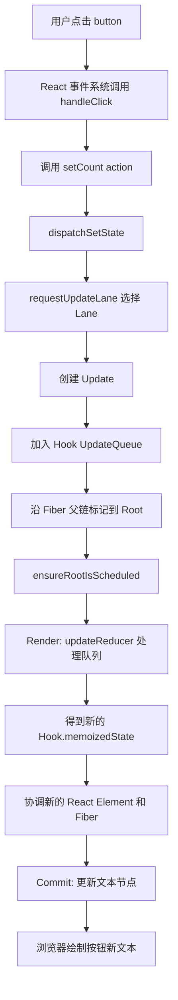
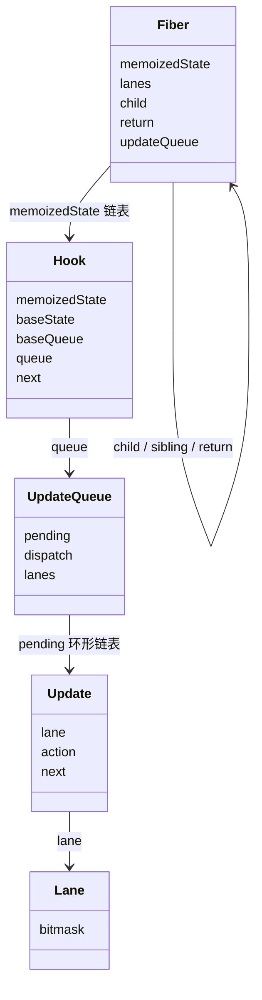

# 第 5 章 `useState` 的工作原理

前一章我们知道，函数组件每次执行都像是在根据当前输入重新计算 UI。

但函数执行结束后，局部变量通常会消失：

```tsx
function Counter() {
  let count = 0;
  count += 1;
  return <p>{count}</p>;
}
```

如果每次执行都从头开始，组件就无法记住上一次的值。

`useState` 解决的就是这个问题：

> 它让 React 能够在多次组件执行之间保存一份状态，并在状态更新时安排新的渲染工作。

但 `useState` 不是一个普通变量，也不是一个立即修改变量的函数。

```tsx
const [count, setCount] = useState(0);
```

这行代码背后至少涉及：

- 当前组件对应的 Fiber；
- 当前 Hook 在 Hook 链表中的位置；
- 状态值；
- 更新队列；
- Update 对象；
- Lane 优先级；
- React 调度和重新渲染。

## 本章学习目标

学习完本章，你应该能够：

1. 解释 `useState` 如何保存跨渲染状态；
2. 理解 `setState` 是请求更新，而不是普通赋值；
3. 说明为什么不能直接修改 State；
4. 理解 Hook 为什么必须按固定顺序调用；
5. 理解 `useState` 的更新队列；
6. 区分值更新和函数式更新；
7. 解释多次 `setState` 为什么会得到不同结果；
8. 理解 React 18/19 的自动批量更新；
9. 能够处理复杂业务中的连续状态更新。

## 5.1 先用生活化语言理解 State

### 5.1.1 函数局部变量像临时草稿

普通函数每次调用时，局部变量通常都会重新创建：

```tsx
function Counter() {
  let count = 0;

  function handleClick() {
    count += 1;
  }

  return <button onClick={handleClick}>{count}</button>;
}
```

点击按钮时，`count` 可能在内存中变成 1，但 React 不知道它变了：

- 没有触发 React 更新；
- 组件不会因为这个赋值自动重新执行；
- 下一次组件执行时，`count` 又从 0 开始。

这像是在纸上写了一个临时数字，但没有把变化登记到系统里。

### 5.1.2 State 像前台登记的记录

```tsx
const [count, setCount] = useState(0);
```

可以把它理解成：

```text
向 React 登记一份 count 记录
  ↓
React 记住当前值 0
  ↓
setCount 是修改记录并请求重新计算界面的入口
```

组件函数执行结束后，局部变量会消失，但 React 保存的 State 仍然存在。

### 5.1.3 `setState` 是“提交变更申请”

调用：

```tsx
setCount(1);
```

更接近下面的意思：

```text
请把 count 的下一次状态安排为 1
请在合适的时机重新计算组件
```

它不是：

```text
立刻把当前函数中的 count 变量改成 1
```

所以在同一次事件函数中，下面的 `count` 仍然是当前渲染快照里的值：

```tsx
function handleClick() {
  console.log(count);
  setCount(count + 1);
  console.log(count);
}
```

两次日志通常会输出相同的旧值。

## 5.2 State 是渲染快照

### 5.2.1 每次渲染都有自己的快照

考虑：

```tsx
function Counter() {
  const [count, setCount] = useState(0);

  function handleClick() {
    console.log('点击前：', count);
    setCount(count + 1);
    console.log('点击后：', count);
  }

  return (
    <button type="button" onClick={handleClick}>
      {count}
    </button>
  );
}
```

如果当前页面显示 0，那么这次渲染创建的 `handleClick` 闭包里看到的 `count` 就是 0。

调用 `setCount` 后：

```text
当前渲染快照中的 count：仍然是 0
下一次渲染快照中的 count：变成 1
```

这不是 React 延迟修改了一个普通变量，而是每次渲染都产生了一组新的变量和事件处理函数。

### 5.2.2 事件处理函数捕获当前快照

可以把一次渲染看成：

```text
Render 1
  count = 0
  handleClick 闭包捕获 count = 0

Render 2
  count = 1
  handleClick 闭包捕获 count = 1
```

旧的事件函数不会自动获得新渲染中的 `count`。

这也是后续 `useEffect`、定时器和异步请求中 stale closure 问题的基础。

### 5.2.3 `setState` 不会改变当前快照

下面的代码不会输出 3：

```tsx
function handleClick() {
  setCount(count + 1);
  setCount(count + 1);
  setCount(count + 1);
}
```

如果当前 `count` 是 0，三个调用都读取同一个快照值 0：

```text
setCount(0 + 1)
setCount(0 + 1)
setCount(0 + 1)
```

最终结果通常是 1。

如果希望基于队列中的最新值连续更新，应使用函数式更新：

```tsx
function handleClick() {
  setCount((value) => value + 1);
  setCount((value) => value + 1);
  setCount((value) => value + 1);
}
```

最终结果是 3。

## 5.3 最小可运行示例

下面的示例展示：

- 值更新；
- 函数式更新；
- 多次更新；
- State 快照；
- 对象 State 的不可变更新。

### `src/App.tsx`

```tsx
import { useState } from 'react';

type Profile = {
  name: string;
  level: number;
};

export default function App() {
  const [count, setCount] = useState(0);
  const [profile, setProfile] = useState<Profile>({
    name: 'Lin',
    level: 1,
  });

  function incrementOnce() {
    setCount(count + 1);
  }

  function incrementThreeTimesWrong() {
    setCount(count + 1);
    setCount(count + 1);
    setCount(count + 1);
  }

  function incrementThreeTimesCorrect() {
    setCount((current) => current + 1);
    setCount((current) => current + 1);
    setCount((current) => current + 1);
  }

  function upgradeProfile() {
    setProfile((current) => ({
      ...current,
      level: current.level + 1,
    }));
  }

  return (
    <main className="app">
      <h1>useState 更新队列</h1>

      <section className="panel">
        <p>当前计数：{count}</p>

        <div className="actions">
          <button type="button" onClick={incrementOnce}>
            增加 1
          </button>

          <button type="button" onClick={incrementThreeTimesWrong}>
            错误地增加 3 次
          </button>

          <button type="button" onClick={incrementThreeTimesCorrect}>
            正确地增加 3 次
          </button>
        </div>
      </section>

      <section className="panel">
        <p>
          用户：{profile.name}，等级：{profile.level}
        </p>

        <button type="button" onClick={upgradeProfile}>
          提升等级
        </button>
      </section>
    </main>
  );
}
```

### `src/main.tsx`

```tsx
import { StrictMode } from 'react';
import { createRoot } from 'react-dom/client';
import App from './App';
import './index.css';

const container = document.getElementById('root');

if (!container) {
  throw new Error('找不到 React 根容器');
}

createRoot(container).render(
  <StrictMode>
    <App />
  </StrictMode>,
);
```

### `src/index.css`

```css
:root {
  font-family: Inter, system-ui, sans-serif;
  color: #28231f;
  background: #f5f1eb;
}

* {
  box-sizing: border-box;
}

body {
  margin: 0;
}

button {
  cursor: pointer;
  border: 1px solid #cfc3b6;
  border-radius: 6px;
  padding: 8px 12px;
  color: inherit;
  background: #fffdf9;
}

.app {
  width: min(760px, calc(100% - 32px));
  margin: 64px auto;
}

.panel {
  margin-top: 20px;
  padding: 24px;
  border: 1px solid #d8cec1;
  border-radius: 8px;
  background: #fffdf9;
}

.actions {
  display: flex;
  flex-wrap: wrap;
  gap: 10px;
}
```

## 5.4 逐行解释代码

### 5.4.1 State 类型

```tsx
type Profile = {
  name: string;
  level: number;
};
```

TypeScript 类型描述的是业务数据结构，不会在浏览器运行时保存。

### 5.4.2 初始化 State

```tsx
const [count, setCount] = useState(0);
```

第一次渲染时，React 为当前组件创建一个 Hook 记录，并把初始值设为 0。

后续重新渲染时，React 不会再次把 State 重置为 0，而是从当前组件对应的 Hook 记录中读取已有值。

### 5.4.3 值更新

```tsx
function incrementOnce() {
  setCount(count + 1);
}
```

这里的 `count` 来自当前渲染快照。

如果当前快照中的 `count` 是 5，那么调用相当于：

```tsx
setCount(6);
```

React 会把值 6 放入更新队列，并安排后续更新。

### 5.4.4 多次值更新的问题

```tsx
function incrementThreeTimesWrong() {
  setCount(count + 1);
  setCount(count + 1);
  setCount(count + 1);
}
```

假设当前 `count` 为 5：

```text
第一次：setCount(6)
第二次：setCount(6)
第三次：setCount(6)
```

它们使用的是同一次事件处理函数捕获的值 5，而不是每次读取更新后的值。

### 5.4.5 函数式更新

```tsx
function incrementThreeTimesCorrect() {
  setCount((current) => current + 1);
  setCount((current) => current + 1);
  setCount((current) => current + 1);
}
```

这里传给 `setCount` 的不是最终值，而是一个更新函数：

```text
上一条更新的结果
  ↓
传给当前更新函数
  ↓
得到下一条结果
```

假设初始值是 5：

```text
update 1：5 → 6
update 2：6 → 7
update 3：7 → 8
```

### 5.4.6 对象 State 的不可变更新

```tsx
setProfile((current) => ({
  ...current,
  level: current.level + 1,
}));
```

这里创建了一个新对象，而不是修改原对象：

```text
旧对象：current
新对象：{ ...current, level: current.level + 1 }
```

这让 React 和其他状态消费者更容易通过引用变化识别更新。

## 5.5 为什么不能直接修改 State

### 5.5.1 原始值直接修改没有意义

JavaScript 原始值本身不能通过这种方式修改：

```tsx
const [count] = useState(0);

// 错误：count 是当前渲染中的局部绑定
count = 1;
```

React 的 State 变量是当前渲染的只读快照。更新必须通过 Setter：

```tsx
setCount(1);
```

### 5.5.2 对象 State 的错误修改

```tsx
const [user, setUser] = useState({
  name: 'Lin',
  age: 20,
});

function updateAge() {
  user.age += 1;
  setUser(user);
}
```

这段代码有两个问题：

1. 直接修改了当前 State 对象；
2. `setUser(user)` 传入的仍然是同一个对象引用。

React 或相关优化逻辑可能通过 `Object.is` 发现新旧值是同一个引用，从而跳过更新。

推荐：

```tsx
function updateAge() {
  setUser((current) => ({
    ...current,
    age: current.age + 1,
  }));
}
```

### 5.5.3 数组 State 的错误修改

错误：

```tsx
const [items, setItems] = useState<string[]>([]);

function addItem(item: string) {
  items.push(item);
  setItems(items);
}
```

推荐：

```tsx
function addItem(item: string) {
  setItems((current) => [...current, item]);
}
```

删除数组项：

```tsx
setItems((current) => current.filter((item) => item !== target));
```

更新数组项：

```tsx
setItems((current) =>
  current.map((item) =>
    item.id === targetId
      ? { ...item, completed: true }
      : item,
  ),
);
```

### 5.5.4 为什么 React 鼓励不可变更新

不可变更新并不只是风格偏好，它带来几个实际好处：

- 新旧状态引用容易比较；
- 更新逻辑的输入和输出更清楚；
- 时间旅行调试更容易；
- Redux、Selector 和 `memo` 更容易判断变化；
- 不会意外影响仍然引用旧对象的代码。

需要注意，React 不要求所有数据都深度不可变，也不会自动冻结所有对象。不可变更新主要是一种状态管理约定。

## 5.6 `useState` 的更新队列

### 5.6.1 为什么需要队列

一次事件中可能有多次更新：

```tsx
setCount((value) => value + 1);
setCount((value) => value + 1);
```

React 不能只保存最后一次函数调用，因为每个更新函数都可能依赖上一个更新结果。

因此 React 需要把更新按顺序记录下来：

```text
当前 State
  ↓
Update 1
  ↓
Update 2
  ↓
Update 3
  ↓
计算最终 State
```

### 5.6.2 Update 可以看成一张任务单

可以用简化类型理解 Update：

```ts
type Update<S> = {
  action: S | ((previous: S) => S);
  next: Update<S> | null;
};
```

真实 React 18/19 的 Update 还会包含 Lane、是否有预计算 State、过渡相关信息等字段。这里先只保留核心：

- `action`：值或更新函数；
- `next`：队列中的下一条更新。

### 5.6.3 值更新和函数更新

值更新：

```tsx
setCount(10);
```

可以理解为：

```text
下一状态直接使用 10
```

函数更新：

```tsx
setCount((previous) => previous + 1);
```

可以理解为：

```text
拿到队列当前计算结果
调用函数得到下一状态
```

React 内部的基础状态处理逻辑可以简化成：

```ts
function basicStateReducer<S>(
  state: S,
  action: S | ((state: S) => S),
): S {
  return typeof action === 'function'
    ? (action as (state: S) => S)(state)
    : action;
}
```

这是帮助理解的简化代码，不是建议复制的 React 源码。

### 5.6.4 队列计算示例

初始值：

```text
0
```

加入三个函数式更新：

```tsx
setCount((value) => value + 1);
setCount((value) => value + 1);
setCount((value) => value + 1);
```

处理队列：

```text
0 → 1 → 2 → 3
```

加入值更新：

```tsx
setCount(5);
setCount((value) => value + 1);
setCount(10);
```

处理队列：

```text
初始值 0
  ↓ setCount(5)
5
  ↓ +1
6
  ↓ setCount(10)
10
```

最后一个值更新覆盖了之前的计算结果。

## 5.7 Hooks 为什么必须按顺序调用

### 5.7.1 React 需要知道当前 Hook 是谁

看下面代码：

```tsx
function Component() {
  const [name, setName] = useState('Lin');
  const [age, setAge] = useState(20);

  return <p>{name} - {age}</p>;
}
```

React 可以把它理解为：

```text
第 1 个 Hook：name
第 2 个 Hook：age
```

在下一次渲染时，React 按相同顺序取回：

```text
第 1 个 Hook → name
第 2 个 Hook → age
```

### 5.7.2 条件调用会改变位置

错误代码：

```tsx
function Component({ enabled }: { enabled: boolean }) {
  if (enabled) {
    useState('Lin');
  }

  const [age] = useState(20);
  return <p>{age}</p>;
}
```

当 `enabled` 从 `true` 变成 `false`：

```text
第一次：第 1 个 Hook = name，第 2 个 Hook = age
下一次：第 1 个 Hook = age
```

React 无法只通过“第几个 Hook”判断原来的状态属于谁。

### 5.7.3 Hook 链表的直觉

React 会在函数组件对应的 Fiber 上保存 Hook 链表：

```text
Fiber.memoizedState
  ↓
Hook 1 → Hook 2 → Hook 3 → null
```

每次执行组件时，React 使用一个当前 Hook 指针，按调用顺序向后读取：

```text
调用第 1 个 useState
  → 读取 Hook 1

调用第 2 个 useEffect
  → 读取 Hook 2

调用第 3 个 useRef
  → 读取 Hook 3
```

因此 Hooks 必须：

- 直接写在组件或自定义 Hook 顶层；
- 不放在 `if`、循环、嵌套函数中；
- 每次渲染保持相同调用顺序。

Hook 链表会在第 6 章深入讨论。

## 5.8 多次 `setState` 如何处理

### 5.8.1 三次值更新

```tsx
function handleClick() {
  setCount(count + 1);
  setCount(count + 1);
  setCount(count + 1);
}
```

当前快照 `count = 0`：

```text
更新 1：设置为 1
更新 2：设置为 1
更新 3：设置为 1
最终：1
```

### 5.8.2 三次函数式更新

```tsx
function handleClick() {
  setCount((value) => value + 1);
  setCount((value) => value + 1);
  setCount((value) => value + 1);
}
```

当前值 0：

```text
更新 1：0 → 1
更新 2：1 → 2
更新 3：2 → 3
最终：3
```

### 5.8.3 值更新和函数更新混合

```tsx
setCount(5);
setCount((value) => value + 1);
setCount((value) => value * 2);
```

处理过程：

```text
初始值
  ↓
5
  ↓
6
  ↓
12
```

函数式更新接收的是它在队列中前面的计算结果，不一定是事件函数开始时的旧变量。

### 5.8.4 用函数式更新处理异步回调

下面的代码容易捕获旧值：

```tsx
setTimeout(() => {
  setCount(count + 1);
}, 1000);
```

如果定时器创建时的 `count` 已经过期，就可能覆盖其他更新。

当逻辑是“基于当前值增加”时，推荐：

```tsx
setTimeout(() => {
  setCount((value) => value + 1);
}, 1000);
```

函数式更新不能解决所有闭包问题，但它可以保证更新计算基于 React 队列中的最新状态。

## 5.9 React 18/19 的批量更新

### 5.9.1 什么是批量更新

批量更新是指：

```text
多个 State 更新
  ↓
合并到同一轮 React 更新中
  ↓
减少重复的 Render 和 Commit
```

例如：

```tsx
function handleClick() {
  setName('Lin');
  setAge(20);
  setOnline(true);
}
```

React 通常不会为每个 Setter 都立即完整渲染一次，而是把它们放在同一轮更新中处理。

### 5.9.2 React 18 的自动批量更新

使用 `createRoot` 的 React 18 应用，会将更多异步场景中的更新进行批量处理，例如：

```tsx
setTimeout(() => {
  setCount((value) => value + 1);
  setFlag((value) => !value);
}, 1000);
```

Promise 回调、定时器和原生事件监听器中的更新，也通常可以被自动批量处理。

::: note 版本说明
React 17 主要在 React 管理的事件处理函数中进行批量更新。React 18 使用 `createRoot` 后，自动批量更新范围扩大。不要把“所有情况下永远只有一次渲染”当成绝对保证，具体行为还要结合 Root API、更新类型和同步刷新操作判断。
:::

### 5.9.3 批量更新不等于更新队列消失

批量更新只是 React 合并调度和提交的一种方式。

更新队列仍然存在：

```text
setState
  ↓
创建 Update
  ↓
加入 Hook 队列
  ↓
批量调度
  ↓
按顺序计算 State
  ↓
一次或多次提交
```

如果多次更新之间存在不同 Lane，或者更新被分批处理，React 可能在不同时间处理它们。

### 5.9.4 `flushSync`

极少数情况下，代码需要在回调结束前让 DOM 同步更新，可以使用 `flushSync`：

```tsx
import { flushSync } from 'react-dom';

function handleClick() {
  flushSync(() => {
    setCount((value) => value + 1);
  });

  const text = document.querySelector('#count')?.textContent;
  console.log(text);
}
```

`flushSync` 会提高同步刷新优先级，可能影响性能，也可能触发额外 Effect。它应该只用于确实需要同步读取 DOM 的边界场景，例如与第三方 DOM API 集成。

不要把 `flushSync` 当成普通 State 更新方式。

## 5.10 源码视角：一次状态更新如何从 dispatch 走到 Fiber

这一节把 `useState` 放回一次真实交互中观察。目标不是背下某个内部函数名，而是回答一个连续的问题：用户点击按钮后，`setCount` 如何变成新的 State，新的 State 又如何进入 Render 和 Commit？

本节的源码片段按 React 19.0.0 的源码结构对照，重点参考 `packages/react/src/ReactHooks.js`、`packages/react-reconciler/src/ReactFiberHooks.js` 和 `packages/react-reconciler/src/ReactFiberWorkLoop.js`。React 的内部函数、字段和并发分支会随版本变化，代码用于定位机制和调用关系，不构成业务 API。

### 5.10.1 从一个使用场景开始

```tsx
function Counter() {
  const [count, setCount] = useState(0);

  function handleClick() {
    setCount((current) => current + 1);
  }

  return <button onClick={handleClick}>{count}</button>;
}
```

用户看到的结果是：点击一次，按钮从 `0` 变成 `1`。React 内部至少要完成以下工作：

1. 在当前组件对应的 Fiber 上找到 `count` 对应的 Hook；
2. 保存这次更新，不能让它在下一次 Render 前丢失；
3. 记录更新的 Lane，让紧急输入和非紧急工作可以区分；
4. 让 Root 进入调度流程；
5. 在 Render 阶段按顺序计算新的 State；
6. 在 Commit 阶段把新文本应用到真实 DOM。

如果 `setCount` 只是直接修改一个普通变量，React 无法知道哪个组件需要重新执行，也无法保存多个连续更新，更不能在 Render 被中断后恢复正确的状态。因此 Setter 的作用是提交一条 Update，而不是直接改写当前 Render 中的局部变量。

### 5.10.2 完整流程图



这张图中最容易混淆的是 `G`、`J` 和 `M`：调用 Setter 时只是把 Update 放入队列；Render 时才计算新 State；Commit 时才把计算结果写入 DOM。

### 5.10.3 核心对象之间如何连接



各对象的职责不同：

- `Fiber` 表示组件在 React 内部的工作节点，也保存 Hook 链表和当前待处理的 Lane；
- `Hook` 保存某一次 Hook 调用对应的状态记录，多个 Hook 通过 `next` 连接；
- `UpdateQueue` 保存某个 State Hook 尚未处理的更新和 Setter；
- `Update` 描述一次状态动作，`action` 可以是目标值，也可以是函数式更新；
- `Lane` 表示这次更新所属的工作集合，帮助 Root 选择处理时机。

`memoizedState` 是当前已经计算出的状态，`pending` 是还没有被当前 Render 消费的更新。两者分别代表“当前结果”和“未来工作”。

### 5.10.4 简化版 `useState`

先忽略 Fiber、并发队列和 Lane，只保留“保存状态、记录更新、下一次 Render 消费队列”这条主线：

```ts
function createSimpleState<S>(initialState: S) {
  let state = initialState;
  const pending: Array<S | ((previous: S) => S)> = [];

  function dispatch(action: S | ((previous: S) => S)) {
    pending.push(action);
  }

  function render(): S {
    while (pending.length > 0) {
      const action = pending.shift()!;
      state = typeof action === 'function'
        ? (action as (previous: S) => S)(state)
        : action;
    }

    return state;
  }

  return { dispatch, render };
}
```

这段代码解决三个问题：

- 输入是初始 State 和一条值更新或函数式更新；
- 处理过程是先保存 Update，再在下一次 `render()` 中按队列顺序计算；
- 输出是计算后的新 State，后续由渲染器决定是否更新宿主节点。

它仍然不是 React 的实现，因为它没有 Fiber 身份、Lane、批量边界、并发更新和 DOM Commit。它只用来建立“Setter 入队，Render 消费”的模型。

### 5.10.5 真实源码入口一：公共 `useState`

React 公共包中的 `useState` 可以概括为下面这个真实源码形态：

```ts
export function useState<S>(
  initialState: (() => S) | S,
): [S, Dispatch<BasicStateAction<S>>] {
  const dispatcher = resolveDispatcher();
  return dispatcher.useState(initialState);
}
```

这段代码解决的问题是：公共 API 不直接决定当前是首次渲染还是更新渲染，而是通过当前 Dispatcher 把工作交给正确的内部实现。

- 输入：初始 State 和当前 React 渲染上下文；
- 处理：`resolveDispatcher()` 取得当前 Dispatcher；
- 输出：由 Mount 或 Update Dispatcher 返回 `[state, dispatch]`。

这也是 Hook 不能脱离 React 组件调用的原因：普通函数调用时没有有效的渲染 Dispatcher。

### 5.10.6 真实源码入口二：State Reducer 和 Hook 初始化

`useState` 的值更新和函数式更新最终都可以通过基础 Reducer 计算：

```ts
function basicStateReducer<S>(
  state: S,
  action: BasicStateAction<S>,
): S {
  return typeof action === 'function'
    ? (action as (state: S) => S)(state)
    : action;
}
```

初始化时，React 会创建 Hook、保存初始值、创建队列并绑定 dispatch。源码中还包含懒初始化、开发检查和并发路径，核心关系可以缩小为：

```ts
function mountState<S>(initialState: (() => S) | S) {
  const hook = mountStateImpl(initialState);
  const queue = hook.queue;
  const dispatch = dispatchSetState.bind(
    null,
    currentlyRenderingFiber,
    queue,
  );

  queue.dispatch = dispatch;
  return [hook.memoizedState, dispatch];
}
```

- 输入：初始值或返回初始值的函数；
- 处理：创建 Hook 和 `UpdateQueue`，把当前 Fiber 和队列绑定到 dispatch；
- 输出：当前 State 和稳定的 Setter；
- 设计原因：Setter 需要知道“哪个 Fiber 的哪个队列”正在更新，不能只是一个独立函数。

### 5.10.7 真实源码入口三：dispatch 进入调度

调用 Setter 后，React 需要把更新和 Fiber、Root 连接起来。忽略 eager state、Render Phase Update 和开发工具分支后，核心路径可以表示为：

```ts
function dispatchSetState<S>(
  fiber: Fiber,
  queue: UpdateQueue<S, BasicStateAction<S>>,
  action: BasicStateAction<S>,
) {
  const lane = requestUpdateLane(fiber);
  const update = createUpdate(action, lane);

  enqueueConcurrentHookUpdate(fiber, queue, update, lane);
  scheduleUpdateOnFiber(fiber, lane);
}
```

这段代码的输入是当前 Fiber、Hook 队列、更新动作；处理过程是选择 Lane、创建 Update、入队并通知 Root；输出是 Root 上出现待处理工作，之后进入 Render。

它不能简化成“修改 `hook.memoizedState`”，因为 Render 可能被暂停、重做或只处理部分 Lane。把动作先记录成 Update，React 才能保持更新顺序，并在正确的 Render 中重新计算结果。

### 5.10.8 一次完整的数据变化

以初始值 `0` 和一次 `setCount(1)` 为例：

```text
首次 Render：
Fiber.memoizedState -> Hook
Hook.memoizedState = 0
Hook.queue.pending = null

调用 setCount(1) 后：
Update.action = 1
Update.lane = 当前更新 Lane
Update.next = 队列中的下一个 Update
Hook.queue.pending = Update
Fiber.lanes 包含当前 Lane
Root.pendingLanes 包含当前 Lane

Render 消费队列后：
Hook.memoizedState = 1
Hook.baseState = 1
当前 Lane 的 Update 被消费
新的 React Element 文本为 "1"

Commit 完成后：
DOM 文本节点从 "0" 变成 "1"
待处理 Lane 被从 Root 状态中移除或更新
```

React 内部的 `pending` 通常是环形链表。上面的箭头只表达逻辑关系，不代表实际链表的首尾指针布局。

### 5.10.9 多次更新如何按顺序计算

下面三条更新都发生在同一次事件中：

```tsx
setCount(1);
setCount(2);
setCount((previous) => previous + 1);
```

如果初始值是 `0`，队列计算过程是：

```text
初始 state = 0

Update 1: action = 1
state = 1

Update 2: action = 2
state = 2

Update 3: action = previous => previous + 1
state = 3

最终 memoizedState = 3
```

如果写成：

```tsx
setCount(count + 1);
setCount(count + 1);
setCount(count + 1);
```

并且当前 Render 中 `count` 是 `0`，三个 Update 的 action 都是值 `1`，因此最终结果是 `1`。这不是 Setter 只执行了一次，而是三个值更新按顺序执行后，后面的值覆盖了前面的计算结果。

### 5.10.10 为什么使用队列、链表和 Lane

- 使用 UpdateQueue，可以保存同一事件中产生的多个动作；
- 使用函数式更新，可以让后一个动作读取前一个动作的结果；
- 使用链表，可以在并发场景下追加和合并更新，避免频繁搬移数组；
- 使用 Lane，可以让一次 Render 只处理当前选中的更新集合，其他工作继续保留；
- 使用 Fiber，可以让更新归属到具体组件，并沿父链找到 Root；
- 把 Render 和 Commit 分开，可以在提交 DOM 前暂停或放弃中间计算结果。

这些设计共同解决了“状态保存、更新顺序、优先级、中断恢复和 DOM 一致性”几个不同问题，不能把它们归结成一个单独的 `setState` 函数。

### 5.10.11 源码和日常开发的关系

开发中连续调用 Setter、追加流式消息、处理定时器回调或更新对象 State 时，都会遇到 UpdateQueue 的行为：

- 依赖前一个状态时，使用函数式更新；
- 需要在当前函数中使用下一值时，先用局部变量计算；
- 需要观察提交后的 State 时，在 Effect 或后续 Render 中读取；
- 需要让复杂结果更新让位于输入时，使用 `startTransition`，不要把它误解成防抖；
- 需要同步读取 DOM 时才考虑 `flushSync`，它不是普通 Setter 的替代品。

### 5.10.12 面试口述版本

> `useState` 会在函数组件对应的 Fiber 上保存一个 Hook 记录。首次渲染时，React 创建 Hook、初始 State、UpdateQueue 和 dispatch；后续渲染时，React 根据 Hook 调用顺序找到对应记录，并处理队列中的 Update。调用 Setter 时不会直接修改当前渲染快照，而是根据 Fiber 和更新上下文选择 Lane，创建 Update，加入队列并调度 Root。Render 阶段按顺序计算新的 State，协调新的 Fiber 树，Commit 阶段再把变化应用到 DOM。连续依赖前一个结果的更新应使用函数式更新，因为值更新可能都捕获同一次渲染中的旧快照。

### 5.10.13 本节小结

1. `useState` 的公共 API 通过 Dispatcher 进入 Mount 或 Update 路径；
2. Hook 保存在函数组件 Fiber 的 Hook 链表中；
3. Setter 创建 Update，并把它放入对应 Hook 的 UpdateQueue；
4. Update 同时记录 action 和 Lane；
5. Render 阶段消费队列并计算新的 `memoizedState`；
6. Commit 阶段才把结果应用到 DOM；
7. 函数式更新按队列中的最新中间结果计算；
8. Lane、Fiber、UpdateQueue 和 Render/Commit 分工协作，共同支持可恢复的状态更新。

## 5.11 常见错误和错误写法

### 5.11.1 把 Setter 当普通赋值

错误理解：

```tsx
setCount(count + 1);
console.log(count); // 以为这里应该已经是新值
```

当前事件函数中的 `count` 仍然属于旧渲染快照。

如果需要得到下一值，可以先计算：

```tsx
const nextCount = count + 1;
setCount(nextCount);
console.log(nextCount);
```

如果需要观察 React 提交后的结果，可以在 Effect 中读取更新后的 State：

```tsx
useEffect(() => {
  console.log('新的 count：', count);
}, [count]);
```

### 5.11.2 直接修改对象或数组

错误：

```tsx
user.name = '新名字';
setUser(user);
```

正确：

```tsx
setUser((current) => ({
  ...current,
  name: '新名字',
}));
```

### 5.11.3 连续更新使用旧快照

错误：

```tsx
setCount(count + 1);
setCount(count + 1);
```

正确：

```tsx
setCount((value) => value + 1);
setCount((value) => value + 1);
```

### 5.11.4 Hook 写在条件中

错误：

```tsx
if (loggedIn) {
  const [user] = useState(null);
}
```

推荐：

```tsx
const [user] = useState(null);

if (!loggedIn) {
  return <Login />;
}
```

### 5.11.5 用 State 保存可以直接计算的值

错误倾向：

```tsx
const [firstName, setFirstName] = useState('Lin');
const [lastName, setLastName] = useState('Chen');
const [fullName, setFullName] = useState('Lin Chen');
```

推荐：

```tsx
const fullName = `${firstName} ${lastName}`;
```

重复 State 会增加更新同步成本。

### 5.11.6 使用 State 作为事件中的即时变量

错误倾向：

```tsx
function handleSubmit() {
  setStatus('submitting');
  sendRequest(status);
}
```

这里 `status` 仍然可能是旧快照。

如果请求函数需要立即使用新值，应使用局部变量：

```tsx
function handleSubmit() {
  const nextStatus = 'submitting';
  setStatus(nextStatus);
  sendRequest(nextStatus);
}
```

## 5.12 真实业务场景：表单编辑和保存

### 5.12.1 表单状态

```tsx
type FormState = {
  name: string;
  email: string;
};

const [form, setForm] = useState<FormState>({
  name: '',
  email: '',
});
```

更新单个字段：

```tsx
function updateField<K extends keyof FormState>(
  key: K,
  value: FormState[K],
) {
  setForm((current) => ({
    ...current,
    [key]: value,
  }));
}
```

### 5.12.2 提交状态

```tsx
const [status, setStatus] = useState<'idle' | 'saving' | 'success' | 'error'>('idle');
```

提交时：

```tsx
async function handleSubmit() {
  setStatus('saving');

  try {
    await saveProfile(form);
    setStatus('success');
  } catch {
    setStatus('error');
  }
}
```

这里需要理解：

- `setStatus('saving')` 不会让当前函数中的 `status` 立刻变成 `saving`；
- `form` 是当前提交函数闭包捕获的表单快照；
- 如果表单更新和提交请求存在竞态，要设计请求 ID 或取消策略；
- 复杂表单可能适合使用专门的表单状态库。

### 5.12.3 为什么不应该为每个派生值都创建 State

```tsx
const [form, setForm] = useState<FormState>(initialForm);
const [isValid, setIsValid] = useState(false);
const [canSubmit, setCanSubmit] = useState(false);
```

如果 `isValid` 和 `canSubmit` 都可以由 `form` 和 `status` 推导，就可以写成：

```tsx
const isValid = form.name.trim() !== '' && form.email.includes('@');
const canSubmit = isValid && status !== 'saving';
```

减少重复 State 可以降低同步错误。

## 5.13 真实业务场景：SSE 流式消息状态

在流式消息中，常见操作是追加文本：

```tsx
setMessage((current) => ({
  ...current,
  content: current.content + chunk,
}));
```

这里必须使用函数式更新，因为多个数据片段可能快速到达：

```text
chunk 1 → 更新队列
chunk 2 → 更新队列
chunk 3 → 更新队列
```

如果使用旧快照：

```tsx
setMessage({
  ...message,
  content: message.content + chunk,
});
```

快速连续到达的片段可能互相覆盖。

在高频流式场景中，还需要考虑：

- 是否需要合并多个 chunk；
- 是否将当前消息单独拆出；
- 是否使用 `requestAnimationFrame` 控制更新频率；
- 是否需要取消旧请求；
- 是否通过消息 ID 校验响应属于当前会话。

第 16 章会把这些问题组合成完整的流式数据方案。

## 5.14 性能与架构考虑

### 5.14.1 把 State 放在最小必要范围

如果一个状态只被一个组件使用，就优先放在这个组件附近：

```text
输入框临时值
  → 输入框内部

页面筛选条件
  → 页面和列表请求的共同父组件

跨页面用户信息
  → Context 或外部 Store
```

State 放得过高，会扩大更新影响范围；放得过低，又会导致 Props 层层传递。

### 5.14.2 大对象 State 要考虑更新粒度

下面的 State 可能非常大：

```tsx
const [dashboard, setDashboard] = useState<DashboardState>(initialDashboard);
```

更新一个字段时，每次都创建整个大对象，可能增加计算和订阅成本。

可以根据业务拆分：

```tsx
const [filters, setFilters] = useState<Filters>(initialFilters);
const [rows, setRows] = useState<Row[]>([]);
const [summary, setSummary] = useState<Summary>(initialSummary);
```

但也不要机械地把每个字段都拆成独立 State。拆分应服务于：

- 不同更新频率；
- 不同使用组件；
- 不同生命周期；
- 不同持久化和请求策略。

### 5.14.3 频繁更新应该尽量局部化

光标位置、输入中间值、流式文本、拖拽坐标等状态更新频率较高。

如果它们放在顶层页面 State 中，可能让大型页面频繁重新协调。

可以考虑：

- 把高频 State 放到局部组件；
- 将历史数据和实时数据拆分；
- 使用外部 Store 的细粒度订阅；
- 用 `requestAnimationFrame` 合并视觉更新；
- 让非紧急内容进入 Transition。

### 5.14.4 不要随意使用 `flushSync`

`flushSync` 能解决某些同步 DOM 读取问题，但会打断 React 的调度和批处理机会。

常见使用边界：

- 第三方 DOM 库要求 DOM 立刻完成；
- 更新后需要立即测量尺寸；
- 与浏览器原生打印或焦点流程集成。

普通业务 State 更新不需要 `flushSync`。

## 5.15 官方行为、源码细节与经验结论

### 官方行为

以下是使用 `useState` 时可以依赖的行为模型：

- State 在同一组件的多次渲染之间保持；
- Setter 请求 React 更新状态；
- 当前渲染中的 State 是快照；
- 函数式更新可以基于前一状态计算下一状态；
- React 可以批量处理多个更新；
- State 应该通过 Setter 更新，而不是直接修改。

### 源码视角

React 18/19 中与 `useState` 相关的重要内部概念包括：

- `mountState`；
- `updateState`；
- `dispatchSetState`；
- Hook 链表；
- `memoizedState`；
- `baseState`；
- `baseQueue`；
- `queue.pending`；
- Update 的 `action`、`lane` 和 `next`；
- `basicStateReducer`；
- `scheduleUpdateOnFiber`。

这些名称适合阅读源码和建立调用链，具体字段和实现可能随版本变化。

### 工程实践

- 需要连续基于最新值更新时使用函数式更新；
- 对象和数组 State 使用不可变更新；
- 不要保存可以直接推导的 State；
- 高频状态尽量限制在局部范围；
- 不要用 `flushSync` 代替正常状态更新；
- React 18/19 中不要简单把 Setter 称为“异步函数”，应说它会安排更新，当前渲染快照不会立即改变。

## 5.16 面试重点：`useState` 的工作原理

### 标准回答

> `useState` 会在函数组件对应的 Fiber 上关联一个 Hook 记录，用来保存跨渲染的 State。首次渲染时创建 Hook 和更新队列，后续渲染时按照 Hook 调用顺序读取已有记录。调用 Setter 时，React 会创建一个 Update，把它加入 Hook 的更新队列，并根据 Lane 调度组件更新。Render 阶段处理队列，按顺序计算新的 State，再通过协调和 Commit 更新 DOM。
>
> Setter 不是普通赋值，它不会改变当前渲染快照中的局部变量。连续依赖最新状态的更新应该使用函数式更新。React 18 使用 `createRoot` 后扩大了自动批量更新范围。

### 面试官可能继续追问

#### `setState` 是同步还是异步？

不应该简单二选一。Setter 是一个安排更新的操作，调用后当前渲染快照中的变量不会立即改变。React 可能根据更新类型和调度策略批量处理、延后或同步提交。需要同步读取 DOM 时可以使用 `flushSync`，但它是特殊边界 API。

#### 为什么连续三次 `setCount(count + 1)` 只增加一次？

因为三次调用都读取同一次渲染快照中的 `count`，如果它是 0，三次都提交值 1。使用 `setCount(value => value + 1)` 后，每个更新函数会按队列顺序接收前一个更新结果。

#### 为什么不能直接修改对象 State？

直接修改会保留原对象引用，React 或相关优化逻辑可能无法通过引用变化发现更新，也会破坏状态的可追踪性。应该创建新对象或新数组，再通过 Setter 提交。

#### Hook 为什么不能写在条件判断中？

React 通常通过当前组件 Fiber 上的 Hook 链表和调用顺序识别每个 Hook。条件调用会导致下一次渲染的 Hook 顺序变化，从而让 State、Effect 等记录错位。

#### React 18 的自动批量更新有什么变化？

使用 `createRoot` 的 React 18 应用会把更多异步场景中的 State 更新放入同一批处理，例如 Promise、定时器和原生事件回调。具体是否合并仍取决于更新边界和是否使用同步刷新 API。

#### 函数式更新解决了什么问题？

它让更新逻辑基于 React 处理队列时的最新状态，而不是依赖事件函数创建时捕获的旧快照，适合连续更新、异步回调和高频消息追加。

## 5.17 本章小结

1. `useState` 让函数组件拥有跨渲染保存的状态；
2. 当前渲染中的 State 是不可变快照；
3. Setter 是安排更新的入口，不是普通变量赋值；
4. 直接修改对象或数组可能造成引用不变和更新丢失；
5. 函数式更新适合基于最新状态连续计算；
6. 多次值更新可能覆盖成同一个结果；
7. Update 会进入 Hook 的更新队列并按顺序计算；
8. Hook 通过调用顺序与 Fiber 上的链表记录对应；
9. React 18 使用 `createRoot` 后扩大了自动批量更新范围；
10. State 设计需要考虑使用范围、更新频率、派生关系和性能成本。

可以把本章浓缩成一句话：

> `useState` 把 State 保存在组件的 Hook 记录中，Setter 把更新加入队列，React 在下一轮渲染中按顺序计算新状态，而当前渲染快照不会被立即修改。

## 5.18 练习题与参考答案

### 练习 1：预测结果

假设初始 `count = 0`，点击一次按钮后结果是多少？

```tsx
function handleClick() {
  setCount(count + 1);
  setCount(count + 1);
  setCount(count + 1);
}
```

**参考答案：** 通常是 1。三次调用都读取当前渲染快照中的 0，并把值 1 加入更新队列。

### 练习 2：改成函数式更新

把下面代码改成一次点击增加 3：

```tsx
function handleClick() {
  setCount(count + 1);
  setCount(count + 1);
  setCount(count + 1);
}
```

**参考答案：**

```tsx
function handleClick() {
  setCount((value) => value + 1);
  setCount((value) => value + 1);
  setCount((value) => value + 1);
}
```

### 练习 3：修复对象 State 更新

```tsx
const [user, setUser] = useState({
  name: 'Lin',
  age: 20,
});

function birthday() {
  user.age += 1;
  setUser(user);
}
```

**参考答案：**

```tsx
function birthday() {
  setUser((current) => ({
    ...current,
    age: current.age + 1,
  }));
}
```

### 练习 4：判断是否应该保存 State

下面的 `fullName` 是否应该使用独立 State？

```tsx
const [firstName, setFirstName] = useState('Lin');
const [lastName, setLastName] = useState('Chen');
const fullName = `${firstName} ${lastName}`;
```

**参考答案：** 不需要。`fullName` 可以由已有 State 直接计算，独立保存会增加不同步风险。

### 练习 5：面试表达

请用不超过 1 分钟回答“为什么 `setState` 后立刻读取 State 仍然是旧值”。

**参考答案：**

> React 的 State 是按渲染保存的快照。事件处理函数捕获的是当前这次渲染中的 State，调用 Setter 只是创建更新并请求 React 安排下一轮渲染，不会修改当前函数里的局部变量。因此在同一个事件函数中立即读取，通常仍然是旧值。下一轮渲染会得到新的 State；如果更新依赖前一个最新值，应使用函数式更新。

---

下一章将讲解 **Hooks 的规则与本质**，重点回答：

```text
Hooks 为什么必须按顺序调用？
Hook 链表如何保存 useState、useEffect 和 useRef？
闭包为什么会产生 stale closure？
如何设计可靠的自定义 Hook？
```
