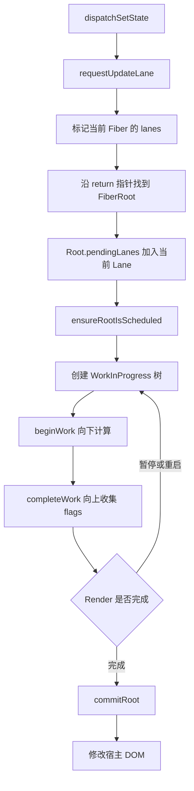
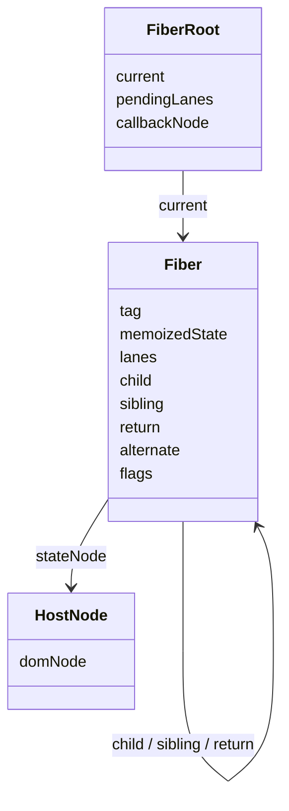

# 第 7 章 为什么 React 需要 Fiber

前面几章已经建立了几条重要的线索：

```text
JSX
  ↓
React Element
  ↓
函数组件执行
  ↓
Fiber 树
  ↓
协调和提交
  ↓
DOM
```

第 5 章介绍了 State 更新队列，第 6 章介绍了 Hook 如何挂在组件对应的 Fiber 上。现在继续追问：

> React 为什么需要一个叫 Fiber 的内部节点？

Fiber 不是新的 UI 语法，也不是浏览器提供的 API。它是 React 用来表示组件工作、保存更新信息、组织树遍历和连接两棵树的数据结构。

如果没有 Fiber，React 也可以计算 UI。但在大型页面、动画、输入和异步更新同时发生时，React 需要更细地管理工作：

- 能不能把一棵大树拆成很多小工作单元？
- 工作执行到一半时，能不能暂时让出主线程？
- 新的高优先级更新到来时，能不能先处理用户输入？
- Render 计算期间，能不能避免半成品直接出现在 DOM 中？
- 当前已经提交的界面和下一版正在计算的界面，如何同时存在？

Fiber 主要为这些问题提供了数据结构基础。

## 本章学习目标

学习完本章，你应该能够：

1. 解释 React 早期 Stack Reconciler 的限制；
2. 说明 Fiber 为什么能够把递归工作拆成可调度单元；
3. 区分 React Element、Fiber 节点和 DOM 节点；
4. 理解 Fiber 的 `child`、`sibling`、`return` 三个树遍历指针；
5. 理解 `current`、`workInProgress` 和 `alternate` 的关系；
6. 了解 Fiber 节点中 `pendingProps`、`memoizedProps`、`memoizedState`、`flags` 和 `lanes` 的作用；
7. 解释 Render 阶段和 Commit 阶段为什么要分开；
8. 理解 Fiber 双树和不可变提交的基本模型；
9. 区分“组件函数执行”“Fiber 工作”“DOM 更新”和“浏览器绘制”；
10. 为下一章学习可中断渲染、时间切片和调度打下基础。

## 7.1 先看一个大型页面的问题

### 7.1.1 一次更新可能包含很多工作

假设页面结构如下：

```text
App
├─ Header
├─ Sidebar
│  ├─ Navigation
│  └─ FilterPanel
├─ Main
│  ├─ Toolbar
│  ├─ DataTable
│  │  ├─ Row 1
│  │  ├─ Row 2
│  │  ├─ Row 3
│  │  └─ ...
│  └─ Pagination
└─ Footer
```

当筛选条件改变时，React 可能需要：

1. 执行页面组件和部分子组件；
2. 计算新的 Element；
3. 比较新旧节点；
4. 创建、更新或删除部分 Fiber；
5. 计算哪些 DOM 属性需要改变；
6. 记录需要在 Commit 阶段执行的操作；
7. 最后把变化提交到 DOM。

如果表格有几千行，这次更新可能需要较长时间。

### 7.1.2 浏览器主线程不能只做 React 工作

浏览器主线程还要处理：

```text
用户点击
键盘输入
指针移动
滚动事件
JavaScript 执行
样式计算
布局
绘制
合成
```

如果一段 JavaScript 长时间占用主线程，浏览器不能及时响应输入，也不能及时绘制下一帧。用户可能看到：

- 输入框出现明显延迟；
- 点击后按钮很久才反馈；
- 动画卡顿；
- 滚动不流畅；
- 页面暂时无法操作。

这不是 React 独有的问题，而是浏览器单线程执行模型和大量计算之间的冲突。

### 7.1.3 递归调用的工作不容易暂停

传统的树遍历通常写成递归函数：

```ts
function visit(node: Node | null) {
  if (node === null) {
    return;
  }

  process(node);

  for (const child of node.children) {
    visit(child);
  }
}
```

它很容易表达父子关系，但 JavaScript 的函数调用栈由运行时管理。执行到深层递归时，如果外部有更紧急的任务到来，普通递归函数没有一个自然的公开接口让 React 在任意位置暂停并保存全部中间状态。

React 早期的协调器就接近这种递归、同步、不可拆分的工作方式。

## 7.2 React 15 的 Stack Reconciler

### 7.2.1 Stack Reconciler 是什么

React 16 之前，React 使用过一种常被称为 Stack Reconciler 的协调实现。这里的 Stack 指 JavaScript 调用栈：

```text
更新开始
  ↓
递归处理父节点
  ↓
递归处理子节点
  ↓
递归处理孙节点
  ↓
递归返回
  ↓
完成整棵树
```

它的优点很明显：

- 代码模型直观；
- 递归天然表达树结构；
- 一次更新内的执行顺序容易理解；
- 对小型页面来说足够简单和高效。

但它也有结构性限制：

- 一旦开始递归，很难在中途让出控制权；
- 大更新可能长时间占用主线程；
- 新的高优先级更新不容易插入当前工作；
- 工作状态主要存在调用栈里，暂停后难以恢复；
- Render 和提交过程的边界不够适合并发调度。

### 7.2.2 一个同步递归示例

下面是一个简化版同步协调器：

```ts
function reconcile(node: ElementNode | null) {
  if (node === null) {
    return;
  }

  const instance = updateHostInstance(node);

  for (const child of node.children) {
    reconcile(child);
  }

  commitHostInstance(instance);
}
```

调用：

```ts
reconcile(rootElement);
```

在 `reconcile(rootElement)` 返回之前，调用方很难在中间位置恢复工作。假设已经处理完 10,000 个节点，但还剩 10,000 个节点，普通递归不会自动把“已经处理到哪儿”保存成一个可调度对象。

### 7.2.3 为什么不能简单地加一个 `setTimeout`

有人可能会想到：

```ts
function reconcileInChunks(nodes: ElementNode[]) {
  for (const node of nodes) {
    reconcile(node);
  }

  setTimeout(() => {
    // 下一批工作
  }, 0);
}
```

这还不够，因为 React 需要知道：

- 当前节点的父节点是谁；
- 当前节点的下一个兄弟是谁；
- 子树是否已经完成；
- 完成子树时要把哪些结果传给父节点；
- 当前工作对应哪一个更新；
- 如果工作被中断，下一次从哪里恢复；
- 哪些变化应该在最后统一提交。

因此，真正的问题不是“把数组分批处理”，而是把树遍历中的中间状态显式保存下来。

## 7.3 Fiber 的核心思想

### 7.3.1 把函数调用栈变成数据结构

Fiber 最重要的思想可以这样理解：

> 把原本保存在 JavaScript 调用栈中的树遍历状态，转换成 React 自己可以保存、暂停、恢复和重新安排的 Fiber 节点。

传统递归依赖调用栈：

```text
visit(App)
  └─ visit(Main)
      └─ visit(Table)
          └─ visit(Row)
```

Fiber 把遍历关系显式放在节点字段中：

```text
App Fiber
  └─ child → Main Fiber
               └─ child → Table Fiber
                            └─ child → Row Fiber
```

遍历过程中，React 可以把“下一个要处理的节点”保存到一个变量里：

```ts
let workInProgress: Fiber | null = rootFiber;
```

暂时停止时，只需要保留这个变量和相关树结构，下一次就可以继续工作。

### 7.3.2 Fiber 既是节点，也是工作单元

一个 Fiber 节点有两层含义：

```text
结构层面：表示组件树中的一个节点
调度层面：表示 React 需要完成的一项工作
```

例如一个函数组件 Fiber 可能需要：

- 执行函数组件；
- 运行 Hook；
- 生成子 Element；
- 协调子节点；
- 记录需要更新的后代。

一个原生 `div` Fiber 可能需要：

- 计算新的 Props；
- 创建或复用 DOM 实例；
- 协调 children；
- 在 Commit 阶段更新属性和文本。

### 7.3.3 Fiber 不是一个线程

“Fiber”这个名字容易让人联想到线程或协程。React Fiber 不是操作系统线程，也不是浏览器 Worker。

它是一种 JavaScript 对象结构和协调算法：

```text
Fiber = 节点数据 + 树关系 + 更新信息 + 工作状态
```

它让 React 可以在一个 JavaScript 主线程中更细致地组织工作，但不会把计算自动搬到另一个线程。

### 7.3.4 Fiber 不等于虚拟 DOM

React Element、Fiber 和 DOM 的职责不同：

```text
React Element
  → 开发者和 JSX 生成的轻量描述

Fiber
  → React 内部长期保存的工作节点和更新状态

DOM
  → 浏览器实际管理的宿主树
```

同一个组件函数在多次渲染中会生成新的 Element 对象，但 React 可以复用同一个组件位置对应的 Fiber。DOM 也可能被复用，只更新属性或文本。

## 7.4 Fiber 节点有哪些信息

真实 React 版本中的 Fiber 字段很多。下面用一个简化类型展示常见概念：

```ts
type Fiber = {
  tag: number;
  key: string | null;
  elementType: unknown;
  type: unknown;
  stateNode: unknown;

  return: Fiber | null;
  child: Fiber | null;
  sibling: Fiber | null;
  index: number;

  ref: unknown;
  pendingProps: unknown;
  memoizedProps: unknown;
  updateQueue: unknown;
  memoizedState: unknown;
  dependencies: unknown;

  flags: number;
  subtreeFlags: number;
  deletions: Fiber[] | null;

  lanes: number;
  childLanes: number;

  alternate: Fiber | null;
};
```

这不是完整类型，也不应当直接作为业务代码接口。它用于把字段按职责分组。

### 7.4.1 `tag`：节点属于哪一类

`tag` 用于表示 Fiber 的类型类别，例如：

```text
函数组件
类组件
HostRoot
原生宿主组件
文本节点
Fragment
Context Provider
Memo 组件
Suspense
```

可以把它理解为：

```text
这个 Fiber 应该使用哪一套处理逻辑？
```

一个函数组件 Fiber 需要执行组件函数，一个 `div` Fiber 需要处理宿主实例，一个文本 Fiber 需要处理文本内容。

具体数字常量属于 React 内部实现，不应依赖数字本身。

### 7.4.2 `key`：列表中的稳定身份

当 Fiber 来自列表子项时，`key` 帮助 React 判断新旧子项是否是同一个逻辑节点：

```tsx
items.map((item) => (
  <Row key={item.id} item={item} />
));
```

`key` 主要参与子节点协调和 Fiber 身份匹配。它不会作为普通 Prop 自动传给 `Row`：

```tsx
function Row(props: { item: Item }) {
  // props.key 通常不是可用的业务字段
  return null;
}
```

### 7.4.3 `elementType` 与 `type`

这两个字段用于保存节点的类型信息。对于不同的组件包装方式，React 需要保留足够的信息来判断：

- 当前节点是函数组件还是宿主组件；
- 是否经过 `memo`、`forwardRef` 等包装；
- 当前节点应该使用哪种更新逻辑；
- 新旧节点的类型是否匹配。

阅读源码时不用一开始就区分所有细节，先记住它们参与“节点类型身份”的判断即可。

### 7.4.4 `stateNode`：关联运行时实例

`stateNode` 的含义随 Fiber 类型不同：

```text
HostComponent Fiber → 对应的 DOM 节点
ClassComponent Fiber → 类组件实例
HostRoot Fiber → FiberRoot 相关对象
FunctionComponent Fiber → 通常没有传统组件实例
```

这也说明函数组件没有一个类似类组件的实例对象。函数组件的 State、Hook 和更新队列主要保存在 Fiber 及其 Hook 链表中。

### 7.4.5 `pendingProps` 与 `memoizedProps`

可以这样区分：

```text
pendingProps
  → 当前这次工作准备使用的 Props

memoizedProps
  → 上一次完成并保存下来的 Props
```

更新时，React 会比较新旧 Props，决定是否需要重新计算当前节点和子树。

例如：

```tsx
<Panel theme="dark" count={count} />
```

当 `count` 改变时，新 Props 会进入 `pendingProps`。完成本次工作后，新的 Props 会保存为 `memoizedProps`。

### 7.4.6 `memoizedState`：节点保存的状态

对于函数组件，Fiber 的 `memoizedState` 通常指向 Hook 链表的第一个节点：

```text
FunctionComponent Fiber
└─ memoizedState
   └─ Hook 1 → Hook 2 → Hook 3
```

对于其他 Fiber 类型，`memoizedState` 的含义可能不同。不要把它简单理解成“组件唯一的 State 值”。

### 7.4.7 `updateQueue`：待处理的更新信息

Fiber 或相关 Hook 需要保存更新队列：

```text
State 更新
Effect 相关更新
Class Component 更新
HostRoot 更新
```

第 5 章介绍的 `useState` 更新队列，属于 Hook 级别的数据；Fiber 也有自己的更新相关结构。它们最终都会参与调度和 Render。

### 7.4.8 `flags`：当前 Fiber 的副作用标记

Render 阶段会记录当前 Fiber 需要在 Commit 阶段处理的工作，例如：

```text
插入
更新
删除
Ref 变化
Effect 相关标记
```

可以把 `flags` 看成：

```text
当前这个 Fiber 自己需要做什么？
```

这些标记不是立即修改 DOM 的命令，而是 Render 阶段计算出的提交计划。

### 7.4.9 `subtreeFlags`：后代子树的标记汇总

`subtreeFlags` 可以帮助 React 快速判断一个 Fiber 的后代是否存在需要处理的工作：

```text
当前 Fiber
├─ flags：自己有更新
└─ subtreeFlags：后代有插入或删除
```

如果一个子树没有相关标记，Commit 阶段可以减少无意义的遍历。

### 7.4.10 `lanes` 与 `childLanes`

`lanes` 用来表示当前 Fiber 上关联的更新优先级集合，`childLanes` 用来表示子树中仍然存在的更新优先级。

可以先用抽象概念理解：

```text
lanes
  → 当前节点有哪些优先级的工作

childLanes
  → 后代子树有哪些优先级的工作
```

Lane 的具体位运算和优先级策略将在第 10 章详细讨论。第 7 章只需要知道 Fiber 节点保存了调度所需的信息。

## 7.5 `child`、`sibling`、`return`：Fiber 如何表示树

### 7.5.1 为什么不用 children 数组

React Element 经常以 `children` 形式包含多个子节点：

```tsx
<div>
  <Header />
  <Main />
  <Footer />
</div>
```

但 Fiber 遍历不只需要“找到所有孩子”，还需要高效地：

- 进入第一个子节点；
- 从一个子节点移动到下一个兄弟；
- 子树完成后返回父节点。

因此 Fiber 使用三个关键指针：

```text
child   → 第一个子 Fiber
sibling → 下一个兄弟 Fiber
return  → 父 Fiber
```

### 7.5.2 一个简单的 Fiber 树

组件树：

```text
App
├─ Header
├─ Main
└─ Footer
```

Fiber 指针可以表示为：

```text
App
└─ child → Header
             └─ sibling → Main
                            └─ sibling → Footer
```

每个子节点都有 `return` 指回父节点：

```text
Header.return → App
Main.return   → App
Footer.return → App
```

### 7.5.3 指针结构的完整表示

```text
        App
        │
      child
        ▼
     Header ──sibling──▶ Main ──sibling──▶ Footer
        │                  │                  │
      return             return             return
        └──────────────────┴──────────────────┘
                         App
```

这里的 `sibling` 只连接同一父节点下的兄弟。`Main` 的子节点不会通过 `sibling` 直接连接到 `Footer`，而是先通过 `return` 回到 `App`，再沿着 `App.child` 的兄弟链继续。

### 7.5.4 为什么 `sibling` 只指向下一个兄弟

链表式兄弟结构让 React 可以按顺序访问子节点：

```ts
let child = fiber.child;

while (child !== null) {
  process(child);
  child = child.sibling;
}
```

如果需要访问第 3 个子节点，只要沿着链表移动。React 不需要为每个 Fiber 保存一个新的数组，也可以在协调过程中逐步生成兄弟节点。

### 7.5.5 Fiber 树不是 DOM 树的一对一镜像

下面的组件：

```tsx
function UserCard() {
  return (
    <article>
      <h2>Lin</h2>
    </article>
  );
}
```

可能对应：

```text
Fiber 树
UserCard FunctionComponent Fiber
└─ article HostComponent Fiber
   └─ h2 HostComponent Fiber
      └─ text HostText Fiber

DOM 树
article
└─ h2
   └─ text
```

函数组件有 Fiber，但通常不对应一个 DOM 节点。Fragment、Context、Suspense 等节点也可能没有直接对应的 DOM 元素。

## 7.6 从递归遍历到 Fiber 遍历

### 7.6.1 传统递归遍历

递归写法：

```ts
function walk(node: TreeNode) {
  begin(node);

  for (const child of node.children) {
    walk(child);
  }

  complete(node);
}
```

它体现了一个重要顺序：

```text
begin 父节点
  ↓
begin 子节点
  ↓
complete 子节点
  ↓
complete 父节点
```

### 7.6.2 Fiber 使用 Begin 和 Complete 两个阶段

Fiber 遍历通常可以抽象成：

```text
beginWork(fiber)
  ↓
如果有 child，进入 child
  ↓
子树完成后
  ↓
completeWork(fiber)
  ↓
如果有 sibling，进入 sibling
  ↓
否则返回 return
```

伪代码：

```ts
function performUnitOfWork(unit: Fiber): Fiber | null {
  const next = beginWork(unit);
  unit.memoizedProps = unit.pendingProps;

  if (next !== null) {
    return next;
  }

  return completeUnitOfWork(unit);
}
```

### 7.6.3 `beginWork` 做什么

`beginWork` 处理当前 Fiber 的“进入”阶段，可能包括：

- 根据 Fiber 类型选择更新逻辑；
- 执行函数组件；
- 处理 Hook；
- 比较新的 Props；
- 创建或协调子 Fiber；
- 决定是否可以跳过子树。

它的结果通常是：

```text
返回下一个要处理的子 Fiber
或返回 null，表示当前没有子节点
```

### 7.6.4 `completeWork` 做什么

`completeWork` 处理当前 Fiber 的“返回”阶段，可能包括：

- 为宿主组件创建 DOM 实例；
- 把子节点的宿主实例组装到父节点；
- 计算和合并副作用标记；
- 准备提交阶段需要的信息；
- 返回父节点或下一个兄弟节点。

对于函数组件，`completeWork` 不等于执行函数。函数组件通常在 `beginWork` 阶段执行，完成阶段主要负责汇总子树结果和标记。

### 7.6.5 一个小树的遍历顺序

Fiber 树：

```text
      A
     / \
    B   C
   / \
  D   E
```

遍历顺序可以表示为：

```text
begin A
  begin B
    begin D
    complete D
    begin E
    complete E
  complete B
  begin C
  complete C
complete A
```

如果当前工作变量指向 `D`，React 可以暂停。下一次继续时，只需要依据 `D`、`D.return` 和兄弟关系找到后续工作，而不用依赖已经返回的 JavaScript 调用栈。

## 7.7 Fiber 的工作循环

### 7.7.1 工作循环的简化版本

```ts
let nextUnitOfWork: Fiber | null = null;

function workLoop() {
  while (nextUnitOfWork !== null) {
    nextUnitOfWork = performUnitOfWork(nextUnitOfWork);
  }
}
```

这个循环已经和传统递归有一个关键区别：

```text
下一个工作单元是一个显式变量
```

因此，循环可以在每个工作单元之间检查是否需要暂停。

### 7.7.2 同步工作循环

同步 Render 可以抽象为：

```ts
function workLoopSync() {
  while (workInProgress !== null) {
    performUnitOfWork(workInProgress);
  }
}
```

它会尽快处理完当前 Render 树，适用于需要同步完成的更新或同步入口。

### 7.7.3 并发工作循环

可中断的 Render 可以抽象为：

```ts
function workLoopConcurrent() {
  while (
    workInProgress !== null
    && !shouldYield()
  ) {
    performUnitOfWork(workInProgress);
  }
}
```

`shouldYield` 表示当前是否应该把控制权还给浏览器或调度器。实际 React 会结合 Scheduler、Lane 和当前根节点状态做更复杂的判断。

下一章会详细说明：

- 如何判断是否应该让出主线程；
- 暂停后如何保存工作；
- 重新开始和继续执行有什么区别；
- 为什么 Commit 阶段通常不能像 Render 一样随意中断。

### 7.7.4 Fiber 不是把每个节点都变成异步

Fiber 把工作拆成可管理的单元，但不表示每个节点都会启动一个异步任务：

```text
一个 Render
  ↓
按 Fiber 节点执行工作
  ↓
在合适边界检查是否让出控制权
  ↓
继续或暂停
```

如果更新足够小，React 可能很快连续完成整个 Render。可中断能力是调度策略可以使用的能力，不是每次更新都必须暂停。

## 7.8 Render 和 Commit 为什么要分开

### 7.8.1 Render 阶段计算下一棵树

Render 阶段的主要任务是：

```text
读取当前树和更新
  ↓
执行组件和 Hook
  ↓
创建或复用 WorkInProgress Fiber
  ↓
协调子节点
  ↓
计算 Props、State 和副作用标记
  ↓
得到下一棵 Fiber 树
```

Render 阶段可以被暂停、重新开始或放弃。它的结果还没有直接成为用户正在看到的页面。

### 7.8.2 Commit 阶段把结果交给外部世界

Commit 阶段处理已经完成的结果：

```text
将 Fiber 变化应用到 DOM
  ↓
处理 Ref
  ↓
运行相关生命周期或 Effect 阶段
  ↓
切换 current 指针
  ↓
浏览器后续执行样式、布局和绘制
```

Commit 阶段会影响用户可见状态，因此需要更严格地组织。React 不能把一半 DOM 更新长期留在页面上，另一半更新等下一次调度。

### 7.8.3 为什么不能 Render 到一个节点就立即改 DOM

假设更新需要把界面从：

```text
旧页面：A、B、C
```

变为：

```text
新页面：X、Y、Z
```

如果 React 边 Render 边直接修改 DOM，用户可能短暂看到：

```text
X、B、C
X、Y、C
X、Y、Z
```

这会产生中间状态，尤其在复杂布局、动画和多个相关节点同时变化时更加明显。

把 Render 和 Commit 分开后：

```text
Render：先在内部计算完整的新结果
Commit：再把必要变化提交到 DOM
```

用户通常只看到提交后的结果。

### 7.8.4 Render 阶段需要保持纯净

组件函数可能在 Render 阶段执行多次，或者某次计算结果最终被放弃。因此 Render 不应该执行不可逆副作用：

```tsx
function Component() {
  // 不推荐：Render 阶段修改外部系统
  document.title = '标题';
  sendAnalytics();

  return <div />;
}
```

更合适的方式：

```tsx
function Component() {
  useEffect(() => {
    document.title = '标题';
  }, []);

  return <div />;
}
```

由用户动作触发的逻辑则应放在事件处理函数中：

```tsx
function Button() {
  function handleClick() {
    sendAnalytics();
  }

  return <button onClick={handleClick}>提交</button>;
}
```

## 7.9 `current`、`workInProgress` 和 `alternate`

### 7.9.1 为什么需要两棵 Fiber 树

React 需要同时保留：

```text
当前已经提交、用户正在看到的树
下一次正在计算的树
```

这两棵树通常称为：

```text
current
workInProgress
```

简化表示：

```text
FiberRoot
├─ current → 当前树
└─ alternate → 工作树
```

更准确地说，树中对应位置的两个 Fiber 通过 `alternate` 互相指向：

```text
current Fiber
      ⇄ alternate
workInProgress Fiber
```

### 7.9.2 首次 Render

首次 Render 时，React 需要创建工作树：

```text
空的 HostRoot
  ↓
创建 HostRoot 的 workInProgress
  ↓
创建子 Fiber
  ↓
完成 Render
  ↓
Commit
  ↓
工作树成为 current 树
```

### 7.9.3 后续更新

后续更新时，React 通常会从当前树创建或复用对应的 WorkInProgress 节点：

```text
当前树 current
  ↓
根据更新创建 workInProgress
  ↓
在 workInProgress 上进行 Render
  ↓
Commit 完成
  ↓
两棵树的角色交换
```

交换后：

```text
原来的 workInProgress → 新的 current
原来的 current       → 下一次可复用的 alternate
```

### 7.9.4 为什么不直接修改 current 树

如果 Render 过程中直接修改用户正在看到的 current 树，Render 被暂停或放弃时，内部树就可能处于半新半旧状态。

使用 WorkInProgress 树的好处是：

- current 保留已提交结果；
- 新计算写入 workInProgress；
- Render 可以暂停或丢弃；
- Commit 成功后再切换两棵树的角色。

这是一种“先在内部准备，再统一提交”的模型。

### 7.9.5 Fiber 双树不等于 DOM 双树

React 维护两棵 Fiber 树，但浏览器通常只有一棵实际 DOM 树：

```text
current Fiber 树       → 描述当前 DOM
workInProgress Fiber 树 → 计算下一版结果
                         ↓ Commit
                     同一棵 DOM 树被更新
```

WorkInProgress 不是第二套隐藏 DOM。它主要是 React 内部的计算结构。

## 7.10 FiberRoot 与 HostRoot Fiber

### 7.10.1 Root 不是普通组件

调用：

```tsx
const root = createRoot(container);
root.render(<App />);
```

React 内部需要一个根级对象管理整个应用：

```text
FiberRoot
└─ current → HostRoot Fiber
               └─ child → App Fiber
```

`FiberRoot` 和 `HostRoot Fiber` 不是完全相同的对象：

```text
FiberRoot
  → 管理整个根、容器、待处理工作和调度信息

HostRoot Fiber
  → Fiber 树中的根节点，连接到 App 和根级更新
```

### 7.10.2 Root 保存哪些方向的信息

可以从概念上理解 FiberRoot 需要保存：

```text
容器 DOM 节点
当前 HostRoot Fiber
待处理 Lane
回调或调度信息
待提交结果
缓存和上下文相关信息
```

具体字段会随 React 版本变化，但根节点必须能够回答：

```text
哪个 Fiber 树是当前提交结果？
哪个 Root 有待处理更新？
下一次应该以什么优先级处理？
结果最终提交到哪个容器？
```

### 7.10.3 根级更新进入 Fiber 系统

```tsx
root.render(<App theme="dark" />);
```

可以抽象为：

```text
Root.render
  ↓
创建根更新
  ↓
加入 HostRoot 的更新队列
  ↓
请求更新 Lane
  ↓
调度 FiberRoot
  ↓
Render App 子树
  ↓
Commit 到 container
```

这说明 App 并不是直接被某个全局函数“替换”到 DOM 中，而是进入了统一的 Fiber 更新链路。

## 7.11 一个更新如何经过 Fiber

假设组件：

```tsx
function Counter() {
  const [count, setCount] = useState(0);

  return (
    <button type="button" onClick={() => setCount((value) => value + 1)}>
      {count}
    </button>
  );
}
```

点击按钮时，可以分为以下步骤。

### 7.11.1 事件中调用 Setter

```text
用户点击
  ↓
事件处理函数执行
  ↓
setCount(functionUpdate)
```

### 7.11.2 Hook 队列接收 Update

```text
创建 Update
  ↓
加入 Counter 对应 Hook 的队列
  ↓
为相关 Fiber 标记待处理 Lane
```

### 7.11.3 调度 Root

```text
从 Counter Fiber 向上找到 Root
  ↓
标记 Root 有待处理工作
  ↓
交给调度器安排 Render
```

### 7.11.4 创建 WorkInProgress

```text
current Counter Fiber
  ↓
创建或复用 alternate
  ↓
形成 workInProgress Counter Fiber
```

### 7.11.5 `beginWork` 执行组件

```text
读取 Hook 队列
  ↓
按顺序计算新的 count
  ↓
重新执行 Counter
  ↓
生成新的 button Element
  ↓
协调 button 和文本子节点
```

### 7.11.6 `completeWork` 汇总结果

```text
完成文本 Fiber
  ↓
完成 button Fiber
  ↓
向上汇总 flags 和 subtreeFlags
  ↓
完成 Counter Fiber
  ↓
完成 HostRoot
```

### 7.11.7 Commit 修改 DOM

```text
找到文本内容从 0 变成 1
  ↓
更新 button 内的文本节点
  ↓
完成 Commit
  ↓
workInProgress 成为 current
```

这条链路把第 5 章的 State 更新、第 6 章的 Hook 记录和本章的 Fiber 连接在一起。

## 7.12 Fiber 与组件身份

### 7.12.1 位置、类型和 key 共同影响复用

React 判断一个位置是否可以复用，通常要综合考虑：

```text
父节点位置
元素类型
key
```

例如：

```tsx
function Page({ showPanel }: { showPanel: boolean }) {
  return showPanel ? <Panel /> : <Empty />;
}
```

同一个位置从 `Panel` 变为 `Empty`，元素类型变化，React 通常会把它们视为不同组件，原有 State 不会简单沿用。

### 7.12.2 同类型组件通常保留 Fiber 和 State

```tsx
function Page({ title }: { title: string }) {
  return <Panel title={title} />;
}
```

如果 `Panel` 仍然位于相同位置，类型和 key 没有变化，React 可以复用对应 Fiber，Panel 内部的 Hook State 通常也会保留。

### 7.12.3 改变 key 会改变身份

```tsx
<Panel key={userId} userId={userId} />
```

当 `userId` 变化导致 `key` 变化时，React 会把它当成新的节点身份：

```text
旧 key → 旧 Fiber 和旧 State
新 key → 新 Fiber 和新 State
```

这可以用于重置表单：

```tsx
<ProfileForm key={selectedUserId} userId={selectedUserId} />
```

但也要避免把不稳定值作为 key：

```tsx
items.map((item) => (
  <Row key={Math.random()} item={item} />
));
```

每次都生成新 key，会让 React 认为每一项都是新节点，导致 State 丢失、DOM 重建和额外工作。

### 7.12.4 Fiber 身份与 DOM 身份相关但不相同

Fiber 身份决定 React 是否复用内部组件和状态记录。DOM 节点是 Commit 阶段的宿主实例，通常会随着 Fiber 复用策略被复用，但二者不是同一个对象。

可以先建立这个关系：

```text
Fiber 身份
  → 决定 React 如何理解组件和状态

DOM 身份
  → 决定浏览器中的宿主节点是否被复用
```

## 7.13 Fiber 的代价与边界

### 7.13.1 Fiber 会增加内存开销

Fiber 为每个重要节点保存对象和字段，双树结构还可能让同一位置存在 current 与 alternate 两份记录。因此 Fiber 会带来：

- 更多 JavaScript 对象；
- 更多指针和元数据；
- 更多更新标记；
- 更多协调和调度逻辑。

React 引入 Fiber 是为了获得可管理、可调度的更新能力，而不是为了让每个小组件都变得更轻。

### 7.13.2 Fiber 不会让昂贵计算自动变快

如果组件每次 Render 都执行一个很慢的计算：

```tsx
function Report({ rows }: { rows: Row[] }) {
  const result = expensiveAnalysis(rows);
  return <Summary result={result} />;
}
```

Fiber 可以让这项工作被调度，但不会自动减少 `expensiveAnalysis` 的计算量。还需要根据实际场景考虑：

- 缓存计算结果；
- 拆分组件和更新范围；
- 将非紧急更新放入 Transition；
- 使用虚拟列表；
- 优化数据结构和算法。

### 7.13.3 Fiber 不会自动阻止组件重新执行

Fiber 是更新基础设施，不等于所有组件都会自动跳过：

```tsx
function Parent({ value }: { value: number }) {
  return <Child value={value} />;
}
```

父组件更新时，Child 是否执行还与组件类型、Props、`memo`、Context、Lane 和子树状态有关。不能简单说“有 Fiber 就不会重复渲染”。

### 7.13.4 Fiber 不能解决所有主线程阻塞

以下工作仍然可能阻塞浏览器：

```text
一次性执行很大的同步计算
第三方库的长任务
大规模 JSON 解析
同步布局读取和写入
复杂的 Canvas 绘制
```

React 只能管理 React 自己的 Render 工作。应用还需要从数据量、算法、网络、布局和浏览器 API 等层面控制长任务。

## 7.14 Fiber、虚拟 DOM 与浏览器绘制的区别

### 7.14.1 React Element

```tsx
const element = <button disabled={loading}>保存</button>;
```

Element 是一个描述对象，通常包含：

```text
type
key
ref
props
```

它是某次 Render 的输出描述，通常会被重新创建。

### 7.14.2 Fiber

Fiber 是 React 内部的长期工作节点，保存：

```text
树关系
类型和 key
Props 快照
Hook 状态
更新队列
优先级
副作用标记
current / alternate 关系
```

它跨越多次 Render 被复用或替换。

### 7.14.3 DOM

DOM 是浏览器提供的对象树：

```text
HTMLElement
Text
SVGElement
```

React 在 Commit 阶段调用浏览器 API 更新它。

### 7.14.4 浏览器布局和绘制

DOM 更新完成后，浏览器还可能执行：

```text
样式计算
布局
绘制
图层合成
```

所以“React Render 完了”不等于“浏览器已经完成绘制”。完整链路更接近：

```text
React Render
  ↓
React Commit
  ↓
DOM 变化
  ↓
浏览器样式和布局
  ↓
浏览器绘制和合成
```

## 7.15 源码阅读入口

### 7.15.1 从更新进入 Fiber

阅读源码时，可以先沿着这条抽象链路：

```text
dispatchSetState
  ↓
markUpdateLaneFromFiberToRoot
  ↓
scheduleUpdateOnFiber
  ↓
ensureRootIsScheduled
  ↓
performConcurrentWorkOnRoot
  ↓
renderRootConcurrent 或 renderRootSync
```

不同版本的函数名和调用关系可能变化，但主线通常是：

```text
更新进入 Fiber
  ↓
找到 Root
  ↓
根据优先级安排工作
  ↓
创建 WorkInProgress 树
  ↓
执行 Render
```

### 7.15.2 从更新到 Fiber 的数据流



一次更新中，`current` 树仍然代表用户正在看到的结果，`workInProgress` 树负责计算下一版结果。Render 被暂停时，React 可以保留或重建工作树；只有 Commit 完成后，下一版结果才会成为用户可见状态。



`alternate` 连接 current Fiber 和 WorkInProgress Fiber，`flags` 记录 Render 阶段计算出的提交计划，`stateNode` 在宿主节点 Fiber 上连接真实 DOM。它们分别承担树版本、提交计划和宿主对象连接三个职责。

### 7.15.3 从 Render 进入树遍历

Render 内部可以关注：

```text
workLoopSync
workLoopConcurrent
performUnitOfWork
beginWork
completeUnitOfWork
completeWork
```

这些入口帮助回答：

- 当前正在处理哪个 Fiber？
- 如何进入子节点？
- 如何返回父节点？
- 什么时候移动到兄弟节点？
- 什么时候 Render 完成？

### 7.15.4 从 Commit 进入 DOM 更新

Commit 阶段可以关注：

```text
commitRoot
commitBeforeMutationEffects
commitMutationEffects
commitLayoutEffects
flushPassiveEffects
```

这些名称用于建立阶段模型：

```text
Before Mutation
  ↓
Mutation
  ↓
Layout
  ↓
Passive Effects
```

实际内部流程会根据 React 版本、Effect 类型和更新情况有所变化。

### 7.15.5 源码阅读顺序

推荐按照下面的顺序阅读：

```text
1. FiberNode 数据结构
2. createFiber、createWorkInProgress
3. FiberRoot 和 HostRoot
4. beginWork
5. completeWork
6. workLoopSync / workLoopConcurrent
7. commitRoot
8. scheduleUpdateOnFiber
```

不要一开始就试图读完整个 React 源码。先围绕一次简单 State 更新，记录对象如何创建、连接、遍历和提交。

## 7.16 用一个简化实现理解 Fiber

下面的代码不是 React 源码，只用来演示 `child`、`sibling`、`return` 和工作循环。

### 7.16.1 简化 Fiber 类型

```ts
type SimpleFiber = {
  name: string;
  child: SimpleFiber | null;
  sibling: SimpleFiber | null;
  return: SimpleFiber | null;
};
```

### 7.16.2 创建一个小树

```ts
const app: SimpleFiber = {
  name: 'App',
  child: null,
  sibling: null,
  return: null,
};

const header: SimpleFiber = {
  name: 'Header',
  child: null,
  sibling: null,
  return: app,
};

const main: SimpleFiber = {
  name: 'Main',
  child: null,
  sibling: null,
  return: app,
};

const footer: SimpleFiber = {
  name: 'Footer',
  child: null,
  sibling: null,
  return: app,
};

app.child = header;
header.sibling = main;
main.sibling = footer;
```

结构是：

```text
App
└─ child → Header
             └─ sibling → Main
                            └─ sibling → Footer
```

### 7.16.3 简化的 Begin

```ts
function beginWork(fiber: SimpleFiber) {
  console.log('begin:', fiber.name);
}
```

### 7.16.4 简化的 Complete

```ts
function completeWork(fiber: SimpleFiber) {
  console.log('complete:', fiber.name);
}
```

### 7.16.5 寻找下一个工作单元

```ts
function performUnitOfWork(fiber: SimpleFiber): SimpleFiber | null {
  beginWork(fiber);

  if (fiber.child !== null) {
    return fiber.child;
  }

  let current: SimpleFiber | null = fiber;

  while (current !== null) {
    completeWork(current);

    if (current.sibling !== null) {
      return current.sibling;
    }

    current = current.return;
  }

  return null;
}
```

### 7.16.6 执行工作循环

```ts
let next: SimpleFiber | null = app;

while (next !== null) {
  next = performUnitOfWork(next);
}
```

输出顺序大致是：

```text
begin: App
begin: Header
complete: Header
begin: Main
complete: Main
begin: Footer
complete: Footer
complete: App
```

这个简化算法体现了 Fiber 遍历的核心：

```text
优先进入 child
没有 child 时完成当前节点
优先进入 sibling
没有 sibling 时沿 return 返回父节点
```

### 7.16.7 加入暂停点

可以加入一个模拟的时间预算：

```ts
function workLoop(deadline: { timeRemaining(): number }) {
  while (next !== null && deadline.timeRemaining() > 0) {
    next = performUnitOfWork(next);
  }

  if (next !== null) {
    requestIdleCallback(workLoop);
  }
}
```

这段代码只是早期时间切片思想的演示，不是现代 React Scheduler 的实现。它说明了为什么显式的 `next` 变量很重要：

```text
本次时间预算结束
  ↓
保留 next
  ↓
下一次从同一工作单元继续
```

## 7.17 Fiber 与性能的正确关系

### 7.17.1 Fiber 提供调度基础

Fiber 为 React 提供了这些能力的基础：

```text
工作拆分
暂停和恢复
优先级调度
Render 与 Commit 分离
双树切换
局部跳过
更新标记汇总
```

这些能力组合起来，才形成 React 18/19 的并发渲染模型。

### 7.17.2 Fiber 不等于性能优化按钮

不能因为页面使用 React Fiber，就认为页面一定流畅。实际体验还取决于：

- 每个组件的计算量；
- 更新范围；
- 数据结构；
- DOM 规模；
- 网络和异步请求；
- 浏览器布局和绘制成本；
- 是否存在长时间同步任务。

Fiber 让 React 有机会更好地安排工作，但应用代码仍然需要减少不必要的工作。

### 7.17.3 先区分四种“慢”

遇到页面卡顿时，先判断慢在哪里：

```text
组件 Render 慢
  → 计算、组件树或数据结构问题

React Commit 慢
  → DOM 变更范围或副作用问题

浏览器布局绘制慢
  → CSS、DOM、图片或绘制问题

其他 JavaScript 长任务慢
  → 第三方库、解析、算法或业务代码问题
```

Fiber 主要影响 React 协调和调度这一层，不能代替整条性能链路的分析。

## 7.18 官方行为、源码细节与工程结论

### 官方行为

可以依赖的高层模型包括：

- React 使用内部 Fiber 结构表示组件和宿主节点的工作；
- Render 阶段计算下一版 UI，Commit 阶段把结果提交到宿主环境；
- 函数组件的 State 和 Hook 信息与对应组件位置关联；
- key 会参与列表子节点的身份匹配；
- Render 代码应该保持纯净，副作用需要放在合适的边界；
- 并发能力允许 React 更灵活地安排部分 Render 工作。

### 源码视角

阅读 Fiber 相关源码时，可以关注：

- `FiberNode`；
- `FiberRootNode`；
- `createFiber`；
- `createWorkInProgress`；
- `createHostRootFiber`；
- `beginWork`；
- `completeWork`；
- `performUnitOfWork`；
- `workLoopSync`；
- `workLoopConcurrent`；
- `commitRoot`；
- `flags`；
- `subtreeFlags`；
- `lanes`；
- `childLanes`；
- `alternate`。

这些名称用于建立源码导航。字段的精确类型和调用关系要根据所阅读的 React 版本确认。

### 工程结论

- Fiber 是 React 的内部工作结构，不是业务层 API；
- Fiber 把树遍历状态从调用栈转移到可保存的数据结构；
- `child`、`sibling`、`return` 让 React 能够用循环完成树遍历；
- current 和 workInProgress 让 Render 可以在内部计算，Commit 后再切换；
- Render 与 Commit 分离有助于避免用户看到半成品界面；
- Fiber 可以支持调度，但不会自动消除昂贵计算；
- 判断性能问题时，要区分 Render、Commit、浏览器绘制和其他长任务；
- 稳定的 key 有助于保留正确的 Fiber 身份和组件 State；
- 不稳定 key 可能导致节点重建、State 丢失和额外工作。

## 7.19 面试重点：为什么 React 需要 Fiber

### React 为什么从 Stack Reconciler 转向 Fiber？

> 早期协调过程主要依赖 JavaScript 递归调用栈，一旦开始处理大树，就很难在中间暂停和恢复，长时间同步计算会阻塞浏览器。Fiber 把每个节点的树关系和工作状态保存成显式对象，并通过 `child`、`sibling`、`return` 遍历。这样 React 可以把 Render 拆成工作单元，结合优先级和调度在合适时机暂停或继续。

### Fiber 是什么？

> Fiber 是 React 内部表示组件、宿主节点和更新工作的数据结构。它保存节点类型、key、Props、Hook 状态、更新队列、父子兄弟关系、优先级和副作用标记等信息。Fiber 既是组件树中的一个内部节点，也是 React 可以调度的工作单元。

### Fiber 和虚拟 DOM 有什么区别？

> React Element 是 JSX 在某次 Render 中产生的轻量描述，通常会重新创建。Fiber 是 React 内部长期维护的工作节点，保存状态、队列、树关系和调度信息。DOM 是浏览器中的实际宿主树，React 在 Commit 阶段把 Fiber 计算出的变化应用到 DOM。

### `child`、`sibling`、`return` 分别是什么？

> `child` 指向第一个子 Fiber，`sibling` 指向同一个父节点下的下一个兄弟 Fiber，`return` 指向父 Fiber。React 可以优先进入 child，没有子节点时进入 sibling，没有兄弟时通过 return 返回父节点，从而不用依赖不可暂停的递归调用栈完成树遍历。

### 为什么需要 current 和 workInProgress 两棵 Fiber 树？

> current 表示已经提交、用户正在看到的结果，workInProgress 用于计算下一版结果。Render 阶段主要在 workInProgress 上工作，计算完成并成功 Commit 后，两棵树交换角色。这样 Render 可以被暂停或放弃，而已经提交的 current 仍然保持一致。

### Render 阶段和 Commit 阶段有什么区别？

> Render 阶段执行组件、处理 Hook、协调子节点并计算下一棵 Fiber 树，可以根据调度策略暂停、重做或放弃。Commit 阶段把已经完成的结果应用到 DOM，处理 Ref 和相关 Effect，并切换当前树。Render 负责计算，Commit 负责把结果交给外部环境。

### Fiber 会让所有 React 应用自动变快吗？

> 不会。Fiber 提供了工作拆分和调度能力，但昂贵的组件计算、过大的 DOM、复杂布局、第三方长任务和大数据处理仍然需要单独优化。性能分析要区分 Render、Commit、浏览器布局绘制和其他 JavaScript 长任务。

## 7.20 本章小结

1. React 早期的 Stack Reconciler 主要依赖同步递归调用栈；
2. 长时间递归工作难以暂停、恢复和插入更高优先级更新；
3. Fiber 把树节点和工作状态转换成 React 可以管理的对象；
4. Fiber 同时表示组件树节点和一个可调度工作单元；
5. `child`、`sibling`、`return` 是 Fiber 树遍历的三个关键指针；
6. `beginWork` 负责进入节点并计算子工作，`completeWork` 负责完成节点并汇总结果；
7. Render 阶段计算下一棵树，Commit 阶段把结果提交到 DOM；
8. `current` 保存已提交结果，`workInProgress` 保存正在计算的下一版结果；
9. `alternate` 连接同一位置的两份 Fiber 记录；
10. `flags`、`subtreeFlags`、`lanes` 和 `childLanes` 支持提交和调度；
11. Fiber 不是线程、不是 DOM，也不是普通业务层虚拟 DOM 对象；
12. Fiber 提供性能和并发调度基础，但不会自动消除业务代码中的昂贵计算。

可以把本章浓缩成一句话：

> Fiber 把 React 的树遍历和更新状态保存成可暂停、可恢复、可调度的数据结构，让 Render 和 Commit 能够分开管理，并为并发渲染提供基础。

## 7.21 练习题与参考答案

### 练习 1：区分三个对象

请说明下面三个对象的职责：

```text
React Element
Fiber
DOM 节点
```

**参考答案：** React Element 是某次 Render 产生的 UI 描述；Fiber 是 React 内部保存组件、状态、树关系和更新工作的节点；DOM 节点是浏览器真正管理并显示的宿主对象。React 在 Render 阶段计算 Fiber 变化，在 Commit 阶段把变化应用到 DOM。

### 练习 2：按顺序填写 Fiber 遍历规则

```text
有 child 时，先进入 ______
没有 child 但有 sibling 时，进入 ______
没有 child 和 sibling 时，通过 ______ 返回父节点
```

**参考答案：**

```text
有 child 时，先进入 child
没有 child 但有 sibling 时，进入 sibling
没有 child 和 sibling 时，通过 return 返回父节点
```

### 练习 3：为什么不能边 Render 边改 DOM？

**参考答案：** Render 过程可能被暂停、重新开始或放弃。如果每处理一个节点就立即修改 DOM，用户可能看到新旧内容混合的中间状态。把 Render 和 Commit 分开，可以先在 WorkInProgress 树上计算完整结果，完成后再统一提交必要的 DOM 变化。

### 练习 4：判断 key 的影响

```tsx
function Editor({ documentId }: { documentId: string }) {
  return <DocumentForm key={documentId} documentId={documentId} />;
}
```

当 `documentId` 改变时，为什么表单 State 可能被重置？

**参考答案：** `key` 参与组件身份匹配。`documentId` 改变后，`DocumentForm` 的 key 变化，React 会把它视为新的节点身份，创建新的 Fiber 和 Hook State，因此原表单状态不会沿用。

### 练习 5：Fiber 是否等于性能优化？

**参考答案：** 不是。Fiber 为工作拆分、优先级和可中断 Render 提供基础，但组件中的大计算、庞大 DOM、浏览器布局、图片处理和第三方库长任务仍然可能阻塞页面。应先定位具体是 Render、Commit、浏览器绘制还是其他 JavaScript 任务变慢。

### 练习 6：面试表达

请用不超过 1 分钟回答“Fiber 是什么”。

**参考答案：**

> Fiber 是 React 内部表示组件和更新工作的数据结构。它保存节点类型、Props、Hook 状态、更新队列、父子兄弟关系、优先级和副作用标记。React 通过 `child`、`sibling`、`return` 遍历 Fiber 树，并把 Render 工作拆成可管理的单元。Render 阶段在 workInProgress 树上计算下一版结果，Commit 阶段再把结果提交到 DOM。Fiber 让 React 具备暂停、恢复和按优先级调度工作的基础。

---

下一章将继续讲解 **Fiber 如何实现可中断渲染**，重点回答：

```text
React 如何在工作单元之间让出主线程？
workLoopConcurrent 如何暂停和恢复？
Render 被打断后为什么可以重新开始？
Commit 阶段为什么需要保持连续？
时间切片、优先级和用户输入如何协同？
```
