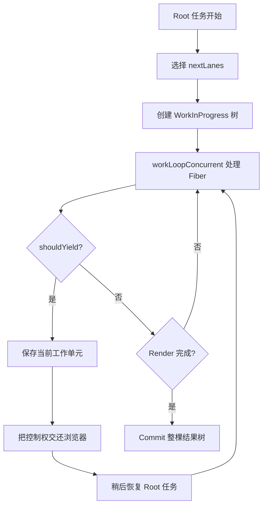

# 第 8 章 Fiber 如何实现可中断渲染

上一章回答了“为什么需要 Fiber”：React 需要把原本依赖调用栈的树遍历工作，转换成可以保存和调度的工作单元。

这一章继续回答：

> Fiber 有了之后，React 具体如何暂停 Render，又如何继续、重新开始或放弃这次工作？

要理解这个问题，必须先区分三个概念：

```text
可中断的 Render
  → React 可以暂停计算下一棵树

可调度的更新
  → React 可以根据优先级安排不同工作

不可随意中断的 Commit
  → 已经开始影响 DOM 的提交需要保持一致
```

“并发渲染”也容易被误解。它不是在浏览器中同时运行多个 JavaScript 线程，而是 React 可以把一段较大的 Render 工作拆开，在工作单元之间让出主线程，并在之后继续处理。

## 本章学习目标

学习完本章，你应该能够：

1. 解释浏览器主线程和帧预算对 React 更新的影响；
2. 区分同步 Render、可中断 Render 和异步 I/O；
3. 理解 `workLoopSync` 与 `workLoopConcurrent` 的差异；
4. 说明 `shouldYield`、时间切片和工作单元之间的关系；
5. 理解 Render 被暂停、重新开始和放弃的条件；
6. 解释为什么 Commit 阶段需要保持连续和一致；
7. 理解 `startTransition` 和 `useTransition` 的基本作用；
8. 了解高优先级用户输入如何打断低优先级更新；
9. 识别并发渲染中的闭包、外部 Store 和 tearing 风险；
10. 从源码入口阅读 React 的并发工作循环。

## 8.1 浏览器为什么需要 React 让出主线程

### 8.1.1 主线程同时承担很多职责

在典型浏览器页面中，主线程可能同时处理：

```text
JavaScript
DOM 事件
样式计算
布局
绘制
滚动
焦点
输入法
```

如果一段 JavaScript 连续执行很久，浏览器没有机会处理其他任务。即使最终计算结果正确，用户也会感到页面卡顿。

### 8.1.2 帧不是 React 的专属概念

以常见的 60Hz 屏幕为例，浏览器大约每 16.67ms 需要准备一次新的画面：

```text
一个显示帧 ≈ 16.67ms
```

这段时间并不全部属于 React：

```text
16.67ms
├─ 浏览器事件和其他任务
├─ React JavaScript
├─ 样式计算
├─ 布局
└─ 绘制与合成
```

如果 React 的一次同步 Render 占用了绝大部分时间，浏览器就可能错过绘制机会。

这个数值只是直觉模型。不同刷新率、设备性能、浏览器实现和页面复杂度都会改变实际预算。现代高刷新率屏幕的单帧预算还会更短。

### 8.1.3 长任务的用户表现

当主线程持续执行长任务时，常见表现包括：

```text
点击后没有立即反馈
输入字符延迟出现
滚动位置不跟手
动画突然停顿
加载指示器不更新
```

因此 React 需要一种方式：

```text
处理一部分 Render
  ↓
检查是否应该让出主线程
  ↓
必要时暂停
  ↓
稍后继续或处理更紧急更新
```

### 8.1.4 React 不能控制浏览器的所有任务

React 只能协调自己负责的工作。下面的任务仍可能阻塞页面：

```text
大 JSON 解析
复杂图片处理
第三方库同步计算
Canvas 大面积绘制
同步布局读取
```

可中断 Render 能缓解 React 自身的长计算，但不能把所有长任务自动变成可中断任务。

## 8.2 同步、异步和并发的区别

### 8.2.1 同步执行

同步函数会在当前调用栈中一直执行到结束：

```ts
function syncWork() {
  for (let index = 0; index < 1_000_000; index += 1) {
    calculate(index);
  }
}

syncWork();
console.log('工作完成');
```

在 `syncWork` 返回之前，当前 JavaScript 执行流不会进入下一条语句。

### 8.2.2 异步 I/O

网络请求的异步表示等待结果时不阻塞当前 JavaScript 调用栈：

```ts
const response = await fetch('/api/data');
```

它解决的是等待外部结果的问题，不代表后续的大计算会自动被拆分。

### 8.2.3 并发渲染

React 的并发渲染主要表示：

```text
Render 工作可以被拆成多个单元
  ↓
单元之间可以让出控制权
  ↓
之后继续、重新开始或放弃
```

同一时刻仍然只有一个 JavaScript 主线程在执行这些代码。并发是调度和可中断能力，不是多个线程同时执行。

### 8.2.4 可中断不等于永远更快

把工作拆开会增加管理成本：

- 需要记录工作位置；
- 需要保存和恢复上下文；
- 可能重新执行已经计算过的 Render；
- 需要处理多个优先级；
- 需要保证最终提交的一致性。

对于很小的更新，直接同步完成可能更简单。可中断能力的主要价值是改善大更新和紧急交互之间的响应关系。

## 8.3 Fiber 工作循环

### 8.3.1 工作单元是暂停边界

上一章中的 `performUnitOfWork` 可以理解为处理一个 Fiber：

```ts
function performUnitOfWork(fiber: Fiber): Fiber | null {
  const next = beginWork(fiber);

  if (next !== null) {
    return next;
  }

  return completeUnitOfWork(fiber);
}
```

React 通常不会在一个普通 JavaScript 函数的任意机器指令之间暂停，而是在完成一个工作单元后检查是否应该让出控制权。

### 8.3.2 同步工作循环

同步 Render 的抽象形式：

```ts
function workLoopSync() {
  while (workInProgress !== null) {
    performUnitOfWork(workInProgress);
  }
}
```

特点是：

```text
只要还有工作，就继续处理
直到整棵 Render 树完成或抛出错误
```

这适合必须立即完成的更新边界，例如某些同步 Root 或显式同步刷新场景。

### 8.3.3 并发工作循环

并发 Render 的抽象形式：

```ts
function workLoopConcurrent() {
  while (
    workInProgress !== null
    && !shouldYield()
  ) {
    performUnitOfWork(workInProgress);
  }
}
```

两种循环的主要区别在于：

```text
workLoopSync
  → 不在工作单元之间主动让出

workLoopConcurrent
  → 根据调度器判断是否让出
```

真实 React 还会处理错误、Suspense、嵌套更新、优先级变化和恢复路径。这个伪代码只表达核心结构。

### 8.3.4 `workInProgress` 保存暂停位置

当时间预算耗尽时，React 可能留下：

```ts
workInProgress !== null
```

它指向下一个尚未完成的 Fiber。下一次工作开始时，React 可以从这个位置继续走树。

但“继续”不是唯一可能性。如果更高优先级更新到来，React 可能选择：

```text
放弃当前低优先级 WorkInProgress
重新从 current 创建一棵新的工作树
先处理高优先级更新
```

## 8.4 `shouldYield` 和时间切片

### 8.4.1 时间切片是什么

时间切片可以理解为把一段工作分成多个时间片：

```text
时间片 1：处理一部分 Fiber
让出主线程
时间片 2：继续处理一部分 Fiber
让出主线程
时间片 3：完成剩余 Fiber
```

每个时间片都不是固定的“处理 N 个节点”，而是根据时间预算、优先级和当前调度状态决定什么时候让出。

### 8.4.2 为什么不能固定每 100 个节点让出

不同 Fiber 的工作量不同：

```text
一个简单文本 Fiber → 工作很少
一个复杂函数组件 → 可能执行很多代码
一个大型子树 → 可能产生大量协调工作
```

因此固定节点数量不能准确代表耗时。调度器更关注时间和任务优先级，而不是只看节点计数。

### 8.4.3 Scheduler 的职责

React Scheduler 可以抽象为负责：

```text
接收不同优先级的任务
安排任务执行时机
判断当前时间是否接近预算结束
在任务之间让出主线程
在必要时继续安排任务
```

Scheduler 和 Fiber 的职责不同：

```text
Fiber
  → 表示具体的树节点和 Render 工作

Scheduler
  → 安排这些工作何时执行
```

### 8.4.4 浏览器调度 API 的变化

React 的调度实现会根据运行环境和版本使用不同机制，例如：

```text
MessageChannel
setTimeout
postTask 或其他宿主调度能力
```

不要把某一个浏览器 API 直接等同于 React 的完整调度器。React 需要在不同环境中提供相似的任务调度语义，具体实现可能变化。

### 8.4.5 让出控制权后发生什么

一个抽象流程是：

```text
Render 开始
  ↓
处理 Fiber A
  ↓
处理 Fiber B
  ↓
shouldYield() = true
  ↓
保存 workInProgress
  ↓
把控制权交回宿主环境
  ↓
稍后再次执行 Render 任务
  ↓
从保存的位置继续
```

让出控制权不会自动把结果提交到 DOM。只有 Render 完成，React 才能进入 Commit。

## 8.5 Render 被暂停、继续和重新开始

### 8.5.1 暂停

当 Render 没有完成但调度器要求让出控制权时，可以暂停：

```text
current：已经提交的旧树
workInProgress：计算到中途的新树
workInProgress 指针：下一个待处理 Fiber
```

此时用户仍然看到 current 对应的 DOM。

### 8.5.2 继续

如果没有更紧急的更新，React 可以继续原来的工作：

```text
workInProgress 指针
  ↓
performUnitOfWork
  ↓
继续 begin / complete
```

### 8.5.3 重新开始

如果当前 Render 依赖的输入发生改变，React 可能需要从根部重新计算一部分树：

```text
旧 workInProgress 的输入过期
  ↓
丢弃或重置部分工作
  ↓
根据最新 current 和更新队列重新 Render
```

并发渲染下，组件函数可能执行多次。组件 Render 必须保持纯净，不能假设“函数只会执行一次”。

### 8.5.4 放弃

低优先级工作可能还没完成，就被更高优先级工作替代：

```text
低优先级：渲染大型列表
  ↓
用户输入到来
  ↓
暂停或放弃列表 Render
  ↓
先处理输入框更新
  ↓
之后重新计算列表
```

放弃 WorkInProgress 不等于丢失已提交 State。current 树和更新队列仍然是 React 恢复工作的依据。

### 8.5.5 Render 的结果不是立即可见结果

在 Render 期间：

```text
组件函数可以执行
Hook 可以读取和计算
Fiber 可以创建或更新
```

但这些不表示用户已经看到新页面。只有 Commit 阶段开始后，变化才会进入 DOM。

## 8.6 为什么 Commit 阶段通常不能随意中断

### 8.6.1 Render 可以计算，Commit 会改变外部环境

Render 主要处理 React 内部结构：

```text
创建 Fiber
读取 State
生成 Element
计算 flags
```

Commit 会执行外部操作：

```text
插入 DOM
更新属性
删除节点
设置 Ref
运行布局相关逻辑
```

外部操作一旦开始，React 就需要保证结果最终一致。

### 8.6.2 中途停在 DOM 更新会产生半成品

如果 Commit 处理到一半就停很久，用户可能看到：

```text
父节点已经更新
子节点还保持旧内容
旧节点已删除
新节点还没有插入
```

因此 React 通常让 Commit 保持连续完成。Commit 也可能很大，但它的正确性要求高于 Render 的可中断性。

### 8.6.3 Commit 仍然可能包含多个内部阶段

Commit 不是单一步骤，可以抽象为：

```text
Before Mutation
  ↓
Mutation
  ↓
Layout
  ↓
Passive Effects
```

这些阶段有不同职责，但它们共同处理已经完成的 Render 结果。

### 8.6.4 `useLayoutEffect` 和 `useEffect`

```tsx
useLayoutEffect(() => {
  const height = elementRef.current?.getBoundingClientRect().height;
  setHeight(height ?? 0);
}, []);

useEffect(() => {
  document.title = '页面标题';
}, []);
```

`useLayoutEffect` 与 DOM 提交后的同步布局流程关系更紧，适合需要在浏览器绘制前读取布局的场景；`useEffect` 通常在提交后异步调度，适合网络、订阅和非阻塞副作用。

两者都需要谨慎使用。布局读取和同步更新可能增加 Commit 到绘制之间的阻塞时间。

## 8.7 高优先级更新如何打断低优先级更新

### 8.7.1 一个典型场景

页面有一个搜索框和一个大型结果列表：

```tsx
function SearchPage() {
  const [query, setQuery] = useState('');
  const [results, setResults] = useState<Result[]>([]);

  return (
    <>
      <input value={query} onChange={(event) => setQuery(event.target.value)} />
      <ResultList results={results} query={query} />
    </>
  );
}
```

用户输入时，React 可能同时需要：

```text
更新输入框 value
重新计算列表筛选结果
重新渲染大量列表项
```

输入框反馈通常比列表内容更紧急。

### 8.7.2 更新优先级的抽象

可以把更新分成：

```text
紧急更新
  → 用户输入、点击反馈、焦点变化

非紧急更新
  → 大列表筛选、图表重算、复杂结果展示
```

React 使用 Lane 表示更新优先级集合。第 10 章会详细解释 Lane 的位掩码模型。

### 8.7.3 `startTransition`

```tsx
import { startTransition, useState } from 'react';

function SearchPage() {
  const [query, setQuery] = useState('');
  const [results, setResults] = useState<Result[]>([]);

  function handleChange(event: React.ChangeEvent<HTMLInputElement>) {
    const nextQuery = event.target.value;

    setQuery(nextQuery);

    startTransition(() => {
      setResults(filterResults(nextQuery));
    });
  }

  return (
    <>
      <input value={query} onChange={handleChange} />
      <ResultList results={results} />
    </>
  );
}
```

它表达的是：

```text
query 更新需要尽快反馈
results 更新可以作为非紧急过渡处理
```

`startTransition` 不会让 `filterResults` 这段同步 JavaScript 自动变成后台线程。它主要告诉 React：这次 State 更新可以使用较低优先级处理，并在更紧急更新到来时让路。

### 8.7.4 `useTransition`

```tsx
import { useState, useTransition } from 'react';

function SearchPage() {
  const [query, setQuery] = useState('');
  const [results, setResults] = useState<Result[]>([]);
  const [isPending, startTransition] = useTransition();

  function handleChange(event: React.ChangeEvent<HTMLInputElement>) {
    const nextQuery = event.target.value;
    setQuery(nextQuery);

    startTransition(() => {
      setResults(filterResults(nextQuery));
    });
  }

  return (
    <section>
      <input value={query} onChange={handleChange} />
      {isPending ? <p>正在更新结果……</p> : null}
      <ResultList results={results} />
    </section>
  );
}
```

`isPending` 用于告诉 UI：过渡更新还没有完成。

### 8.7.5 Transition 不能包住受控输入的紧急值

下面的写法可能让输入框本身变得不及时：

```tsx
startTransition(() => {
  setQuery(nextQuery);
  setResults(filterResults(nextQuery));
});
```

更常见的做法是：

```tsx
setQuery(nextQuery);

startTransition(() => {
  setResults(filterResults(nextQuery));
});
```

输入框的受控值通常需要同步反映用户输入，而昂贵的结果展示可以进入 Transition。

### 8.7.6 Transition 不是防抖

防抖的目标是减少函数调用次数：

```text
连续输入
  ↓
等待一段时间没有新输入
  ↓
只执行一次请求或计算
```

Transition 的目标是调整 React 更新优先级：

```text
更新仍然可以开始
  ↓
遇到更紧急工作时让路
  ↓
之后继续处理
```

两者可以一起使用，但解决的问题不同。

## 8.8 并发 Render 中的纯度和一致性

### 8.8.1 组件函数可能被执行多次

```tsx
function Report({ data }: { data: Data }) {
  console.log('Render Report');
  return <Summary data={data} />;
}
```

在并发 Render、Strict Mode、错误恢复或重新开始场景中，日志可能出现多次。不能把组件函数执行次数当作业务事件次数。

### 8.8.2 不要在 Render 中修改外部变量

错误：

```tsx
let renderCount = 0;

function Component() {
  renderCount += 1;
  return <p>{renderCount}</p>;
}
```

如果 Render 被重新执行或放弃，`renderCount` 就会记录并不等于已提交界面的次数。

如果需要统计提交后的变化，可以使用 Effect 或专门的性能 API：

```tsx
function Component() {
  useEffect(() => {
    recordCommittedView();
  }, []);

  return <p>内容</p>;
}
```

### 8.8.3 不要在 Render 中注册订阅

错误：

```tsx
function Component() {
  externalStore.subscribe(() => {
    console.log('changed');
  });

  return null;
}
```

每次 Render 都可能添加新的订阅，而且中断的 Render 可能永远不会对应清理。

应使用专门的外部 Store Hook，或者至少在正确的 Effect 生命周期中配对订阅和取消：

```tsx
useEffect(() => {
  const unsubscribe = externalStore.subscribe(handleChange);
  return unsubscribe;
}, [handleChange]);
```

对于需要并发一致性保证的外部 Store，应优先考虑 `useSyncExternalStore`。

## 8.9 Tearing：并发读取中的不一致

### 8.9.1 什么是 tearing

假设 React 正在计算一棵较大的树，外部 Store 在中间发生变化：

```text
组件 A 读取 Store = 1
Render 暂停
Store 变成 2
组件 B 读取 Store = 2
Render 继续
```

如果同一轮 Render 里不同组件读到了不同版本，就可能出现 tearing，也就是撕裂式不一致。

### 8.9.2 普通全局变量容易产生问题

```ts
let currentValue = 0;

function ComponentA() {
  return <p>{currentValue}</p>;
}

function ComponentB() {
  return <p>{currentValue}</p>;
}
```

如果 `currentValue` 在 Render 过程中被外部修改，React 没有统一的订阅和快照协议来保证所有组件读取同一个版本。

### 8.9.3 `useSyncExternalStore`

React 提供了用于读取外部 Store 的 API：

```tsx
import { useSyncExternalStore } from 'react';

function useOnlineStatus() {
  return useSyncExternalStore(
    (onStoreChange) => {
      window.addEventListener('online', onStoreChange);
      window.addEventListener('offline', onStoreChange);

      return () => {
        window.removeEventListener('online', onStoreChange);
        window.removeEventListener('offline', onStoreChange);
      };
    },
    () => navigator.onLine,
    () => true,
  );
}
```

这个 API 让 React 知道：

```text
如何订阅 Store
如何读取当前快照
服务端渲染时如何读取快照
```

React 可以据此在并发场景中检查快照是否一致。

### 8.9.4 外部 Store 的实现责任

如果自己实现外部 Store，需要明确：

```text
订阅函数是否能正确取消
getSnapshot 是否返回稳定且可比较的快照
Store 变化是否通知所有订阅者
变化期间是否可能返回互相矛盾的版本
```

并发 React 不会自动修复一个没有一致性协议的全局可变对象。

## 8.10 Suspense 与可中断 Render

### 8.10.1 Suspense 的基本关系

Suspense 允许组件声明某部分内容暂时还不能完成：

```tsx
<Suspense fallback={<Loading /> }>
  <ProfilePage />
</Suspense>
```

当子树暂停时，React 可以显示 `fallback`，并在数据或资源准备好后重新尝试子树。

### 8.10.2 Suspense 不是普通 try/catch

React 的 Suspense 机制涉及特殊的 Promise 或资源读取协议：

```text
子树读取未完成资源
  ↓
Render 暂停或标记边界
  ↓
显示 fallback 或保留旧内容
  ↓
资源完成
  ↓
重新尝试子树 Render
```

具体数据获取方案和框架集成方式会影响实际行为。不要把任意异步函数直接放进组件 Render 就认为会自动得到 Suspense 支持。

### 8.10.3 Transition 与 Suspense 的配合

在切换页面或大块内容时，Transition 可以帮助 React 把新内容当作非紧急更新处理，Suspense 则负责在新内容未准备好时显示合适的加载状态。

```tsx
startTransition(() => {
  setPage(nextPage);
});
```

具体是显示 fallback、保留旧 UI 还是延迟切换，要结合 Suspense 边界和资源读取方式判断。

## 8.11 错误、异常和被放弃的 Render

### 8.11.1 Render 抛错不等于 DOM 已更新

如果组件在 Render 阶段抛出错误：

```tsx
function Component() {
  throw new Error('Render failed');
}
```

React 可能中止当前 Render，并寻找错误边界处理。已经提交的 current DOM 通常仍然是之前的结果，除非错误恢复流程产生了新的 Commit。

### 8.11.2 错误边界提供恢复范围

```tsx
class ErrorBoundary extends React.Component {
  state = { hasError: false };

  static getDerivedStateFromError() {
    return { hasError: true };
  }

  render() {
    if (this.state.hasError) {
      return <p>页面加载失败</p>;
    }

    return this.props.children;
  }
}
```

现代应用也可以通过框架提供的错误边界和路由错误处理机制组织恢复。核心思想是：

```text
某个子树 Render 失败
  ↓
由边界决定显示替代内容
  ↓
其他已提交内容保持可用
```

### 8.11.3 Render 可能重新执行，提交只发生在完成之后

这也是为什么 Render 中不应写：

```tsx
sendPaymentRequest();
createOrder();
writeToLocalStorage();
```

如果 Render 被重试或放弃，这些操作可能执行多次，甚至执行了却没有对应的可见 UI。

## 8.12 同步更新和 `flushSync`

### 8.12.1 普通更新可以被批量处理

```tsx
function handleClick() {
  setCount((value) => value + 1);
  setOpen(true);
}
```

React 通常会把多个更新放入同一轮调度和提交中。

### 8.12.2 `flushSync` 提高同步边界

```tsx
import { flushSync } from 'react-dom';

function handleClick() {
  flushSync(() => {
    setOpen(true);
  });

  const panel = document.querySelector('#panel');
  console.log(panel?.getBoundingClientRect());
}
```

它适合确实需要在当前回调中读取已更新 DOM 的集成边界。

### 8.12.3 `flushSync` 的代价

`flushSync` 可能：

- 强制 React 提前完成部分工作；
- 减少批处理和调度机会；
- 触发额外的 Effect；
- 增加当前交互延迟；
- 让本来可以延后的工作变成同步工作。

它不能用来解决普通的 State 快照理解问题，也不能作为所有更新的默认写法。

## 8.13 源码阅读：可中断 Render 的入口

### 8.13.1 从 Root 调度到 Render

可以先关注这条抽象路径：

```text
scheduleUpdateOnFiber
  ↓
ensureRootIsScheduled
  ↓
调度一个 Root 任务
  ↓
performConcurrentWorkOnRoot
  ↓
renderRootConcurrent
  ↓
workLoopConcurrent
```

如果更新必须同步处理，路径可能进入：

```text
performSyncWorkOnRoot
  ↓
renderRootSync
  ↓
workLoopSync
```

### 8.13.2 一次可中断 Render 的状态变化



暂停发生在 Render 工作单元之间，已经提交的 DOM 不会被并发 Render 改成半新半旧。恢复时 React 还要重新检查 Root 上是否出现了更高优先级的 Lane；如果出现，当前工作可能被重启或改选。

一次过程可以记录为：

```text
开始：Root.pendingLanes = TransitionLane
处理：完成 Header，当前指针停在 ResultList
让出：WorkInProgress 保留，current DOM 仍是旧结果
插入输入更新：Root.pendingLanes 同时包含 SyncLane
恢复：优先完成 SyncLane，再继续或重做 TransitionLane
提交：只提交完成且通过一致性检查的结果
```

### 8.13.3 `performConcurrentWorkOnRoot`

这个入口需要处理：

- 当前 Root 有哪些待处理 Lane；
- 本次应该使用同步还是并发 Render；
- Render 是否完成；
- Render 是否被挂起；
- 是否需要继续安排任务；
- 是否进入 Commit。

可以用伪代码表示：

```ts
function performConcurrentWorkOnRoot(root: FiberRoot) {
  const lanes = getNextLanes(root);
  const exitStatus = renderRootConcurrent(root, lanes);

  if (exitStatus === RootCompleted) {
    commitRoot(root);
  } else {
    ensureRootIsScheduled(root);
  }
}
```

真实逻辑还会处理 Suspense、错误、恢复、Passive Effects 和优先级变化。

### 8.13.4 `renderRootConcurrent`

```ts
function renderRootConcurrent(root: FiberRoot, lanes: Lanes) {
  prepareFreshStack(root, lanes);

  do {
    try {
      workLoopConcurrent();
      break;
    } catch (error) {
      handleRenderError(root, error);
    }
  } while (true);

  return getRootExitStatus(root);
}
```

重点不是伪代码中的具体实现，而是：

```text
准备 WorkInProgress
  ↓
运行可让出的工作循环
  ↓
根据完成、暂停或错误返回状态
```

### 8.13.5 `shouldYieldToHost`

Scheduler 内部通常会有判断是否让出宿主环境的逻辑，名称可能类似：

```text
shouldYieldToHost
shouldYield
getCurrentTime
requestHostCallback
```

阅读时要注意：

- Scheduler 的时间判断和 React 的 Lane 优先级是两个层次；
- `shouldYield` 只表示当前是否适合继续执行一段工作；
- 是否重新开始 Render 还取决于 Root 上的更新和树状态。

### 8.13.6 版本差异

React 18/19 的并发实现会持续演进：

- 内部函数名可能变化；
- Scheduler 的宿主实现可能变化；
- Lane 组合和恢复策略可能变化；
- Server Components 和新异步 API 可能引入额外路径。

阅读源码时，先验证当前分支和构建版本，再把稳定概念与实现细节分开记录。

## 8.14 业务中的并发更新设计

### 8.14.1 搜索输入和结果列表

推荐把紧急输入和非紧急展示分开：

```tsx
function SearchBox() {
  const [input, setInput] = useState('');
  const [query, setQuery] = useState('');

  function handleChange(event: React.ChangeEvent<HTMLInputElement>) {
    const nextValue = event.target.value;
    setInput(nextValue);

    startTransition(() => {
      setQuery(nextValue);
    });
  }

  return (
    <>
      <input value={input} onChange={handleChange} />
      <SearchResults query={query} />
    </>
  );
}
```

如果查询还要发起网络请求，还需要处理：

```text
请求取消
旧响应丢弃
加载状态
错误状态
缓存
```

Transition 只负责更新优先级，不会自动取消网络请求。

### 8.14.2 标签页切换

```tsx
function Tabs() {
  const [tab, setTab] = useState('overview');
  const [isPending, startTransition] = useTransition();

  function selectTab(nextTab: string) {
    startTransition(() => {
      setTab(nextTab);
    });
  }

  return (
    <section>
      <TabButtons current={tab} onSelect={selectTab} />
      {isPending ? <LoadingIndicator /> : null}
      <TabPanel tab={tab} />
    </section>
  );
}
```

如果 Tab 按钮的选中状态需要立即反馈，可以把“按钮当前选择”与“大面板内容”拆成两个状态，而不是让整个交互都变成低优先级。

### 8.14.3 流式消息

流式消息更新通常需要保持顺序：

```tsx
setMessage((current) => ({
  ...current,
  content: current.content + chunk,
}));
```

如果消息追加频率很高，可以进一步考虑：

- 合并一小段时间内的 chunk；
- 使用 `requestAnimationFrame` 控制视觉刷新频率；
- 将当前流式消息和历史消息分开；
- 为每次请求分配 ID；
- 取消或忽略旧请求。

Transition 可以影响 React 更新优先级，但不能替代数据流的顺序和取消控制。

## 8.15 性能分析方法

### 8.15.1 先看长任务

浏览器 Performance 面板中可以先确认：

```text
是否存在超过 50ms 的长任务
长任务来自 React 还是其他代码
是否发生大量布局和绘制
输入事件与响应之间延迟多长
```

### 8.15.2 再看 React Render

React Profiler 可以帮助观察：

```text
哪个组件重新渲染
每次 Render 持续多久
哪些子组件没有必要执行
Commit 花费多少时间
```

不要只看组件函数执行次数，也要看实际耗时和最终 DOM 变化。

### 8.15.3 不要用日志判断可中断行为

```tsx
console.log('render', componentName);
```

日志本身可能改变性能表现，也不能直接告诉你：

- Render 是否被暂停；
- 是否重新开始；
- 是否进入 Commit；
- 浏览器何时绘制。

应结合 Profiler、Performance 时间线和用户可见响应进行判断。

## 8.16 常见错误与修复方式

### 8.16.1 把 Transition 当成后台线程

错误理解：

```text
startTransition 会把计算放到另一个线程
```

准确理解：

```text
startTransition 把 State 更新标记为非紧急过渡
React 可以用较低优先级调度这次更新
```

如果回调中直接执行很大的同步计算，这个计算仍然发生在当前 JavaScript 线程。

### 8.16.2 把防抖和 Transition 混为一谈

```tsx
const debouncedQuery = useDebounce(input, 300);
```

这是延迟或合并输入值。

```tsx
startTransition(() => {
  setResults(nextResults);
});
```

这是告诉 React 更新优先级不同。

复杂搜索场景可能同时需要两者：防抖减少请求，Transition 保持输入响应。

### 8.16.3 在 Render 中执行网络请求

错误：

```tsx
function User({ id }: { id: string }) {
  fetch(`/api/users/${id}`);
  return null;
}
```

并发 Render 可能执行多次，导致重复请求。网络请求应交给数据获取层、Effect、框架加载机制或支持 Suspense 的资源系统。

### 8.16.4 假设 Render 只执行一次

错误：

```tsx
let created = false;

function Component() {
  if (!created) {
    createExternalResource();
    created = true;
  }

  return null;
}
```

这个全局标记不能可靠地表达组件生命周期，也无法处理多个实例和重新挂载。资源创建和清理应跟随组件或外部资源的明确生命周期。

### 8.16.5 用 `flushSync` 解决所有延迟

如果只是想在同一个事件函数中读取最新 State，`flushSync` 通常不是正确答案：

```tsx
const nextValue = value + 1;
setValue(nextValue);
console.log(nextValue);
```

如果需要读取提交后的 DOM，再考虑是否确实需要同步刷新。

## 8.17 官方行为、源码细节与工程结论

### 官方行为

可以依赖的高层模型包括：

- React 可以把部分更新作为并发 Render 处理；
- Render 阶段可能被暂停、重新开始或放弃；
- Commit 阶段负责把完成的结果提交到宿主环境；
- `startTransition` 用于标记非紧急更新；
- `useTransition` 可以提供过渡中的 Pending 状态；
- Render 代码需要保持纯净；
- 外部 Store 需要通过适合并发读取的订阅和快照协议接入。

### 源码视角

阅读可中断 Render 时，可以关注：

- `performConcurrentWorkOnRoot`；
- `performSyncWorkOnRoot`；
- `renderRootConcurrent`；
- `renderRootSync`；
- `workLoopConcurrent`；
- `workLoopSync`；
- `performUnitOfWork`；
- `completeUnitOfWork`；
- `shouldYieldToHost`；
- `requestHostCallback`；
- `scheduleCallback`；
- `startTransition`；
- `useTransition`；
- `useSyncExternalStore`。

### 工程结论

- 可中断 Render 主要改善大更新和紧急交互之间的响应关系；
- 并发渲染不是多线程，也不会自动拆分任意 JavaScript 计算；
- `workInProgress` 是恢复 Render 位置的重要依据；
- 更高优先级更新可能让低优先级 Render 暂停、重新开始或放弃；
- Commit 需要保持外部结果的一致性；
- Transition、Debounce、Throttle 和 Web Worker 解决的是不同问题；
- 外部可变 Store 要考虑并发读取中的一致性；
- 组件 Render 中不能执行依赖“只发生一次”的副作用；
- 性能分析要结合浏览器长任务、React Profiler 和真实交互延迟。

## 8.18 面试重点：可中断渲染

### React 如何实现可中断渲染？

> Fiber 把树节点和遍历状态保存成显式工作单元，React 通过 `workInProgress` 指向当前工作，并在 `workLoopConcurrent` 中逐个处理 Fiber。每完成一个工作单元，调度器可以检查是否应该让出主线程。如果需要让出，React 保留当前工作位置，稍后继续、重新开始或处理更高优先级更新。

### 可中断渲染是多线程吗？

> 不是。React 并发渲染仍然运行在 JavaScript 主线程上。它通过拆分工作、在单元之间让出控制权和按优先级安排任务来改善响应性。真正的多线程需要 Web Worker 等浏览器机制，React Fiber 本身不创建线程。

### Render 和 Commit 为什么要分开？

> Render 主要计算下一版 Fiber 树，可能被暂停、重做或放弃；Commit 会修改 DOM、设置 Ref 和运行相关副作用，需要把结果一致地交给外部环境。分开后，React 可以在内部准备完整结果，避免用户看到半更新的 DOM。

### `startTransition` 做了什么？

> 它把回调中的 State 更新标记为非紧急 Transition。React 可以降低这些更新的处理优先级，让用户输入等更紧急更新优先完成，并在需要时中断或重做过渡 Render。它不会创建后台线程，也不会自动防抖或取消网络请求。

### 为什么组件 Render 必须保持纯净？

> 并发 Render 可能暂停、重试或放弃，组件函数可能执行多次而不一定对应一次 Commit。如果在 Render 中发请求、写 DOM、注册订阅或修改全局变量，这些副作用可能重复发生或没有正确清理。副作用应该放到事件处理函数、Effect、数据层或专门的资源机制中。

### 什么是 tearing？

> tearing 指同一轮并发 Render 中，不同组件读取了外部可变 Store 的不同版本，导致 UI 内部不一致。接入外部 Store 时需要稳定的订阅函数和快照读取函数，React 提供的 `useSyncExternalStore` 用于表达这类协议。

## 8.19 本章小结

1. 浏览器主线程需要同时处理 JavaScript、事件、布局和绘制；
2. 大型同步 Render 可能阻塞输入和绘制；
3. 并发渲染表示 React 可以拆分、暂停和重新安排 Render 工作；
4. `workLoopConcurrent` 在工作单元之间检查是否应该让出控制权；
5. `workInProgress` 保存当前尚未完成的工作位置；
6. Render 可能继续、重新开始或被更高优先级更新放弃；
7. Commit 会影响 DOM 和外部环境，通常需要连续完成；
8. `startTransition` 调整更新优先级，但不会创建线程或自动防抖；
9. `useTransition` 提供过渡更新的 Pending 状态；
10. 外部 Store 在并发读取中需要避免 tearing；
11. Render 必须保持纯净，副作用要放在正确的生命周期边界；
12. Fiber 的可中断能力改善调度空间，但不等于所有代码自动变快。

可以把本章浓缩成一句话：

> React 通过 Fiber 工作单元、时间预算和优先级调度，让 Render 可以在合适的位置让出主线程，再继续或重做计算；完成后的结果仍然要经过连续的 Commit 才能进入 DOM。

## 8.20 练习题与参考答案

### 练习 1：同步和并发工作循环有什么区别？

**参考答案：** `workLoopSync` 只要还有 Fiber 工作就继续处理，直到 Render 完成；`workLoopConcurrent` 会在工作单元之间检查是否应该让出主线程，因此可以暂停并在稍后继续。两者都处理 Fiber 树，区别在于是否允许根据调度状态让出。

### 练习 2：为什么不能在 Render 中发送请求？

**参考答案：** 并发 Render 可能被重试或放弃，组件函数也可能执行多次。把请求放在 Render 中可能导致重复请求，且请求结果不一定对应最终提交的 UI。应使用数据获取层、Effect、框架加载机制或支持 Suspense 的资源系统。

### 练习 3：Transition 和防抖有什么不同？

**参考答案：** 防抖通过等待一段时间合并连续输入，减少请求或计算次数；Transition 通过降低 React 更新优先级，让更紧急的更新先处理。防抖控制“什么时候开始”，Transition 控制“React 如何安排已经开始的更新”。

### 练习 4：为什么 Commit 不像 Render 一样随意暂停？

**参考答案：** Render 主要修改 React 内部的 WorkInProgress 结构，暂停不会直接改变用户看到的 DOM；Commit 会插入、更新和删除 DOM。如果中途长期暂停，用户可能看到新旧节点混合的半成品。因此 Commit 通常需要保持连续和一致。

### 练习 5：修复外部 Store 读取问题

```tsx
let value = 0;

function Widget() {
  return <p>{value}</p>;
}
```

**参考答案：** 不应让组件直接依赖没有订阅协议的全局变量。可以把状态提升到 React State，或为 Store 提供 subscribe、getSnapshot，再使用 `useSyncExternalStore` 接入。核心是让 React 知道数据何时变化以及当前一致快照是什么。

### 练习 6：面试表达

请用不超过 1 分钟回答“React 并发渲染是什么”。

**参考答案：**

> React 并发渲染是基于 Fiber 的可调度 Render 模型。React 把组件树处理拆成多个工作单元，在工作单元之间根据时间预算和更新优先级决定是否让出主线程。暂停后可以从 `workInProgress` 位置继续，也可能因为更高优先级更新而重新开始或放弃当前工作。并发渲染仍然运行在单个 JavaScript 主线程上，完成的结果最后要经过 Commit 一致地应用到 DOM。

---

下一章将讲解 **React 的 Reconciliation 与 Diff**，重点回答：

```text
React 如何比较新旧子节点？
为什么 key 会影响节点复用？
单节点 Diff 和多节点 Diff 有什么区别？
列表中的插入、删除和移动如何被识别？
为什么 index 作为 key 可能造成状态错位？
```
