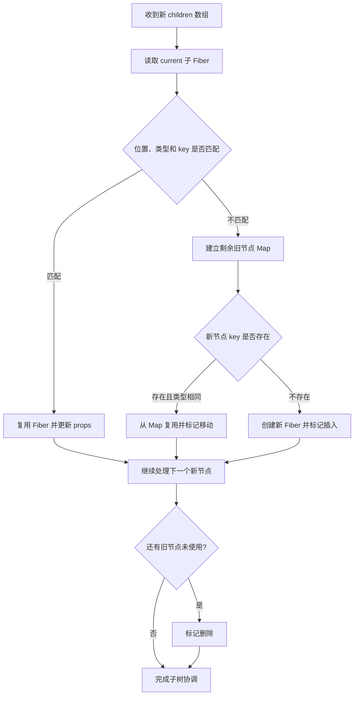

# 第 9 章 React 的 Reconciliation 与 Diff

上一章介绍了 Fiber 如何把 Render 拆成可调度工作。现在需要回答一个更具体的问题：

> 新一轮 Render 产生了新的 React Element，React 如何知道哪些旧 Fiber 可以复用，哪些需要插入、删除或移动？

这个过程通常被称为 Reconciliation，中文常译为协调。它发生在 Render 阶段，目标是根据新旧子节点计算下一棵 Fiber 子树，以及需要在 Commit 阶段执行的变化。

很多文章会把它简单称为“Virtual DOM Diff”，但实际过程比逐个对象比较更具体：

- React 要比较的是不同类型的节点、文本、Fragment、组件和列表；
- React 要维护 Fiber 身份、Hook State 和 DOM 复用关系；
- `key` 参与列表节点身份匹配；
- Diff 结果会生成 Fiber 和副作用标记；
- 真正的 DOM 插入、删除和移动在 Commit 阶段执行。

## 本章学习目标

学习完本章，你应该能够：

1. 解释 Reconciliation 发生在 Render 的哪一个阶段；
2. 区分 React Element、旧 Fiber 和新 WorkInProgress Fiber；
3. 理解单节点 Diff 与多节点 Diff 的处理差异；
4. 说明元素类型和 `key` 如何决定节点身份；
5. 理解列表节点的复用、插入、删除和移动；
6. 理解 `lastPlacedIndex` 的作用；
7. 解释为什么数组索引作为 key 可能导致状态错位；
8. 理解 `Placement`、`Deletion`、`Update` 等标记；
9. 识别 Fragment、文本和空值子节点的处理方式；
10. 从源码入口阅读 `reconcileChildFibers` 相关逻辑。

## 9.1 Reconciliation 在整个更新链路中的位置

### 9.1.1 从 State 更新到子节点协调

以按钮更新 State 为例：

```tsx
function Counter() {
  const [count, setCount] = useState(0);

  return <button onClick={() => setCount(count + 1)}>{count}</button>;
}
```

更新链路可以抽象为：

```text
调用 setCount
  ↓
创建 Update 并调度 FiberRoot
  ↓
创建或复用 WorkInProgress Fiber
  ↓
执行 Counter
  ↓
得到新的 button Element 和文本 Element
  ↓
Reconciliation：比较旧 Fiber 与新 Element
  ↓
设置复用、更新或插入标记
  ↓
完成 Render
  ↓
Commit 阶段修改 DOM
```

### 9.1.2 Reconciliation 不是 Commit

Reconciliation 主要回答：

```text
新旧节点是否能复用？
应该生成哪一个 WorkInProgress Fiber？
哪些节点需要插入、更新、删除或移动？
```

Commit 主要执行：

```text
把这些结果应用到 DOM
```

因此下面的描述不够准确：

```text
React Diff 的时候已经把 DOM 改了
```

更准确的说法是：

```text
Render 阶段协调新旧 Fiber，并记录变化；
Commit 阶段根据这些变化修改 DOM。
```

### 9.1.3 每次都重新创建 Element，不等于每次都重建 DOM

组件函数每次执行可能产生新的对象：

```tsx
function App() {
  return <button className="primary">保存</button>;
}
```

新旧 Render 可能分别得到两个不同的 Element 对象：

```text
旧 Element !== 新 Element
```

但如果类型、key 和位置都一致，React 可以复用对应 Fiber 和 DOM，只更新必要属性。

React 比较的是节点的结构和身份条件，而不是简单比较 Element 对象引用。

## 9.2 React 判断节点身份的基本规则

### 9.2.1 同一位置、同一类型通常可以复用

```tsx
function Page({ title }: { title: string }) {
  return <h1>{title}</h1>;
}
```

如果两次 Render 都是在同一个位置返回 `h1`，React 通常可以复用对应 Fiber 和 DOM：

```text
旧：h1，文本“旧标题”
新：h1，文本“新标题”
结果：复用 h1，更新文本
```

### 9.2.2 类型变化通常意味着新的节点身份

```tsx
function Page({ compact }: { compact: boolean }) {
  return compact ? <span>内容</span> : <div>内容</div>;
}
```

同一个位置从 `span` 变成 `div`，宿主类型变化，React 通常会删除旧节点并创建新的节点：

```text
旧 Fiber：span
新 Fiber：div
结果：删除 span，创建 div
```

如果组件类型变化，也可能导致组件 State 被重置：

```tsx
return mode === 'a' ? <EditorA /> : <EditorB />;
```

### 9.2.3 `key` 参与列表身份匹配

```tsx
items.map((item) => (
  <Row key={item.id} item={item} />
));
```

React 主要使用以下信息匹配列表节点：

```text
key
元素类型
父节点范围
```

相同 key 但类型不同，也不能简单认为是同一个节点：

```tsx
<Row key="a" />
<Card key="a" />
```

类型变化仍然可能导致旧 Fiber 被删除、新 Fiber 被创建。

### 9.2.4 key 只在同一父节点范围内有意义

下面两个节点的 key 都是 `item-1`，并不表示它们是同一个节点：

```tsx
<LeftPanel>
  <Row key="item-1" />
</LeftPanel>

<RightPanel>
  <Row key="item-1" />
</RightPanel>
```

key 的匹配范围通常是同一个父 Fiber 的子节点集合。

## 9.3 单节点 Diff

### 9.3.1 什么是单节点

组件返回以下内容时，可以视为单节点场景：

```tsx
return <Panel />;
```

```tsx
return condition ? <Panel /> : null;
```

```tsx
return '文本';
```

```tsx
return <>{children}</>;
```

实际实现会区分 Element、文本、Fragment、Portal 和空值等类型，但它们都不是“多个并列数组子节点”的主要路径。

### 9.3.2 单节点复用条件

可以用简化规则表示：

```text
旧 Fiber 存在
且新旧 key 相同
且新旧类型兼容
  → 复用 Fiber
否则
  → 删除旧 Fiber，创建新 Fiber
```

伪代码：

```ts
function reconcileSingleElement(
  returnFiber: Fiber,
  currentFirstChild: Fiber | null,
  element: ReactElement,
): Fiber {
  let child = currentFirstChild;

  while (child !== null) {
    if (child.key === element.key) {
      if (child.elementType === element.type) {
        deleteRemainingChildren(returnFiber, child.sibling);
        return useFiber(child, element.props);
      }

      deleteRemainingChildren(returnFiber, child);
      break;
    }

    deleteChild(returnFiber, child);
    child = child.sibling;
  }

  return createFiberFromElement(element);
}
```

这段代码省略了 Fragment、兼容类型、Ref 和开发环境校验，但表达了核心：

```text
先匹配 key
再判断类型
匹配成功则复用
剩余旧节点需要删除
```

### 9.3.3 单节点的 key 仍然有作用

虽然 key 最常见于数组，但单节点也可以使用 key 控制身份：

```tsx
<Editor key={documentId} documentId={documentId} />
```

`documentId` 变化时，key 变化，React 会创建新的身份，Editor 内部 State 可以从初始值重新开始。

### 9.3.4 单节点从有到无

```tsx
return visible ? <Panel /> : null;
```

当 `visible` 从 `true` 变为 `false`：

```text
旧 Panel Fiber 存在
新 children = null
  ↓
标记 Panel 删除
  ↓
Commit 阶段移除对应 DOM 和子树
```

### 9.3.5 单节点从无到有

```text
旧 children = null
新 children = <Panel />
  ↓
创建 Panel Fiber
  ↓
标记 Placement
  ↓
Commit 阶段插入对应宿主节点
```

## 9.4 多节点 Diff

### 9.4.1 数组子节点

```tsx
<ul>
  {items.map((item) => (
    <li key={item.id}>{item.name}</li>
  ))}
</ul>
```

React 需要处理：

```text
旧数组：A、B、C
新数组：B、C、D
```

可能的结果是：

```text
A 被删除
B 复用
C 复用
D 插入
```

如果顺序变化：

```text
旧数组：A、B、C
新数组：C、A、B
```

React 需要识别 C、A、B 的身份，并决定是否需要移动宿主节点。

### 9.4.2 多节点 Diff 的简化步骤

实际算法会有优化路径，可以先理解为：

```text
第一阶段：从左到右尝试匹配
  ↓
如果旧节点和新节点按顺序匹配，继续快速遍历
  ↓
遇到不匹配时，建立剩余旧节点的 Map
  ↓
第二阶段：根据 key 或索引查找可复用节点
  ↓
标记移动、插入和删除
```

这种设计兼顾了常见场景和顺序变化场景。

### 9.4.3 为什么先处理头部连续匹配

绝大多数列表更新并不是完全随机变化：

```text
旧：A、B、C、D
新：A、B、C、E
```

从头开始比较可以很快复用 A、B、C，只处理最后一个节点。

如果一开始就把整个旧数组转成 Map，会增加常见简单更新的额外成本。

### 9.4.4 简化的多节点算法

```ts
function reconcileChildrenArray(
  returnFiber: Fiber,
  currentFirstChild: Fiber | null,
  newChildren: ReactNode[],
): Fiber | null {
  let oldFiber = currentFirstChild;
  let previousNewFiber: Fiber | null = null;
  let resultingFirstChild: Fiber | null = null;
  let newIndex = 0;

  for (; oldFiber !== null && newIndex < newChildren.length; newIndex += 1) {
    const newFiber = updateSlot(
      returnFiber,
      oldFiber,
      newChildren[newIndex],
    );

    if (newFiber === null) {
      break;
    }

    if (oldFiber.index > newIndex) {
      oldFiber = null;
    } else {
      oldFiber = oldFiber.sibling;
    }

    placeChild(newFiber, newIndex);

    if (previousNewFiber === null) {
      resultingFirstChild = newFiber;
    } else {
      previousNewFiber.sibling = newFiber;
    }

    previousNewFiber = newFiber;
  }

  if (newIndex === newChildren.length) {
    deleteRemainingChildren(returnFiber, oldFiber);
    return resultingFirstChild;
  }

  const existingChildren = mapRemainingChildren(returnFiber, oldFiber);

  for (; newIndex < newChildren.length; newIndex += 1) {
    const newFiber = updateFromMap(
      existingChildren,
      returnFiber,
      newIndex,
      newChildren[newIndex],
    );

    if (newFiber !== null) {
      placeChild(newFiber, newIndex);
      existingChildren.delete(getMapKey(newFiber, newIndex));

      if (previousNewFiber === null) {
        resultingFirstChild = newFiber;
      } else {
        previousNewFiber.sibling = newFiber;
      }

      previousNewFiber = newFiber;
    }
  }

  existingChildren.forEach((child) => deleteChild(returnFiber, child));
  return resultingFirstChild;
}
```

这不是 React 的完整源码，重点是演示两个阶段：

```text
先尝试按顺序匹配
无法继续时，使用剩余旧节点 Map
```

## 9.5 Fiber 复用与 `useFiber`

### 9.5.1 复用不是直接修改 current

旧 Fiber 不能简单直接改成新 Fiber。React 通常会为本次 Render 准备 WorkInProgress：

```text
current Fiber
  ↓
createWorkInProgress / useFiber
  ↓
WorkInProgress Fiber
```

复用意味着保留节点身份、State、队列和 DOM 关联，同时为新一轮工作准备新的 Props 和标记。

### 9.5.2 简化的 `useFiber`

```ts
function useFiber(fiber: Fiber, pendingProps: unknown): Fiber {
  const workInProgress = createWorkInProgress(
    fiber,
    pendingProps,
  );

  workInProgress.index = 0;
  workInProgress.sibling = null;
  return workInProgress;
}
```

实际代码还会处理 Ref、依赖、更新队列和其他字段。

### 9.5.3 复用 Fiber 的意义

如果节点被正确复用，React 可以保留：

```text
组件 Hook State
DOM 节点关联
更新队列
Ref 关系
子树身份
```

因此 Diff 不只是性能优化，也决定了用户输入、焦点和组件 State 能否被保留。

## 9.6 `key` 如何参与多节点匹配

### 9.6.1 稳定 key 的列表

```tsx
const items = [
  { id: 'a', name: 'A' },
  { id: 'b', name: 'B' },
  { id: 'c', name: 'C' },
];

items.map((item) => (
  <EditableRow key={item.id} item={item} />
));
```

如果列表变成：

```text
C、A、B
```

React 可以通过 key 找到：

```text
新 C → 旧 C
新 A → 旧 A
新 B → 旧 B
```

每一行的 Fiber State 可以跟随对应数据项移动。

### 9.6.2 没有 key 时的默认行为

如果没有显式 key，React 会使用位置和隐式索引进行匹配：

```tsx
items.map((item) => <EditableRow item={item} />)
```

这在列表只追加到末尾时通常没有问题：

```text
旧：A、B
新：A、B、C
```

但在头部插入或重排时，位置对应的身份可能不再代表同一数据项。

### 9.6.3 索引作为 key 的状态错位

```tsx
items.map((item, index) => (
  <EditableRow key={index} item={item} />
));
```

假设每行有本地编辑 State：

```text
旧位置 0 → A，draft = A 的草稿
旧位置 1 → B，draft = B 的草稿
```

头部插入 X 后：

```text
新位置 0 → X，但 key 仍为 0
新位置 1 → A，但 key 仍为 1
新位置 2 → B，key 为 2
```

React 可能复用位置上的 Fiber：

```text
X 得到原 A 的草稿
A 得到原 B 的草稿
B 得到新建的状态
```

这就是状态错位。

### 9.6.4 索引 key 什么时候风险较低

只有在以下条件都成立时，索引 key 的风险才相对低：

```text
列表不会重新排序
列表不会在中间插入或删除
列表项没有本地 State、输入焦点或动画身份
```

即便如此，使用稳定业务 ID 通常更清楚。

### 9.6.5 不要使用随机 key

错误：

```tsx
items.map((item) => (
  <Row key={crypto.randomUUID()} item={item} />
));
```

每次 Render 都生成新 key，会导致：

```text
旧 key 找不到对应新节点
旧 Fiber 被删除
新 Fiber 被创建
State 被重置
DOM 可能被重建
```

key 应该稳定地来自数据身份，而不是来自当前 Render 的随机值。

## 9.7 `lastPlacedIndex` 与移动判断

### 9.7.1 为什么需要判断移动

假设旧列表顺序：

```text
A(index 0)、B(index 1)、C(index 2)
```

新列表顺序：

```text
B(index 1)、A(index 0)、C(index 2)
```

B 可以继续留在当前 DOM 位置，A 需要移动到 B 后面。React 需要记录已经见过的旧索引，判断后续节点是否退后。

### 9.7.2 简化的 `placeChild`

```ts
function placeChild(
  newFiber: Fiber,
  newIndex: number,
  lastPlacedIndex: number,
): number {
  newFiber.index = newIndex;

  if (!shouldTrackSideEffects) {
    return lastPlacedIndex;
  }

  const current = newFiber.alternate;

  if (current !== null) {
    const oldIndex = current.index;

    if (oldIndex < lastPlacedIndex) {
      newFiber.flags |= Placement;
      return lastPlacedIndex;
    }

    return oldIndex;
  }

  newFiber.flags |= Placement;
  return lastPlacedIndex;
}
```

实际 React 会使用返回值和其他参数进行更完整的处理。核心规则是：

```text
已有 Fiber 且旧索引没有退后
  → 可以保持相对位置

已有 Fiber 但旧索引小于已见最大索引
  → 标记 Placement，表示需要移动

没有旧 Fiber
  → 标记 Placement，表示插入
```

### 9.7.3 为什么不是所有节点都标记移动

DOM 按顺序插入节点时，一个节点的位置变化可能通过插入其他节点自然完成。React 会尽量找出需要实际放置的节点，而不是把整个列表全部标记移动。

```text
最小必要变化
  → 减少 Commit 阶段工作
```

但实际 DOM 操作是否完全等价于最少的理论移动，还要结合具体算法、宿主节点和嵌套结构判断。

### 9.7.4 `Placement` 不等于立刻插入 DOM

`Placement` 是 Render 阶段在 Fiber 上写入的标记：

```text
这个节点在 Commit 阶段需要进行放置处理
```

真正的 DOM 插入或移动发生在 Commit 阶段的相关函数中。

## 9.8 删除和插入

### 9.8.1 删除旧节点

如果旧列表中的节点没有在新列表中找到：

```text
旧：A、B、C
新：A、C
```

B 需要被删除：

```text
deleteChild(returnFiber, B)
```

删除标记会被记录到父 Fiber 或相关删除列表中，Commit 阶段再执行：

```text
卸载 Ref
运行卸载相关清理
移除宿主节点
清理子树
```

### 9.8.2 插入新节点

```text
旧：A、C
新：A、B、C
```

B 没有可复用的旧 Fiber：

```text
创建 B Fiber
标记 Placement
完成 B 子树
Commit 时找到宿主父节点
插入 B 的宿主节点
```

函数组件本身不一定有 DOM 节点，因此放置时需要向下查找真正的宿主节点。

### 9.8.3 删除函数组件 Fiber 时删除什么

```tsx
function Panel() {
  return (
    <section>
      <p>内容</p>
    </section>
  );
}
```

删除 `Panel` Fiber 时，React 需要处理它的宿主后代：

```text
Panel FunctionComponent Fiber
└─ section HostComponent Fiber
   └─ p HostComponent Fiber
```

函数组件没有 DOM 实例，但它的子树可能有多个宿主节点。Commit 删除需要递归处理 Fiber 子树，找到并移除相关宿主节点。

## 9.9 文本、空值和 Fragment

### 9.9.1 文本节点

```tsx
return count;
```

数字或字符串会形成文本子节点。文本节点匹配通常不依赖 key，核心是：

```text
旧节点也是文本类型
  → 复用文本 Fiber，更新文本内容
```

如果从文本变成元素：

```text
旧：'加载中'
新：<Spinner />
```

类型不同，需要删除旧文本并建立新元素子树。

### 9.9.2 `null`、`false` 和空数组

在 JSX children 中，以下值通常表示不产生宿主节点：

```tsx
null
false
true
undefined
[]
```

例如：

```tsx
{loading ? <Spinner /> : null}
```

从 Spinner 变为 null 时需要删除旧子树；从 null 变为 Spinner 时需要插入新子树。

布尔值本身不会渲染成文本：

```tsx
return false;
```

这和返回字符串 `'false'` 不同。

### 9.9.3 Fragment

```tsx
return (
  <>
    <Header />
    <Main />
  </>
);
```

Fragment 可以提供 React 结构边界，但不必创建额外 DOM 元素：

```text
Fragment Fiber
├─ Header Fiber
└─ Main Fiber
```

带 key 的 Fragment 可以参与列表身份匹配：

```tsx
items.map((item) => (
  <Fragment key={item.id}>
    <dt>{item.term}</dt>
    <dd>{item.description}</dd>
  </Fragment>
));
```

## 9.10 类型变化、Props 变化和 State 保留

### 9.10.1 Props 变化通常保留 State

```tsx
<Editor documentId="a" mode="preview" />
```

变成：

```tsx
<Editor documentId="a" mode="edit" />
```

如果组件类型、key 和位置不变，React 通常复用 Editor Fiber，内部 State 保留，只更新 Props。

### 9.10.2 组件类型变化通常重置 State

```tsx
return mode === 'edit'
  ? <EditForm />
  : <Preview />;
```

这两个组件类型不同，即使它们返回相似 DOM，React 也不会把它们当成同一个组件身份。

### 9.10.3 给同一组件换 key 可以主动重置

```tsx
<ChatInput key={conversationId} conversationId={conversationId} />
```

切换对话时 key 变化，可以让输入草稿、校验状态和本地 Hook State 一起重置。

### 9.10.4 不要用 Props 变化模拟组件重建

如果业务要求切换文档时清空编辑器，下面方式不够可靠：

```tsx
<Editor documentId={documentId} />
```

然后在组件内部试图手动清空所有 State：

```tsx
useEffect(() => {
  setTitle('');
  setContent('');
  setErrors([]);
}, [documentId]);
```

如果确实要求完整重置，key 可以明确表达身份变化：

```tsx
<Editor key={documentId} documentId={documentId} />
```

当然，如果需要保留部分 State、只重置部分字段，显式的业务更新逻辑更合适。

## 9.11 Diff 的性能与复杂度

### 9.11.1 通用树 Diff 的困难

如果要找出两棵任意树之间的最小编辑距离，计算成本可能很高。React 通过一些假设把实际协调控制在可用范围内：

```text
不同类型的元素生成不同树
开发者通过 key 表达稳定身份
同一父节点下主要处理直接子节点
```

这些规则让 React 不需要计算任意两棵树的全局最优编辑方案。

### 9.11.2 React 优先保证可预测的身份匹配

实际工程中，更重要的通常不是得到数学意义上的最少 DOM 操作，而是保证：

```text
正确的组件 State 跟随正确的数据项
输入焦点不会无故丢失
动画身份保持稳定
DOM 变化范围合理
```

key 是开发者向 React 提供身份信息的重要接口。

### 9.11.3 Map 路径的额外成本

当顺序匹配中断时，React 可能建立剩余旧节点的 Map：

```text
key → oldFiber
```

这会产生额外的内存和构建成本。稳定 key 不只影响正确性，也帮助 React 更快找到可复用节点。

### 9.11.4 组件拆分可以缩小协调范围

```tsx
function Page() {
  return (
    <>
      <StaticHeader />
      <InteractiveTable />
      <StaticFooter />
    </>
  );
}
```

如果表格 State 只在 `InteractiveTable` 内更新，React 可以把变化限制在更小的子树。组件拆分不保证自动跳过所有 Render，但有助于明确更新边界和后续使用 `memo`、Context 分割或外部 Store。

## 9.12 源码阅读：`reconcileChildFibers`

### 9.12.1 从 `beginWork` 进入子节点协调

源码阅读可以沿着：

```text
beginWork
  ↓
updateFunctionComponent / updateHostComponent
  ↓
reconcileChildren
  ↓
reconcileChildFibers
```

`reconcileChildFibers` 根据新 children 的形状选择路径：

```text
单个 React Element
  → reconcileSingleElement

文本
  → reconcileSingleTextNode

数组
  → reconcileChildrenArray

Fragment
  → reconcileChildFibers / updateFragment

空值
  → 删除剩余旧子树
```

### 9.12.1.1 一次数组 Diff 的执行过程



以旧列表 `[A, B, C]` 变成 `[B, A, D]` 为例：

```text
旧 Fiber：A(key=a) -> B(key=b) -> C(key=c)
新节点 1：B(key=b)，复用旧 B，位置发生变化，标记移动
新节点 2：A(key=a)，复用旧 A，位置发生变化，标记移动
新节点 3：D(key=d)，旧 Map 中没有，创建新 Fiber，标记插入
旧 C(key=c) 未被使用，标记删除
```

`key` 表达的是数据身份，`placeChild` 负责把匹配结果转换成插入或移动标记，Commit 阶段再根据这些标记操作 DOM。Diff 阶段本身不直接移动浏览器节点。

### 9.12.2 Mount 和 Update 的差别

React 会区分首次挂载和更新：

```text
mountChildFibers
  → 新树第一次建立，通常不需要记录旧树的删除副作用

reconcileChildFibers
  → 已有 current 子树，需要追踪插入、移动和删除
```

首次挂载时，所有节点都是新建的；更新时，React 才需要对比旧 Fiber。

### 9.12.3 重要源码函数

阅读数组 Diff 时，可以关注：

```text
reconcileChildrenArray
updateSlot
updateFromMap
mapRemainingChildren
placeChild
deleteChild
deleteRemainingChildren
useFiber
createChild
```

它们分别参与：

```text
按位置尝试匹配
根据 key 和类型复用
建立剩余旧节点 Map
标记插入或移动
记录删除
创建新 Fiber
```

### 9.12.4 `shouldTrackSideEffects`

协调逻辑需要知道当前是否应记录删除等副作用：

```text
首次挂载
  → 旧树为空，通常不需要删除旧节点

更新
  → 需要追踪旧节点删除、插入和移动
```

源码中的布尔参数或路径差异用于区分这两类情况。

### 9.12.5 Commit 端的相关入口

Diff 标记完成后，Commit 阶段会处理：

```text
commitMutationEffects
commitPlacement
commitDeletionEffects
commitUpdate
insertOrAppendPlacementNode
```

协调算法只决定“需要做什么”，宿主配置和 Commit 逻辑负责“如何对 DOM 做”。

## 9.13 真实业务场景

### 9.13.1 可编辑表格

错误：

```tsx
rows.map((row, index) => (
  <EditableRow key={index} row={row} />
));
```

如果表格支持排序、筛选、头部插入和删除，索引 key 可能让输入状态错位。

推荐：

```tsx
rows.map((row) => (
  <EditableRow key={row.id} row={row} />
));
```

### 9.13.2 搜索结果

搜索结果会频繁变化：

```tsx
results.map((result) => (
  <SearchResult key={result.id} result={result} />
));
```

如果结果项有：

```text
收藏状态
展开状态
输入草稿
异步加载状态
```

稳定 key 尤其重要。

### 9.13.3 消息列表

```tsx
messages.map((message) => (
  <MessageBubble key={message.id} message={message} />
));
```

消息流通常追加到尾部，索引 key 的风险可能不明显，但如果支持撤回、分页合并、按时间排序或插入系统消息，仍然应使用稳定 ID。

### 9.13.4 Tab 面板

如果 Tab 内容切换时希望保留各自 State：

```tsx
<TabPanel key={tab.id} tab={tab} />
```

如果希望每次切换都重置内容，可以让 key 或组件身份发生变化，或者显式清理 State。需求决定身份策略。

## 9.14 常见错误与修复方式

### 9.14.1 把 key 写成数组索引

错误：

```tsx
items.map((item, index) => (
  <Row key={index} item={item} />
));
```

修复：

```tsx
items.map((item) => (
  <Row key={item.id} item={item} />
));
```

### 9.14.2 把 key 当成业务 Prop

错误理解：

```tsx
function Row(props: { key: string }) {
  return <p>{props.key}</p>;
}
```

`key` 是 React 用于协调的特殊字段，不会按普通 Prop 传入。需要业务使用时显式传递：

```tsx
<Row key={item.id} itemId={item.id} />
```

### 9.14.3 每次 Render 生成随机 key

错误：

```tsx
<Row key={Date.now()} item={item} />
```

这会破坏稳定身份，使 React 频繁卸载和重建节点。

### 9.14.4 认为相同 DOM 就一定复用组件 State

```tsx
function Page({ mode }: { mode: 'a' | 'b' }) {
  return mode === 'a'
    ? <EditorA />
    : <EditorB />;
}
```

即使 EditorA 和 EditorB 返回完全相同的 DOM，组件类型不同也代表不同身份。State 是否保留取决于 React 的 Fiber 匹配条件，而不是最终 DOM 是否看起来相同。

### 9.14.5 手动操作 React 管理的 DOM

错误：

```tsx
const list = document.querySelector('#list');
list?.appendChild(document.createElement('li'));
```

React 下一次 Commit 可能根据自己的 Fiber 树覆盖这次手动修改。需要第三方 DOM 集成时，应明确边界，让 React 管理的区域和外部库管理的区域分开。

### 9.14.6 误以为 Diff 会找全局最优移动方案

React 的协调算法基于类型、key、位置和局部规则工作。它不承诺计算任意树变化的数学最小编辑距离。工程上应提供稳定 key、合理组件边界和可预测的数据身份。

## 9.15 官方行为、源码细节与工程结论

### 官方行为

可以依赖的高层模型包括：

- React 在 Render 阶段比较新 Element 和旧 Fiber；
- 同一位置的相同类型节点通常可以复用；
- key 帮助 React 识别列表中的稳定身份；
- 类型或 key 变化可能导致节点身份变化和 State 重置；
- Commit 阶段才把协调结果应用到 DOM；
- key 不会作为普通 Prop 传给组件。

### 源码视角

阅读 Reconciliation 时可以关注：

- `reconcileChildFibers`；
- `mountChildFibers`；
- `reconcileSingleElement`；
- `reconcileSingleTextNode`；
- `reconcileChildrenArray`；
- `updateSlot`；
- `updateFromMap`；
- `mapRemainingChildren`；
- `placeChild`；
- `deleteChild`；
- `deleteRemainingChildren`；
- `useFiber`；
- `createChild`；
- `commitPlacement`；
- `commitDeletionEffects`。

### 工程结论

- key 是数据身份的一部分，不是为了消除控制台警告的装饰字段；
- 列表存在排序、插入、删除或本地 State 时，应使用稳定业务 ID；
- 数组索引 key 可能造成组件 State、输入内容和焦点错位；
- 随机 key 会让节点频繁卸载和重建；
- 组件类型变化通常意味着状态身份变化；
- 使用 key 可以明确表达“这是一个新的组件身份”；
- 组件重新执行、Fiber 复用和 DOM 更新是三个不同层次；
- React Diff 是局部、启发式的协调算法，不是任意树的全局最优编辑算法。

## 9.16 面试重点：Reconciliation 与 Diff

### React 如何判断两个节点是否可以复用？

> React 会结合父节点范围内的位置、元素类型和 key 判断身份。类型和 key 满足匹配条件时，通常可以复用旧 Fiber，并在它的基础上创建 WorkInProgress；否则就会删除旧节点并创建新节点。列表中 key 用于把新数据项对应到旧 Fiber，决定 State 和 DOM 是否跟随数据项保留。

### 为什么 key 不能使用数组索引？

> 当列表头部插入、删除或排序时，索引代表的是位置，不再代表原来的数据项。React 可能把旧位置的 Fiber 复用给新的数据项，导致输入值、展开状态和其他本地 State 跟错对象。稳定业务 ID 能让 Fiber 身份跟随数据项而不是位置。

### React Diff 发生在哪个阶段？

> Diff 和 Reconciliation 主要发生在 Render 阶段。React 比较新 Element 和旧 Fiber，创建或复用 WorkInProgress，并设置 Placement、Deletion、Update 等标记。真正的 DOM 插入、删除和属性更新发生在后续 Commit 阶段。

### `lastPlacedIndex` 的作用是什么？

> 在多节点列表协调中，React 会记录已经处理的旧节点索引。如果后续复用节点的旧索引小于这个已见索引，说明它在新顺序中需要向后移动，React 会标记 Placement。它帮助 React 判断哪些节点需要在 Commit 阶段重新放置。

### 相同的 DOM 结构一定会复用 State 吗？

> 不一定。State 是否保留取决于 Fiber 身份匹配，包括组件类型、key 和位置。两个不同组件即使返回完全相同的 DOM，也可能被视为不同身份。反过来，同一个组件类型的 Props 改变通常可以保留 State。

### 为什么 Render 产生新 Element 仍然可以复用 DOM？

> Element 是某次 Render 的描述对象，组件执行时可以每次创建新的对象。React 不只比较 Element 对象引用，而是根据类型、key 和树位置匹配旧 Fiber。匹配成功后可以复用 Fiber 和宿主 DOM，只更新变化的 Props 或文本。

## 9.17 本章小结

1. Reconciliation 是 Render 阶段根据新 Element 和旧 Fiber 计算下一棵子树的过程；
2. Commit 阶段才把协调结果应用到 DOM；
3. 节点复用通常依赖位置、类型和 key；
4. 单节点 Diff 会先匹配 key，再判断类型和兼容关系；
5. 多节点 Diff 先尝试按顺序匹配，失败后处理剩余节点 Map；
6. `Placement`、`Deletion` 和 `Update` 是提交计划中的标记；
7. `lastPlacedIndex` 帮助判断列表节点是否需要移动；
8. 稳定 key 让 State 和 DOM 身份跟随数据项；
9. 数组索引 key 在插入、删除、排序和本地 State 场景中有状态错位风险；
10. 随机 key 会让节点不断被卸载和重建；
11. Fragment、文本和空值也有各自的协调路径；
12. React Diff 是基于启发式规则的局部算法，不追求任意树的全局最优编辑距离。

可以把本章浓缩成一句话：

> Reconciliation 根据类型、key 和位置把新的 Element 对应到旧的 Fiber，决定哪些节点可以保留身份、哪些需要插入、删除或移动，再由 Commit 阶段把这些结果应用到 DOM。

## 9.18 练习题与参考答案

### 练习 1：预测 State 是否保留

```tsx
function Page({ mode }: { mode: 'edit' | 'preview' }) {
  return mode === 'edit'
    ? <Editor />
    : <Preview />;
}
```

切换 `mode` 时，Editor 的 State 是否会自动保留？

**参考答案：** 通常不会跨 Editor 和 Preview 保留，因为组件类型不同，React 会把它们视为不同身份。即使两个组件返回相同 DOM，类型变化也会导致对应 Fiber 和 State 变化。

### 练习 2：判断列表 key

```tsx
function List({ items }: { items: Item[] }) {
  return items.map((item, index) => (
    <Row key={index} item={item} />
  ));
}
```

当列表支持拖拽排序且 Row 有输入框时，应该如何修改？

**参考答案：** 使用稳定的业务 ID：

```tsx
return items.map((item) => (
  <Row key={item.id} item={item} />
));
```

拖拽排序会改变位置，输入框 State 需要跟随数据项而不是索引位置。

### 练习 3：key 是否会传给子组件？

```tsx
<Row key={row.id} />
```

子组件中能否通过 `props.key` 读取？

**参考答案：** 不能把 key 当成普通 Prop 读取。需要显式传递：

```tsx
<Row key={row.id} rowId={row.id} />
```

### 练习 4：旧节点如何处理

旧列表为 `A、B、C`，新列表为 `A、C、D`。请说明各节点的大致结果。

**参考答案：** A 按位置和身份复用；C 根据 key 从旧列表中找到并复用；D 没有旧 Fiber，创建新 Fiber 并标记插入；B 没有在新列表中匹配到，标记删除。

### 练习 5：为什么新旧 Element 引用不同仍能复用 DOM？

**参考答案：** 每次 Render 都可能创建新的 Element 对象，但 React 会根据元素类型、key 和父节点范围内的位置匹配旧 Fiber。匹配成功后，WorkInProgress 可以复用旧 Fiber 的状态和宿主节点，因此不需要重建 DOM。

### 练习 6：面试表达

请用不超过 1 分钟回答“React 的 Diff 算法是怎样工作的”。

**参考答案：**

> React 的 Diff 发生在 Render 阶段，输入是新的 React Element 和旧的 Fiber 子树。对于单节点，React 先比较 key，再比较元素类型；对于数组子节点，通常先从左到右尝试按顺序匹配，遇到不匹配后把剩余旧 Fiber 建成 Map，再根据 key 和类型查找可复用节点。复用节点会创建或更新 WorkInProgress，新增节点标记 Placement，找不到的旧节点标记 Deletion，顺序变化通过索引和 Placement 判断移动。最后 Commit 阶段把这些标记应用到 DOM。

---

下一章将讲解 **Lane、优先级与调度**，重点回答：

```text
Lane 为什么使用位掩码？
同步更新、默认更新和 Transition 如何区分？
React 如何选择下一个要处理的更新？
多个 Lane 如何合并、跳过和恢复？
优先级如何影响 Render 和 Commit？
```
