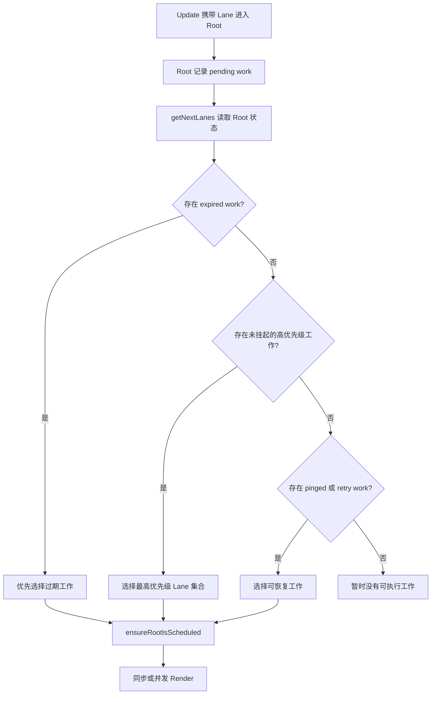

# 第 10 章 Lane、优先级与调度

前两章已经建立了这条链路：

```text
Fiber
  → 把组件树拆成工作单元

Concurrent Render
  → 允许 Render 在工作单元之间暂停和继续

Reconciliation
  → 计算新旧 Fiber 如何复用和变化
```

但 React 还需要回答一个问题：

> 当多个更新同时存在时，React 先处理哪一个？

例如用户正在输入搜索词，同时页面需要重新计算一个大型结果列表：

```text
输入框更新
大型列表更新
网络请求结果更新
动画更新
后台刷新更新
```

如果所有更新拥有相同优先级，React 就无法表达“先让输入框响应，列表稍后更新”。

React 使用 Lane 模型表示更新的优先级和集合关系。Lane 不是一个简单的数字等级，而是一个位掩码集合：每个 Lane 的某一位代表一类更新，多个 Lane 可以通过位运算合并、选择和拆分。

## 本章学习目标

学习完本章，你应该能够：

1. 解释 React 为什么需要更新优先级；
2. 理解 Lane 作为位掩码集合的基本模型；
3. 区分 Lane、事件优先级和 Scheduler 任务优先级；
4. 理解同步更新、默认更新、Transition 和 Idle 工作的差异；
5. 说明 Root 如何保存 pending、suspended、pinged 和 expired Lanes；
6. 理解 React 如何选择下一组要处理的 Lanes；
7. 解释更新如何沿 Fiber 向上标记到 Root；
8. 理解被跳过的低优先级更新如何保留并在之后恢复；
9. 理解 `startTransition`、批量更新和 `flushSync` 的关系；
10. 从源码入口阅读 Lane 和调度逻辑。

## 10.1 为什么更新需要优先级

### 10.1.1 所有更新同时处理的问题

```tsx
function Dashboard() {
  const [query, setQuery] = useState('');
  const [rows, setRows] = useState<Row[]>([]);

  function handleChange(event: React.ChangeEvent<HTMLInputElement>) {
    const nextQuery = event.target.value;
    setQuery(nextQuery);
    setRows(filterLargeTable(nextQuery));
  }

  return (
    <>
      <input value={query} onChange={handleChange} />
      <Table rows={rows} />
    </>
  );
}
```

用户每输入一个字符，两个更新都进入 React：

```text
更新 1：输入框显示新字符
更新 2：计算大型表格结果
```

如果表格计算耗时较长，输入框的反馈可能被拖慢。

### 10.1.2 更新的紧急程度不同

可以把工作按用户感知分类：

```text
紧急
  用户正在输入、点击按钮、移动焦点

普通
  页面 State 更新、常规数据展示

过渡
  路由切换、大列表筛选、复杂内容切换

空闲
  预加载、后台分析、非关键缓存更新
```

优先级不是“重要业务等级”，而是 React 调度时的响应紧迫程度。一个后台刷新对业务可能很重要，但不应阻塞用户正在进行的输入。

### 10.1.3 优先级不能脱离一致性

React 不能只处理最高优先级的一个节点，然后让页面永久处于新旧数据混合状态。它需要在：

```text
快速响应
完整计算
状态一致
```

之间取得平衡。

因此 Lane 不只是“先后顺序”，还要记录哪些更新属于同一组、哪些更新可以一起处理、哪些更新被暂停或需要恢复。

## 10.2 Lane 是什么

### 10.2.1 位掩码基础

Lane 使用二进制位表示更新集合。可以用简化示例理解：

```ts
const NoLanes = 0b0000;
const SyncLane = 0b0001;
const InputLane = 0b0010;
const DefaultLane = 0b0100;
const TransitionLane = 0b1000;
```

多个更新可以合并：

```ts
const pendingLanes = InputLane | DefaultLane;
// 0b0110
```

判断集合是否包含某个 Lane：

```ts
const hasInput = (pendingLanes & InputLane) !== NoLanes;
```

移除已经处理的 Lane：

```ts
const remaining = pendingLanes & ~InputLane;
```

### 10.2.2 为什么使用位而不是数组

位掩码适合表示一组有限的标志：

```text
合并 → 按位或 |
包含 → 按位与 &
删除 → 与按位取反后的值相与
优先选择 → 结合位顺序和策略计算
```

它可以在一个整数中保存多个 Lane，减少创建数组和遍历集合的成本。

### 10.2.3 真实 Lane 数量和名称会变化

React 不同版本和构建环境中的 Lane 常量可能不同，常见概念包括：

```text
SyncLane
InputContinuousLane
DefaultLane
TransitionLanes
RetryLanes
SelectiveHydrationLane
IdleLane
OffscreenLane
```

具体位位置和常量名称属于内部实现。学习时应把“某类更新使用某个优先级集合”的模型，与当前版本的具体数字分开。

### 10.2.4 Lane 不是单一等级

下面的表达不够准确：

```text
React 只有高、中、低三个优先级
```

更准确的是：

```text
React 使用多个 Lane 表示更新集合，
再根据当前 Root 状态、过期时间、挂起情况和调度策略选择下一组工作。
```

一个 Transition 也可能使用多个 Transition Lane。多个更新可以共享一组 Lane，成为同一批需要处理的工作。

## 10.3 Lane、事件优先级和 Scheduler 优先级

### 10.3.1 三个层次容易混淆

React 内部至少有几个相关但不同的概念：

```text
事件优先级
  → 用户事件本身有多紧急

Lane 优先级
  → React 更新属于哪类工作集合

Scheduler 任务优先级
  → 调度回调何时获得执行机会
```

它们之间有关联，但不是同一个枚举值。

### 10.3.2 事件优先级

可以抽象为：

```text
DiscreteEventPriority
  → click、keydown 等离散事件

ContinuousEventPriority
  → mousemove、scroll 等连续事件

DefaultEventPriority
  → 普通更新

IdleEventPriority
  → 空闲工作
```

事件优先级描述的是事件来源。

### 10.3.3 Lane

Lane 描述更新如何进入 React 的 Render 和 Root 调度：

```text
requestUpdateLane(fiber)
  ↓
根据当前事件、Transition、Render 上下文等选择 Lane
```

同一个事件中不同代码路径可能通过 Transition 产生不同 Lane。

### 10.3.4 Scheduler 任务优先级

Scheduler 需要决定回调何时执行：

```text
ImmediatePriority
UserBlockingPriority
NormalPriority
LowPriority
IdlePriority
```

这些名称在不同版本的 Scheduler 中可能有所变化。Scheduler 主要安排 JavaScript 回调，Lane 主要表示 React 更新集合。

### 10.3.5 三者的关系

可以用这条链路理解：

```text
用户事件
  ↓
事件优先级
  ↓
requestUpdateLane
  ↓
React Lane
  ↓
getNextLanes 选择工作
  ↓
Scheduler 安排 Root 回调
  ↓
Render 和 Commit
```

不要直接根据 Scheduler 任务优先级推断某个 State 的 Lane，也不要把 Lane 数字当成公开 API。

## 10.4 更新如何获得 Lane

### 10.4.1 `setState` 进入 `requestUpdateLane`

第 5 章中的 State Setter 可以抽象为：

```text
setState(action)
  ↓
dispatchSetState
  ↓
requestUpdateLane(fiber)
  ↓
创建 Update(lane, action)
  ↓
加入 Hook 队列
  ↓
调度 Root
```

`requestUpdateLane` 会根据当前上下文判断使用哪个 Lane。

### 10.4.2 普通事件中的更新

```tsx
function handleClick() {
  setOpen(true);
}
```

普通用户事件通常会让更新获得与当前事件相关的高响应优先级或默认优先级，具体取决于事件类型和 React 版本。

### 10.4.3 Transition 中的更新

```tsx
startTransition(() => {
  setResults(nextResults);
});
```

React 会把这次更新识别为 Transition 工作：

```text
进入 Transition 上下文
  ↓
requestUpdateLane 返回 Transition Lane
  ↓
更新进入非紧急工作集合
```

Transition Lane 的意义不是“永远最后处理”，而是允许更紧急的更新先完成。

### 10.4.4 Render 阶段更新

组件 Render 中调用 State Setter 通常是错误或需要特殊处理的场景：

```tsx
function Component() {
  const [value, setValue] = useState(0);

  if (value === 0) {
    setValue(1);
  }

  return <p>{value}</p>;
}
```

React 对 Render 阶段更新有内部处理路径，但业务代码不应依赖它来做普通状态转换。Render 应保持纯净，避免形成循环 Render。

### 10.4.5 `flushSync` 中的同步 Lane

```tsx
flushSync(() => {
  setOpen(true);
});
```

同步刷新会提高处理紧迫程度，使更新更接近同步处理边界。它不是普通的优先级选择方式，只适合需要同步读取 DOM 等特殊集成场景。

## 10.5 更新如何标记到 Root

### 10.5.1 Fiber 树需要找到 Root

一个更新从叶子组件开始：

```text
Button Fiber
  ↓
Panel Fiber
  ↓
Page Fiber
  ↓
HostRoot Fiber
  ↓
FiberRoot
```

React 需要把这次更新影响的 Lane 沿父链标记上去，确保 Root 知道子树有待处理工作。

### 10.5.2 简化的向上标记

```ts
function markUpdateLaneFromFiberToRoot(
  sourceFiber: Fiber,
  lane: Lane,
): FiberRoot | null {
  sourceFiber.lanes |= lane;

  let parent = sourceFiber.return;

  while (parent !== null) {
    parent.childLanes |= lane;
    parent = parent.return;
  }

  return getRootFromFiber(sourceFiber);
}
```

真实实现会处理 Alternate、隐藏子树、Suspense 和其他特殊情况，但核心关系是：

```text
当前 Fiber 记录自己的 Lane
祖先 Fiber 记录 childLanes
Root 记录待处理 Lane
```

### 10.5.3 `lanes` 和 `childLanes`

```text
Fiber.lanes
  → 当前 Fiber 自己的更新

Fiber.childLanes
  → 后代 Fiber 的更新集合

FiberRoot.pendingLanes
  → 整个 Root 尚未完成的 Lane 集合
```

这些字段帮助 React 在遍历时判断：

```text
当前节点自己需要处理吗？
它的后代需要处理吗？
这一棵子树能否跳过？
```

### 10.5.4 更新队列还需要保留被跳过的工作

假设当前正在处理高优先级 Lane，但更新队列中还有低优先级更新：

```text
Update A：SyncLane
Update B：TransitionLane
```

如果本次 Render 只选择 SyncLane，React 不能把 B 丢掉。它需要保留 B 以及后续计算所需的基础状态，等待之后处理。

这就是为什么更新队列中会有 `baseState`、`baseQueue` 等概念。

## 10.6 Root 保存的 Lane 集合

### 10.6.1 `pendingLanes`

```text
pendingLanes
  → Root 上所有尚未完成的更新 Lane
```

有更新进入 Root 时，相关 Lane 会被加入：

```ts
root.pendingLanes |= updateLane;
```

### 10.6.2 `suspendedLanes`

某些工作因为 Suspense 或资源未准备好而暂时不能继续：

```text
suspendedLanes
  → 当前因为挂起而暂时不能直接处理的 Lane
```

挂起不一定等于失败。资源准备好后，React 可以通过 ping 让相关 Lane 重新获得处理机会。

### 10.6.3 `pingedLanes`

当挂起的资源准备完成时，React 需要知道哪些 Lane 可以重新尝试：

```text
资源完成
  ↓
pingRoot
  ↓
pingedLanes 加入相关 Lane
  ↓
重新调度 Root
```

### 10.6.4 `expiredLanes`

低优先级工作如果等待过久，React 不能让它无限期饿死：

```text
等待时间过长
  ↓
标记为 expired
  ↓
提高处理紧迫程度
```

这是一种防止 starvation 的机制。

### 10.6.5 `entangledLanes`

某些更新之间存在必须一起处理的关系，React 可以把相关 Lane 关联起来：

```text
Lane A 与 Lane B 产生依赖
  ↓
entangleLanes
  ↓
选择 A 时也考虑 B
```

具体的 entanglement 规则会随 React 特性变化，但核心目标是避免有依赖关系的更新被不合理地拆开。

## 10.7 `getNextLanes`：选择下一组工作

### 10.7.1 选择不是简单找最小数字

Root 上可能同时存在：

```text
SyncLane
DefaultLane
TransitionLane
IdleLane
```

React 不能只执行：

```ts
const nextLane = Math.min(pendingLanes);
```

因为还要考虑：

- 当前正在处理的 Lane；
- 被挂起的 Lane；
- 被 ping 的 Lane；
- 已过期的 Lane；
- 被 entangle 的 Lane；
- 是否有更高优先级新更新到来。

### 10.7.2 简化选择模型

```ts
function getNextLanes(root: FiberRoot): Lanes {
  const pending = root.pendingLanes;

  if (pending === NoLanes) {
    return NoLanes;
  }

  const nonSuspended = pending & ~root.suspendedLanes;

  if (root.expiredLanes !== NoLanes) {
    return root.expiredLanes;
  }

  if (nonSuspended !== NoLanes) {
    return pickHighestPriorityLanes(nonSuspended);
  }

  return root.pingedLanes;
}
```

这段代码只是示意。真实实现会用位运算和更多条件选择一组 Lanes。

### 10.7.3 为什么选择一组 Lane

React 可能同时处理多个兼容或相同优先级的更新：

```text
Update A：DefaultLane
Update B：DefaultLane
```

如果每个更新都单独 Render，会产生额外工作和中间提交。将相关 Lane 合并可以：

```text
一次 Render 处理一组相关更新
减少重复计算
维持状态转换的一致性
```

### 10.7.4 新的高优先级更新如何插入

假设：

```text
当前正在处理 TransitionLane
用户点击产生 SyncLane
```

React 可以：

```text
暂停当前 Transition Render
选择 SyncLane
优先完成点击反馈
之后继续或重新计算 Transition
```

这就是优先级调度对用户体验的实际意义。

## 10.8 更新队列如何处理不同 Lane

### 10.8.1 一个队列中的多个更新

```tsx
setCount((value) => value + 1);
startTransition(() => {
  setCount((value) => value + 10);
});
```

更新队列可能包含：

```text
Update 1：某个高优先级 Lane
Update 2：Transition Lane
```

### 10.8.2 本轮只处理选中的 Lane

如果本轮选择了高优先级 Lane：

```text
处理 Update 1
跳过 Update 2
保留 Update 2
```

下一轮选择 Transition Lane 时，再继续计算 Update 2。

### 10.8.3 跳过更新会影响基础状态

假设初始值为 0：

```text
Update A：设置为 1，当前优先级可处理
Update B：加 10，当前优先级暂时跳过
```

React 需要记住：

```text
本次提交的状态
剩余队列从哪里开始
被跳过更新需要基于什么状态计算
```

因此 `baseState` 和 `baseQueue` 很重要。它们让被延后的更新不会因为高优先级 Render 而丢失或重复计算。

### 10.8.4 函数式更新更适合连续队列

```tsx
setCount((value) => value + 1);
setCount((value) => value + 1);
```

函数式更新可以在队列处理时基于当前计算结果继续执行，适合多个 Lane 或多个连续更新共同作用的场景。

值更新则可能覆盖前面的结果：

```tsx
setCount(1);
setCount(2);
```

最终队列处理结果通常以后面的值为准。

## 10.9 事件优先级到 Lane 的转换

### 10.9.1 `requestUpdateLane`

可以把 Lane 选择抽象成：

```ts
function requestUpdateLane(fiber: Fiber): Lane {
  if (isLegacyRoot(fiber)) {
    return SyncLane;
  }

  if (isRenderPhaseUpdate()) {
    return pickArbitraryLane(renderLanes);
  }

  if (isInsideTransition()) {
    return requestTransitionLane();
  }

  return eventPriorityToLane(resolveUpdatePriority());
}
```

具体条件和函数名称会变化，但逻辑方向是：

```text
当前 Root 模式
  ↓
当前是否在 Render
  ↓
当前是否在 Transition
  ↓
当前事件优先级
  ↓
选择 Lane
```

### 10.9.2 `resolveUpdatePriority`

React 需要知道当前更新来自什么上下文：

```text
离散事件
连续事件
默认代码路径
Transition
同步刷新
```

对于浏览器事件，React 事件系统可以提供上下文；对于异步回调，则可能使用默认更新优先级，除非代码显式进入 Transition 或同步边界。

### 10.9.3 异步回调不是天然低优先级

下面的更新发生在 Promise 回调中：

```tsx
fetchData().then((data) => {
  setData(data);
});
```

它不应该被简单描述为“异步所以低优先级”。实际 Lane 取决于当前 React 上下文和更新 API。需要让它成为 Transition 时，应明确写出：

```tsx
fetchData().then((data) => {
  startTransition(() => {
    setData(data);
  });
});
```

### 10.9.4 同一事件中的多个 Lane

```tsx
function handleChange(nextValue: string) {
  setInput(nextValue);

  startTransition(() => {
    setQuery(nextValue);
  });
}
```

同一个事件处理函数里可以有：

```text
input 更新 → 当前事件相关 Lane
query 更新 → Transition Lane
```

这正是 Lane 比单一全局优先级更灵活的地方。

## 10.10 批量更新与 Lane

### 10.10.1 批量更新解决提交次数

```tsx
function handleClick() {
  setName('Lin');
  setOnline(true);
  setCount((value) => value + 1);
}
```

批量更新的目标是把多个更新放到合适的处理边界中：

```text
多个 Update
  ↓
合并调度
  ↓
一次或较少次数 Render / Commit
```

### 10.10.2 Lane 决定批量更新的组合方式

多个更新即使发生在相近时间，也不一定属于同一 Lane：

```text
普通更新
Transition 更新
同步刷新更新
```

React 可能先处理高优先级工作，再处理 Transition。批量更新不等于所有工作必须一次完成。

### 10.10.3 React 18 自动批量更新

使用 `createRoot` 的 React 18 应用扩大了自动批量更新范围：

```tsx
setTimeout(() => {
  setCount((value) => value + 1);
  setFlag((value) => !value);
}, 1000);
```

这两个更新通常可以进入同一批处理，但它们的 Lane 和调度仍然取决于当前上下文。

### 10.10.4 批量更新不等于同步执行

```text
批量
  → 多个更新是否合并到同一处理边界

同步
  → 当前调用是否必须立即完成
```

它们是不同维度。多个更新可以被批量但稍后执行，也可以在同步边界中批量完成。

## 10.11 Transition 的 Lane 模型

### 10.11.1 Transition 是一组非紧急工作

```tsx
startTransition(() => {
  setPage('reports');
});
```

React 会为 Transition 分配一个或一组 Transition Lane。这样做的目的不是让更新永远等待，而是：

```text
让用户直接操作优先
允许页面内容稍后完成
在更紧急更新出现时让路
```

### 10.11.2 Transition 可能被重启

如果用户快速输入：

```text
输入 a → Transition 计算结果 a
输入 ab → 更高优先级新输入
输入 abc → 又一个新 Transition
```

React 可能放弃过时的中间结果，优先处理最新输入，再计算最新结果。

这要求 UI 和数据层能够处理：

```text
旧结果暂时保留
新结果未完成
过渡状态显示
请求响应乱序
```

### 10.11.3 Transition 不会自动取消副作用

```tsx
startTransition(() => {
  setQuery(nextQuery);
});
```

如果 `setQuery` 触发了 Effect 请求：

```tsx
useEffect(() => {
  fetch(`/api/search?q=${query}`).then(setResults);
}, [query]);
```

Transition 不会自动取消旧的 fetch。请求层仍需要：

```text
AbortController
请求序列号
响应 ID 校验
缓存层去重
```

### 10.11.4 `isPending` 的含义

```tsx
const [isPending, startTransition] = useTransition();
```

`isPending` 表示相关 Transition 工作仍处于待处理或进行中的状态。它不等于网络请求一定还在进行，也不等于所有页面任务都完成。

如果 UI 同时有多个异步来源，应分别设计加载状态，不要把 `isPending` 当成全局请求状态。

## 10.12 Suspense、Retry Lane 和挂起工作

### 10.12.1 Render 可能因为资源挂起

```text
Transition Render
  ↓
子树读取未完成资源
  ↓
无法继续完成当前子树
  ↓
标记相关 Lane 或边界为挂起
```

React 可以根据 Suspense 边界显示 fallback，或者等待更合适的时机。

### 10.12.2 资源完成后重新尝试

```text
Promise 完成
  ↓
ping Root
  ↓
加入 pingedLanes
  ↓
重新调度相关工作
  ↓
重试子树 Render
```

这就是为什么 Root 需要保存 suspended 和 pinged 相关集合。

### 10.12.3 Retry Lane 的作用

重试工作可以使用专门的 Retry Lane 集合，避免把所有挂起任务简单当成普通同步更新处理。具体 Lane 分配随版本和 Suspense 场景变化。

理解重点是：

```text
挂起不是删除更新
资源准备好后，React 需要重新获得处理机会
```

## 10.13 防止低优先级工作饿死

### 10.13.1 什么是 starvation

如果高优先级更新持续不断：

```text
输入更新 1
输入更新 2
输入更新 3
输入更新 4
……
```

低优先级列表更新可能永远没有机会完成，这称为饥饿。

### 10.13.2 过期时间

React 会为某些 Lane 记录事件时间或过期信息：

```text
低优先级工作等待过久
  ↓
超过允许等待时间
  ↓
标记为过期
  ↓
以更紧急方式处理
```

这使调度不只是“永远优先高优先级”，而是在响应性和最终完成之间平衡。

### 10.13.3 连续输入中的实际体验

搜索页面常见策略：

```text
输入框 value：立即更新
结果列表：Transition
网络请求：防抖或取消
过渡太久：显示 pending
```

即使用户持续输入，旧的列表结果也不应让输入框卡住。最终当输入停止，最新结果应该能够完成。

## 10.14 `ensureRootIsScheduled`

### 10.14.1 Root 需要保持一个调度任务

当 Root 的待处理 Lane 改变时，React 需要决定：

```text
当前任务是否还适合处理这些 Lane？
是否需要取消旧任务？
是否需要安排新的任务？
应该使用同步还是并发回调？
```

`ensureRootIsScheduled` 可以理解为这个调度入口之一。

### 10.14.2 简化伪代码

```ts
function ensureRootIsScheduled(root: FiberRoot) {
  const nextLanes = getNextLanes(root);

  if (nextLanes === NoLanes) {
    cancelExistingCallback(root);
    return;
  }

  const newPriority = lanesToSchedulerPriority(nextLanes);

  if (root.callbackPriority === newPriority) {
    return;
  }

  cancelExistingCallback(root);
  root.callbackNode = scheduleCallback(
    newPriority,
    () => performWorkOnRoot(root),
  );
  root.callbackPriority = newPriority;
}
```

实际实现会处理同步回调队列、时间切片、Continuation、Passive Effects、Suspense 和恢复逻辑。

### 10.14.3 Lane 到 Scheduler 优先级

```ts
function lanesToSchedulerPriority(lanes: Lanes) {
  if (includesSyncLane(lanes)) {
    return ImmediatePriority;
  }

  if (includesInputLane(lanes)) {
    return UserBlockingPriority;
  }

  if (includesTransitionLane(lanes)) {
    return NormalPriority;
  }

  return LowPriority;
}
```

这也是概念示例。真实映射并不是简单固定的所有版本通用表格。

## 10.15 同步 Root 与 Concurrent Root

### 10.15.1 `createRoot`

React 18 推荐使用：

```tsx
const root = createRoot(container);
root.render(<App />);
```

它启用现代 Root 语义和并发特性支持。

### 10.15.2 Legacy Root

旧式入口：

```tsx
ReactDOM.render(<App />, container);
```

在 React 18 中属于旧的 Root API，行为和现代 `createRoot` 不完全相同。

### 10.15.3 Root 模式影响 Lane

当前 Root 模式会影响 `requestUpdateLane` 和同步/并发工作选择：

```text
Legacy Root
  → 可能更多使用旧的同步行为

Concurrent Root
  → 支持现代 Lane、Transition 和并发调度语义
```

这也是升级 React 时不能只替换包版本而不检查 Root API 的原因之一。

## 10.16 Lane 与 Fiber 子树跳过

### 10.16.1 当前子树没有匹配 Lane

如果当前 Render 只处理某些 Lanes，而某个子树没有相关工作：

```text
当前 Fiber 没有选中 Lane
子树 childLanes 也没有选中 Lane
  ↓
可以复用已有子树
```

这类跳过是性能优化的基础之一。

### 10.16.2 有子树工作仍需进入

```text
当前 Fiber 自己没有更新
但 childLanes 包含本轮 Lane
  ↓
不能跳过整个子树
  ↓
进入后代处理
```

`lanes` 和 `childLanes` 的区别就在这里：

```text
当前节点没变
不代表后代没变
```

### 10.16.3 Props 相同也不一定跳过

即使 Props 引用相同，以下情况也可能需要进入子树：

```text
Context 变化
后代有匹配 Lane
外部 Store 快照变化
ForceUpdate
Suspense 恢复
```

因此不能把“Props 没变”简单等同于“子树一定不执行”。

## 10.17 实际代码场景

### 10.17.1 搜索框分离紧急和非紧急更新

```tsx
function SearchPage() {
  const [input, setInput] = useState('');
  const [query, setQuery] = useState('');
  const [isPending, startTransition] = useTransition();

  function handleChange(event: React.ChangeEvent<HTMLInputElement>) {
    const nextValue = event.target.value;
    setInput(nextValue);

    startTransition(() => {
      setQuery(nextValue);
    });
  }

  return (
    <main>
      <input value={input} onChange={handleChange} />
      {isPending ? <p>正在筛选……</p> : null}
      <SearchResults query={query} />
    </main>
  );
}
```

这里没有保证 `SearchResults` 的所有计算都很快，但至少给 React 提供了更新优先级信息。

### 10.17.2 结果请求需要取消

```tsx
function useSearch(query: string) {
  const [state, setState] = useState<SearchState>(initialState);

  useEffect(() => {
    if (!query) {
      setState(initialState);
      return;
    }

    const controller = new AbortController();
    let active = true;

    setState((current) => ({
      ...current,
      loading: true,
    }));

    fetch(`/api/search?q=${encodeURIComponent(query)}`, {
      signal: controller.signal,
    })
      .then((response) => response.json() as Promise<Result[]>)
      .then((results) => {
        if (active) {
          setState({ data: results, loading: false, error: null });
        }
      })
      .catch((error: unknown) => {
        if (active && (error as { name?: string }).name !== 'AbortError') {
          setState({ data: [], loading: false, error: toError(error) });
        }
      });

    return () => {
      active = false;
      controller.abort();
    };
  }, [query]);

  return state;
}
```

Transition 控制 State 更新优先级，请求取消控制网络响应是否仍然有效，两者需要分别设计。

### 10.17.3 页面切换与 pending UI

```tsx
function Navigation() {
  const [page, setPage] = useState('home');
  const [isPending, startTransition] = useTransition();

  function navigate(nextPage: string) {
    startTransition(() => {
      setPage(nextPage);
    });
  }

  return (
    <>
      <nav>
        <button onClick={() => navigate('home')}>首页</button>
        <button onClick={() => navigate('reports')}>报表</button>
      </nav>
      {isPending ? <span>切换中</span> : null}
      <PageContent page={page} />
    </>
  );
}
```

真实路由库会有自己的导航和数据加载策略。这里用于说明 Transition 的交互模型。

### 10.17.4 高频流式状态

```tsx
function appendChunk(chunk: string) {
  setMessage((current) => ({
    ...current,
    content: current.content + chunk,
  }));
}
```

如果每个 chunk 都触发一次更新，可以进一步把消息缓冲到 Ref，并按帧或短时间窗口提交：

```tsx
const bufferRef = useRef('');
const frameRef = useRef<number | null>(null);

function appendChunk(chunk: string) {
  bufferRef.current += chunk;

  if (frameRef.current !== null) {
    return;
  }

  frameRef.current = requestAnimationFrame(() => {
    const nextChunk = bufferRef.current;
    bufferRef.current = '';
    frameRef.current = null;

    setMessage((current) => ({
      ...current,
      content: current.content + nextChunk,
    }));
  });
}
```

这里的帧合并属于业务层节流策略，Lane 可以进一步影响 React 如何处理这些更新，二者不是同一个机制。

## 10.18 常见错误与修复方式

### 10.18.1 把 Lane 当成公开 API

错误倾向：

```tsx
// 业务代码直接依赖 React 内部 Lane 数字
const lane = 0b0100;
```

Lane 常量和位位置属于内部实现，业务代码应使用公开 API 表达意图：

```tsx
setValue(nextValue);

startTransition(() => {
  setExpensiveValue(nextValue);
});
```

### 10.18.2 把 Transition 当成性能优化万能开关

Transition 不能解决：

```text
超慢的同步算法
第三方库的长任务
网络请求不取消
DOM 过大
布局抖动
```

它只能给 React 更新提供优先级信息。

### 10.18.3 把异步回调全部当成低优先级

```tsx
setTimeout(() => {
  setValue(nextValue);
}, 0);
```

`setTimeout` 只改变 JavaScript 回调进入事件循环的时机，不等于 React 一定会把更新分配到某个低优先级 Lane。需要 Transition 时应显式使用 Transition API。

### 10.18.4 在 Transition 中更新受控输入

错误倾向：

```tsx
startTransition(() => {
  setInput(event.target.value);
});
```

受控输入通常需要立即反映用户输入。更常见的写法是：

```tsx
setInput(nextValue);
startTransition(() => {
  setResults(filter(nextValue));
});
```

### 10.18.5 把 `isPending` 当作网络加载状态

```tsx
const [isPending, startTransition] = useTransition();
```

`isPending` 描述 Transition 更新状态，不自动描述 fetch、SSE 或图片加载。网络层需要自己的 loading、error、abort 和 stale response 管理。

### 10.18.6 认为低优先级更新可以被永久丢弃

React 可能放弃某个中间 Render，但不能随意丢弃仍然有效的 State 更新。更新队列和 Root Lane 集合会保留必要工作，之后重新处理。业务代码仍需要处理过期请求和无效响应，因为它们属于外部副作用层。

### 10.18.7 只优化 Render，不看 Commit

即使 Render 很快，大量 DOM 插入、删除、布局读取和同步 Effect 也可能让 Commit 变慢。性能分析需要把：

```text
Render
Commit
浏览器布局绘制
```

分开观察。

## 10.19 源码阅读：Lane 和调度入口

这一节先从“用户正在输入，同时页面有一块复杂内容需要更新”的场景开始，再解释 Lane 如何把更新组织成可选择、可暂停和可恢复的工作集合。源码函数名集中放在最后，作为定位工具。

### 10.19.1 先看紧急输入和过渡更新

```tsx
function SearchBox() {
  const [input, setInput] = useState('');
  const [query, setQuery] = useState('');
  const [isPending, startTransition] = useTransition();

  function handleChange(event: React.ChangeEvent<HTMLInputElement>) {
    const nextValue = event.target.value;
    setInput(nextValue);

    startTransition(() => {
      setQuery(nextValue);
    });
  }

  return (
    <>
      <input value={input} onChange={handleChange} />
      {isPending ? <span>正在更新结果</span> : null}
      <SearchResults query={query} />
    </>
  );
}
```

用户输入一个字符时，页面可以按两种紧迫程度理解：

```text
输入事件到达
  ↓
input 更新需要尽快反馈
  ↓
query 更新被标记为 Transition
  ↓
两个更新进入同一个 Root 的待处理工作
  ↓
React 选择更紧急的 Lane
  ↓
先完成输入反馈
  ↓
稍后处理结果列表
```

Lane 是 React 内部表示更新集合的位掩码。它不是业务优先级，也不是“开启后台线程”的开关，而是帮助 React 回答：当前 Root 上有哪些工作、这次先处理哪一组、哪些工作可以暂缓。

### 10.19.2 更新如何进入 Root

从一次 State Setter 开始，可以先记住这条行为链：

```text
调用 setState
  ↓
根据当前上下文选择 Lane
  ↓
创建带 action 和 lane 的 Update
  ↓
把 Update 放入 Hook 或 Fiber 的队列
  ↓
沿 Fiber 父链把工作标记到 Root
  ↓
Root.pendingLanes 加入这次工作
  ↓
安排同步或并发任务
```

因此，调用 Setter 时并没有立即完成整个页面更新。它先把“要做什么”和“这件事有多紧急”记录下来，之后由 Root 根据所有待处理工作重新选择执行顺序。

### 10.19.3 Root 如何选择下一组 Lane



一次选择可以这样记录：

```text
Root.pendingLanes = SyncLane | TransitionLane
Root.suspendedLanes = TransitionLane
新的输入到达：加入 SyncLane
选择下一组工作：优先处理 SyncLane
Render：先处理输入，TransitionLane 继续保留
输入提交：移除已完成的 SyncLane
后续恢复：重新选择 TransitionLane
```

如果低优先级工作被跳过，它不会因为这次 Render 没处理就自动丢失。相关 Update 和 Root 的 pending 状态会保留，之后仍可被选择。

### 10.19.4 Root 状态分别回答什么问题

源码中经常会看到这些 Root 字段：

```text
pendingLanes
suspendedLanes
pingedLanes
expiredLanes
mutableReadLanes
entangledLanes
eventTimes
expirationTimes
```

先不要记住每个位图的数字，而是把字段映射到问题：

```text
pendingLanes   → 哪些工作还没有完成？
suspendedLanes → 哪些工作因为数据或边界暂时不能继续？
pingedLanes    → 哪些挂起工作已经可以重试？
expiredLanes   → 哪些工作等待太久，需要提高紧迫程度？
entangledLanes → 哪些工作需要一起处理？
eventTimes     → 这些工作大约什么时候进入系统？
```

### 10.19.5 优先级选择和调度是两步

Lane 选择和 Scheduler 安排任务属于不同层次：

```text
Root 状态
  ↓
选择下一组 Lanes
  ↓
映射到事件或 Scheduler 优先级
  ↓
安排同步回调或并发回调
  ↓
执行 Render
```

这意味着“发生在 Promise 回调中”不等于“React 一定会使用低优先级 Lane”。如果业务明确需要把更新标记为 Transition，应使用 `startTransition` 等 API。

### 10.19.6 过期机制如何避免低优先级工作饿死

优先响应紧急输入不能意味着低优先级更新永远等待。React 会记录更新时间，并在等待超过一定条件时标记工作已经过期：

```text
检查 pending Lane 的事件时间
  ↓
判断是否等待过久
  ↓
标记 expiredLanes
  ↓
后续选择时提高处理紧迫程度
```

这体现了调度系统的两个目标：紧急工作尽快响应，普通工作最终完成。

### 10.19.7 源码导航入口：用于定位，不是必须背诵

理解用户时间线后，可以按下面顺序阅读：

**Lane 的集合操作：**

```text
NoLanes
NoLane
SyncLane
DefaultLane
TransitionLanes
RetryLanes
mergeLanes
removeLanes
includesSomeLane
```

**更新进入 Root：**

```text
dispatchSetState
  ↓
requestUpdateLane
  ↓
createUpdate
  ↓
enqueueUpdate
  ↓
markUpdateLaneFromFiberToRoot
  ↓
markRootUpdated
```

**选择和安排工作：**

```text
getNextLanes
ensureRootIsScheduled
lanesToEventPriority
lanesToSchedulerPriority
scheduleSyncCallback
scheduleCallback
```

**挂起、恢复和过期：**

```text
markRootSuspended
markRootPinged
markStarvedLanesAsExpired
performSyncWorkOnRoot
performConcurrentWorkOnRoot
```

这些名称用于回答“更新如何带上 Lane、如何到达 Root、Root 如何选下一组工作”。它们不是业务 API，Lane 的具体位图和内部函数会随 React 版本变化；阅读源码时优先验证“Update 入队 → Root 记录 → 选择 Lanes → 调度 Render → 完成 Commit”这条稳定行为链。

## 10.20 官方行为、源码细节与工程结论

### 官方行为

可以依赖的高层模型包括：

- React 会根据更新上下文和 API 为更新安排不同处理优先级；
- Transition 用于标记非紧急更新；
- `useTransition` 可以暴露过渡进行状态；
- `flushSync` 可以建立特殊同步边界；
- 批量更新可以合并多个 State 更新，但不等于所有更新都同步完成；
- React 会尽量保证低优先级工作最终有机会完成。

### 源码视角

阅读 Lane 和调度时可以关注：

- `requestUpdateLane`；
- `resolveUpdatePriority`；
- `eventPriorityToLane`；
- `requestTransitionLane`；
- `mergeLanes`；
- `removeLanes`；
- `includesSomeLane`；
- `markUpdateLaneFromFiberToRoot`；
- `markRootUpdated`；
- `markRootSuspended`；
- `markRootPinged`；
- `markStarvedLanesAsExpired`；
- `getNextLanes`；
- `ensureRootIsScheduled`；
- `lanesToEventPriority`；
- `scheduleCallback`。

### 工程结论

- 优先级表达的是用户响应紧迫程度，不是业务重要性；
- Lane 是更新集合和调度状态的内部表示；
- 事件优先级、Lane 和 Scheduler 任务优先级处于不同层次；
- `startTransition` 适合把复杂展示标记为非紧急更新；
- 受控输入通常应保持紧急更新，结果列表可以使用 Transition；
- Transition 不会自动取消请求、减少计算或创建后台线程；
- 批量更新和同步刷新是不同概念；
- 被跳过的 Lane 会保留在更新队列和 Root 状态中；
- Suspense 需要挂起、ping 和重试相关状态；
- 过期机制避免低优先级工作无限饥饿；
- 业务代码不应依赖具体 Lane 数字或内部字段。

## 10.21 面试重点：Lane、优先级与调度

### React 为什么需要 Lane？

> 一个 Root 中可能同时存在用户输入、普通 State、Transition、Suspense 重试和后台更新。如果所有更新同优先级，React 无法优先响应紧急交互。Lane 使用位掩码表示不同更新集合，让 React 能够合并、选择、跳过和恢复特定工作，并把选择结果交给调度器。

### Lane 和优先级是什么关系？

> Lane 是 React 内部表示更新集合的位掩码，优先级是 React 根据 Lane 和 Root 状态选择工作时使用的调度概念。一个 Lane 可以代表一类更新，多个 Lane 可以组成一组工作。Lane、浏览器事件优先级和 Scheduler 任务优先级相关但不是同一个枚举。

### `startTransition` 做了什么？

> `startTransition` 把回调中的 State 更新标记为非紧急 Transition 工作。React 可以降低这些更新的处理优先级，让输入和点击等更紧急更新先完成，在必要时暂停或重做 Transition Render。它不创建线程，也不自动取消网络请求或防抖计算。

### 被跳过的低优先级更新会丢失吗？

> 不会。一次 Render 只处理当前选中的 Lanes 时，其他低优先级 Update 会保留在 Hook 或 Fiber 的更新队列中，Root 也会继续记录对应 pending Lane。之后 React 选择这些 Lane 时，再基于正确的基础状态处理它们。

### React 如何防止低优先级更新饿死？

> React 会记录更新的事件时间，并在某些工作等待过久时把对应 Lane 标记为过期，提高处理紧迫程度。这样调度不会永远只服务持续到来的高优先级更新，也能保证低优先级工作最终有机会完成。

### 批量更新和同步更新有什么区别？

> 批量更新表示多个 Update 是否放入同一处理边界，减少重复 Render 和 Commit；同步更新表示当前工作是否需要立即完成。多个更新可以被批量但延后执行，也可以在同步边界中批量完成，两者不是同一个概念。

### 为什么不能直接把异步更新称为低优先级？

> 更新发生在 Promise、定时器或网络回调中，只说明 JavaScript 回调的触发时机，不足以推断 React 一定使用低优先级 Lane。需要把更新标记为 Transition 时，应使用 `startTransition` 等明确 API。

## 10.22 本章小结

1. 同一时间可能存在多个紧迫程度不同的 React 更新；
2. Lane 使用位掩码表示更新集合，而不是简单的单一等级数字；
3. 事件优先级、Lane 和 Scheduler 优先级属于不同层次；
4. State Setter 会通过 `requestUpdateLane` 获得 Lane；
5. 更新会沿 Fiber 父链标记到 Root；
6. `lanes` 表示当前 Fiber 的工作，`childLanes` 表示后代工作；
7. Root 会保存 pending、suspended、pinged、expired 等工作集合；
8. `getNextLanes` 根据优先级、挂起、过期和关联关系选择下一组工作；
9. 低优先级更新被跳过时会保留在队列中，之后可以恢复；
10. `startTransition` 让复杂展示更新变成非紧急工作；
11. 批量更新、同步更新、防抖和 Web Worker 解决不同问题；
12. 过期机制保证低优先级更新不会无限饥饿；
13. Lane 为并发 Render、Suspense 和调度提供了统一的更新标记基础。

可以把本章浓缩成一句话：

> Lane 把不同更新组织成可合并、可选择和可恢复的优先级集合，React 根据 Root 上的 Lane 状态选择下一组工作，再由 Scheduler 安排同步或并发 Render。

## 10.23 练习题与参考答案

### 练习 1：为什么输入框和列表要分开更新？

**参考答案：** 输入框的 value 直接反映用户操作，响应延迟会明显影响体验；大型列表计算可以稍后完成。因此可以同步更新输入值，把列表结果更新放入 `startTransition`，让 React 在输入等紧急更新完成后处理列表。

### 练习 2：Lane 为什么适合使用位掩码？

**参考答案：** 一个 Root 可能同时存在多个工作集合。位掩码可以用按位或合并多个 Lane，用按位与判断是否包含，用按位操作移除或选择，避免为每个更新创建和遍历复杂数组。

### 练习 3：`startTransition` 会取消旧请求吗？

**参考答案：** 不会。它只标记 React State 更新的优先级。由 State 触发的 fetch、SSE 或其他副作用仍然需要使用 AbortController、请求 ID 或响应校验处理旧请求和乱序结果。

### 练习 4：被跳过的更新如何保留？

**参考答案：** React 会把当前未处理 Lane 的 Update 保留在 Hook 或 Fiber 更新队列中，并在 Root 上继续记录 pending Lane。之后选择该 Lane 时，React 根据 baseState 和 baseQueue 等信息继续计算，避免更新丢失或错误重复。

### 练习 5：判断下面的说法是否准确

```text
Promise 回调中的 setState 一定是低优先级。
```

**参考答案：** 不准确。Promise 回调只表示更新发生在异步回调中，不能单独决定 React Lane。需要非紧急 Transition 语义时，应使用 `startTransition` 明确标记。

### 练习 6：面试表达

请用不超过 1 分钟回答“React 如何选择下一次要处理的更新”。

**参考答案：**

> React 会在 FiberRoot 上记录 pending、suspended、pinged、expired 等 Lane 集合。更新进入时通过 `requestUpdateLane` 获得 Lane，并沿 Fiber 父链标记到 Root。调度时 `getNextLanes` 会根据当前待处理工作、优先级、挂起状态、过期状态和 Lane 关联关系选择下一组工作。然后 `ensureRootIsScheduled` 把这组 Lane 转换成同步或并发调度任务，进入对应的 Render 工作循环。没有被选中的低优先级更新会继续保留，等待后续处理。

---

下一部分将进入 **Hooks 的深入理解**，第 11 章会讲解 `useEffect`，重点回答：

```text
Effect 为什么不在 Render 阶段执行？
依赖数组如何决定重新同步？
清理函数什么时候运行？
useEffect、useLayoutEffect 和外部系统如何配合？
```
