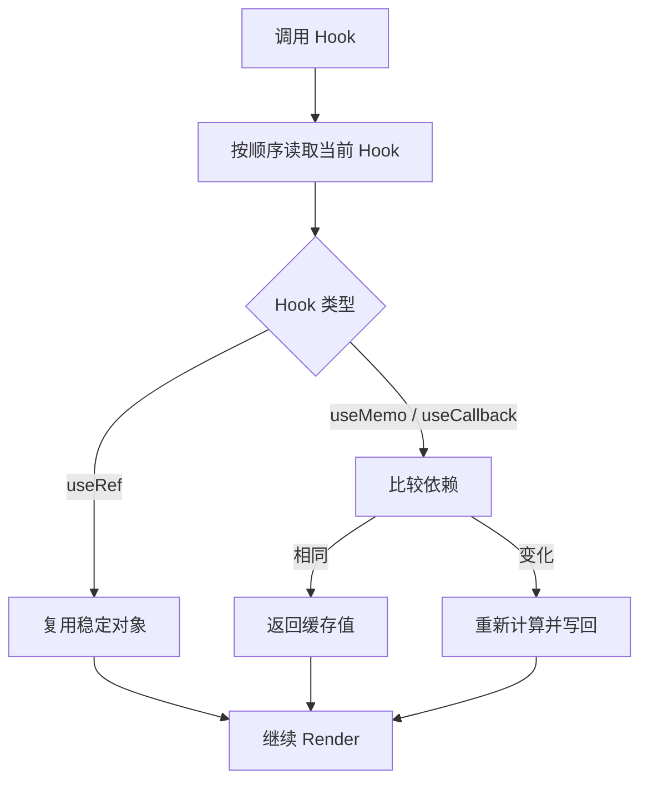

# 第 12 章 `useRef`、`useMemo` 与 `useCallback`

这一章解决一个常见误区：**引用稳定不等于组件自动变快**。

`useRef`、`useMemo`、`useCallback` 和 `React.memo` 都会让某些值或组件在不同 Render 之间保持稳定，但它们解决的是不同问题：

- `useRef` 保存一个不会因为赋值而触发 Render 的可变容器；
- `useMemo` 缓存一次计算得到的值；
- `useCallback` 缓存一个函数对象；
- `React.memo` 在 Props 没有变化时尝试跳过子组件 Render。

缓存是性能工具，不是业务正确性的替代品。组件必须先拥有正确的数据流，再根据测量结果减少真正昂贵的工作。

## 本章学习目标

学习完本章，你应该能够：

1. 区分 State、Ref、Memo 值和普通局部变量的生命周期；
2. 解释依赖数组如何决定缓存失效；
3. 判断什么时候需要 `React.memo`；
4. 识别闭包捕获旧值的问题；
5. 处理 DOM 引用、定时器、请求 ID 和上一次值；
6. 解释缓存被丢弃时为什么代码仍然必须正确；
7. 用 Profiler 验证优化是否值得保留。

## 12.1 源码模型：Hook 节点保存什么

`useRef`、`useMemo` 和 `useCallback` 都会把记录挂在当前 Fiber 的 Hook 链上，但它们对更新的处理不同。



输入是 Hook 参数和依赖数组，处理过程是读取链表节点并决定复用或更新，输出是本次 Render 使用的值。缓存属于性能工具，不能成为业务正确性的唯一依据。

### 12.1.1 Hook 仍然按调用顺序挂在 Fiber 上

在第 6 章中，我们把 Hook 简化成 Fiber 上的一条链：

```text
Fiber.memoizedState
  -> Hook(useState)
  -> Hook(useRef)
  -> Hook(useMemo)
  -> Hook(useCallback)
```

不同 Hook 的 `memoizedState` 结构不同。可以用伪代码表达：

```ts
type RefHook = {
  memoizedState: { current: unknown };
};

type MemoHook = {
  // [上一次计算结果, 上一次依赖]
  memoizedState: [unknown, unknown[] | undefined];
};
```

更新阶段遇到 `useMemo(factory, deps)` 时，React 会比较新旧依赖。依赖相等就返回旧值，否则重新执行 `factory`：

```ts
function updateMemo<T>(factory: () => T, deps?: unknown[]) {
  const hook = updateWorkInProgressHook();
  const previous = hook.memoizedState;

  if (previous && areHookInputsEqual(deps, previous[1])) {
    return previous[0];
  }

  const value = factory();
  hook.memoizedState = [value, deps];
  return value;
}
```

这里的比较通常是逐项 `Object.is`。因此下面两个依赖都无法稳定：

```tsx
const options = { page, pageSize };
const load = () => fetch(`/api/items?page=${page}`);

const filtered = useMemo(() => filterItems(items, options), [options]);
const onLoad = useCallback(load, [load]);
```

每次 Render 都会新建对象和函数，缓存自然每次失效。应当把依赖缩小到真正参与计算的原始值，或者把对象创建放到缓存计算内部。

### 12.1.2 `useRef` 保存的是身份稳定的盒子

`useRef(initialValue)` 的关键语义可以写成：

```ts
function mountRef<T>(initialValue: T) {
  const hook = mountWorkInProgressHook();
  const ref = { current: initialValue };
  hook.memoizedState = ref;
  return ref;
}

function updateRef<T>() {
  const hook = updateWorkInProgressHook();
  return hook.memoizedState as { current: T };
}
```

`ref` 对象跨 Render 保持同一个身份，修改 `ref.current` 不会排队更新：

```tsx
const countRef = useRef(0);
countRef.current += 1;
```

下一次 Render 可以读到新值，但这次赋值本身不会让界面重新计算。因此，任何需要立刻反映在 UI 上的值都应该放在 State 中。

### 12.1.3 `useCallback(fn, deps)` 本质上是 `useMemo` 的函数版

概念上可以这样理解：

```ts
function useCallback<T extends (...args: any[]) => any>(fn: T, deps: unknown[]) {
  return useMemo(() => fn, deps);
}
```

它只稳定函数对象的引用，并不会让函数内部自动读取最新的 State。函数闭包捕获的是创建它那次 Render 的变量：

```tsx
function SearchButton({ query }: { query: string }) {
  const handleClick = useCallback(() => {
    console.log(query);
  }, []);

  return <button onClick={handleClick}>搜索</button>;
}
```

上面的 `query` 永远是第一次 Render 的值。修复方式是补上依赖，或把不需要参与闭包的最新值放进 Ref：

```tsx
const handleClick = useCallback(() => {
  console.log(query);
}, [query]);
```

## 12.2 `useRef` 的业务用法

### 12.2.1 访问 DOM

```tsx
function FocusSearch() {
  const inputRef = useRef<HTMLInputElement>(null);

  function focusInput() {
    inputRef.current?.focus();
  }

  return (
    <>
      <input ref={inputRef} aria-label="搜索" />
      <button onClick={focusInput}>聚焦</button>
    </>
  );
}
```

React 在 Commit 阶段把 DOM 节点写入 `inputRef.current`，卸载时再清空。组件 Render 阶段不要依赖这个节点完成业务计算，因为 Render 可能被中断或重复执行。

### 12.2.2 保存定时器和外部资源句柄

```tsx
function AutoSave({ content }: { content: string }) {
  const timerRef = useRef<number | null>(null);

  function scheduleSave() {
    if (timerRef.current !== null) {
      window.clearTimeout(timerRef.current);
    }

    timerRef.current = window.setTimeout(() => {
      void fetch('/api/draft', {
        method: 'POST',
        body: JSON.stringify({ content }),
        headers: { 'content-type': 'application/json' },
      });
    }, 500);
  }

  useEffect(() => {
    scheduleSave();
    return () => {
      if (timerRef.current !== null) {
        window.clearTimeout(timerRef.current);
      }
    };
  }, [content]);

  return null;
}
```

真实业务中还要处理组件卸载、请求取消和失败提示。Ref 适合保存句柄，不适合单独保存需要展示的保存状态。

### 12.2.3 记录上一次值

```tsx
function PriceChange({ price }: { price: number }) {
  const previousPrice = useRef(price);

  useEffect(() => {
    previousPrice.current = price;
  }, [price]);

  const direction = price > previousPrice.current
    ? '上涨'
    : price < previousPrice.current
      ? '下跌'
      : '不变';

  return <span>{price}（{direction}）</span>;
}
```

这个例子有一个边界：第一次 Render 时“上一次价格”就是当前价格。如果业务要区分首次显示，应另加 `hasPrevious` 标记。

## 12.3 `useMemo` 与 `useCallback` 的业务代码

### 12.3.1 缓存昂贵的纯计算

```tsx
type Product = {
  id: string;
  name: string;
  price: number;
  tags: string[];
};

function ProductTable({ products, keyword }: {
  products: Product[];
  keyword: string;
}) {
  const visibleProducts = useMemo(() => {
    const normalized = keyword.trim().toLowerCase();
    return products
      .filter((product) => product.name.toLowerCase().includes(normalized))
      .sort((a, b) => a.price - b.price);
  }, [products, keyword]);

  return (
    <ul>
      {visibleProducts.map((product) => (
        <li key={product.id}>{product.name}：¥{product.price}</li>
      ))}
    </ul>
  );
}
```

这里的前提是过滤和排序确实有成本，并且父组件经常因为其他状态更新。如果列表很小，`useMemo` 的依赖比较和内存保留可能比计算本身更贵。

### 12.3.2 给 `React.memo` 子组件稳定回调

```tsx
const ToolbarButton = memo(function ToolbarButton({
  label,
  onClick,
}: {
  label: string;
  onClick: () => void;
}) {
  console.log('ToolbarButton render:', label);
  return <button onClick={onClick}>{label}</button>;
});

function EditorToolbar({ documentId }: { documentId: string }) {
  const [zoom, setZoom] = useState(100);

  const save = useCallback(() => {
    void fetch(`/api/documents/${documentId}`, { method: 'PUT' });
  }, [documentId]);

  return (
    <div>
      <ToolbarButton label="保存" onClick={save} />
      <button onClick={() => setZoom((value) => value + 10)}>
        缩放 {zoom}%
      </button>
    </div>
  );
}
```

如果 `save` 改成每次 Render 都新建的函数，`ToolbarButton` 即使被 `memo` 包裹，也会因为 `onClick` 引用变化而重新 Render。

### 12.3.3 先拆分组件，再考虑缓存

```tsx
function Dashboard() {
  const [draft, setDraft] = useState('');

  return (
    <>
      <DraftEditor value={draft} onChange={setDraft} />
      <ExpensiveReport />
    </>
  );
}
```

很多时候，把频繁变化的输入状态移动到更靠近输入框的组件，比在整个页面上堆 `useMemo` 更直接。状态边界本身就是渲染边界。

## 12.4 `React.memo` 的比较边界

`memo(Component)` 默认对 Props 做浅比较。原始值相等通常可以跳过，新的对象、数组和函数通常会被视为变化：

```tsx
const UserCard = memo(function UserCard({ user }: { user: User }) {
  return <div>{user.name}</div>;
});
```

父组件这样写时，`user` 每次都是新对象：

```tsx
<UserCard user={{ id: user.id, name: user.name }} />
```

可以把 Props 设计为原始字段：

```tsx
<UserCard id={user.id} name={user.name} />
```

也可以在确实有收益时稳定对象：

```tsx
const userView = useMemo(
  () => ({ id: user.id, name: user.name }),
  [user.id, user.name],
);
```

自定义比较函数必须保持正确：

```tsx
const Avatar = memo(
  function Avatar({ url, alt }: { url: string; alt: string }) {
    return ;
  },
  (previous, next) => previous.url === next.url && previous.alt === next.alt,
);
```

如果比较函数漏掉 `alt` 或其他影响 UI 的字段，组件会显示旧内容。性能优化不能改变 Props 的语义。

## 12.5 常见错误边界

### 错误一：把 `useMemo` 当作永久缓存

React 可以在特定情况下丢弃 Memo 值，例如组件被卸载、开发检查重置或未来实现需要回收资源。因此不能把 `useMemo` 当作唯一数据源，也不能在 `useMemo` 中写副作用：

```tsx
// 错误：副作用不属于 useMemo
const result = useMemo(() => {
  localStorage.setItem('key', value);
  return calculate(value);
}, [value]);
```

副作用应放在 Effect 或事件处理函数中。

### 错误二：依赖数组写空导致闭包过期

```tsx
const onSubmit = useCallback(() => {
  submit(form);
}, []);
```

如果 `form` 会变化，提交的就是旧数据。优先补齐依赖，或使用函数式更新减少依赖：

```tsx
setItems((items) => [...items, newItem]);
```

### 错误三：用 Ref 逃避所有依赖问题

Ref 可以保存最新值，但会绕过 React 的响应式数据流。如果事件逻辑依赖某个值且必须随值变化重新建立订阅，应该让依赖数组表达这层关系，而不是全部塞进 Ref。

### 错误四：缓存了错误的计算

```tsx
const total = useMemo(() => {
  return cart.reduce((sum, item) => sum + item.price, 0);
}, []);
```

这里的结果不会随购物车变化。缓存只改变计算时机，不会修复遗漏的依赖。

### 错误五：在 Render 中修改 Ref 造成隐式状态

```tsx
// 可能让 Render 结果依赖执行次数，难以预测
ref.current += 1;
```

如果值会影响 UI，就用 State；如果只是记录非视觉信息，确保修改不会影响当前 Render 的结果，并放在事件或 Effect 中更容易维护。

## 12.6 验证优化是否有效

使用 React DevTools Profiler 观察：

1. 哪个组件因为哪个交互重新 Render；
2. Render 花费在计算、子组件还是 DOM 提交；
3. `memo` 是否真的跳过了昂贵子树；
4. 缓存命中带来的收益是否超过依赖比较和维护成本。

也可以先加入简单计时：

```tsx
console.time('filter products');
const visible = filterProducts(products, keyword);
console.timeEnd('filter products');
```

测量应覆盖真实数据量和真实交互，而不是只看开发环境下的一次点击。

## 12.7 练习题

1. 为什么 `useRef` 的 `current` 变化不会触发 Render？请结合 Fiber 上的 Hook 节点说明。
2. 下面的 `useMemo` 为什么每次都会失效？请改成稳定依赖：

   ```tsx
   const options = { min, max };
   const result = useMemo(() => filter(list, options), [options]);
   ```

3. 设计一个 `usePrevious<T>` Hook，并处理第一次 Render 没有旧值的情况。
4. `React.memo` 包裹的子组件仍然频繁 Render，列出至少三种可能原因。
5. 将一个包含输入框、列表和统计图的页面拆成合理的状态边界，并说明哪些地方值得测量。
6. 找出项目中一个真实的 `useMemo`，通过 Profiler 判断它是否应该保留。

## 本章小结

`useRef` 稳定的是容器身份，`useMemo` 稳定的是计算结果，`useCallback` 稳定的是函数引用，`React.memo` 尝试跳过 Props 未变化的子树。它们都依赖正确的依赖关系，也都可能被错误使用。先建立清晰的数据流，再用测量结果决定缓存位置，才是可维护的性能优化。