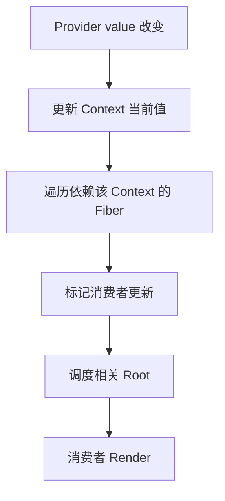

# 第 13 章 Context、自定义 Hook 与状态抽离

当多个组件需要读取同一份数据时，最直接的做法是把数据提升到共同父组件，再通过 Props 向下传递。组件层级变深之后，Context 和自定义 Hook 可以减少重复传参，让业务逻辑拥有稳定边界。

它们解决的问题不同：

- Context 负责沿组件树提供和读取值；
- 自定义 Hook 负责复用状态逻辑；
- Provider 负责确定数据的作用域和更新边界；
- 状态抽离负责把业务规则与具体视图分开。

Context 不是全局变量，也不是自动优化工具。Provider 的 `value` 改变时，读取该 Context 的组件会收到更新，因此 Context 的值设计和 Provider 的位置都需要经过规划。

## 本章学习目标

学习完本章，你应该能够：

1. 解释 Context 在 Fiber 树中的传播模型；
2. 设计带默认值和错误提示的 Context；
3. 区分 Context、Props 和外部 Store；
4. 编写可复用且不隐藏依赖的自定义 Hook；
5. 拆分 Context 的读取、写入和派生数据；
6. 处理 Provider 缺失、重复 Provider 和更新范围过大的问题。

## 13.1 源码模型：Context 如何穿过组件树

Context 的源码模型包含 Provider 当前值和消费者依赖记录两个部分。



输入是 Provider 的新值，处理过程是更新值并标记依赖消费者，输出是消费者读取到的新快照。依赖记录让 Context 更新可以绕过没有直接传 Props 的中间组件。

### 13.1.1 `createContext` 保存当前 Provider 的值

可以把 Context 简化成一个带 Provider 和 Consumer 关系的对象：

```ts
type Context<T> = {
  _currentValue: T;
  Provider: ComponentType<{ value: T; children: ReactNode }>;
};

function createContext<T>(defaultValue: T): Context<T> {
  return {
    _currentValue: defaultValue,
    Provider: /* 由 React 创建的特殊组件 */,
  } as Context<T>;
}
```

真实 React 会根据渲染器和并发场景维护更多内部字段，但核心关系不变：Provider 在树上的某个位置提供值，后代通过 `useContext` 读取最近的 Provider。

### 13.1.2 `useContext` 会登记依赖

```ts
function readContext<T>(context: Context<T>): T {
  const value = context._currentValue;
  recordContextDependency(currentlyRenderingFiber, context, value);
  return value;
}
```

读取 Context 不只是取一个变量，还会让当前 Fiber 记录“我依赖这个 Context”。当 Provider 的值变化时，React 可以找到相关消费者并安排更新。Context 更新和普通父组件传 Props 的更新路径不同，但最终仍然会回到 Fiber 调度与 Render 流程。

### 13.1.3 Provider 值使用 `Object.is` 语义判断变化

```tsx
function ThemeProvider({ children }: { children: ReactNode }) {
  const [mode, setMode] = useState<'light' | 'dark'>('light');

  const value = useMemo(
    () => ({ mode, setMode }),
    [mode],
  );

  return <ThemeContext.Provider value={value}>{children}</ThemeContext.Provider>;
}
```

如果直接写 `value={{ mode, setMode }}`，Provider 每次 Render 都会创建新对象，所有消费者都会观察到值变化。`useMemo` 只能减少不必要的引用变化，不能阻止 `mode` 真正变化时的通知。

## 13.2 设计一个安全的 Context

### 13.2.1 用 `undefined` 检查 Provider 缺失

```tsx
import { createContext, useContext, useMemo, useState } from 'react';

type Theme = 'light' | 'dark';

type ThemeContextValue = {
  theme: Theme;
  toggleTheme: () => void;
};

const ThemeContext = createContext<ThemeContextValue | undefined>(undefined);

export function ThemeProvider({ children }: { children: ReactNode }) {
  const [theme, setTheme] = useState<Theme>('light');

  const value = useMemo<ThemeContextValue>(() => ({
    theme,
    toggleTheme: () => {
      setTheme((current) => current === 'light' ? 'dark' : 'light');
    },
  }), [theme]);

  return <ThemeContext.Provider value={value}>{children}</ThemeContext.Provider>;
}

export function useTheme() {
  const value = useContext(ThemeContext);
  if (!value) {
    throw new Error('useTheme 必须在 ThemeProvider 内使用');
  }
  return value;
}
```

这样可以在组件接入错误时立即报错，而不是静默使用一个不符合业务预期的默认主题。

### 13.2.2 业务代码：用户会话

```tsx
type User = {
  id: string;
  name: string;
  permissions: string[];
};

type SessionContextValue = {
  user: User | null;
  loading: boolean;
  signOut: () => Promise<void>;
};

const SessionContext = createContext<SessionContextValue | undefined>(undefined);

export function SessionProvider({ children }: { children: ReactNode }) {
  const [user, setUser] = useState<User | null>(null);
  const [loading, setLoading] = useState(true);

  useEffect(() => {
    let cancelled = false;

    fetch('/api/session')
      .then((response) => response.ok ? response.json() : null)
      .then((nextUser: User | null) => {
        if (!cancelled) setUser(nextUser);
      })
      .finally(() => {
        if (!cancelled) setLoading(false);
      });

    return () => {
      cancelled = true;
    };
  }, []);

  const signOut = useCallback(async () => {
    await fetch('/api/logout', { method: 'POST' });
    setUser(null);
  }, []);

  const value = useMemo(
    () => ({ user, loading, signOut }),
    [user, loading, signOut],
  );

  return <SessionContext.Provider value={value}>{children}</SessionContext.Provider>;
}

export function useSession() {
  const value = useContext(SessionContext);
  if (!value) throw new Error('useSession 缺少 SessionProvider');
  return value;
}
```

生产代码还需要统一处理网络失败、401、刷新令牌和跨标签页同步。Provider 负责会话边界，具体页面不应该各自重复实现登录状态加载。

## 13.3 自定义 Hook：复用逻辑而不是共享实例

### 13.3.1 自定义 Hook 仍然属于调用它的组件

```tsx
function useOnlineStatus() {
  const [online, setOnline] = useState(() => navigator.onLine);

  useEffect(() => {
    const handleOnline = () => setOnline(true);
    const handleOffline = () => setOnline(false);

    window.addEventListener('online', handleOnline);
    window.addEventListener('offline', handleOffline);
    return () => {
      window.removeEventListener('online', handleOnline);
      window.removeEventListener('offline', handleOffline);
    };
  }, []);

  return online;
}
```

两个组件分别调用 `useOnlineStatus()` 时，它们拥有各自的 State，但各自也会注册一个监听器。自定义 Hook 复用的是代码和规则，不会自动把 State 变成共享状态。需要共享实例时，应该使用 Context 或外部 Store。

### 13.3.2 业务 Hook：分页查询

```tsx
type PageResult<T> = {
  rows: T[];
  total: number;
};

function usePagedQuery<T>(url: string, page: number, pageSize: number) {
  const [state, setState] = useState<{
    data: PageResult<T> | null;
    loading: boolean;
    error: Error | null;
  }>({ data: null, loading: true, error: null });

  useEffect(() => {
    const controller = new AbortController();
    setState((current) => ({ ...current, loading: true, error: null }));

    fetch(`${url}?page=${page}&pageSize=${pageSize}`, {
      signal: controller.signal,
    })
      .then(async (response) => {
        if (!response.ok) throw new Error(`请求失败：${response.status}`);
        return response.json() as Promise<PageResult<T>>;
      })
      .then((data) => setState({ data, loading: false, error: null }))
      .catch((error: unknown) => {
        if (error instanceof DOMException && error.name === 'AbortError') return;
        setState({ data: null, loading: false, error: error as Error });
      });

    return () => controller.abort();
  }, [url, page, pageSize]);

  return state;
}
```

Hook 的参数就是它的公开依赖。调用方改变 `url`、`page` 或 `pageSize` 时，Hook 清理旧请求并创建新请求。

## 13.4 拆分 Context 的更新范围

如果一个 Context 同时提供用户资料、主题、通知数量和编辑器草稿，任何一个字段变化都会让所有读取者收到更新。可以按变化频率拆分：

```tsx
<UserContext.Provider value={user}>
  <ThemeContext.Provider value={theme}>
    <NotificationContext.Provider value={notifications}>
      {children}
    </NotificationContext.Provider>
  </ThemeContext.Provider>
</UserContext.Provider>
```

也可以把读取和写入拆成两个 Context：

```tsx
const CartStateContext = createContext<CartState | undefined>(undefined);
const CartDispatchContext = createContext<Dispatch<CartAction> | undefined>(undefined);
```

只负责触发动作的按钮不需要订阅完整购物车状态，从而减少更新范围。若业务需要按选择器精确订阅，可以考虑外部 Store 或专门的 Context selector 方案。

## 13.5 常见错误边界

### 错误一：把 Context 当作所有状态的默认位置

局部输入框、弹窗开关和页面筛选条件通常离使用它们的组件很近。把这些值全部放进顶层 Context，会扩大更新范围，也让依赖关系变得隐蔽。

### 错误二：Provider 位置错误

```tsx
function App() {
  return (
    <Header />
    <ThemeProvider>
      <Main />
    </ThemeProvider>
  );
}
```

如果 `Header` 也需要主题，它必须位于 Provider 内。嵌套多个同类型 Provider 时，消费者读取的是最近的一个，测试环境尤其容易因为重复包装而得到意外配置。

### 错误三：默认值掩盖接入错误

```tsx
const AuthContext = createContext({ user: null, logout: () => {} });
```

组件忘记包在 Provider 中时，页面看起来像“未登录”，真实错误却被隐藏。对必须存在的依赖，使用 `undefined` 加自定义 Hook 检查更容易定位问题。

### 错误四：Hook 隐藏副作用和网络请求

Hook 名称应表达它会做什么。`useUser()` 如果会发请求、写缓存和跳转路由，调用者需要知道这些行为，否则很难预判 Render 后的工作和错误处理。

### 错误五：在自定义 Hook 中违反 Hook 规则

```tsx
function useData(enabled: boolean) {
  if (enabled) {
    useEffect(() => {}, []);
  }
}
```

Hook 必须在每次调用中保持相同顺序。条件应放在 Hook 内部：

```tsx
function useData(enabled: boolean) {
  useEffect(() => {
    if (!enabled) return;
    // 执行同步逻辑
  }, [enabled]);
}
```

## 13.6 测试与错误恢复

Context 测试应提供最小 Provider：

```tsx
function renderWithTheme(ui: ReactNode, theme: Theme = 'light') {
  return render(
    <ThemeProvider initialTheme={theme}>
      {ui}
    </ThemeProvider>,
  );
}
```

网络型 Hook 应验证四条路径：初始加载、成功、失败、卸载或参数变化时取消。对于会话 Provider，接口失败不应导致整个应用白屏，可以将“未登录”“加载失败”和“网络暂时不可用”建模成不同状态，交给上层决定展示方式。

## 13.7 练习题

1. 为什么两个组件分别调用同一个自定义 Hook 时，State 不会自动共享？
2. 实现 `useLocalStorageState<T>(key, initialValue)`，处理 JSON 解析失败和服务端没有 `window` 的情况。
3. 设计一个购物车 Context，把“状态读取”和“派发动作”拆开。
4. 一个页面有 20 个组件读取 `AppContext`，其中只有一个字段每秒更新。请提出至少两种降低更新范围的方案。
5. 为 `usePagedQuery` 增加 `retry` 和 `refresh` 能力，并保证旧请求不会覆盖新请求。
6. 写一个测试，证明组件脱离 `SessionProvider` 时会得到明确错误。

## 本章小结

Context 负责沿组件树传递依赖，自定义 Hook 负责复用状态逻辑，Provider 决定共享状态的生命周期和作用域。清晰的 Context 值、稳定的 Provider 边界和可见的 Hook 依赖，能让共享状态既方便使用，又保持可测试性。