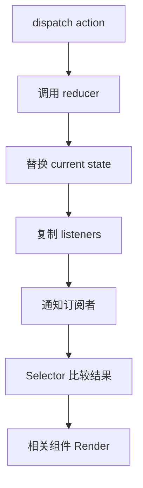

# 第 15 章 Redux 的工作原理

Redux 的核心不是某个 React Hook，而是一套可预测的状态转换协议：

```text
dispatch(Action)
  -> Middleware 链
  -> Reducer(state, action)
  -> 新 Store State
  -> 通知订阅者
  -> React 读取新快照并更新组件
```

Redux 把“发生了什么”写成 Action，把“状态如何变化”写成 Reducer，把共享状态存放在 Store。React-Redux 负责把外部 Store 与 React 的渲染生命周期连接起来。

现代项目通常使用 Redux Toolkit（RTK）减少样板代码。理解底层协议仍然重要，因为它能解释派发、不可变更新、Selector、Middleware 和异步请求之间的关系。

## 本章学习目标

学习完本章，你应该能够：

1. 手写一个最小 Redux Store；
2. 解释 Action、Reducer、Dispatch 和订阅者的关系；
3. 理解 React-Redux 如何订阅 Store；
4. 使用 Redux Toolkit 设计 Slice 和 Selector；
5. 区分 Thunk、Middleware 和服务端缓存；
6. 处理不可变更新、竞态、错误和持久化边界。

## 15.1 源码模型：最小 Store

Redux Store 的核心是把状态替换和订阅通知集中在一个对象中：



输入是 Action，处理过程是 Reducer 生成新状态并通知订阅者，输出是选择器读取的新快照。订阅通知不等于所有组件都必须更新，React-Redux 还会通过选择器和引用比较缩小影响范围。

### 15.1.1 Store 的四个核心能力

```ts
type Action = { type: string; payload?: unknown };
type Reducer<S> = (state: S | undefined, action: Action) => S;
type Listener = () => void;

function createStore<S>(reducer: Reducer<S>) {
  let state = reducer(undefined, { type: '@@init' });
  const listeners = new Set<Listener>();

  return {
    getState() {
      return state;
    },
    dispatch(action: Action) {
      state = reducer(state, action);
      listeners.forEach((listener) => listener());
      return action;
    },
    subscribe(listener: Listener) {
      listeners.add(listener);
      return () => listeners.delete(listener);
    },
  };
}
```

这段代码展示了 Redux 的基本约束：Reducer 在 Dispatch 期间同步计算下一个状态，Store 更新完成后通知订阅者，订阅者通过 `getState()` 读取新快照。

真实 Redux 还会检查 Reducer 是否在执行期间递归 Dispatch，处理替换 Reducer、增强器和开发提示。

### 15.1.2 Middleware 是包裹 Dispatch 的函数

```ts
type Middleware =
  (api: { getState: () => unknown; dispatch: (action: unknown) => unknown })
  => (next: (action: unknown) => unknown)
  => (action: unknown) => unknown;

const logger: Middleware = (api) => (next) => (action) => {
  console.log('before', api.getState());
  const result = next(action);
  console.log('after', api.getState());
  return result;
};
```

多个 Middleware 会组成洋葱式调用链：

```text
dispatch
  -> logger 前置
    -> thunk 判断
      -> next
        -> Reducer
      <- thunk 返回
  <- logger 后置
```

Middleware 可以处理日志、异步函数、错误上报和性能指标，但不要在 Middleware 中偷偷修改 State。状态变化仍应由 Reducer 负责。

### 15.1.3 React-Redux 的订阅边界

React-Redux 的 Provider 将 Store 放入 Context，组件通过 `useSelector` 读取选择器结果，通过 `useDispatch` 派发 Action。概念上可以写成：

```tsx
function useSelector<T>(selector: (state: RootState) => T): T {
  const store = useReduxStore();
  return useSyncExternalStore(
    store.subscribe,
    () => selector(store.getState()),
    () => selector(store.getState()),
  );
}
```

真实实现还要处理选择器结果比较、嵌套订阅、批量更新以及服务端快照。组件不应该直接把整个 `state` 返回给 `useSelector`，否则任何字段变化都会让它更新。

## 15.2 使用 Redux Toolkit

### 15.2.1 Slice 集中描述状态和 Action

```tsx
import { createSlice, PayloadAction } from '@reduxjs/toolkit';

type CartItem = {
  productId: string;
  name: string;
  quantity: number;
};

type CartState = {
  items: CartItem[];
};

const initialState: CartState = { items: [] };

const cartSlice = createSlice({
  name: 'cart',
  initialState,
  reducers: {
    itemAdded(state, action: PayloadAction<CartItem>) {
      const existing = state.items.find(
        (item) => item.productId === action.payload.productId,
      );

      if (existing) existing.quantity += action.payload.quantity;
      else state.items.push(action.payload);
    },
    itemRemoved(state, action: PayloadAction<string>) {
      state.items = state.items.filter(
        (item) => item.productId !== action.payload,
      );
    },
    quantityChanged(
      state,
      action: PayloadAction<{ productId: string; quantity: number }>,
    ) {
      const item = state.items.find(
        (current) => current.productId === action.payload.productId,
      );
      if (item) item.quantity = Math.max(1, action.payload.quantity);
    },
  },
});

export const { itemAdded, itemRemoved, quantityChanged } = cartSlice.actions;
export default cartSlice.reducer;
```

RTK 的 Immer 允许在 Reducer 中写出类似修改的代码，但它会根据修改记录生成不可变的新 State。这个便利只在 Immer 管理的 Reducer 中成立，不能把同样的写法带到普通组件 State 或普通 Reducer 里。

### 15.2.2 Store 和类型化 Hook

```tsx
const store = configureStore({
  reducer: {
    cart: cartReducer,
    session: sessionReducer,
  },
});

type RootState = ReturnType<typeof store.getState>;
type AppDispatch = typeof store.dispatch;

export function useAppSelector<T>(selector: (state: RootState) => T) {
  return useSelector(selector);
}

export function useAppDispatch() {
  return useDispatch<AppDispatch>();
}
```

在 React 入口处提供 Store：

```tsx
createRoot(document.getElementById('root')!).render(
  <Provider store={store}>
    <App />
  </Provider>,
);
```

测试时可以为每个测试创建新的 Store，避免测试之间共享旧 State。

## 15.3 Selector 与派生数据

```tsx
const selectCartItems = (state: RootState) => state.cart.items;

const selectCartTotal = createSelector(
  [selectCartItems],
  (items) => items.reduce((sum, item) => sum + item.quantity, 0),
);

function CartBadge() {
  const total = useAppSelector(selectCartTotal);
  return <span aria-label="购物车数量">{total}</span>;
}
```

Selector 有三个作用：

- 隐藏 State 的存储结构；
- 在读取处计算派生数据；
- 在结果没有变化时复用引用，减少组件更新。

Selector 的输入和输出都要保持纯函数特征。不要在 Selector 中发请求、修改 Store 或依赖当前时间。

## 15.4 异步与 Thunk

### 15.4.1 Thunk 的核心思想

Thunk Middleware 可以让 `dispatch` 接收函数：

```ts
type Thunk = (dispatch: Dispatch, getState: () => RootState) => unknown;

const thunkMiddleware: Middleware = ({ dispatch, getState }) => (next) => (action) => {
  if (typeof action === 'function') {
    return action(dispatch, getState);
  }
  return next(action);
};
```

业务请求通常需要显式建模 pending、fulfilled 和 rejected：

```tsx
export const loadProfile = createAsyncThunk(
  'profile/load',
  async (userId: string, { signal, rejectWithValue }) => {
    const response = await fetch(`/api/users/${userId}`, { signal });
    if (!response.ok) return rejectWithValue('用户不存在');
    return response.json() as Promise<User>;
  },
);
```

Reducer 根据生命周期 Action 更新状态：

```tsx
extraReducers: (builder) => {
  builder
    .addCase(loadProfile.pending, (state) => {
      state.status = 'loading';
      state.error = null;
    })
    .addCase(loadProfile.fulfilled, (state, action) => {
      state.status = 'success';
      state.user = action.payload;
    })
    .addCase(loadProfile.rejected, (state, action) => {
      if (action.meta.aborted) return;
      state.status = 'error';
      state.error = String(action.payload ?? action.error.message);
    });
},
```

### 15.4.2 Redux 不等于服务端缓存

Redux 适合需要跨页面共享、可回放和可审计的客户端业务状态。服务端查询通常还需要缓存 Key、失效、重试、预取和请求去重。可以使用 RTK Query 等方案统一这些语义，避免手动在多个 Slice 中复制请求生命周期。

## 15.5 业务代码：权限与导航

```tsx
type PermissionState = {
  status: 'unknown' | 'ready';
  codes: string[];
};

const permissionSlice = createSlice({
  name: 'permission',
  initialState: { status: 'unknown', codes: [] } as PermissionState,
  reducers: {
    permissionsLoaded(state, action: PayloadAction<string[]>) {
      state.status = 'ready';
      state.codes = action.payload;
    },
    permissionsCleared(state) {
      state.status = 'ready';
      state.codes = [];
    },
  },
});

const selectCan = (code: string) => (state: RootState) =>
  state.permission.codes.includes(code);

function ExportButton() {
  const canExport = useAppSelector(selectCan('report:export'));
  if (!canExport) return null;
  return <button>导出报表</button>;
}
```

按钮级权限只控制界面可见性，真正的接口仍必须在服务端检查权限。前端隐藏按钮不是安全边界。

## 15.6 常见错误边界

### 错误一：Reducer 直接修改普通 State

```ts
function reducer(state: State, action: Action) {
  state.items.push(action.item);
  return state;
}
```

普通 Redux Reducer 必须返回新的引用。RTK Slice 中可以使用 Immer 语法，但要清楚代码运行在哪个 Reducer 环境。

### 错误二：Selector 每次都返回新对象

```tsx
const view = useAppSelector((state) => ({
  user: state.session.user,
  theme: state.settings.theme,
}));
```

这个对象每次读取都新建，默认比较会认为发生变化。可以拆成两个 Selector，或使用记忆化 Selector，并保证输入依赖正确。

### 错误三：Store 里保存不可序列化对象

函数、Promise、DOM 节点、AbortController 和类实例放进 Store，会破坏时间旅行、持久化和调试。请求句柄放在组件 Ref 或请求库内部，Store 只保存可序列化的业务结果和状态。

### 错误四：异步响应覆盖新请求

用户先查看 A 再快速查看 B，如果 A 的响应后到，旧数据可能覆盖 B。使用 `requestId`、AbortSignal 或请求库的 Key 校验：

```ts
if (action.meta.requestId !== state.currentRequestId) return;
```

### 错误五：只在前端判断权限

前端权限控制改善体验，服务端鉴权保护资源。任何敏感接口都必须独立验证用户身份和权限。

### 错误六：一个 Slice 包含所有领域

把用户、订单、消息和 UI 弹窗放在一个巨大 Slice 中，会让 Action 名称、测试和更新范围逐渐失控。按业务领域拆分，再通过 Selector 组合跨领域视图。

## 15.7 测试 Redux

Reducer 测试应是纯输入输出测试：

```tsx
it('增加相同商品时合并数量', () => {
  const state = cartReducer(
    { items: [{ productId: 'p1', name: '书', quantity: 1 }] },
    itemAdded({ productId: 'p1', name: '书', quantity: 2 }),
  );

  expect(state.items[0].quantity).toBe(3);
});
```

组件测试应通过用户行为派发真实事件，验证页面结果，而不是断言组件内部调用了某个 Action。异步测试要覆盖成功、失败、取消和重复请求顺序。

## 15.8 练习题

1. 手写 `createStore`，加入禁止 Reducer 中递归 Dispatch 的检查。
2. 解释为什么 Selector 返回新对象会造成重复 Render，并给出两种修复方式。
3. 用 Redux Toolkit 写一个上传 Slice，包含 idle、uploading、success、error 四种状态。
4. 为异步用户搜索加入 `requestId` 校验，确保旧响应不能覆盖新查询。
5. 设计一个不可序列化数据边界：哪些数据放 Redux，哪些数据放 Ref 或服务端缓存？
6. 为权限 Selector 编写测试，并说明为什么前端权限不是安全边界。

## 本章小结

Redux 用 Action 描述事件，用 Reducer 计算新状态，用 Store 统一保存和通知，用 Middleware 扩展 Dispatch。Redux Toolkit 让这些规则更易写、更易维护，但不可变更新、Selector 纯度、异步竞态和服务端鉴权仍然需要开发者明确处理。