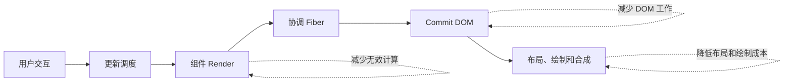

# 第 18 章 React 性能优化方法

React 性能优化的目标不是让所有组件都“零 Render”，而是在真实用户操作中减少可感知的等待、卡顿和资源浪费。优化通常分成四层：

1. 减少需要处理的数据量；
2. 缩小更新影响的组件范围；
3. 避免重复计算和重复网络请求；
4. 把必要工作安排到合适的优先级和时间。

`React.memo`、`useMemo` 和 `useCallback` 只是其中一小部分。列表虚拟化、代码分割、Transition、Deferred Value、缓存和服务端渲染同样重要。

## 本章学习目标

学习完本章，你应该能够：

1. 使用 Profiler 和 Performance 面板定位瓶颈；
2. 选择状态拆分、组件拆分和选择器优化；
3. 实现基础虚拟列表；
4. 区分防抖、节流、Transition 和 Deferred Value；
5. 使用懒加载和资源预取控制首屏成本；
6. 评估优化的正确性和维护成本。

## 18.1 源码模型：优化影响调度、Render 和浏览器工作

性能优化需要先定位工作发生在哪一层：



输入是一次交互和数据变化，处理过程是分别测量调度、Render、Commit 和浏览器阶段，输出是有证据支持的优化选择。`memo`、缓存、状态下沉、虚拟列表和 Worker 解决的是不同阶段的问题，不能互相替代。

### 18.1.1 更新优先级

React 18 会把更新放入不同 Lane。用户输入通常需要尽快响应，报表筛选、预览计算和列表切换可以作为较低优先级工作：

```tsx
const [isPending, startTransition] = useTransition();

function handleChange(value: string) {
  setInput(value);
  startTransition(() => {
    setFilter(value);
  });
}
```

这不会让计算量消失，只是允许 React 在更紧急的更新到来时先处理它们。Transition 内的更新仍可能很重，如果单次计算阻塞主线程，仍要拆分数据、虚拟化或交给 Worker。

### 18.1.2 Bailout 和缓存

当 Props、Context 和待处理更新允许时，Fiber 可以复用已有子树。`memo` 和稳定引用帮助 React 判断是否可以 Bailout；但如果 Context 高频变化、子组件自身有 State 或选择器每次返回新对象，仍然会继续工作。

### 18.1.3 代码分割延后模块执行

```tsx
const ReportPage = lazy(() => import('./ReportPage'));

<Suspense fallback={<PageSkeleton />}>
  <ReportPage />
</Suspense>
```

懒加载把模块下载和解析推迟到真正需要的时刻。Suspense 只负责展示等待状态，模块加载失败仍需要 Error Boundary 处理。

## 18.2 先测量再优化

一个完整的性能调查至少包含：

- 真实设备和真实数据量；
- 用户操作到反馈出现的时间；
- React Render 和 Commit 耗时；
- JavaScript 长任务和主线程占用；
- 网络、脚本解析、图片和字体成本；
- 优化后错误率和交互是否变化。

可以建立简单的用户计时：

```tsx
function measureSearch() {
  performance.mark('search-start');
  // 更新搜索状态
  requestAnimationFrame(() => {
    performance.mark('search-painted');
    performance.measure('search-feedback', 'search-start', 'search-painted');
  });
}
```

测量结果应按设备、网络和数据规模分组。只在开发机器上观察一次，不足以证明优化有效。

## 18.3 状态拆分和组件边界

```tsx
function ProductPage() {
  return (
    <>
      <SearchPanel />
      <ProductResults />
      <CartSummary />
    </>
  );
}
```

让搜索输入、结果列表和购物车分别拥有最小必要状态，可以避免一个字段变化触发整个页面。组件拆分不是越细越好：过度拆分会增加 Props 传递、组件数量和调试成本，应围绕更新边界和职责拆分。

## 18.4 虚拟列表

当列表有数万行时，把所有 DOM 节点一次性挂载会增加 Render、布局和内存成本。固定行高的基础虚拟列表如下：

```tsx
type VirtualListProps<T> = {
  items: T[];
  rowHeight: number;
  height: number;
  renderRow: (item: T, index: number) => ReactNode;
};

function VirtualList<T>({ items, rowHeight, height, renderRow }: VirtualListProps<T>) {
  const [scrollTop, setScrollTop] = useState(0);
  const overscan = 4;
  const first = Math.max(0, Math.floor(scrollTop / rowHeight) - overscan);
  const count = Math.ceil(height / rowHeight) + overscan * 2;
  const visible = items.slice(first, first + count);

  return (
    <div
      style={{ height, overflow: 'auto' }}
      onScroll={(event) => setScrollTop(event.currentTarget.scrollTop)}
    >
      <div style={{ height: items.length * rowHeight, position: 'relative' }}>
        {visible.map((item, offset) => {
          const index = first + offset;
          return (
            <div
              key={index}
              style={{
                position: 'absolute',
                top: index * rowHeight,
                height: rowHeight,
                width: '100%',
              }}
            >
              {renderRow(item, index)}
            </div>
          );
        })}
      </div>
    </div>
  );
}
```

真实列表还要考虑动态高度、可访问性、键盘导航、滚动定位、首尾占位和数据变化。动态行高应使用成熟库或经过充分测试的测量策略。

## 18.5 Transition 和 Deferred Value

### 18.5.1 Transition：把更新标记为非紧急

```tsx
function SearchPage() {
  const [input, setInput] = useState('');
  const [query, setQuery] = useState('');
  const [isPending, startTransition] = useTransition();

  function handleChange(value: string) {
    setInput(value);
    startTransition(() => setQuery(value));
  }

  return (
    <>
      <input value={input} onChange={(event) => handleChange(event.target.value)} />
      {isPending && <span>正在更新结果…</span>}
      <Results query={query} />
    </>
  );
}
```

输入框使用紧急更新，结果列表使用 Transition。结果组件必须允许在旧数据和新数据之间短暂过渡。

### 18.5.2 `useDeferredValue`：延后读取一个值

```tsx
const deferredQuery = useDeferredValue(query);
return <LargeResultList query={deferredQuery} />;
```

它适合父组件已经拥有查询值，而下游子树可以稍后跟进的场景。它不是防抖，不会减少请求次数，也不保证固定延迟。网络请求仍应通过 Key、取消和缓存策略控制。

### 18.5.3 防抖和节流属于事件层

```tsx
const search = useMemo(
  () => debounce((value: string) => fetchResults(value), 300),
  [],
);

useEffect(() => () => search.cancel(), [search]);
```

防抖等待用户停止输入再执行，节流限制一段时间内的执行次数；Transition 调整 React 更新优先级，三者解决的问题不同。

## 18.6 `React.memo` 和选择器优化

```tsx
const Row = memo(function Row({ id, name, selected, onSelect }: RowProps) {
  return (
    <button aria-pressed={selected} onClick={() => onSelect(id)}>
      {name}
    </button>
  );
});
```

如果每个 Row 都收到全新的 `onSelect`，Memo 可能失效。可以把回调改成稳定的事件入口，或使用列表项级选择器。优化时应验证：

- Props 是否确实稳定；
- 子组件是否昂贵；
- 比较本身是否比 Render 更贵；
- Context 是否绕过了预期的 Bailout。

## 18.7 图片、模块和数据的加载策略

```tsx

```

图片应提供尺寸，减少布局偏移；首屏关键资源可以预加载，非关键内容延迟加载。路由模块可以懒加载，用户即将进入的页面可以在空闲时或悬停时预取，但预取要结合带宽和缓存策略。

服务端数据可以通过分页、窗口化、缓存和预取减少重复请求。不要为了少一次请求而把数万条记录全部传给浏览器。

## 18.8 常见错误边界

### 错误一：只优化 Render，不看网络和资源

首屏慢可能来自 JavaScript 体积、图片、字体或 API 延迟。React Profiler 看不到所有浏览器成本，需要配合 Network 和 Performance 面板。

### 错误二：Transition 包住输入本身

如果把输入框的受控值也放进 Transition，输入反馈可能变慢。紧急的输入状态与非紧急的结果状态应分开。

### 错误三：虚拟列表使用数组下标作为永久身份

列表排序或插入时，下标会对应不同数据，输入状态可能错位。可视行的 Key 应使用稳定的数据 ID。

### 错误四：防抖解决不了旧响应覆盖

防抖只减少请求次数，不能保证响应顺序。仍要使用 AbortSignal、请求 ID 或服务端查询版本。

### 错误五：缓存导致数据过期

缓存必须有失效策略、手动刷新和错误恢复。对于权限、库存和价格等数据，不能无期限使用旧值。

### 错误六：把优化代码写成不可维护的魔法

复杂缓存、手工比较和自制虚拟化组件都要有测量数据、边界测试和注释。收益消失时，应允许删除优化。

## 18.9 练习题

1. 使用 Profiler 分析一个列表输入页面，记录优化前后的 Render 时间。
2. 实现固定高度虚拟列表，加入 overscan、空数据和键盘可访问性。
3. 比较防抖、节流、Transition 和 Deferred Value 的触发时机。
4. 为懒加载页面增加 Error Boundary，模拟模块下载失败并提供重试。
5. 设计图片加载策略，降低首屏布局偏移和非关键资源竞争。
6. 找出一个缓存策略，列出它的失效条件、刷新入口和错误恢复方式。

## 本章小结

性能优化从测量开始，依次关注数据量、更新范围、重复计算和调度时机。状态拆分、虚拟列表、代码分割、Transition、Deferred Value 和缓存分别解决不同瓶颈。任何优化都要在真实交互、真实数据和错误场景下验证。