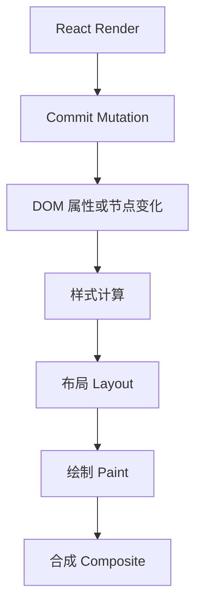

# 第 19 章 浏览器渲染与 React 性能

React 的 Commit 结束后，浏览器还要完成样式计算、布局、绘制和合成。页面卡顿不一定来自 React，React Render 快也不代表浏览器已经完成了一帧。

理解浏览器流水线，可以解释这些问题：

- 为什么频繁读取布局又修改样式会抖动；
- 为什么大面积阴影和滤镜会增加绘制成本；
- 为什么 `transform` 动画通常比改变 `top` 更容易保持流畅；
- 为什么一个长任务会让输入和流式文本都延迟；
- 为什么页面在高刷新率设备上更容易暴露性能问题。

## 本章学习目标

学习完本章，你应该能够：

1. 描述 JavaScript、样式、布局、绘制和合成的关系；
2. 区分 React Render/Commit 与浏览器 Paint；
3. 识别布局抖动和长任务；
4. 设计 `requestAnimationFrame` 驱动的交互；
5. 使用 CSS 和 DOM API 减少不必要的布局工作；
6. 用 Performance 面板验证用户感知性能。

## 19.1 源码模型：React Commit 后发生什么

React Commit 完成后，浏览器仍然需要处理样式、布局、绘制和合成：



输入是 Commit 阶段的宿主修改，处理过程是浏览器根据 DOM 和 CSS 重新计算视觉结果，输出是屏幕上的一帧。源码阅读不能把 React Render 时间等同于用户看到的完整响应时间。

一次典型的更新可以表示为：

```text
React Render
  -> React Commit：设置属性、插入节点、运行 Layout Effect
  -> 浏览器样式计算
  -> Layout：计算几何尺寸和位置
  -> Paint：生成绘制指令
  -> Composite：合成图层
  -> 屏幕显示
```

这不是每次更新都会完整执行所有步骤。浏览器会根据修改的属性和渲染树变化决定需要做哪些工作。React 不能直接保证某个更新只触发合成，也不能代替浏览器完成布局。

### 19.1.1 Layout Effect 的位置

`useLayoutEffect` 在 DOM Commit 后、浏览器绘制前执行，适合读取布局并同步修正需要立即显示的视觉结果：

```tsx
function Tooltip({ anchor }: { anchor: HTMLElement }) {
  const ref = useRef<HTMLDivElement>(null);

  useLayoutEffect(() => {
    const box = anchor.getBoundingClientRect();
    ref.current?.style.setProperty('top', `${box.bottom + 8}px`);
  }, [anchor]);

  return <div ref={ref}>提示</div>;
}
```

Layout Effect 执行太久会阻塞首次绘制。在服务端渲染场景中，它还需要使用只在客户端执行的封装，避免服务器环境警告。

### 19.1.2 Effect 与下一帧

普通 `useEffect` 通常在浏览器绘制后处理，但具体时机取决于更新来源和调度。不要把 `useEffect` 当作精确的帧回调；需要对齐浏览器帧时使用 `requestAnimationFrame`。

## 19.2 布局抖动

下面的代码在循环中交替读取和写入布局：

```tsx
for (const item of items) {
  const height = item.getBoundingClientRect().height;
  item.style.top = `${height}px`;
}
```

读取布局可能迫使浏览器立刻计算此前积累的样式变化，随后写入又使布局失效，循环会反复触发同步计算。

可以批量读取，再批量写入：

```tsx
const heights = items.map((item) => item.getBoundingClientRect().height);

items.forEach((item, index) => {
  item.style.top = `${heights[index]}px`;
});
```

更复杂的场景可使用 `ResizeObserver`、CSS Grid、容器查询或虚拟列表，把布局交给浏览器和专门的测量策略。

## 19.3 `requestAnimationFrame` 驱动视觉更新

滚动和拖拽事件可能在一帧内触发多次。可以将最新位置合并到下一帧：

```tsx
function useRafScroll() {
  const [scrollY, setScrollY] = useState(0);
  const frame = useRef<number | null>(null);
  const latest = useRef(0);

  useEffect(() => {
    const onScroll = () => {
      latest.current = window.scrollY;
      if (frame.current !== null) return;

      frame.current = requestAnimationFrame(() => {
        frame.current = null;
        setScrollY(latest.current);
      });
    };

    window.addEventListener('scroll', onScroll, { passive: true });
    return () => {
      window.removeEventListener('scroll', onScroll);
      if (frame.current !== null) cancelAnimationFrame(frame.current);
    };
  }, []);

  return scrollY;
}
```

这段 Hook 只保留一帧内最后的位置。它仍可能导致组件频繁更新，因此消费方还应保持轻量，或只在滚动区间改变时更新。

## 19.4 CSS 属性与合成

改变不同属性可能触发不同范围的浏览器工作：

- 修改布局相关属性，如 `width`、`height`、`top`，可能需要重新布局；
- 修改颜色、阴影等可能需要重新绘制；
- 使用 `transform` 和 `opacity` 在合适条件下可以主要交给合成阶段。

```css
.card {
  transition: transform 180ms ease, opacity 180ms ease;
}

.card[data-opening='true'] {
  transform: translateY(0);
  opacity: 1;
}
```

这不是绝对规则。图层创建、滤镜、复杂阴影和大面积透明也有成本，`will-change` 不能大量滥用。应使用 Performance 面板确认实际渲染路径。

## 19.5 业务代码：拖拽预览

```tsx
function DragPreview() {
  const [point, setPoint] = useState({ x: 0, y: 0 });
  const [dragging, setDragging] = useState(false);

  function move(event: PointerEvent) {
    if (!dragging) return;
    setPoint({ x: event.clientX, y: event.clientY });
  }

  return (
    <div
      onPointerDown={() => setDragging(true)}
      onPointerMove={(event) => move(event.nativeEvent)}
      onPointerUp={() => setDragging(false)}
      style={{
        transform: `translate3d(${point.x}px, ${point.y}px, 0)`,
        touchAction: 'none',
      }}
    >
      拖拽我
    </div>
  );
}
```

实际拖拽组件需要处理指针捕获、离开窗口、取消事件、边界吸附和键盘操作。对于高频移动，最好使用 Ref 保存最新坐标，并在 `requestAnimationFrame` 中批量写入 DOM，避免每个 PointerMove 都让复杂 React 子树 Render。

## 19.6 长任务和主线程

浏览器主线程通常同时处理 JavaScript、事件、样式和绘制。一个同步函数执行太久，会阻塞输入和绘制：

```tsx
function parseLargeFile(text: string) {
  // 一次处理数百万字符，可能形成长任务
  return expensiveParse(text);
}
```

拆分任务可以给浏览器机会处理用户输入：

```tsx
async function parseInChunks(lines: string[]) {
  const result: ParsedLine[] = [];

  for (let index = 0; index < lines.length; index += 500) {
    result.push(...parseLines(lines.slice(index, index + 500)));
    await new Promise<void>((resolve) => setTimeout(resolve, 0));
  }

  return result;
}
```

`setTimeout(0)` 不一定是最佳调度方式，也可以使用 `scheduler.postTask`、`requestIdleCallback` 或 Web Worker，具体取决于浏览器支持和任务优先级。CPU 密集型解析更适合 Worker，避免阻塞 UI 主线程。

## 19.7 React 与浏览器测量的配合

```tsx
function MeasuredPanel() {
  const ref = useRef<HTMLDivElement>(null);
  const [height, setHeight] = useState(0);

  useLayoutEffect(() => {
    const node = ref.current;
    if (!node) return;

    const observer = new ResizeObserver(([entry]) => {
      setHeight(entry.contentRect.height);
    });
    observer.observe(node);
    return () => observer.disconnect();
  }, []);

  return (
    <>
      <div ref={ref}>内容</div>
      <output>{height}px</output>
    </>
  );
}
```

`ResizeObserver` 把尺寸变化转成可处理的事件，不需要每次 Render 都主动测量。尺寸状态如果只用于 CSS，可以优先使用 CSS 自定义属性或容器查询，减少 React 更新。

## 19.8 常见错误边界

### 错误一：把 React Profiler 当作完整浏览器性能工具

Profiler 主要观察 React 工作。图片解码、CSS、布局、绘制、合成和第三方脚本需要使用浏览器 Performance、Rendering 和 Memory 工具。

### 错误二：在 Render 中读写 DOM

Render 可能被中断和重试，DOM 也可能还没有 Commit。DOM 测量和命令式操作放在 Ref、Layout Effect 或事件处理函数中。

### 错误三：无限使用 `will-change`

`will-change` 可能提前创建图层并占用显存。只在即将变化的元素上短时间使用，或优先使用稳定的 CSS 动画验证效果。

### 错误四：把滚动事件设置为非被动后执行重活

`passive: true` 有助于浏览器及时处理滚动，但回调中仍不能执行大计算。滚动监听应保持短小，视觉更新按帧合并。

### 错误五：通过 `setState` 保存每一个高频事件

鼠标移动、指针移动和滚动可能每秒触发很多次。不是所有原始事件都需要进入 React State。可以先用 Ref 缓冲，再按帧或按业务阈值更新。

### 错误六：只在高性能电脑上测试

低端设备、高刷新率屏幕和移动网络会放大长任务、布局和资源下载问题。性能预算应基于目标用户设备。

## 19.9 练习题

1. 使用浏览器 Performance 面板记录一次长列表滚动，标出 JavaScript、Layout、Paint 和 Composite。
2. 将一个读写交替的布局循环改为批量读取和批量写入。
3. 用 `requestAnimationFrame` 实现平滑滚动进度条，并保证卸载时取消帧回调。
4. 比较 `top` 动画和 `transform` 动画的实际耗时与图层变化。
5. 将一个大文件解析任务拆成 Worker 或分块任务，并验证输入不会被长时间阻塞。
6. 为一个动态面板选择 CSS 容器查询、ResizeObserver 或 React State，说明选择依据。

## 本章小结

React Commit 只是页面更新链路的一部分。浏览器还要处理样式、布局、绘制和合成，主线程上的长任务会影响输入和绘制。把测量、DOM 操作和高频事件放进正确的阶段，并使用批量更新、合成友好的属性和 Worker，才能从 React 到屏幕完整改善性能。