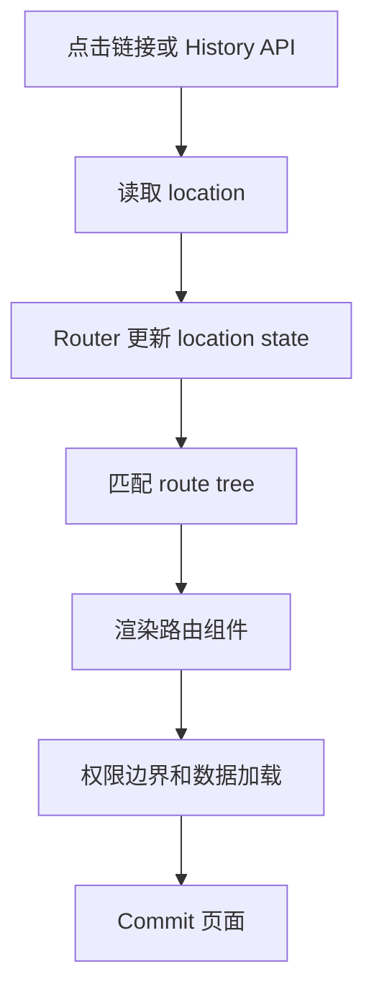

# 第 21 章 React Router 与权限系统

路由不仅是“根据 URL 显示组件”。一个完整的路由系统还要处理：

- 路径匹配和参数解析；
- 嵌套路由和布局复用；
- 页面加载、懒加载和错误边界；
- 登录状态恢复和鉴权跳转；
- 返回地址和浏览器历史；
- 页面级、按钮级和接口级权限。

前端路由改善导航体验，真正的资源保护仍由服务端完成。任何隐藏按钮或客户端守卫都不能代替服务端授权。

## 本章学习目标

学习完本章，你应该能够：

1. 解释浏览器路由和 React 路由的关系；
2. 设计嵌套路由、布局和错误边界；
3. 处理参数、查询字符串和返回地址；
4. 区分认证、授权、路由守卫和接口鉴权；
5. 设计加载状态、重定向和权限失败页面；
6. 测试登录、刷新、深链接和无权限访问。

## 21.1 源码模型：URL 如何变成组件树

路由更新本质上是外部 URL 变化进入 React 状态和组件匹配流程：



输入是 URL 和导航事件，处理过程是生成匹配结果并触发相关状态更新，输出是新的路由组件树。浏览器 History API 自身不会执行 React Render，Router 才把地址变化接入 React。

### 21.1.1 浏览器导航事件

```text
点击 Link / 调用 navigate
  -> history.pushState 或 replaceState
  -> Router 监听 location
  -> 匹配 route config
  -> 生成嵌套 Element 树
  -> React Render
  -> Commit 页面内容
```

浏览器原生 History API 只改变地址和历史记录，不会自动渲染 React。Router 把 Location 转换成路由匹配结果，再通过 State 更新 React。

### 21.1.2 路由匹配是树上的选择

```ts
type Route = {
  path?: string;
  element: ReactNode;
  children?: Route[];
};

const routes = [
  {
    element: <AppLayout />,
    children: [
      { path: '/', element: <HomePage /> },
      {
        path: '/projects/:projectId',
        element: <ProjectLayout />,
        children: [
          { index: true, element: <ProjectOverview /> },
          { path: 'settings', element: <ProjectSettings /> },
        ],
      },
    ],
  },
];
```

匹配 `/projects/p1/settings` 时，Router 会得到从根布局到项目布局再到设置页的一组嵌套结果。布局组件通过 `Outlet` 显示下一级内容。

### 21.1.3 路由参数和查询参数来源不同

```tsx
function ProjectPage() {
  const { projectId } = useParams();
  const [searchParams] = useSearchParams();
  const tab = searchParams.get('tab') ?? 'overview';

  return <ProjectView projectId={projectId!} tab={tab} />;
}
```

路径参数通常标识资源，查询参数通常表示筛选、排序或视图状态。参数变化可能需要重新加载数据，也可能只更新本地视图，业务应明确区分。

## 21.2 嵌套路由与加载边界

### 21.2.1 布局代码

```tsx
function AppLayout() {
  return (
    <div className="app-shell">
      <Navigation />
      <main>
        <Outlet />
      </main>
    </div>
  );
}

function ProjectLayout() {
  return (
    <section>
      <ProjectHeader />
      <Suspense fallback={<ProjectSkeleton />}>
        <Outlet />
      </Suspense>
    </section>
  );
}
```

布局保持导航和共享资源，子路由只负责变化区域。Suspense 可以展示等待状态，但懒加载模块失败时仍需要错误边界。

### 21.2.2 路由级懒加载

```tsx
const ProjectSettings = lazy(() => import('./pages/ProjectSettings'));

const routes = [
  {
    path: '/projects/:projectId/settings',
    element: (
      <RouteErrorBoundary>
        <Suspense fallback={<PageSkeleton />}>
          <ProjectSettings />
        </Suspense>
      </RouteErrorBoundary>
    ),
  },
];
```

错误边界应提供重试或返回上一级的操作。若 Chunk 版本已过期，重试可以重新加载入口，但要避免无限刷新循环。

## 21.3 认证和授权

### 21.3.1 两个不同问题

- **认证 Authentication**：用户是谁，登录状态是否有效；
- **授权 Authorization**：这个用户能否执行某个动作或访问某个资源。

路由守卫可以根据当前认证状态决定界面导航：

```tsx
function RequireAuth({ children }: { children: ReactNode }) {
  const { user, loading } = useSession();
  const location = useLocation();

  if (loading) return <FullPageLoading />;
  if (!user) {
    return <Navigate to="/login" replace state={{ from: location }} />;
  }
  return children;
}
```

登录成功后恢复返回位置：

```tsx
function LoginPage() {
  const navigate = useNavigate();
  const location = useLocation();
  const from = (location.state as { from?: Location } | null)?.from;

  async function submit(credentials: Credentials) {
    await signIn(credentials);
    navigate(from?.pathname ?? '/', { replace: true });
  }

  return <LoginForm onSubmit={submit} />;
}
```

返回地址应只允许站内路径，不能直接把不可信的完整 URL 交给 `navigate`，否则可能产生开放重定向。

### 21.3.2 页面权限

```tsx
function RequirePermission({
  code,
  children,
}: {
  code: string;
  children: ReactNode;
}) {
  const { loading, can } = usePermissions();

  if (loading) return <PageSkeleton />;
  if (!can(code)) return <ForbiddenPage />;
  return children;
}
```

路由配置可以声明权限：

```tsx
{
  path: '/reports',
  element: (
    <RequirePermission code="report:read">
      <ReportsPage />
    </RequirePermission>
  ),
}
```

权限数据变化时，需要重新评估当前路由。用户退出、角色切换或令牌过期后，旧页面不能继续展示敏感数据。

## 21.4 业务代码：数据路由和请求取消

路由参数变化时，页面请求应关联当前参数和生命周期：

```tsx
function ProjectOverview() {
  const { projectId } = useParams();
  const [state, setState] = useState<Resource<Project>>({ status: 'loading' });

  useEffect(() => {
    if (!projectId) return;
    const controller = new AbortController();
    setState({ status: 'loading' });

    getProject(projectId, controller.signal)
      .then((data) => setState({ status: 'success', data }))
      .catch((error: unknown) => {
        if (controller.signal.aborted) return;
        setState({ status: 'error', error: error as Error });
      });

    return () => controller.abort();
  }, [projectId]);

  if (state.status === 'loading') return <ProjectSkeleton />;
  if (state.status === 'error') {
    return <ErrorPanel error={state.error} onRetry={() => window.location.reload()} />;
  }
  return <ProjectDetails project={state.data} />;
}
```

真实 Router 数据 API 可能会在路由匹配阶段加载数据，并提供 loader、defer 和错误边界。无论采用哪种方式，都要保证参数切换时旧请求不能覆盖新页面。

## 21.5 路由状态与 URL 设计

```tsx
function OrdersPage() {
  const [params, setParams] = useSearchParams();
  const page = Number(params.get('page') ?? 1);
  const status = params.get('status') ?? 'all';

  function updateStatus(next: string) {
    setParams((current) => {
      if (next === 'all') current.delete('status');
      else current.set('status', next);
      current.set('page', '1');
      return current;
    });
  }

  return (
    <>
      <StatusSelect value={status} onChange={updateStatus} />
      <OrderList page={page} status={status} />
    </>
  );
}
```

URL 参数要定义默认值、非法值和编码规则。用户手动输入 `page=-1` 或未知状态时，页面应回退到安全默认值，而不是把异常值一路传到 API。

## 21.6 常见错误边界

### 错误一：只保护前端路由

用户可以直接调用接口或修改请求。所有敏感资源和操作必须由服务端验证用户身份、资源归属和权限。

### 错误二：认证加载期间直接跳转登录

刷新页面时会话状态可能还没有恢复。如果在 `loading` 阶段立刻判断 `user === null`，会出现登录页闪烁。先展示加载状态，再决定是否重定向。

### 错误三：把未登录和无权限混为一谈

未登录通常跳转登录页，无权限应展示 403 页面或返回上一级。两者的用户行动不同，错误处理也不同。

### 错误四：开放重定向

```tsx
navigate(searchParams.get('redirect') ?? '/');
```

不可信参数可能把用户引导到外部恶意网站。只接受经过校验的站内 pathname，并限制协议、Host 和路径格式。

### 错误五：路由切换后旧请求写入页面

参数变化、快速点击和浏览器后退都会产生竞态。使用 AbortController、请求 Key 或数据层缓存保证当前路由只消费当前请求结果。

### 错误六：用隐藏按钮代替权限控制

CSS 隐藏和条件渲染只改善界面，不能保护接口、下载地址或服务端数据。权限校验必须在 API 和资源服务器执行。

### 错误七：深链接部署失败

History 路由刷新 `/projects/p1` 时，服务器需要返回应用入口。如果静态服务器没有回退规则，应配置 rewrite，或选择能适配部署环境的路由方案。

## 21.7 测试路由和权限

至少覆盖：

1. 未登录访问受保护页面，跳转登录并保留返回位置；
2. 会话加载完成前显示 Loading，不发生错误跳转；
3. 已登录但无权限，展示 403；
4. 权限变化后当前页面重新检查；
5. 深链接刷新仍能加载对应页面；
6. 路由参数快速变化时，旧请求不会覆盖新数据；
7. Chunk 加载失败时可以重试或返回稳定页面。

测试应该通过真实导航和用户点击验证结果，而不是只调用守卫函数。权限测试还要在接口层验证服务端拒绝越权请求。

## 21.8 练习题

1. 设计一个带公开页、登录页和管理页的嵌套路由树。
2. 实现 `RequireAuth`，处理加载、未登录、已登录三种状态。
3. 为返回地址增加站内路径校验，拒绝外部 URL 和非法协议。
4. 为路由参数变化编写请求取消测试，证明旧响应不会覆盖新页面。
5. 比较页面权限、按钮权限和 API 权限的责任边界。
6. 在静态部署环境中验证一个深链接刷新路径，并写出服务器回退配置。

## 本章小结

路由把 URL、历史记录和组件树连接起来，权限系统则要同时处理认证、授权、加载和错误恢复。嵌套路由减少布局重复，参数和查询状态让页面可分享和可恢复，AbortSignal 和错误边界保护异步导航。前端守卫负责用户体验，服务端鉴权负责真正的安全边界。