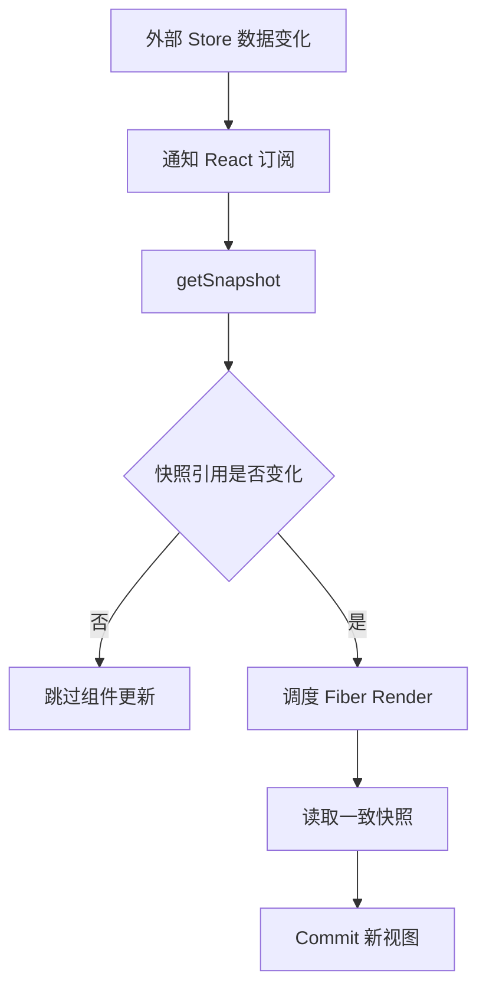

# 第 30 章 React 数据获取、缓存一致性与服务端状态架构

组件 State 适合保存用户交互，服务端状态却有另一组问题：请求中、缓存中、过期、重试、失效、分页、预取、权限变化和多个组件共享同一份数据。

如果把服务端数据简单复制到多个 `useState`、Context 和 Redux Slice 中，应用就会出现多个事实来源。一个页面更新了，另一个页面仍显示旧值；用户切换路由时，重复请求又把旧结果覆盖新结果。

## 本章学习目标

1. 区分客户端状态与服务端状态；
2. 设计 Query Key、缓存和失效策略；
3. 处理加载、旧数据、错误和重试；
4. 处理请求竞态和取消；
5. 选择手写 Hook、RTK Query 或其他数据层；
6. 设计乐观更新和缓存回滚。

## 30.1 生活化直觉：图书馆借阅记录

服务端数据像图书馆的库存。多个读者可以看到同一本书的状态，但库存会被别人修改；你手里的复印件可能已经过期，需要知道它来自哪里、什么时候刷新、怎么重新借阅。

Query Key 就像书的索引，缓存就是复印件，失效策略决定什么时候重新去图书馆确认。

## 30.2 最小查询 Hook

```tsx
function useUser(userId: string | null) {
  const [state, setState] = useState<
    | { status: 'idle' }
    | { status: 'loading'; data?: User }
    | { status: 'success'; data: User }
    | { status: 'error'; error: Error; data?: User }
  >({ status: userId ? 'loading' : 'idle' });

  useEffect(() => {
    if (!userId) return;
    const controller = new AbortController();
    setState((current) => ({
      status: 'loading',
      data: 'data' in current ? current.data : undefined,
    }));

    fetch(`/api/users/${encodeURIComponent(userId)}`, {
      signal: controller.signal,
    })
      .then((response) => {
        if (!response.ok) throw new Error('用户加载失败');
        return response.json() as Promise<User>;
      })
      .then((data) => setState({ status: 'success', data }))
      .catch((error: unknown) => {
        if (controller.signal.aborted) return;
        setState({
          status: 'error',
          error: error instanceof Error ? error : new Error('未知错误'),
        });
      });

    return () => controller.abort();
  }, [userId]);

  return state;
}
```

这段代码处理了一次查询，但还没有共享缓存、去重、失效和重试。它适合学习生命周期，不适合直接承担大型应用的所有服务端状态。

## 30.3 Query Key 和缓存模型

```ts
type QueryKey = readonly unknown[];

type CacheEntry<T> = {
  key: string;
  data: T;
  updatedAt: number;
  staleAt: number;
};

function serializeKey(key: QueryKey) {
  return JSON.stringify(key);
}

const key = ['users', { page: 1, keyword: 'react' }] as const;
```

Key 必须包含影响结果的所有参数。下面的 Key 不完整：

```ts
['users']; // 缺少 page 和 keyword，可能复用错误结果
```

Key 不是缓存的全部，还要定义 `staleTime`、失效时机、垃圾回收、重试和错误回退。

## 30.4 源码视角：外部 Store 与快照



输入是外部 Store 的版本变化，处理过程是通知订阅者并比较快照，输出是需要更新的组件视图。`getSnapshot` 必须在数据没有变化时返回稳定引用，否则 React 会把每次读取都当成新数据。

复杂数据层通常通过外部 Store 保存缓存，并用 `useSyncExternalStore` 让 React 订阅快照：

```tsx
const data = useSyncExternalStore(
  cache.subscribe,
  () => cache.getSnapshot(queryKey),
  () => cache.getServerSnapshot(queryKey),
);
```

React 需要能够比较前后快照。如果 `getSnapshot` 每次都返回全新对象，即使数据没有改变，组件也会不断收到更新。缓存层应该在真实数据变化时替换快照引用。

## 30.5 加载状态和旧数据

```tsx
function UserList({ page }: { page: number }) {
  const query = useUsers(page);

  if (query.status === 'loading' && !query.data) {
    return <ListSkeleton />;
  }
  if (query.status === 'error' && !query.data) {
    return <ErrorPanel onRetry={query.retry} />;
  }

  return (
    <section aria-busy={query.status === 'loading'}>
      {query.data?.rows.map((user) => <UserRow key={user.id} user={user} />)}
      {query.status === 'loading' && <span>正在更新…</span>}
    </section>
  );
}
```

切换分页时保留旧数据可以减少空白闪烁，但必须通过 `aria-busy` 或状态提示让用户知道内容仍在更新。旧数据不能被误认为新查询已经确认。

## 30.6 失效与写操作

创建订单后，相关查询需要失效或精确更新：

```ts
await createOrder(input);
queryClient.invalidateQueries({ queryKey: ['orders'] });
queryClient.invalidateQueries({ queryKey: ['cart'] });
```

如果使用手写缓存，应集中管理失效关系，不要让每个按钮知道所有相关页面。更复杂的场景可以通过服务端版本号、WebSocket 事件或重新验证策略更新缓存。

## 30.7 乐观更新和回滚

```ts
async function updateTodo(id: string, completed: boolean) {
  const previous = cache.get(['todos']);
  cache.update(['todos'], (todos) =>
    todos.map((todo) => todo.id === id ? { ...todo, completed } : todo),
  );

  try {
    await api.updateTodo(id, completed);
  } catch (error) {
    cache.set(['todos'], previous);
    throw error;
  }
}
```

真实系统需要处理多个并发乐观更新、服务端标准化字段、冲突和重新获取。回滚不能只依赖组件局部 State，否则其他页面仍会保存错误副本。

## 30.8 常见错误和错误边界

### 错误一：每个组件各自 Fetch 同一资源

会产生重复请求和不一致结果。应使用共享缓存或数据层。

### 错误二：把 `isLoading` 当成全部状态

首次加载、后台刷新、失败但有旧数据和空结果是不同体验，应建模为可组合状态。

### 错误三：请求成功后只更新当前页面

其他使用同一资源的组件仍会过期。写操作后要更新或失效相关 Query Key。

### 错误四：无条件重试

权限错误、参数错误和服务端 4xx 不适合无限重试。网络错误可以指数退避，并设置最大次数。

### 错误五：缓存敏感数据没有生命周期

会话、权限、支付和个人信息需要明确缓存范围、登出清理和跨标签页同步。

## 30.9 性能和架构考虑

- Query Key 只包含必要且可序列化的值；
- 缓存共享请求和结果，减少重复网络；
- 对大列表分页和预取，不要把所有数据放进一个组件；
- 让组件订阅最小选择结果；
- 通过服务端版本、失效事件和重新验证控制一致性；
- 记录缓存命中率、请求时延和失败率。

## 30.10 面试重点：标准回答

> 服务端状态和客户端状态的生命周期不同。服务端状态需要 Query Key、缓存、过期、失效、重试、请求去重和竞态处理，通常适合专门的数据层或 RTK Query；客户端状态更适合 Redux、Context 或组件 State。成功写操作后不能只改当前组件，还要更新或失效相关缓存，避免多个页面出现不同事实来源。

## 30.11 面试官追问

1. stale time 和 cache time 解决什么问题？
2. 为什么 Query Key 必须包含筛选条件？
3. 如何防止旧响应覆盖新查询？
4. 乐观更新失败时如何恢复？
5. 为什么不建议把所有请求数据都放 Redux？

## 30.12 练习题与参考答案

### 练习题 1

为一个分页搜索设计 Query Key。

**参考答案**：`['products', { page, pageSize, keyword, sort }]`，所有影响结果的参数都在 Key 中，并保证对象字段稳定、可序列化。

### 练习题 2

如何处理用户快速切换 A、B、C 三个详情页？

**参考答案**：每次请求使用 AbortController，并让响应携带对应 ID；只允许当前参数或当前请求 ID 写入页面，缓存层则按独立 Key 保存已完成结果。

### 练习题 3

何时选择专门的数据层而不是手写 Hook？

**参考答案**：当项目需要跨组件共享、请求去重、失效、重试、分页、预取和 SSR 快照时，专门数据层可以降低重复实现和一致性风险。

## 30.13 本章小结

服务端状态不是普通 State 的放大版。它需要缓存身份、过期和失效规则，也需要面对其他用户和其他页面带来的外部变化。明确 Query Key、减少重复副本、处理取消竞态和设计回滚，是复杂 React 应用保持一致性的基础。