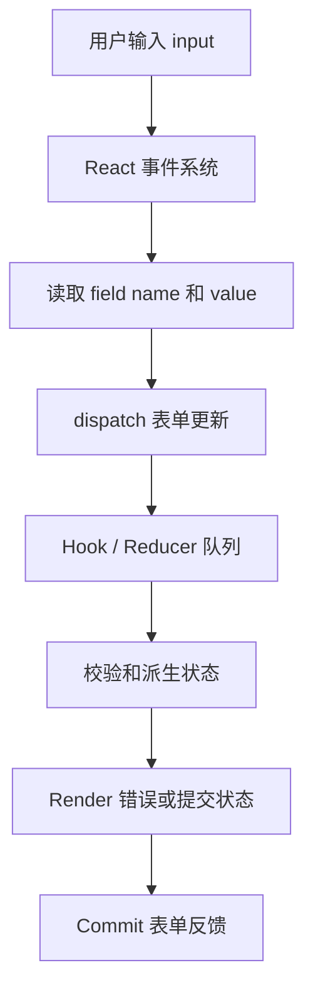

# 第 31 章 React 表单、校验与复杂提交

表单是 React 业务系统中最容易变复杂的区域之一。字段值、格式校验、异步校验、提交状态、服务端错误、草稿保存、权限、重复提交和离开确认会同时出现。

本章从受控组件开始，逐步讨论复杂表单的状态边界、校验时机和提交模型。

## 本章学习目标

1. 区分受控和非受控表单；
2. 设计字段值、错误和 touched 状态；
3. 处理同步、异步和服务端校验；
4. 处理重复提交、取消和草稿保存；
5. 选择表单库时理解它们的核心抽象；
6. 设计可访问、可恢复的复杂表单。

## 31.1 生活化直觉

表单像一份需要审核的申请单。用户填写的是草稿，字段校验是柜台初审，服务端校验是最终审批，提交中状态是“正在处理”，成功后才是正式记录。把草稿和正式记录混成一个对象，会让取消和回滚变得困难。

## 31.2 最小受控表单

```tsx
function LoginForm({ onSubmit }: {
  onSubmit: (input: { email: string; password: string }) => Promise<void>;
}) {
  const [email, setEmail] = useState('');
  const [password, setPassword] = useState('');
  const [error, setError] = useState('');
  const [pending, setPending] = useState(false);

  async function handleSubmit(event: FormEvent) {
    event.preventDefault();
    setError('');
    if (!email.includes('@')) {
      setError('请输入有效邮箱');
      return;
    }

    setPending(true);
    try {
      await onSubmit({ email, password });
    } catch {
      setError('登录失败，请重试');
    } finally {
      setPending(false);
    }
  }

  return (
    <form onSubmit={handleSubmit} noValidate>
      <label>
        邮箱
        <input
          name="email"
          type="email"
          value={email}
          onChange={(event) => setEmail(event.target.value)}
          aria-invalid={Boolean(error)}
        />
      </label>
      <label>
        密码
        <input
          name="password"
          type="password"
          value={password}
          onChange={(event) => setPassword(event.target.value)}
        />
      </label>
      {error && <p role="alert">{error}</p>}
      <button disabled={pending}>{pending ? '登录中…' : '登录'}</button>
    </form>
  );
}
```

受控表单的字段值由 React State 保存，每次输入都经过 React。它适合需要实时校验、条件字段和跨字段派生的表单；字段特别多时，频繁更新顶层 State 可能带来性能成本。

## 31.3 表单状态模型

```ts
type FieldState<T> = {
  value: T;
  error?: string;
  touched: boolean;
  dirty: boolean;
};

type FormStatus = 'idle' | 'validating' | 'submitting' | 'success' | 'error';

type ProfileFormState = {
  name: FieldState<string>;
  department: FieldState<string>;
  status: FormStatus;
  submitError?: string;
};
```

不要用一个 `isValid` 布尔值覆盖所有状态。表单可能尚未校验、正在异步校验、字段错误、提交失败但字段有效，状态之间有不同含义。

## 31.4 校验时机

- 输入时校验：即时反馈，但可能过于打扰；
- Blur 时校验：用户离开字段后反馈；
- Submit 时校验：逻辑简单，错误集中出现；
- 服务端校验：最终可信结果，必须处理网络和字段映射。

```ts
function validate(values: { name: string; email: string }) {
  const errors: Record<string, string> = {};
  if (!values.name.trim()) errors.name = '姓名不能为空';
  if (!values.email.includes('@')) errors.email = '邮箱格式错误';
  return errors;
}
```

服务端返回字段错误时，要把 API 字段名映射到表单字段，并保留全局错误：

```ts
type ApiValidationError = {
  fields: Record<string, string>;
  message: string;
};
```

## 31.5 非受控和 `FormData`

简单表单可以由 DOM 保存字段值，提交时读取 `FormData`：

```tsx
function FeedbackForm() {
  function submit(formData: FormData) {
    const message = String(formData.get('message') ?? '');
    void fetch('/api/feedback', {
      method: 'POST',
      body: JSON.stringify({ message }),
      headers: { 'content-type': 'application/json' },
    });
  }

  return (
    <form action={submit}>
      <textarea name="message" required />
      <button>发送</button>
    </form>
  );
}
```

非受控方式减少每次输入的 React 更新，适合字段多、即时派生少的场景；需要动态显示字符数、联动字段或实时过滤时，受控方式更直接。React 19 的 Form Action 可以进一步组织提交状态。

## 31.6 复杂表单与 Reducer

```ts
type Action =
  | { type: 'fieldChanged'; field: 'name' | 'email'; value: string }
  | { type: 'fieldBlurred'; field: 'name' | 'email' }
  | { type: 'submitStarted' }
  | { type: 'submitSucceeded' }
  | { type: 'submitFailed'; message: string };

function reducer(state: FormState, action: Action): FormState {
  switch (action.type) {
    case 'fieldChanged':
      return {
        ...state,
        [action.field]: {
          ...state[action.field],
          value: action.value,
          dirty: true,
        },
      };
    case 'fieldBlurred':
      return {
        ...state,
        [action.field]: { ...state[action.field], touched: true },
      };
    case 'submitStarted':
      return { ...state, status: 'submitting', submitError: undefined };
    case 'submitSucceeded':
      return { ...state, status: 'success' };
    case 'submitFailed':
      return { ...state, status: 'error', submitError: action.message };
  }
}
```

Reducer 把表单事件集中起来，适合字段多、状态转换复杂的场景。字段组件仍可以拆开，让单个字段更新不必重绘整个页面。

## 31.7 源码视角：输入事件到字段状态



输入是浏览器输入事件，处理过程是读取字段、更新表单状态并计算校验结果，输出是字段值、错误信息和提交按钮状态。受控表单把每次输入接入 React，非受控表单则更多依赖 DOM 和提交时的 FormData。

```text
input/change
  -> React 事件处理
  -> setState 或 dispatch
  -> Hook Update 入队
  -> Render 计算 input value
  -> Commit 设置 DOM value
```

受控输入的每次变更都经过 React。输入卡顿时需要检查字段组件、父级昂贵子树和同步校验，而不是简单把所有输入改成非受控。

## 31.8 草稿保存与离开确认

```tsx
useEffect(() => {
  if (!dirty) return;
  const timer = window.setTimeout(() => {
    void saveDraft(values);
  }, 500);
  return () => window.clearTimeout(timer);
}, [dirty, values]);
```

草稿保存还需要请求 ID、取消旧保存、服务端版本号和冲突提示。`beforeunload` 只能作为最后一道浏览器提示，不能保证所有移动端场景都触发。

## 31.9 常见错误和错误边界

### 错误一：只在前端校验

前端校验改善体验，服务端必须再次校验权限、格式、业务约束和资源状态。

### 错误二：提交按钮只用 `disabled` 防重复

请求可能通过脚本重复发送，服务端需要幂等键；前端还要处理网络超时和用户重试。

### 错误三：错误只显示在 Toast

字段错误应该靠近字段，表单级错误要有可访问的 `role="alert"`，Toast 不能承担全部信息。

### 错误四：表单状态和服务端实体混在一起

编辑草稿未保存时，不要覆盖缓存中的正式实体。提交成功后再合并服务端标准化结果。

## 31.10 性能和架构考虑

- 大表单按字段组件拆分；
- 只在必要时做即时校验；
- 重型校验可放 Worker 或延后；
- 用非受控字段减少无意义 Render；
- 服务端错误统一转换成字段错误模型；
- 草稿保存要有防抖、取消和版本冲突策略。

## 31.11 面试重点：标准回答

> 表单状态可以拆成字段值、交互元数据、校验结果和提交状态。受控组件适合实时联动和校验，非受控组件适合字段多且只在提交时读取的表单。前端校验用于反馈，服务端校验才是最终边界；异步提交需要处理 pending、重复提交、取消、字段错误和幂等。

## 31.12 面试官追问

1. 受控组件为什么可能造成输入卡顿？
2. 如何设计表单字段级错误和全局错误？
3. 草稿自动保存如何避免旧请求覆盖新内容？
4. 表单库通常解决了哪些重复问题？
5. 为什么服务端返回的错误不能直接 `JSON.stringify` 展示？

## 31.13 练习题与参考答案

### 练习题 1

设计一个带异步用户名校验的注册表单。

**参考答案**：对用户名请求使用 AbortController 和请求版本号，只有最新输入的结果可以写入错误状态；提交时仍由服务端再次检查唯一性。

### 练习题 2

比较受控和非受控表单。

**参考答案**：受控值保存在 React 中，适合实时联动；非受控值由 DOM 保存，提交时通过 Ref 或 FormData 读取，减少每次输入更新。复杂表单可以混合使用。

## 31.14 本章小结

表单是一个小型状态机，不只是若干输入框。把草稿、校验、提交、服务端错误和持久化边界分开，才能处理复杂业务。受控与非受控没有绝对优劣，选择应由交互、性能和数据流决定。