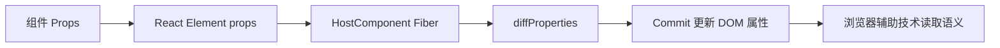

# 第 32 章 React 可访问性与键盘交互

可访问性不是给页面额外加几个 `aria-label`，而是让不同输入方式、不同辅助技术和不同能力的用户都能完成任务。React 组件化可以复用无障碍行为，也可能因为自定义按钮、弹窗和列表而隐藏原生语义。

本章重点讨论语义 HTML、键盘焦点、表单错误、动态内容和复合组件。

## 本章学习目标

1. 优先使用正确的 HTML 语义；
2. 设计键盘可操作的按钮、菜单和对话框；
3. 管理焦点移动和恢复；
4. 正确使用 `aria-*` 属性和 live region；
5. 让异步加载、错误和流式内容可感知；
6. 在组件测试和 E2E 中验证可访问性。

## 32.1 生活化直觉

视觉用户可以看见按钮和焦点位置；键盘用户需要通过 Tab 和方向键移动；屏幕阅读器用户需要从语义和状态描述中理解页面。可访问组件就像一栋有清晰门牌、电梯和引导标识的建筑，颜色漂亮只是其中一部分。

## 32.2 语义优先的最小组件

```tsx
function SaveButton({ onSave, pending }: {
  onSave: () => void;
  pending: boolean;
}) {
  return (
    <button type="button" onClick={onSave} disabled={pending}>
      {pending ? '保存中…' : '保存'}
    </button>
  );
}
```

不要用 `<div onClick>` 模拟按钮。原生 `<button>` 自带键盘触发、焦点和禁用语义，也更容易被辅助技术识别。

如果必须构建自定义交互，至少要明确 `role`、`tabIndex`、键盘事件和状态属性，但优先回到原生元素。

## 32.3 表单标签与错误

```tsx
function EmailField({ error }: { error?: string }) {
  const errorId = 'email-error';

  return (
    <div>
      <label htmlFor="email">邮箱</label>
      <input
        id="email"
        name="email"
        type="email"
        aria-invalid={Boolean(error)}
        aria-describedby={error ? errorId : undefined}
      />
      {error && <p id={errorId} role="alert">{error}</p>}
    </div>
  );
}
```

`label` 与 `input` 通过 `htmlFor` 和 `id` 关联；`aria-invalid` 描述字段状态；`aria-describedby` 指向帮助文本或错误；`role="alert"` 让动态错误更容易被读取。

## 32.4 焦点管理与 Dialog

```tsx
function Dialog({ open, onClose, children }: {
  open: boolean;
  onClose: () => void;
  children: ReactNode;
}) {
  const panelRef = useRef<HTMLDivElement>(null);
  const triggerRef = useRef<HTMLButtonElement>(null);

  useEffect(() => {
    if (!open) return;
    const previous = document.activeElement as HTMLElement | null;
    panelRef.current?.focus();

    return () => {
      previous?.focus();
      triggerRef.current?.focus();
    };
  }, [open]);

  if (!open) return null;

  return (
    <div role="presentation" onMouseDown={onClose}>
      <div
        ref={panelRef}
        role="dialog"
        aria-modal="true"
        tabIndex={-1}
        onMouseDown={(event) => event.stopPropagation()}
      >
        <button aria-label="关闭" onClick={onClose}>×</button>
        {children}
      </div>
    </div>
  );
}
```

生产对话框还要实现焦点陷阱：Tab 不能跑到遮罩后面的内容；Escape 应关闭可关闭对话框；关闭后焦点要回到触发按钮；滚动锁定和嵌套 Dialog 也要处理。优先使用经过验证的无障碍组件库。

## 32.5 菜单和键盘事件

```tsx
function Menu({ items }: { items: string[] }) {
  const [index, setIndex] = useState(0);
  const refs = useRef<Array<HTMLButtonElement | null>>([]);

  function onKeyDown(event: KeyboardEvent) {
    if (event.key === 'ArrowDown') {
      event.preventDefault();
      setIndex((value) => (value + 1) % items.length);
    }
    if (event.key === 'ArrowUp') {
      event.preventDefault();
      setIndex((value) => (value - 1 + items.length) % items.length);
    }
  }

  useEffect(() => {
    refs.current[index]?.focus();
  }, [index]);

  return (
    <div role="menu" onKeyDown={onKeyDown}>
      {items.map((item, itemIndex) => (
        <button
          key={item}
          ref={(node) => { refs.current[itemIndex] = node; }}
          role="menuitem"
        >
          {item}
        </button>
      ))}
    </div>
  );
}
```

复合组件的键盘模式应符合 WAI-ARIA Authoring Practices。自定义键盘行为要验证 Tab、方向键、Home、End、Escape 和输入法场景。

## 32.6 动态内容和流式消息

```tsx
<div aria-live="polite" aria-atomic="false">
  {status === 'loading' && '正在加载结果…'}
  {status === 'error' && '加载失败，请重试'}
</div>
```

流式 AI 消息不应每个 token 都触发一次屏幕阅读器播报。可以维护一个简短状态区域，只在阶段变化或消息完成时更新可访问摘要。

## 32.7 源码视角：属性最终进入 DOM



输入是组件属性和交互状态，处理过程是协调前后 Props 并在 Commit 阶段设置 DOM 属性，输出是浏览器和辅助技术可以读取的语义状态。`aria-*`、键盘事件、焦点和原生元素选择都属于最终用户行为的一部分。

```text
JSX aria-label / disabled
  -> React Element props
  -> Fiber HostComponent
  -> Commit 属性更新
  -> DOM 节点属性和可访问树
```

React 负责把属性提交到 DOM，但浏览器、辅助技术和平台语义最终决定用户体验。`aria-*` 写对名称并不代表交互模型完整。

## 32.8 常见错误和错误边界

### 错误一：按钮用 div 模拟

失去键盘和默认语义。优先使用 Button。

### 错误二：`aria-label` 覆盖可见名称

屏幕阅读器可能只读 `aria-label`，导致可见文案和可访问名称不一致。只有在确实没有可见文本时才添加。

### 错误三：焦点进入已卸载节点

异步加载和路由切换时，保存的 Ref 可能已经失效。调用 `focus` 前检查节点和可见状态。

### 错误四：错误只用颜色表示

红色边框需要配合文本、图标或状态属性，不能让颜色成为唯一信息。

### 错误五：动态列表没有稳定身份

列表 Key、DOM id 和 aria 关联要稳定，插入和排序后不能让标签指向错误字段。

## 32.9 性能和架构考虑

- 把焦点管理封装为可复用 Hook；
- 对话框和菜单使用经过审查的组件模式；
- 避免全局 `keydown` 监听覆盖页面其他区域；
- 流式内容按阶段更新 live region；
- 在 CI 中使用 axe 等工具做自动检查，同时保留键盘人工验证。

## 32.10 面试重点：标准回答

> React 可访问性首先依赖语义 HTML，其次才是 ARIA。按钮、表单、Dialog、菜单和动态内容都要有完整的键盘、焦点、名称和状态模型。焦点管理要处理打开、关闭、卸载和恢复，错误不能只依赖颜色，流式内容要控制 live region 的播报频率。

## 32.11 面试官追问

1. 为什么 `<div role="button">` 仍然不如 `<button>`？
2. Dialog 关闭后焦点应该去哪？
3. `aria-live="polite"` 和 `assertive` 如何选择？
4. 如何测试键盘用户能完成一个表单？
5. 为什么组件库也需要做无障碍评审？

## 32.12 练习题与参考答案

### 练习题 1

把一个点击 `<div>` 的卡片重构成可访问交互。

**参考答案**：如果行为是按钮，使用 `<button>`；如果是导航，使用 `<a>`；如果卡片包含多个操作，保留语义容器并为每个操作提供原生控件。

### 练习题 2

设计 Dialog 的焦点生命周期。

**参考答案**：打开时保存触发元素并把焦点移入，Tab 在 Dialog 内循环，Escape 根据配置关闭，关闭后恢复触发元素；节点卸载时检查 Ref 是否仍然有效。

## 32.13 本章小结

可访问性是组件行为和信息结构的一部分。语义 HTML、正确标签、焦点管理、键盘模式、动态状态和错误提示要一起设计。React 只负责渲染和更新，真正的可访问体验需要浏览器语义、辅助技术和人工验证共同完成。