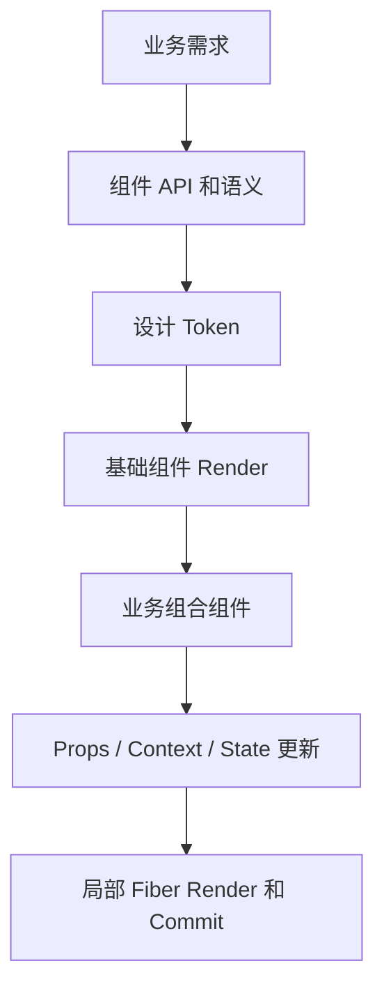

# 第 33 章 React 设计系统与业务组件复用

组件复用不是把一个大组件复制到另一个页面，而是建立稳定的视觉、交互、状态和可访问性契约。设计系统把颜色、间距、字号、组件变体和使用规则变成团队可以共同理解的基础设施。

React 组件 API 设计得不好，会出现大量布尔 Props、业务条件和无法组合的特殊分支。本章讨论如何从 Token、原语、复合组件和业务组件构建设计系统。

## 本章学习目标

1. 理解设计 Token、原语和业务组件的层次；
2. 设计稳定的 React 组件 API；
3. 处理变体、尺寸、状态和复合结构；
4. 设计主题和暗色模式；
5. 让组件保持可访问和可测试；
6. 识别过度抽象和复制粘贴的边界。

## 33.1 生活化直觉

设计系统像一套建筑标准：颜色和间距是材料规格，Button、Input 是标准门窗，业务页面是房间。标准应该限制危险差异，但不能把每个房间都强行做成同样布局。

## 33.2 Token 与 CSS 变量

```css
:root {
  --color-primary: #d95f39;
  --color-surface: #ffffff;
  --color-text: #272421;
  --space-2: 8px;
  --space-3: 12px;
  --radius-sm: 4px;
}

[data-theme='dark'] {
  --color-surface: #1e1d1b;
  --color-text: #f4efe8;
}
```

组件使用语义变量，而不是每个组件写一套颜色：

```css
.button {
  color: var(--color-surface);
  background: var(--color-primary);
  padding: var(--space-2) var(--space-3);
  border-radius: var(--radius-sm);
}
```

Token 的价值是集中修改和主题切换，但命名要表达用途。`--orange-500` 比 `--color-action-primary` 更难适应品牌变更。

## 33.3 最小 Button 组件

```tsx
type ButtonProps = {
  variant?: 'primary' | 'secondary' | 'danger';
  size?: 'sm' | 'md' | 'lg';
  loading?: boolean;
  disabled?: boolean;
  children: ReactNode;
  onClick?: () => void;
};

function Button({
  variant = 'primary',
  size = 'md',
  loading = false,
  disabled = false,
  children,
  onClick,
}: ButtonProps) {
  return (
    <button
      type="button"
      className={`button button--${variant} button--${size}`}
      disabled={disabled || loading}
      aria-busy={loading}
      onClick={onClick}
    >
      {loading ? '处理中…' : children}
    </button>
  );
}
```

这个 API 只表达视觉和交互状态，不包含“创建订单”“删除用户”等具体业务。业务含义由调用方组合。

## 33.4 避免布尔 Props 爆炸

```tsx
// 难以组合
<Panel compact elevated bordered closable loading error empty />
```

布尔 Props 增多后，合法组合数量快速增长。可以使用明确的变体、复合组件和状态对象：

```tsx
<Panel>
  <Panel.Header action={<Button>编辑</Button>}>用户信息</Panel.Header>
  <Panel.Body>{content}</Panel.Body>
  <Panel.Footer>{actions}</Panel.Footer>
</Panel>
```

复合组件让结构由调用方决定，组件库负责布局、语义和样式。

## 33.5 受控与非受控组件 API

```tsx
type DialogProps =
  | { open: boolean; onOpenChange: (open: boolean) => void; defaultOpen?: never }
  | { defaultOpen?: boolean; open?: never; onOpenChange?: never };
```

受控模式适合页面统一管理状态，非受控模式适合简单使用。TypeScript 联合类型可以阻止同时传入冲突 Props。

## 33.6 主题 Context 与 CSS 变量

```tsx
type Theme = 'light' | 'dark';

const ThemeContext = createContext<{
  theme: Theme;
  setTheme: (theme: Theme) => void;
} | null>(null);

function ThemeProvider({ children }: { children: ReactNode }) {
  const [theme, setTheme] = useState<Theme>('light');

  useEffect(() => {
    document.documentElement.dataset.theme = theme;
  }, [theme]);

  return (
    <ThemeContext.Provider value={{ theme, setTheme }}>
      {children}
    </ThemeContext.Provider>
  );
}
```

Context 负责主题状态，CSS 变量负责大范围样式切换。不要让每个组件因为主题切换都重新计算大量业务数据。

## 33.7 源码视角：组件复用的边界



输入是业务场景、设计 Token 和组件参数，处理过程是把稳定语义封装在基础组件中，再通过组合扩展业务能力，输出是可复用且可访问的 UI。组件复用的边界应由行为和状态所有权决定，不能只由视觉相似度决定。

```text
设计 Token
  -> CSS 变量 / 主题
  -> 视觉原语 Button、Input、Dialog
  -> 业务组件 UserPicker、OrderForm
  -> 页面组合
```

组件树越靠下，业务语义越强，复用范围越窄。把业务规则塞进通用 Button 会让组件 API 越来越不可预测。

## 33.8 业务场景：统一确认弹窗

```tsx
function DeleteUserAction({ userId }: { userId: string }) {
  const [open, setOpen] = useState(false);

  async function confirm() {
    await deleteUser(userId);
    setOpen(false);
  }

  return (
    <>
      <Button variant="danger" onClick={() => setOpen(true)}>删除</Button>
      <Dialog open={open} onOpenChange={setOpen}>
        <Dialog.Title>确认删除用户？</Dialog.Title>
        <Dialog.Description>删除后无法直接恢复。</Dialog.Description>
        <Dialog.Actions>
          <Button variant="secondary" onClick={() => setOpen(false)}>取消</Button>
          <Button variant="danger" onClick={() => void confirm()}>确认删除</Button>
        </Dialog.Actions>
      </Dialog>
    </>
  );
}
```

通用 Dialog 负责语义、焦点和关闭行为，业务组件负责删除权限、请求和成功后的数据刷新。

## 33.9 常见错误和错误边界

### 错误一：组件库 API 直接暴露业务字段

通用组件不应出现 `userDeleteMode`、`orderSubmitStatus` 这类业务专用 Props。

### 错误二：为了复用强行抽象

两个页面暂时相似，不代表需要立刻抽象。先观察稳定的交互契约，再提取原语。

### 错误三：样式 Token 没有语义

组件直接写颜色和像素，会让主题、品牌和无障碍调整变得困难。

### 错误四：组件状态不完整

Button 只设计默认和 hover，遗漏 focus、disabled、loading、错误和高对比模式，最终每个业务页面都自行修补。

## 33.10 性能和架构考虑

- Token 通过 CSS 变量切换，减少业务树更新；
- 复合组件避免大量布尔 Props；
- 稳定的 `value` 和 Context 拆分减少主题更新范围；
- 组件包按入口和使用场景分割，避免全量引入；
- Storybook 或视觉回归测试覆盖状态矩阵。

## 33.11 面试重点：标准回答

> 设计系统应该分为 Token、基础原语和业务组件。Token 统一视觉语义，原语提供稳定的无障碍交互，业务组件组合领域规则。React 组件 API 要控制布尔 Props 数量，优先使用明确变体、复合组件和受控/非受控边界。抽象的目标是稳定契约和一致体验，不是让所有代码都长得一样。

## 33.12 面试官追问

1. 如何避免通用组件越来越像业务大杂烩？
2. 受控组件和非受控组件如何共存？
3. 主题切换为什么适合 CSS 变量？
4. 组件库如何测试焦点和键盘交互？
5. 何时应该停止抽象？

## 33.13 练习题与参考答案

### 练习题 1

为一个 Select 设计支持受控和非受控的 Props。

**参考答案**：受控模式要求 `value` 和 `onChange`，非受控模式使用 `defaultValue`；用联合类型禁止两种模式同时传入冲突字段，并统一内部事件和键盘行为。

### 练习题 2

把带 6 个布尔 Props 的 Card 重构成复合组件。

**参考答案**：将 Header、Body、Footer、Loading 和 Empty 作为明确子结构或状态插槽，保留 Card 的布局和语义，不让调用者组合出不可解释的状态。

## 33.14 本章小结

设计系统是组件契约、视觉 Token、无障碍交互和工程流程的组合。React 负责组合能力，但好的复用依赖清晰边界：通用组件解决稳定问题，业务组件承担业务语义，页面负责组合和数据流。