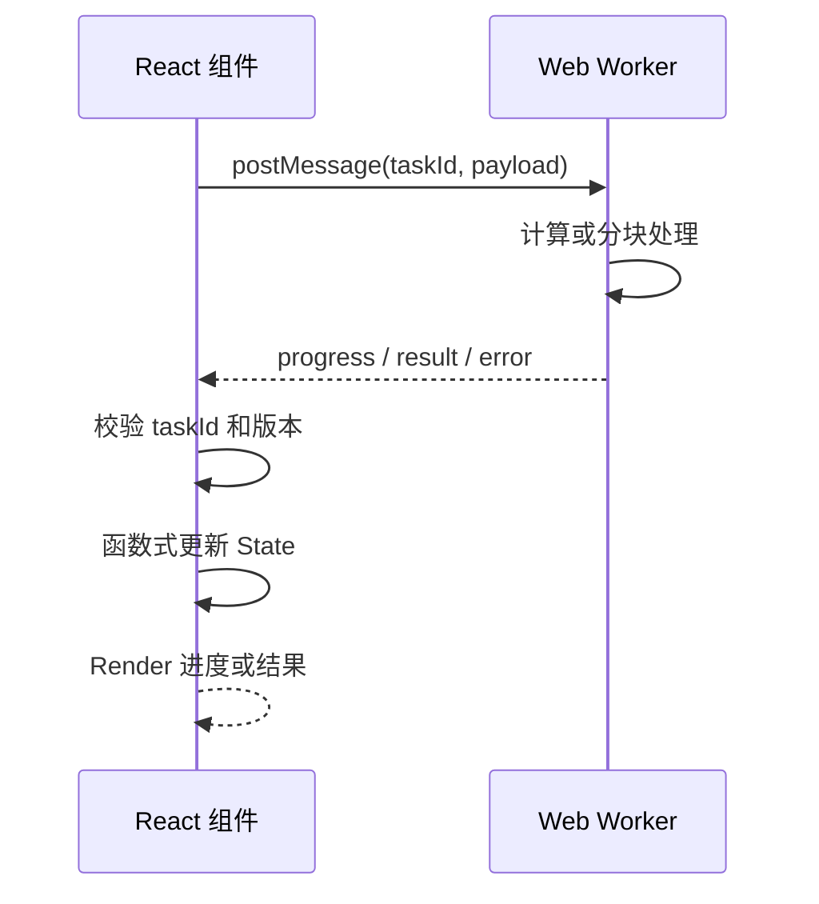

# 第 34 章 Web Worker、SharedWorker 与 React 高负载任务

React 可以拆分 Render 工作，但不能让一个巨大的同步计算自动不阻塞主线程。文件解析、图像处理、搜索索引和复杂数据转换如果持续执行，就会影响输入、动画和流式文本。

Web Worker 把计算放到独立线程，SharedWorker 允许同一来源的多个页面共享一个 Worker。React 负责展示任务状态，Worker 负责计算和消息通信。

## 本章学习目标

1. 理解主线程、Worker 和 React 的边界；
2. 使用 `postMessage` 设计类型化协议；
3. 处理 Worker 生命周期、取消和错误；
4. 区分 Dedicated Worker 与 SharedWorker；
5. 让 Worker 结果安全进入 React State；
6. 评估结构化克隆、Transferable 和 Worker 成本。

## 34.1 生活化直觉

主线程像前台接待员，既要接待用户又要更新页面；Worker 像后场加工间。前台不能把一大箱原料直接放在柜台上处理，否则用户无法得到及时回应。Worker 处理完成后，把结果或进度送回前台。

## 34.2 最小 Worker

`parser.worker.ts`：

```ts
self.onmessage = (event: MessageEvent<{ id: string; text: string }>) => {
  const { id, text } = event.data;
  const words = text.trim().split(/\s+/).filter(Boolean);

  self.postMessage({
    id,
    count: words.length,
  });
};
```

React 组件：

```tsx
function WordCounter() {
  const workerRef = useRef<Worker | null>(null);
  const [count, setCount] = useState<number | null>(null);

  useEffect(() => {
    const worker = new Worker(
      new URL('./parser.worker.ts', import.meta.url),
      { type: 'module' },
    );
    workerRef.current = worker;
    worker.onmessage = (event: MessageEvent<{ count: number }>) => {
      setCount(event.data.count);
    };

    return () => {
      worker.terminate();
      workerRef.current = null;
    };
  }, []);

  function parse(text: string) {
    workerRef.current?.postMessage({ id: crypto.randomUUID(), text });
  }

  return <button onClick={() => parse('React Fiber Worker')}>{count ?? '计算'}</button>;
}
```

Worker 不是 React 组件，不能直接调用 Hook。组件通过 `postMessage` 发送任务，收到消息后调用 State Setter。

## 34.3 类型化协议和请求 ID

```ts
type WorkerRequest =
  | { type: 'parse'; requestId: string; text: string }
  | { type: 'cancel'; requestId: string };

type WorkerResponse =
  | { type: 'progress'; requestId: string; percent: number }
  | { type: 'result'; requestId: string; value: ParsedResult }
  | { type: 'error'; requestId: string; message: string };
```

请求 ID 防止旧任务结果写入新页面。协议还要包含版本、错误类型和取消语义。

## 34.4 取消和进度

```ts
const running = new Set<string>();

self.onmessage = (event: MessageEvent<WorkerRequest>) => {
  if (event.data.type === 'cancel') {
    running.delete(event.data.requestId);
    return;
  }

  running.add(event.data.requestId);
  for (let index = 0; index < 100; index += 1) {
    if (!running.has(event.data.requestId)) return;
    doSmallChunk(index);
    if (index % 10 === 0) {
      self.postMessage({
        type: 'progress',
        requestId: event.data.requestId,
        percent: index,
      });
    }
  }
}
```

取消是协作式的：Worker 必须定期检查标记。正在执行的同步函数不会被主线程强行打断；如果任务无法分块，只有终止 Worker 才能停止，但会丢失该 Worker 的其他状态。

## 34.5 SharedWorker

SharedWorker 可以被同一来源的多个页面连接：

```ts
const worker = new SharedWorker(
  new URL('./shared-cache.worker.ts', import.meta.url),
  { type: 'module' },
);

worker.port.start();
worker.port.postMessage({ type: 'subscribe', key: 'session' });
worker.port.onmessage = (event) => {
  console.log(event.data);
};
```

SharedWorker 适合跨标签页共享连接、缓存或同步状态，但需要处理端口加入、离开、页面关闭和浏览器兼容性。它不能替代服务端事实，也不能把敏感数据无限期留在浏览器内存中。

## 34.6 源码视角：Worker 结果如何回到 React



输入是带任务 ID 的工作请求，处理过程是 Worker 计算并通过消息返回阶段结果，输出是 React 显示的进度或结果。Worker 解决的是 CPU 任务占用主线程的问题，取消、旧结果过滤、序列化成本和 React Render 成本仍需要单独设计。

```text
Worker 线程计算
  -> postMessage
  -> 主线程 MessageEvent
  -> 校验 requestId 和数据结构
  -> setState / 外部 Store
  -> React 调度 Render
  -> Commit
```

Worker 解决 CPU 计算阻塞，不会自动减少 React 处理结果的成本。如果一次性把巨大结果放进 State，主线程仍会在序列化、Render 和 DOM 阶段卡顿。

## 34.7 Transferable 和结构化克隆

大型 `ArrayBuffer` 可以转移所有权，减少复制：

```ts
worker.postMessage({ buffer }, [buffer]);
```

转移后主线程中的 `buffer` 不再可用。只有在数据量足够大且所有权清晰时才使用；普通对象应使用结构化克隆，并测量实际开销。

## 34.8 业务场景：CSV 导入

完整流程可以是：

1. 主线程读取文件元数据；
2. Worker 分块解析 CSV；
3. Worker 回传进度和错误行；
4. React 展示进度；
5. 用户取消时发送 cancel；
6. 完成后只把必要的摘要或分页数据放入 State。

```tsx
function ImportPanel({ file }: { file: File }) {
  const [progress, setProgress] = useState(0);
  const [status, setStatus] = useState('idle');

  async function start() {
    setStatus('running');
    const text = await file.text();
    // 实际项目把 text 或 ArrayBuffer 分发给 Worker
    setProgress(text.length > 0 ? 100 : 0);
    setStatus('done');
  }

  return (
    <section aria-busy={status === 'running'}>
      <button onClick={() => void start()}>导入</button>
      <progress value={progress} max={100} />
    </section>
  );
}
```

示例中的 `file.text()` 仍在主线程，真正的大文件应使用 Worker 读取和分块处理。

## 34.9 常见错误和错误边界

### 错误一：Worker 里直接访问 DOM

Worker 没有 `window` 和 DOM。所有界面更新通过消息回到主线程。

### 错误二：没有终止 Worker

组件卸载后 Worker 仍可能计算和发送消息。Effect 清理函数要 terminate 或发送取消。

### 错误三：结果没有请求 ID

页面快速切换或重复计算时，旧结果可能覆盖新结果。每个任务必须带 ID 并校验。

### 错误四：把 Worker 当成万能加速

创建、序列化、传输和合并结果都有成本。小任务放进 Worker 可能更慢，先测量。

### 错误五：SharedWorker 共享了错误的用户状态

同源标签页不一定属于同一个用户会话。登录切换和登出时要清理共享缓存并重新校验身份。

## 34.10 性能和架构考虑

- 大任务分块，允许取消和报告进度；
- 使用 Transferable 时明确数据所有权；
- 结果分批回传，避免一次性阻塞主线程；
- Worker 只做纯计算，权限和敏感访问仍在服务端；
- 监控 Worker 启动时间、消息大小和主线程合并耗时。

## 34.11 面试重点：标准回答

> Worker 把 CPU 密集任务移出浏览器主线程，React 仍然只负责展示任务状态。主线程和 Worker 通过结构化克隆或 Transferable 通信，需要设计类型化消息、请求 ID、取消、进度和错误协议。Worker 不能访问 DOM，也不能替代服务端权限；结果回到 React 后仍要控制数据量和 Render 成本。

## 34.12 面试官追问

1. Worker 任务可以被任意中断吗？
2. `postMessage` 会复制数据吗？
3. SharedWorker 适合哪些跨标签页场景？
4. Worker 结果回到 React 后为什么仍可能卡顿？
5. 如何测试 Worker 协议？

## 34.13 练习题与参考答案

### 练习题 1

为大文件解析设计消息协议。

**参考答案**：请求包含任务 ID、文件信息和协议版本；响应包含进度、批次结果、错误行和完成状态；取消消息携带同一 ID，主线程只消费当前任务结果。

### 练习题 2

什么时候使用 Transferable？

**参考答案**：数据是大型二进制缓冲区且主线程不再需要原对象时使用；如果需要双方同时访问，不能转移，应使用结构化克隆或共享内存并重新评估复杂度。

## 34.14 本章小结

Worker 解决主线程被 CPU 任务阻塞的问题，SharedWorker 提供跨页面共享连接的可能。React 与 Worker 之间需要明确的消息协议、请求身份、取消和生命周期。把计算移走只是第一步，结果传输、State 规模和 DOM 更新仍然需要优化。