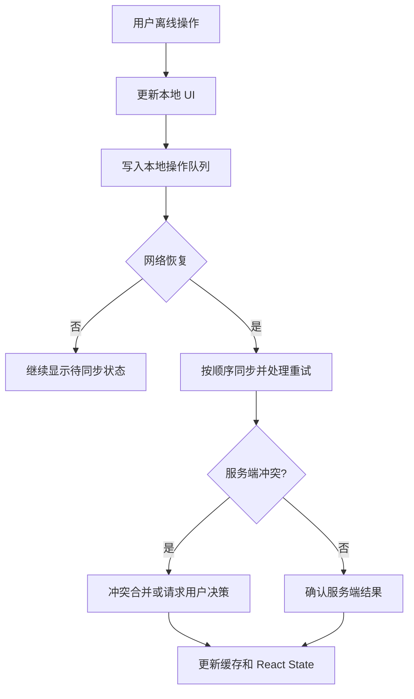

# 第 35 章 React 离线能力、PWA 与冲突处理

离线应用不是简单地把页面缓存下来。真正的离线体验要回答：资源是否可用、数据是否可读、用户操作是否暂存、网络恢复后如何同步、两个设备同时修改时谁优先。

React 负责展示连接状态、同步进度和冲突提示，Service Worker、IndexedDB 和服务端同步协议负责数据生命周期。

## 本章学习目标

1. 区分资源缓存、数据缓存和离线写队列；
2. 设计 Service Worker 与页面的消息边界；
3. 使用 IndexedDB 保存可恢复数据；
4. 设计乐观更新、重试和幂等同步；
5. 处理多设备冲突和版本号；
6. 评估离线功能的安全和一致性成本。

## 35.1 生活化直觉

离线应用像一个可以暂存订单的门店：断网时可以把订单写进本地账本，网络恢复后再送到总部。总部可能已经处理了同一商品，账本必须带版本和操作 ID，不能盲目覆盖。

## 35.2 连接状态 Hook

```tsx
function useOnline() {
  const [online, setOnline] = useState(() => navigator.onLine);

  useEffect(() => {
    const on = () => setOnline(true);
    const off = () => setOnline(false);
    window.addEventListener('online', on);
    window.addEventListener('offline', off);
    return () => {
      window.removeEventListener('online', on);
      window.removeEventListener('offline', off);
    };
  }, []);

  return online;
}
```

`navigator.onLine` 只能表示浏览器网络连接的粗略状态，不保证 API 可访问。真正同步仍要通过请求确认。

## 35.3 Service Worker 的职责

Service Worker 可以拦截请求并缓存静态资源：

```ts
self.addEventListener('fetch', (event) => {
  if (event.request.destination !== 'document') return;

  event.respondWith(
    caches.match(event.request).then((cached) => {
      return cached ?? fetch(event.request);
    }),
  );
});
```

缓存策略要按资源类型选择：

- 静态 JS/CSS：版本化后缓存优先；
- 文档：网络优先或带回退；
- 图片：缓存优先并限制容量；
- API：根据业务选择网络优先、缓存优先或 stale-while-revalidate。

不要把所有 API 都永久缓存。用户权限和个人数据需要登出清理、版本控制和加密风险评估。

## 35.4 页面与 Service Worker 通信

```ts
navigator.serviceWorker.controller?.postMessage({
  type: 'sync-requested',
});

navigator.serviceWorker.addEventListener('message', (event) => {
  if (event.data?.type === 'sync-progress') {
    console.log(event.data.pending, event.data.completed);
  }
});
```

消息需要版本和类型校验，不能把 Service Worker 消息直接当可信指令。页面卸载、旧 Worker 和新 Worker 同时存在时，要考虑生命周期。

## 35.5 离线写队列

```ts
type PendingMutation = {
  id: string;
  type: 'update-note' | 'create-comment';
  payload: unknown;
  baseVersion?: string;
  createdAt: number;
  attempts: number;
};
```

用户离线修改时：

1. 先更新本地可见数据；
2. 把操作写入 IndexedDB；
3. 显示“待同步”状态；
4. 网络恢复后按顺序或依赖关系发送；
5. 服务端返回成功、冲突或不可重试错误；
6. 更新本地版本并清理队列。

队列操作必须有幂等 ID，重试不能导致重复创建。

## 35.6 乐观更新和版本冲突

```ts
type Note = {
  id: string;
  content: string;
  version: number;
};

async function saveNote(note: Note, mutationId: string) {
  const response = await fetch(`/api/notes/${note.id}`, {
    method: 'PUT',
    headers: {
      'content-type': 'application/json',
      'idempotency-key': mutationId,
      'if-match': String(note.version),
    },
    body: JSON.stringify({ content: note.content }),
  });

  if (response.status === 412) {
    throw new Error('版本冲突，需要合并');
  }
  if (!response.ok) throw new Error('保存失败');
  return response.json() as Promise<Note>;
}
```

`If-Match` 或业务版本号让服务端知道客户端基于哪个版本修改。冲突时可以让用户选择覆盖、保留服务端版本或合并字段。

## 35.7 源码视角：离线更新仍回到 React



输入是离线操作和网络状态，处理过程是本地持久化、重试、幂等同步和冲突处理，输出是与服务端确认后的 UI。乐观显示可以改善反馈，但本地状态不能代替服务端事实来源。

```text
IndexedDB / Service Worker
  -> 读取本地快照或同步事件
  -> 外部 Store / setState
  -> React Render
  -> 展示 offline / pending / conflict
```

React 不会自动监听 IndexedDB。需要封装订阅协议，或在读写完成后主动更新 State。多个页面共享离线状态时，BroadcastChannel 可以同步事件，但仍要验证版本和用户会话。

## 35.8 业务代码：同步状态展示

```tsx
type SyncStatus = 'synced' | 'offline' | 'pending' | 'conflict' | 'failed';

function SyncBadge({ status }: { status: SyncStatus }) {
  const labels: Record<SyncStatus, string> = {
    synced: '已同步',
    offline: '离线',
    pending: '等待同步',
    conflict: '需要处理冲突',
    failed: '同步失败',
  };

  return <span role="status">{labels[status]}</span>;
}
```

同步状态必须在视觉、文本和辅助技术中可感知。离线保存成功不应显示成“已同步”。

## 35.9 常见错误和错误边界

### 错误一：把网络断开事件当作真实离线事实

网络状态只是提示，API 请求仍可能失败或被代理阻断。以请求结果和重试状态为准。

### 错误二：缓存了过期权限

登出、账号切换和租户切换时清除敏感缓存，服务端每次仍检查权限。

### 错误三：离线队列没有幂等键

重试或页面恢复会重复创建数据。每条 Mutation 使用稳定 ID，服务端根据 ID 去重。

### 错误四：冲突直接覆盖

最后写入者覆盖可能丢失另一个设备的内容。至少使用版本校验，并为不可自动合并的冲突提供界面。

### 错误五：Service Worker 更新不透明

新旧 Worker 并存可能造成资源版本不一致。需要设计更新提示、刷新时机和回滚策略。

## 35.10 性能和架构考虑

- IndexedDB 只保存必要字段，避免无限增长；
- 同步队列按优先级和依赖排序；
- 后台同步失败使用退避，不要持续唤醒设备；
- 资源缓存和业务数据缓存分开管理；
- 埋点记录队列长度、同步耗时和冲突率。

## 35.11 面试重点：标准回答

> PWA 离线能力分为静态资源缓存、数据缓存和离线写队列。Service Worker 负责请求拦截和后台生命周期，IndexedDB 保存结构化数据，React 负责展示连接、待同步和冲突状态。离线写操作需要幂等键、版本号和重试策略，冲突不能简单覆盖；真正的权限和最终一致性仍由服务端负责。

## 35.12 面试官追问

1. Cache Storage 和 IndexedDB 分别适合保存什么？
2. 离线创建两条相同数据如何去重？
3. 多设备冲突如何解决？
4. Service Worker 更新时为什么可能出现新旧资源混用？
5. 离线数据如何处理登出和账号切换？

## 35.13 练习题与参考答案

### 练习题 1

设计一个离线笔记保存队列。

**参考答案**：本地保存笔记快照和 Mutation ID，UI 显示 pending；联网后按版本发送，成功更新版本并删除队列，412 冲突进入冲突页，网络失败退避重试。

### 练习题 2

为什么 `navigator.onLine === true` 仍然可能请求失败？

**参考答案**：它只反映本地网络连接状态，DNS、代理、服务端、权限和超时都可能让请求失败，必须以真实请求结果判断。

## 35.14 本章小结

离线能力是缓存、队列、版本和冲突处理的组合，不是简单的页面缓存。React 展示状态，Service Worker 管资源和后台生命周期，IndexedDB 保存可恢复数据，服务端决定最终一致性。明确幂等和版本边界，才能让离线体验可恢复而不是制造隐性数据丢失。